 
# [1. Two Sum](https://leetcode.com/problems/two-sum/)

# 思路
刚开始用暴力匹配，后来看了答案恍然大悟，hash会快很多。

# C++
``` C++
class Solution {
public:
    vector<int> twoSum(vector<int>& nums, int target) {
        map<int, int>mp;
        vector<int>ans;
        int len = nums.size();
        for(int i = 0; i < len; i++){
            if( mp.find(target - nums[i]) != mp.end()){
                ans.push_back(mp[target - nums[i]]);
                ans.push_back(i);
                return ans;
            }
            mp[nums[i]] = i;  
        }     
    }
};

```

# [2. Add Two Numbers](https://leetcode.com/problems/add-two-numbers/)
# 思路
从前到尾不断将两个链表的元素相加就行了，这个过程中一直会用到一个代表进位的变量cin，另外注意处理两个链表不等长的情况。

# C++
``` C++
class Solution {
private:
    int digit_add(const int a, const int b, int& cin){ // 先定义一个一位数字相加的函数，方便后面使用，注意是用引用的方式传入cin的
        int sum = a + b + cin;
        cin = sum / 10;
        return sum % 10;
    }
public:
    ListNode* addTwoNumbers(ListNode* l1, ListNode* l2) {
        int cin = 0; // 进位
        ListNode *root = new ListNode(digit_add(l1 -> val, l2 -> val, cin)); // root是最后要返回的指针
        ListNode *last = root; // last指向当前结果链表中的最后一个元素
        l1 = l1 -> next;
        l2 = l2 -> next;
        while(l1 && l2){  // 由前先后对两个链表的元素相加
            last -> next = new ListNode(digit_add(l1 -> val, l2 -> val, cin));
            last = last -> next;
            l1 = l1 -> next;
            l2 = l2 -> next;
        }
        if(l2) l1 = l2; // 若l2长一些，将l1指向l2，后续就只对l1处理就行了.
        while(l1 && cin > 0){
            last -> next = new ListNode(digit_add(l1 -> val, 0, cin));
            last = last -> next;
            l1 = l1 -> next;
        }
        if(l1) last -> next = l1; // cin = 0，直接将l1后续的所有节点接到last后面就行了
        else{   // l1 == NULL， cin >= 0
            if(cin > 0){
                last -> next = new ListNode(cin);
                last = last -> next;    
            }
            last -> next = NULL;
        }
        return root;
    }
};
```

# [3. Longest Substring Without Repeating Characters](https://leetcode.com/problems/longest-substring-without-repeating-characters/)
# 思路
## 思路一、暴力动归
用一个与s等长数组dp记录以某个字符结尾的最长不重复子串的长度，即`dp[i] = m`表示以s[i]结尾的最长不重复子串的长度为m。所以dp初始化全为1.    
dp[i]应该这样计算：   
* 从s[i-1]开始往前遍历dp[i-1]个字符，若中途遍历到某个字符与s[i]相等了则跳出循环。若往前遍历了tmp(从0开始)个字符，则`dp[i] = 1 + tmp`。    

由于计算dp[i]时只用到了前一个dp[i-1]，所以可采用滚动数组的方式将空间优化至O(1)

时间复杂度O(n*n)，空间复杂度O(1)

## 思路二、窗口法
用一个hash map(这里直接用一个长为128数组就行了，因为ASCII就是0-127) mp记录某个字符c在s中的位置，初始全-1.    
用left、right记录当前窗口左、右边的位置，窗口[left ~ right]中保证是无重复的。    

left和right初始都为0，right从0开始不断加1并按下面步骤循环:  
* 设当前字符为c，
    1. 若 `mp[c] >= left`，则字符c第二次出现在了窗口中，将left更新到上一个c所在位置的下一个位置; 
    2. 还要更新` mp[c] = right`以及res。

由于两个指针从左到右都只遍历了一次，所以时间复杂度O(n)，空间复杂度O(1)

值得一提的是，mp的作用就是记录 c 是否已经在窗口内，所以也可以用一个set，把出现过的字符都放入其中，如果遇到重复的，则从左边开始删字符，直到删到重复的字符。

# C++
## 思路一
``` C++
class Solution {
public:
    int lengthOfLongestSubstring(string s) {
        if(s.empty()) return 0;
        int dp = 1, res = 1, tmp;
        for(int i = 1; i < s.size(); i++){
            for(tmp = 0; tmp < dp; tmp++) // 往前遍历dp[i - 1]个字符
                if(s[i] == s[i - 1 - tmp]) break;
        
            dp = 1 + tmp;
            res = max(res, dp);
        }
        return res;
    }
};
```
## 思路二
``` C++
class Solution {
public:
    int lengthOfLongestSubstring(string s) {
        vector<int>mp(128, -1); // 记录s中某个字符所在位置，初始为-1
        
        int left = 0, right = 0, res = 0; // 窗口[left~right]中保证是无重复的
        char c;
        for(; right < s.size(); right++){
            c = s[right];
            if(mp[c] >= left) // 字符c第二次出现在了窗口中, 更新left
                left = mp[c] + 1; // 更新到上一个c所在位置的下一个位置
    
            mp[c] = right;
            res = max(res, right - left + 1);
        }
        return res;
    }
};
```

# [4. Median of Two Sorted Arrays](https://leetcode.com/problems/median-of-two-sorted-arrays/)

# 思路

给定两个（递增）排好序的数组，求所有数字的中位数。
要求时间复杂度为O(log(m+n))，所以从头到尾合并两个数组直到遇到中位数的方式不可取，因为这样复杂度为O(m+n)。

## 思路一

核心思想：**按照中位数的定义将所有元素划分成两个大小相等（或差一）的集合。**

排好序+对数复杂度这两个条件就相当于告诉我们要用二分的思路。

先看看中位数的定义：在统计学中，中位数用于
* 将集合划分为两个相等长度的子集，
* 且一个子集总是大于另一个子集。

设给的两个数组分别是A和B，我们先随机将A划分成两个部分：

```
      left_A             |           right_A
A[0], A[1], ..., A[i-1]  |  A[i], A[i+1], ..., A[m-1]
```
所以 i 有m+1中可能，即`0,1,...,m`。

同理，可将B分成两个部分：
```
     left_B              |        right_B
B[0], B[1], ..., B[j-1]  |  B[j], B[j+1], ..., B[n-1]
```
j 可以是`0,1,...,n`。

我们 left_A 和 left_B 放入同一个集合，将 right_A 和 right_B 放入另外一个集合：
```
      left_part          |        right_part
A[0], A[1], ..., A[i-1]  |  A[i], A[i+1], ..., A[m-1]
B[0], B[1], ..., B[j-1]  |  B[j], B[j+1], ..., B[n-1]
```

由于我们想求中位数，所以需要满足
```
1. len(left_part) == len(right_part) (或者相差1, 当m+n为奇数的时候)
2. max(left_part) <= min(right_part)  <==> B[j-1] <= A[i] && A[i-1] <= B[j]
```
对应于中位数的定义中的两个条件。

为了满足第一个条件，我们规定
```
若 m+n = 2N,   则 len(left_part) == N
若 m+n = 2N+1, 则 len(left_part) == N + 1
所以这里的 N = (m+n+1)/2

又因为 len(left_part) == i + j
所以 j = N - i
```

为了使`j = N - i`在区间[0, n]内，我们规定**m <= n**。

第一个条件始终满足后，我们就可以利用第二个条件进行二分了，即在 [0, m] 中进行二分查找，使找到的 i 满足:
```
B[j-1] <= A[i] && A[i-1] <= B[j], where j = N - i
```

设初始时`min_i = 0, max_i = m`，则算法步骤就是
1. 设 `i = (min_i + max_i) / 2, j = N - i`;
2. 此时有三种情况:
    * 若`B[j-1] <= A[i] && A[i-1] <= B[j]`, 即找到了所需的i，停止搜索；
    * 若`B[j-1] > A[i]`, 意味着 A[i] 太小 B[j-1] 太大，那么我们需增大 i 。因为只有 i 增大时（j 会跟着减小）`B[j-1] <= A[i]`才可能成立。所以，更新`min_i = i+1`, 然后回到步骤1.
    * 若`A[i-1] > B[j]`, 意味着 A[i-1] 太大 B[j] 太小。所以，更新`max_i = i-1`, 然后回到步骤1.

上述算法步骤中我们没有考虑边界条件，写代码时需要仔细考虑，而且还需要考虑 m+n 为奇偶时的不同情况：
* 若为偶数，所以`len(left_part) == N`且`len(right_part) == N`，所以最终的中位数为`(max_of_left + min_of_right) / 2`。
* 若为奇数，所以`len(left_part) == N+1`且`len(right_part) == N`，所以最终的中位数为`max_of_left`。

时间复杂度O(log(min(m, n)))，空间复杂度O(1)

[参考链接](https://leetcode-cn.com/problems/median-of-two-sorted-arrays/solution/xun-zhao-liang-ge-you-xu-shu-zu-de-zhong-wei-shu-b/)

## 思路二、求第k小的数

核心思想：**每次去掉k/2个数，然后递归求第(k - k/2)小的数**

此题更一般的问法是求第k小的数（设k从1编号），我们设为target。

我们设两个数组的第 k/2 大的数分别为 a 和 b，
* 若 a < b，那么target肯定比 a 大，所以我们可以排除掉第一个数组的前 k/2 个数，我们继续在剩下的元素中找递归找第 k - k/2 大的元素；
* 否则，即 a >= b，那么target肯定不比 b 小，所以我们可以排除掉第二个数组的前 k/2 个数，我们继续在剩下的元素中找递归找第 k - k/2 大的元素；

举个例子来说明，假设题目 k = 7：

<div>
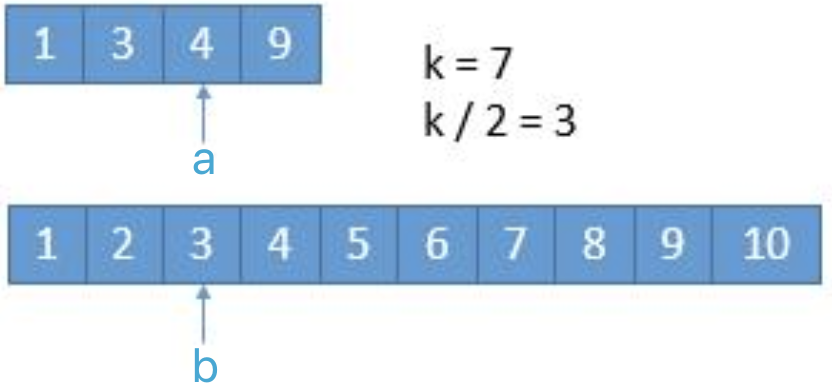
</div>

可见`a > b`，那么第二个数组的前三个元素可以去除掉了（下图橙色表示去掉的元素），

<div>
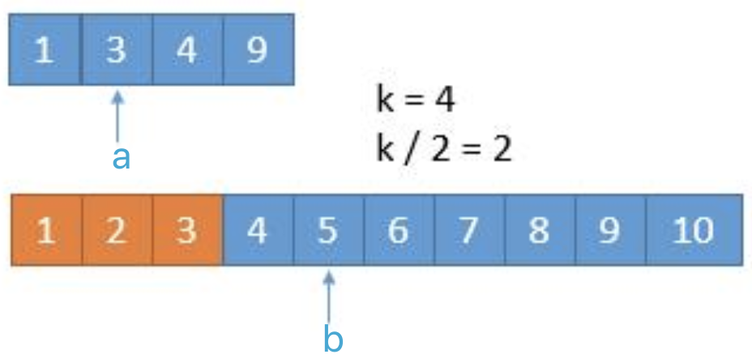
</div>

现在 k = 4，k/2 = 2，此时的`a < b`，那么应该去掉第一个数组的前两个元素，

<div>
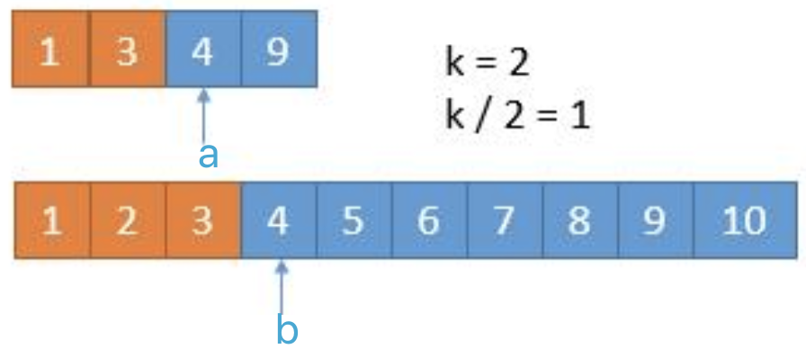
</div>

一次类推直到k = 1：

<div>
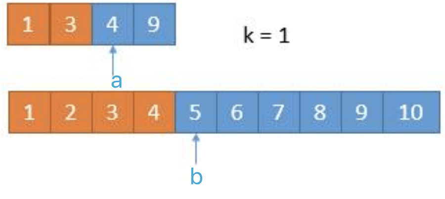
</div>

此时就可以直接返回结果了，结果是`min(a, b)`。


需要注意的是有时候数组的元素不够 k/2 个，所以究竟去掉了多少个元素需要视实际情况而定。

时间复杂度：每次减少 k/2 个元素，所以时间复杂度是 O(log(k)，而 k=(m+n)/2，所以最终的复杂也就是 O(log(m+n))。

空间复杂度：虽然我们用到了递归，但是可以看到这个递归属于尾递归（即递归调用在函数最末尾），所以编译器不需要不停地堆栈，所以空间复杂度为 O(1)。


[参考链接](https://leetcode-cn.com/problems/median-of-two-sorted-arrays/solution/xiang-xi-tong-su-de-si-lu-fen-xi-duo-jie-fa-by-w-2/)


# C++

## 思路一
``` C++
class Solution {
public:
    double findMedianSortedArrays(vector<int>& nums1, vector<int>& nums2) {
        int m = nums1.size(), n = nums2.size();
        if(m > n) return findMedianSortedArrays(nums2, nums1);
        
        // m <= n
        
        int min_i(0), max_i(m), i, j;
        const int LEFT_PARTS_NUM = (m + n + 1) / 2;
        while(min_i <= max_i){
            i = (min_i + max_i) / 2;
            j = LEFT_PARTS_NUM - i;
            
            if(i < m && nums1[i] < nums2[j - 1]) min_i = i + 1;
            else if(i > 0 && nums1[i-1] > nums2[j]) max_i = i - 1;
            else{ // find it
                double max_of_left = max(i > 0 ? nums1[i-1]: INT_MIN, 
                                         j > 0 ? nums2[j-1]: INT_MIN);
                
                if((m + n) & 1) return max_of_left;
                double min_of_right = min(i < m ? nums1[i]: INT_MAX, 
                                          j < n ? nums2[j]: INT_MAX);
                return 0.5 * (max_of_left + min_of_right);
            }
        }
        return -1; // 永远不会执行
    }
};
```

## 思路二
``` C++
class Solution {
private:
    // 从两个有序数组里面找到第k小的元素, k从1开始
    double helper(const vector<int>& nums1, const vector<int>& nums2,
                  int start1, int start2, int k){
        if(k == 1) return min(start1 < nums1.size() ? nums1[start1] : INT_MAX,
                              start2 < nums2.size() ? nums2[start2] : INT_MAX);
        
        // 有一个数组为空
        if(start1 >= nums1.size()) return (double)nums2[start2 + k - 1];
        else if(start2 >= nums2.size()) return (double)nums1[start1 + k - 1];
        
        int i = min(start1 + k / 2, (int)nums1.size());
        int j = min(start2 + k / 2, (int)nums2.size());
        
        if(nums1[i - 1] < nums2[j - 1]) 
            return helper(nums1, nums2, i, start2, k - i + start1);
        else 
            return helper(nums1, nums2, start1, j, k - j + start2);
    }
public:
    double findMedianSortedArrays(vector<int>& nums1, vector<int>& nums2) {
        int m = nums1.size(), n = nums2.size();
        double mid1 = helper(nums1, nums2, 0, 0, (m + n + 1) >> 1);
        if((m + n) & 1) return mid1;
        else return 0.5 * (mid1 + helper(nums1, nums2, 0, 0, (m + n + 2) >> 1));
    }
};
```
# [5. Longest Palindromic Substring](https://leetcode.com/problems/longest-palindromic-substring/)
见我的[个人博客](http://tangshusen.me/2018/12/01/Longest-Palindromic-Substring/)


# [6. ZigZag Conversion](https://leetcode.com/problems/zigzag-conversion/)
# 思路
题意是将一个字符串里的所有字符按照ZigZag的规则重新排列后按序输出。例如
```
Input: s = "PAYPALISHIRING", numRows = 4
Output: "PINALSIGYAHRPI"
Explanation:

第0行: P     I    N
第1行: A   L S  I G
第2行: Y A   H R
第3行: P     I
```
可以看到这种排列是有周期性的，上例周期T为6，一般化的 `T = 2 * numRows - 2`(特殊情况：当numRows为1时T为1)。
把题目意思搞清楚了这题也就迎刃而解了。    
就拿上面的例子来说，
* 第0行的"PIN"在s中的下标分别是0、6、12 --> 0、0 + T、0 + 2T ...
* 第1行的"ALSIG"在s中的下标分别是1、5，7、11，13 --> 1、5，1 + T、5 + T，1 + 2T、5 + 2T ...
* 第2行的"YAHR"在s中的下标分别是2、4，8、10 --> 2、4，2 + T、4 + T，2 + 2T、4 + 2T ...
* 第3行的"PI"在s中的下标分别是3、9 --> 3、3 + T、3 + 2T ...

由上面分析不难写出代码。

# C++
``` C++
class Solution {
public:
    string convert(string s, int numRows) {
        if(numRows == 1) return s;
        string ans = "";
        int T = 2 * numRows - 2;
        for(int i = 0; i < numRows; i++){
            int pos1 = i, pos2 = T - i;
            while(1){
                if(pos1 >= s.size()) break;
                ans += s[pos1];
                pos1 += T;
                if(i != 0 && i != numRows - 1){ // 不是0行也不是最后一行
                    if(pos2 >= s.size()) break;
                    ans += s[pos2];
                    pos2 += T;
                }  
            }
        }
        return ans;
    }
};
```

# [7. Reverse Integer](https://leetcode.com/problems/reverse-integer/description/)
# 思路
翻转一个整数，这题主要就是考察如何判断溢出(只能是[−2^31,  2^31 − 1], 即[-2147483648, 2147483647])。题目要求只能用32位的整数，所以就不能使用long long型了，下面的代码给出两种比较巧妙的判断溢出的方法。  
另外注意对负数运用取余操作符"%":
* C++（G++ 编译）： cout << (-7) % 3; // 输出 -1 
* Java（1.6）： System.out.println((-7) % 3); // 输出 -1 
* Python 3.6：>>> (-7) % 3 // 输出 2
# C++
## 方法一
``` C++
class Solution {
public:
    int reverse(int x) {
        int ans = 0;
        while (x) {
            // 如果接下来的代码会溢出的话，此时ans肯定等于正负214748364
            int temp = ans * 10 + x % 10;
            // 若上面的代码未溢出，temp / 10 肯定等于ans，否则溢出
            if (temp / 10 != ans) // 巧妙的判断是否溢出的方法
                return 0;
            ans = temp;
            x /= 10;
        }
        return ans;
    }
};
```

## 方法二(较方法一更快)
``` C++
class Solution {
public:
    int reverse(int x) {
        int ans = 0, tmp;
        while (x) {
            tmp = x % 10; 
            // INT_MAX / 10 = 214748364
            if(abs(ans) > INT_MAX / 10) return 0; // 此时ans * 10肯定溢出
            if(abs(ans) == INT_MAX / 10){  
                if(tmp <= -9 || tmp >= 8) return 0; // ans * 10 不溢出但是加上tmp溢出
            }
            ans = ans * 10 + tmp;
            x /= 10;
        }
        return ans;
    }
};
```

# [8. String to Integer (atoi)](https://leetcode.com/problems/string-to-integer-atoi/)
# 思路
实现atoi函数，即将字符串转换为对应数字。  
> `atoi()`函数用来将字符串转换成整数(int)，其原型为：
`int atoi (const char * str);`
atoi函数会扫描参数 str 字符串，跳过前面的空白字符（例如空格，tab缩进等），
直到遇上数字或正负符号才开始做转换，而再遇到非数字或字符串结束时('\0')才结束转换，并将结果返回。

按照上面的说明转换即可（题目说了空白字符只考虑空格），为了防止溢出将结果用long long型存放。

# C++
``` C++
class Solution {
private:
    int char2digit(const char c){ // 将字符转换为对应数字，若非数字则返回-1
        if(c >= '0' && c <= '9') return int(c - '0');
        return -1;
    }
public:
    int myAtoi(string str) {
        long long res = 0;
        int len = str.size(), i = 0, minus_sign = 0;
        while(i < len && str[i] == ' ') i++;
        if(i < len && (str[i] == '-' || str[i] == '+'))
            if(str[i++] == '-') minus_sign = 1;

        while(i < len){
            int digit = char2digit(str[i]);
            if(digit == -1) break;
            res  = res * 10 + digit;
            if(minus_sign == 1 && -res < INT_MIN) return INT_MIN;
            else if(minus_sign == 0 && res > INT_MAX) return INT_MAX; 
            i++;
        }
        return minus_sign == 1 ? -res: res;
    }
};
```


# [9. Palindrome Number](https://leetcode.com/problems/palindrome-number/description/)
# 思路
判断一个int型数是否为回文数。   
首先小于0肯定不是可以直接返回false；  
对于一般的int型数，可以先将其转换成字符串，这样判断是否回文就快多了。   
# C++
``` C++
class Solution {
public:
    bool isPalindrome(int x) {
        if(x < 0) return false;
        if(x < 10) return true;
        if(x % 10 == 0) return false;
        // std::string s = std::to_string(x); // 注意学习这种将int型转字符串的简单方法
        auto s = std::to_string(x);
        int low = 0, high = s.size() - 1;
        while(low < high){
            if(s[low++] != s[high--]) return false;
        }
        return true;
    }
};
```

 
# [10. Regular Expression Matching](https://leetcode.com/problems/regular-expression-matching/)

# 思路

仅包含'.'和'*'以及小写字母的正则表达式匹配。模式中的字符

* '.'表示任意一个字符；
* 而'*'表示它前面的字符可以出现任意次（包含0次）。


## 思路一、递归

递归解法，先考虑如何匹配s中的第一个字符，再递归匹配剩余部分。

由于模式的第二个字符可能是'*'，所以模式的第一个字符不一定要匹配，例如模式'a\*bc'可以匹配'bc'，所以我们按照模式中 **第二个字符是否为'\*'** 对情况分类：

* 若是，即`p[1] == '*'`，因为可以匹配第一个字符`p[0]`0次或>0次，所以有两条路可尝试：
    * (1) 尝试匹配0次，此时递归考虑模式p的剩余部分是否与s匹配即可，即若`isMatch(s, p.substr(2))==true`，则返回true，程序结束，否则进入(2)。
    * (2) 尝试匹配>0次，此时前提是p和s的第一个字符匹配成功，即`(s[0] == p[0] || '.' == p[0])`，然后递归考虑模式p是否与s的剩余部分是否匹配即可，即若`isMatch(s.substr(1), p)==true`，则返回true，程序结束。若(1)(2)都不成立，则匹配失败，返回false，程序结束。

* 若不是，那就比较简单了，直接判断模式p和s的第一个字符是否匹配然后再递归匹配剩余即可，即返回`(s[0] == p[0] || '.' == p[0]) && isMatch(s.substr(1), p.substr(1))`。

另外还有一个重要的点就是递归出口，先来看三个边界情况：

|s|p|匹配结果|
| :-: | :-: | :-: |
|空|空|true|
|不空|空|false|
|空|不空|无法判断, 例若s为空, 则p='x*'时匹配成功, p='x'时匹配失败|

由上表可知递归出口为
``` C++
if(p.empty()) return s.empty();
```
所以s为空但p不为空时不会立即返回，所以在访问`s[0]`之前需要先判断s是否为空，见代码。

这种方法由于递归调用次数比较多，所以亲测比较慢。下面思路二采用动态规划迭代的方式要快很多。

## 思路二、动归
也可以使用动态规划的方法，因为匹配问题可以分解为单个字符进行匹配的子问题。

我们定义状态：
```
如果 s[0, 1, ..., i-1] 与 p[0, 1, ..., j-1] 匹配则 dp[i][j] = true 否则 dp[i][j] = false. 
```
所以初始状态为`dp[0][0] = true`表示两个空串相匹配，其他全部初始为false。

根据思路一的分析，我们有类似的状态转移方程：

* 如果模式最后一个字符（即`p[j-1]`）为'*'，则有两条路:
    * (1)尝试匹配0次，即`p[j-2]`和`p[j-1]`都没用，所以如果`dp[i][j-2] == true`则`dp[i][j]`为true；
    * (2)尝试匹配1次，即在前一个模式字符`p[j-2]`与待匹配字符`s[i-1]`相匹配的情况下，如果`dp[i-1][j]=true`则`dp[i][j]`为true；
* 否则，即模式最后一个字符不为'*'，则只能检查这个字符是否与待匹配字符是否匹配了，若匹配，且`dp[i-1][j-1]=true`则`dp[i][j]`为true。

与思路一类似，由于s为空但p不为空时可能成功匹配，所以第一层循环i应该从0开始而不是从1开始，见代码。

# C++

## 思路一
``` C++
class Solution {
public:
    bool isMatch(string s, string p) {
        if(p.empty()) return s.empty();
        
        #define MATCH (s[0] == p[0] || '.' == p[0])
        
        // p的第二个字符是*
        if(p[1] == '*'){ // 不会溢出, 因为p[p.size()] == '\0'
            // 匹配0个字符, 此时若s为空也可能匹配成功
            if(isMatch(s, p.substr(2))) return true; 
            // 匹配1个字符
            if(s.size() && MATCH && isMatch(s.substr(1), p)) return true; 
            return false;
        }
        
        // p的第二个字符不是*
        return s.size() && MATCH && isMatch(s.substr(1), p.substr(1));
    }
};
```

## 思路二
``` C++
class Solution {
public:
    bool isMatch(string s, string p) {
        // if(p.empty()) return s.empty();
        int sn = s.size(), pn = p.size();
        vector<vector<bool>>dp(sn + 1, vector<bool>(pn + 1, false));
        dp[0][0] = true;
        
        for(int i = 0; i <= sn; i++){ // i = 0代表s为空的情况, 所以不能从1开始
            for(int j = 1; j <= pn; j++){
                if(j > 1 && p[j - 1] == '*'){ // 最后一个字符为*
                    // 匹配0个字符
                    if(dp[i][j-2]) dp[i][j] = true;
                    // 匹配1个字符
                    else if(i > 0 && (s[i - 1] == p[j - 2] || '.' == p[j - 2]) && dp[i-1][j]) 
                        dp[i][j] = true;
                }
                // 最后一个字符不是*
                else if(i > 0 && (s[i - 1] == p[j - 1] || '.' == p[j - 1]) && dp[i-1][j-1]) 
                    dp[i][j] = true;
            }
        }
        
        return dp[sn][pn];
    }
};
```
# [11. Container With Most Water](https://leetcode.com/problems/container-with-most-water/)
# 思路
题意就是选择两条线，使其组成的容器装的水最多。水的量可以用宽乘高计算。   
由于宽最大就是height两端之间的距离，所以要想在两端之内取得最大值的话只能是高度比较高。   
可以考虑设置两个初始分别为两端的指针left和right代表当前容器，不断跳过高度不够高的height使这两个指针往中间靠。这个过程不断循环即可得到结果。   
时间复杂度O(n)，空间复杂度O(1)

> 注意不要把此题和[42. Trapping Rain Water](https://leetcode.com/problems/trapping-rain-water/)题搞混了！！

# C++
``` C++
class Solution {
public:
    int maxArea(vector<int>& height) {
        int res = 0;
        int left = 0, right = height.size() - 1;
        while(left < right){
            int h = min(height[left], height[right]); // 当前容器高度
            res = max(res, h * (right - left));
            while(height[left] <= h && left < right) left++;  // 跳过高度不够高的
            while(height[right] <= h && left < right) right--;
        }
        return res;
    }
};
```

# [12. Integer to Roman](https://leetcode.com/problems/integer-to-roman/)
# 思路
阿拉伯数字转罗马数字。
按照题意将所有可能的罗马数字列出来，再从大到小看能不能将阿拉伯数字转换成罗马数字。详细过程见代码。

# C++
``` C++
class Solution {
public:
    string intToRoman(int num) {
        map<int, string>int2rom;
        string res = "";
        int nums[13] = {1,4,5,9,10,40,50,90,100,400,500,900,1000};
        int2rom[1] = "I";
        int2rom[5] = "V";
        int2rom[10] = "X";
        int2rom[50] = "L";
        int2rom[100] = "C";
        int2rom[500] = "D";
        int2rom[1000] = "M";
        int2rom[4] = "IV";
        int2rom[9] = "IX";
        int2rom[40] = "XL";
        int2rom[90] = "XC";
        int2rom[400] = "CD";
        int2rom[900] = "CM";
        for(int i = 12; i >= 0; i--){
            int tmp = num / nums[i];
            while(tmp--) res += int2rom[nums[i]];
            num %= nums[i];
        }
        return res;
    }
};
```

# [13. Roman to Integer](https://leetcode.com/problems/roman-to-integer/description/)
# 思路
罗马数字转阿拉伯数字。七个大写字母对应七个数，对应关系可以用一个数组（或者map）来实现。  
用res代表结果，将代表罗马数字的字符串s从前往后遍历，如果当前字母对应的数大于等于下一个字母对应的数，则res加上对应的数，否则减。   
注意：根据题意是没有可能发生s[i] < s[i + 1] < s[i + 2]的。
# C++
``` C++
class Solution {
public:
    int romanToInt(string s) {
        vector<int>mp(26);
        mp['I' - 'A'] = 1;
        mp['V' - 'A'] = 5;
        mp['X' - 'A'] = 10;
        mp['L' - 'A'] = 50;
        mp['C' - 'A'] = 100;
        mp['D' - 'A'] = 500;
        mp['M' - 'A'] = 1000;
        int res = mp[s[s.size() - 1] - 'A'];
        for(int i = 0; i < s.size() - 1; i++){
            if(mp[s[i] - 'A'] < mp[s[i + 1] - 'A']) res -= mp[s[i] - 'A'];
            else res += mp[s[i] - 'A'];
        }
        return res;
    }
};
```

# [14. Longest Common Prefix](https://leetcode.com/problems/longest-common-prefix/description/)
# 思路
求字符串数组的最长公共前缀。    
纵向遍历字符串，即第一次比较所有字符串的第一个字符，第二次比较所有字符串的第二个字符...直到字符串不相等或者超出某个字符串的长度时退出循环。   
注意：  
append函数可以用来在字符串的末尾追加字符和字符串。由于string重载了运算符，也可以用+=操作实现。
# C++
``` C++
class Solution {
public:
    string longestCommonPrefix(vector<string>& strs) {
        if(strs.size() == 0) return "";
        string res;
        int i = 0;
        while(1){
            for(int j = 0; j < strs.size(); j++){
                if(i >= strs[j].size()) return res; // 长度超过最短字符串的长度
                if(j == 0 || strs[j][i] == strs[j-1][i]) continue; // 处于第一个字符串或者与上一个字符串的当前位置字符相等
                else return res;
            }
            res += strs[0][i++];
            // res.append(1, strs[0][i++]); // 1 代表重复次数

        }
    }
};
```

# [15. 3Sum](https://leetcode.com/problems/3sum/)
# 思路、双指针法
找出数组中的所有和为0的三个数组合。  
先想一下如何求所有和为0的两个数的组合。可以这样考虑，先将数组从小到大排序，再设置两个指针low和high分别初始为数组两端，计算两个指针的和sum，
根据sum与0的大小关系适当调整指针:
* 若sum > 0，说明和有点大了，应该小一点，则应该将high左移；
* 若sum < 0，说明和有点小了，应该大一点，则应该将low右移；
* 若sum = 0，说明刚刚好，记录即可，然后同时将low和high向中间移。

三个数的话其实思路是一致的只是外面多一层循环而已。先将数组排序，外层循环就是将当前位置的数定为第一个数，然后就进入内层循环进行类似两个数的和的操作。   
注意跳过重复元素。   
时间复杂度O(n^2)，空间复杂度O(1)

类似的题目还有[16. 3Sum Closest](https://leetcode.com/problems/3sum-closest/)和[18. 4Sum](https://leetcode.com/problems/4sum/)，都是先排序再使用双指针。


# C++
``` C++
class Solution {
public:
    vector<vector<int>> threeSum(vector<int>& nums) {
        vector<vector<int>>res;
        int len = nums.size();
        sort(nums.begin(), nums.end());
        for(int i = 0; i < len - 2; i++){ // nums[i] 为三个数的第一个数
            if(i > 0 && nums[i] == nums[i - 1]) continue;
            int low = i + 1, high = nums.size() - 1;
            while(low < high){
                int sum = nums[i] + nums[low] + nums[high];
                if(sum < 0) 
                    while(++low < high && nums[low] == nums[low - 1]) ; // 不断右移low指针
                else if(sum > 0) 
                    while(low < --high && nums[high] == nums[high + 1]) ; // 不断左移high指针
                else{
                    res.push_back(vector<int>{nums[i], nums[low], nums[high]});
                    while(nums[++low] == nums[low - 1]) ;
                    while(nums[--high] == nums[high + 1]) ;
                }
            }
        }
        return res;
    }
};
```

# [16. 3Sum Closest](https://leetcode.com/problems/3sum-closest/)
# 思路
类似[15. 3Sum](https://leetcode.com/problems/3sum/),先对数组进行排序，外层循环就是遍历一遍数组，内层循环就是用两个指针low和high，与3sum不同的就是
每次循环要判断记录当前sum和target的差值。
时间复杂度O(n^2)

# C++
``` C++
class Solution {
public:
    int threeSumClosest(vector<int>& nums, int target) {
        int len = nums.size();
        long long res=nums[0] + nums[1] + nums[2], min_gap, sum, curr_gap; // 防止溢出所以用long long型
        min_gap = abs(res - target);
        sort(nums.begin(), nums.end());
        for(int i = 0; i < len - 2; i++){
            int low = i + 1, high = len - 1;
            while(low < high){
                sum = nums[i] + nums[low] + nums[high];
                curr_gap = abs(sum - target);
                if(curr_gap < min_gap){
                    res = sum;
                    min_gap = curr_gap;
                } 
                if(target < sum) high--;
                else if(target > sum) low++;
                else return target;
            } // low == high
        }
        return res;   
    }
};
```

# [17. Letter Combinations of a Phone Number](https://leetcode.com/problems/letter-combinations-of-a-phone-number/)
# 思路
## 思路一
举例说明吧。
1. `digits = "2"`时，结果显然是`res = ["a","b","c"]`；
2. `digits = "23"`时，1中res的每一个字符串后都可以接d、e、f任意一个，所以可以先将1中的res中所有元素复制两遍
变成["a","b","c","a","b","c","a","b","c"]，再在此时res的每一个元素后面合适地接上d、e、f其中一个就变成了
["ad","bd","cd","ae","be","ce","af","bf","cf"]。

由此就可以写出代码了。   
时间复杂度O(n^2)，空间复杂度O(1)

## 思路二
其实可以将此题看成求解一棵树的所有root(root可以看做是空)到叶子的路径。  
例如当`digits = "23"`时，树应该是这个样子:
```
          root
        /   |   \
  2:   a    b    c
      /|\  /|\  /|\
  3:  def  def  def
```
所以就可以用DFS求解这题了。


# C++
## 思路一
```C++
class Solution {    
public:
    vector<string> letterCombinations(string digits) {
        int len = digits.size();
        vector<string>res;
        if(len == 0) return res;
        
        const vector<string>digit2char{"","","abc","def","ghi",
                                        "jkl","mno","pqrs","tuv","wxyz"};
        res.push_back("");
        for(int i = 0; i < len; i++){
            int digit = int(digits[i] - '0');
            int curr_res_size = res.size();
            for(int k = 0; k < digit2char[digit].size() - 1; k++) // 将res中所有元素复制几遍
                for(int j = 0; j < curr_res_size; j++) 
                    res.push_back(res[j]);
            for(int k = 0; k < digit2char[digit].size(); k++)
                for(int j = 0; j < curr_res_size; j++)
                    res[k * curr_res_size + j] += digit2char[digit][k];
        }
        return res;
        
    }
};
```

## 思路二
``` C++
class Solution {
private:
    const vector<string>digit2char{"", "", "abc", "def", "ghi", "jkl", "mno", "pqrs", "tuv", "wxyz"};
    void DFS(const string &digits, string out, vector<string> &res){
        int start = out.size();
        if(start == digits.size()){
            res.push_back(out);
            return;
        }
        for(char c: digit2char[digits[start]-'0'])
            DFS(digits, out+c, res);
    }
public:
    vector<string> letterCombinations(string digits) {
        vector<string>res;
        if(digits.size() == 0) return res;
        string out;
        DFS(digits, out, res);
        return res;
    }
};
```

# [18. 4Sum](https://leetcode.com/problems/4sum/)
# 思路
和[3sum](./15.%203Sum.md)这题基本一样的，注意这题由于循环层数比较多所以如果能
在外层循环判断一下的话可以提前终止循环或跳过某次循环，见代码。   
时间复杂度O(n^3)

# C++
``` C++
class Solution {
public:
    vector<vector<int>> fourSum(vector<int>& nums, int target) {
        vector<vector<int>>res;
        int len = nums.size(), low, high, sum;
        if(len < 4) return res;
        sort(nums.begin(), nums.end());
        for(int i = 0; i < len - 3; i++){
            if(i != 0 && nums[i] == nums[i - 1]) continue;
            
            // 提前退出或跳过不可能的情况
            if(nums[i]+nums[i+1]+nums[i+2]+nums[i+3] > target) break; // 最小的都比target大了，可以提前终止循环
            if(nums[i]+nums[len-3]+nums[len-2]+nums[len-1] < target) continue;
            
            for(int j = i + 1; j < len - 2; j++){
                if(j != i + 1 && nums[j] == nums[j - 1]) continue;
                low = j + 1;
                high = len - 1;
                while(low < high){
                    sum = nums[i] + nums[j] + nums[low] + nums[high];
                    if(sum < target) 
                        while(++low < high && nums[low] == nums[low - 1]) ; // 不断右移low指针
                    else if(sum > target) 
                        while(low < --high && nums[high] == nums[high + 1]) ; // 不断左移high指针
                    else{
                        vector<int>tmp = {nums[i], nums[j], nums[low++], nums[high--]};
                        res.push_back(tmp);
                        while(low < high && nums[low] == nums[low - 1]) low++;
                        while(low < high && nums[high] == nums[high + 1]) high--;
                    }
                }
            }
        }
        return res;
        
    }
};
```

# [19. Remove Nth Node From End of List](https://leetcode.com/problems/remove-nth-node-from-end-of-list/)
# 思路
题意就是去掉链表中倒数第n个节点。   
涉及到链表中倒数节点的思路都是使用两个指针p1、p2，两个指针初始都是head，p2先走n步，然后p1、p2再同时走直到p2到达链尾，
此时p1就位于链表倒数第n个节点的前一个节点。     
需要注意当要删除的节点就是head时需要特殊处理。    
时间复杂度O(N)，空间复杂度O(1)

# C++
``` C++
/**
 * Definition for singly-linked list.
 * struct ListNode {
 *     int val;
 *     ListNode *next;
 *     ListNode(int x) : val(x), next(NULL) {}
 * };
 */
class Solution {
public:
    ListNode* removeNthFromEnd(ListNode* head, int n) {
        if(n <= 0) return head;
        ListNode *p1 = head, *p2 = head;
        while(n--) p2 = p2 -> next;  // p2先走n步
        if(p2 == NULL){ // 此时删掉的应该是head
            head = head -> next;
            delete p1;
            return head;
        }
        while(p2 -> next){
            p1 = p1 -> next;
            p2 = p2 -> next;
        } // 此时p1位于倒数第n个节点的前一个节点
        p2 = p1 -> next;
        p1 -> next = p2 -> next;
        delete p2;
        return head;
    }
};
```

# [20. Valid Parentheses](https://leetcode.com/problems/valid-parentheses/description/)
# 思路
用一个栈来存放左括号，每次遇到左括号就将其入栈，遇到右括号就查看是否与栈顶元素配对，若能配对则pop栈顶元素，继续下一循环，否则返回false。
退出循环后，若栈不空，说明还剩下未配对的左括号，则应该返回false。   
时间复杂度O(n), 空间复杂度O(n)
# C++
``` C++
class Solution {
private:
    bool isLegal(const char& a, const char&b){
        if(a == '(' && b == ')') return true;
        if(a == '[' && b == ']') return true;
        if(a == '{' && b == '}') return true;
        return false;
    }
public:
    bool isValid(string s) {
        stack<char>stk;
        for(int i = 0; i < s.size(); i++){
            if(s[i] == ')' || s[i] == '}' || s[i] == ']'){
                if(stk.empty() || !isLegal(stk.top(), s[i])) return false;
                stk.pop();
            }
            else stk.push(s[i]);
        }
        if(!stk.empty()) return false;
        return true;
    }
};
```

# [21. Merge Two Sorted Lists](https://leetcode.com/problems/merge-two-sorted-lists/description/)
# 思路
合并两个已有序的链表，注意题目给的链表没有头结点，所以为了操作方便可以自己设一个头结点，最后返回头结点的下一个节点即可。两个链表的工作指针就用传进来的l1和
l2即可。
# C++
``` C++
/**
 * Definition for singly-linked list.
 * struct ListNode {
 *     int val;
 *     ListNode *next;
 *     ListNode(int x) : val(x), next(NULL) {}
 * };
 */
class Solution {
public:
    ListNode* mergeTwoLists(ListNode* l1, ListNode* l2) {
        ListNode *res = new ListNode(0); // 自己设一个头结点
        ListNode *pre = res; // pre代表已排好序的链表的最后一个节点
        while(l1 && l2){
            if(l1 -> val <= l2 -> val){
                pre -> next = l1;
                l1 = l1 -> next;
            } 
            else{
                pre -> next = l2;
                l2  = l2 -> next;
            }
            pre = pre -> next; // pre后移
        }
        // 跳出循环时，l1和l2其中一个是NULL
        if(l1) pre -> next = l1;
        else pre -> next = l2;
        
        // 释放头结点
        ListNode *head = res;
        res = head -> next;
        head -> next = NULL;
        delete head;
        
        return res;
    }
};
```

# [22. Generate Parentheses](https://leetcode.com/problems/generate-parentheses/)
# 思路
给定括号的个数，返回所有可能的合法的括号组成情况。    
## 思路一
用str代表一个合法的括号串，初始为空。再作如下定义:
* 用left代表当前还能往str加入左括号的个数，left初始为n；
* 用right代表当前还能往str加入右括号的个数，right初始为0（即str不能以右括号开头）。

定义一个递归函数helper:
* 递归出口：当left和right都等于0，此时str就应该是一个合法的括号串，push进结果数组中再返回即可。
* 否则，若`right > 0`, 说明此时可以添加右括号了，right应该减一，进入递归，跳出递归后，若`left > 0`，则添加左括号，left减一right加一。

## 思路二
其实和思路一类似，不过亲测要比思路一快一些。   
用str代表一个括号字符串，初始为空。再作如下定义:
* left代表使str成为含有n个括号的合法串还应该向str中加入的左括号的个数（即若当前str中左括号的个数为k，则left=n-k），left初始为n；
* right定义同理，right初始也为n。（注意和思路一不一样）

有了以上定义，那么当`left > right`时，说明str中左括号数小于右括号数，例如"())"，则str不合法。    
定义一个递归函数helper:
* 递归出口：`left > right`时直接return，或者当left和right都等于0，此时str就应该是一个合法的括号串，push进结果数组中再返回即可。
* 否则，若`right > 0`, 说明此时可以添加右括号了，right应该减一，进入递归，跳出递归后，若`left > 0`，则添加左括号，left减一（与思路一不同:right不加一）。

## 思路一
``` C++
class Solution {
private:
    void helper(vector<string> &res, string str, int left, int right){
        // left代表此时还能添加的左括号的个数，right代表此时能添加上的右括号的个数
        if(left == 0 && right == 0){
            res.push_back(str);
            return;
        }
        if(right > 0) helper(res, str + ")", left, right - 1);  
        if(left > 0) helper(res, str + "(", left - 1, right + 1); // 添加一个左括号后就可以多添加一个右括号了
    }
public:
    vector<string> generateParenthesis(int n) {
        vector<string>res;
        helper(res, "", n, 0); // 不能一开始就添加右括号，所以right=0
        return res;
    }
};
```
## 思路二
与思路一不同的只有三个地方，下面标了出来
``` C++
class Solution {
private:
    void helper(vector<string> &res, string str, int left, int right){
        // left代表使str成为含有n个括号的合法串还应该向str中加入的左括号的个数，right同理
        if(left > right) return; // 不同点1
        if(left == 0 && right == 0){
            res.push_back(str);
            return;
        }
        if(right > 0) helper(res, str + ")", left, right - 1);  
        if(left > 0) helper(res, str + "(", left - 1, right);  // 不同点2
    }
public:
    vector<string> generateParenthesis(int n) {
        vector<string>res;
        helper(res, "", n, n); // 不同点3
        return res;
    }
};
``` 

# [23. Merge k Sorted Lists](https://leetcode.com/problems/merge-k-sorted-lists/)

# 思路

将k个排好序的链表合并成一个大的有序链表。

## 思路一

最好想的就是维护一个堆（priority_queue）或者红黑树（multiset或者multimap）的数据结构。首先把k个链表的首元素都加入其中，然后每次取出最小的那个元素加入最终结果的链表中，然后把取出元素所在链表的下一个元素再加入结构中，以此类推，直到结构中没有元素了。


设所有元素个数为N，时间复杂度O(Nlogk)，空间复杂度O(k)

## 思路二

另一个思路就是外排序，即k路归并排序的思想，如下图所示

<div align=center>
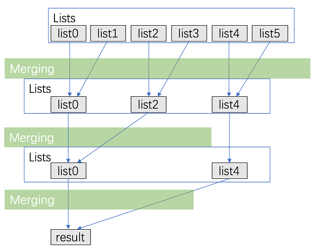
</div>

由于每次归并时间复杂度是线性的，所以每一轮归并时间均为O(N)，而需要 logk 轮归并，所以时间复杂度O(Nlogk)。

空间复杂度O(1)

# C++
## 思路一、使用priority_queue
**注意学习如何自定义compare类**
``` C++
// 默认为最大堆, 所以需要自定义compare类使成为最小堆
struct compare {
    bool operator()(const ListNode* p1, const ListNode* p2) {
        return p1 -> val > p2 -> val;
    }
};

class Solution {
public:
    ListNode* mergeKLists(vector<ListNode*>& lists) {
        priority_queue<ListNode*, vector<ListNode*>, compare>min_heap;
        
        for(int i = 0; i < lists.size(); i++)
            if(lists[i]) min_heap.push(lists[i]);
        
        if(min_heap.empty()) return NULL;
    
        ListNode *head = min_heap.top(), *p = head;
        min_heap.pop();
        if(p -> next) min_heap.push(p -> next);
        while(!min_heap.empty()){
            p -> next = min_heap.top(); min_heap.pop();
            p = p -> next;
            if(p -> next) min_heap.push(p -> next);
        }
        return head;
    }
};
```

## 思路一、使用multimap
**注意multimap插入时需传入一个{key, value}的pair**
``` C++
class Solution {
public:
    ListNode* mergeKLists(vector<ListNode*>& lists) {
        multimap<int, ListNode*>mp;
        for(int i = 0; i < lists.size(); i++)
            if(lists[i]) mp.insert({lists[i] -> val, lists[i]});
        
        if(mp.empty()) return NULL;
    
        ListNode *head = mp.begin() -> second, *p = head;
        mp.erase(mp.begin());
        if(p -> next) mp.insert({p -> next -> val, p -> next});
        while(!mp.empty()){
            p -> next = mp.begin() -> second; 
            mp.erase(mp.begin());
            p = p -> next;
            if(p -> next) mp.insert({p -> next-> val, p -> next});
        }
        return head;
    }
};
```

## 思路二
``` C++
class Solution {
private:
    ListNode* mergeTwoLists(ListNode* l1, ListNode* l2) {
        /*copy from 21. Merge Two Sorted Lists  */
        ListNode *res = new ListNode(0);
        ListNode *pre = res;
        while(l1 && l2){
            if(l1 -> val <= l2 -> val){
                pre -> next = l1;
                l1 = l1 -> next;
            } 
            else{
                pre -> next = l2;
                l2  = l2 -> next;
            }
            pre = pre -> next;
        }
        
        if(l1) pre -> next = l1;
        else pre -> next = l2;
        
        ListNode *head = res;
        res = head -> next;
        head -> next = NULL;
        delete head;
        return res;
    }
    
public:
    ListNode* mergeKLists(vector<ListNode*>& lists) {
        int n = lists.size();
        if(!n) return NULL;
        
        int interval = 1;
        while(interval < n){
            for(int i = 0; i < n - interval; i += (2 * interval))
                lists[i] = mergeTwoLists(lists[i], lists[i+interval]);
            
            interval*=2;
        }
        return lists[0];
    }
};
```
# [24. Swap Nodes in Pairs](https://leetcode.com/problems/swap-nodes-in-pairs/)
# 思路
将一个链表两个两个地进行翻转。   
为了方便我们可以设置一个头结点head_node。用p1指向当前需要翻转的第一个节点，p2指向当前需要翻转的第二个节点，并用pre指向p1的前一个节点。
然后交换p1、p2两个节点即可，再将指针向右移进行下一次翻转。   
时间复杂度O(n)，空间复杂度O(1)

# C++
``` C++
class Solution {
public:
    ListNode* swapPairs(ListNode* head) {
        if(head == NULL || head -> next == NULL) return head;
        ListNode *head_node = new ListNode(0);
        head_node -> next = head;
        ListNode *pre = head_node, *p1 = head, *p2 = head -> next;
        while(p2 != NULL){
            // 翻转
            p1 -> next = p2 -> next;
            p2 -> next = p1;
            pre -> next = p2;
            // 指针右移，准备进行下一次翻转
            pre = p1;
            p1 = pre -> next;
            if(p1 == NULL) break; // 到链尾了
            p2 = p1 -> next;
        }
        return head_node -> next;
    }
};
```

# [026. Remove Duplicates from Sorted Array](https://leetcode.com/problems/remove-duplicates-from-sorted-array/description/)

# 思路 
由于是已经排序好的数组，所以相同的数肯定是相邻的，遍历数组时跳过与上一个数重复的数即可。
可以用一个count记录在下标count及之前是没有重复的数组， count初始化为0，然后从前往后遍历，若a[i]==a[count]说明重复，不更新count，
否则应该让count++。注意单独判断空数组。

# C++
``` c++
class Solution {
public:
    int removeDuplicates(vector<int>& nums) {
        if(nums.empty()) return 0;
        int count = 0;
        for(int i = 1; i < nums.size(); i++){
            if(nums[i] != nums[count]) nums[++count] = nums[i];
        }
        return count+1;
    }
};
```

# 思路
类似第26题, 用count记录非val的个数，从前往后遍历，如果值为val则跳过，否则令nums[count并=nums[i]并自增count
# C++
``` C++
class Solution {
public:
    int removeElement(vector<int>& nums, int val) {
        int count = 0;
        for(int i = 0; i < nums.size(); i++){
            if(nums[i] != val) nums[count++] = nums[i]; 
        }
        return count;
    }
};
```

# [28. Implement strStr()](https://leetcode.com/problems/implement-strstr/)

# 思路

字符串匹配。

## 思路一、暴力

用一个两层循环暴力匹配，可能测试样例比较弱，所以亲测时间并不慢（8ms）。

时间复杂度O(mn)，空间复杂度O(1)

## 思路二、KMP

字符串匹配经典的解法应该就是KMP（Knuth-Morris-Pratt）算法了，与暴力匹配（每次失配时，回到模式串开头重新匹配）不同，**KMP的核心思想就是每次失配时，根据模式串的特点，将模式串回退到适当的位置。**


先来定义next数组:

* `next[i]`表示模式串中前i个字符串（即P[0,...,i-1]）中相同前缀后缀的最大长度，`next[0]`和`next[1]`固定为-1和0。

举例：
* 若`next[5] = 2`，则说明`P[0,1] == P[3,4]`
* 又如`abcabd`的`next = {-1, 0, 0, 0, 1, 2}`


若某个模式串P如下图所示，若匹配到`P[k]`与待匹配的字符串`S[i]`失配，即`P[k]!=S[i]`；对于暴力匹配来说，我们需要从头开始匹配P和S，即从`P[0]`开始匹配；但是由于我们知道了蓝色部分的子串是相等的，所以我们可以从`P[next[k]]`开始匹配。

<div align=center>
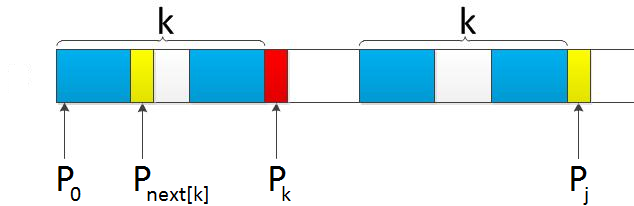
</div>
<div align=center>一个模式串P的示意图，颜色相同的子串相等</div>


所以问题就是如何求next数组，仔细分析一下下图也很简单，如果我们求得了`next[0,...,j]`，

* 令`k = next[j]`, 如果`P[j] == P[k]`，那么`next[j+1] = k + 1`;
* 否则，令`k = next[k]`，重复上述过程；

此外，next还可以优化，因为如果`P[k] == P[next[k]]`，那么如果`P[k]`与待匹配的字符串`S[i]`失配，那么`P[next[k]]`肯定还是与`S[i]`失配，所以如果`P[k] == P[next[k]]`，我们可更新 `next[k] = next[next[k]]`。

关于KMP比较详细的介绍可参考[从头到尾彻底理解KMP](https://blog.csdn.net/v_july_v/article/details/7041827)。

KMP算法时间复杂度为O(m+n)，空间复杂度为O(n)，其中n为模式串的长度

## 思路三、Sunday

关于字符串匹配还有比KMP更好理解的算法，叫做Sunday算法。

参考[字符串匹配——Sunday算法](https://blog.csdn.net/q547550831/article/details/51860017)，举个例子来说明：

* 刚开始时，把模式串与主串左边对齐：
<div>
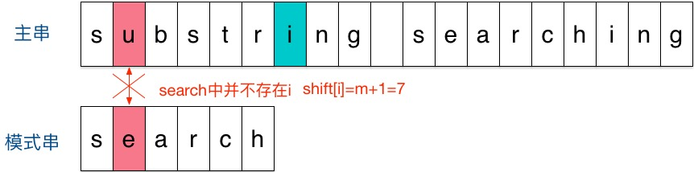
</div>

* 结果发现在第2个字符处发现不匹配，不匹配时**关注主串中参加匹配的最末位字符的下一位字符**，即标粗的字符 i，因为模式串search中并不存在i，所以模式串直接跳过一大片，向右移动位数 = 匹配串长度 + 1 = 6 + 1 = 7，从 i 之后的那个字符（即字符n）开始下一步的匹配，如下图
<div>
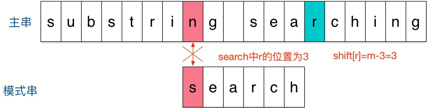
</div>

* 结果第一个字符就不匹配，再看主串中参加匹配的最末位字符的下一位字符，是 r，它在模式串位于倒数第3位（如果模式串有多个 r 我们应该以最后一个为准，因为那样移动次数较少才不会错过），于是把模式串向右移动3位（m - 3 = 6 - 3 = r 到模式串末尾的距离 + 1 = 2 + 1 =3），使两个 r 对齐，如下
<div>
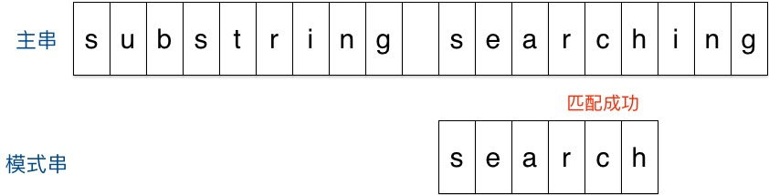
</div>

* 匹配成功。

可见我们需要一个数组，记录了某个字符在模式串中最后一次出现的位置到末尾的距离，由于ASCII用0-127来编码字符，所以我们可以用一个长度为128的数组，即代码中的move数组。

平均复杂度O(m+n)，move数组的大小时固定的，所以可认为空间复杂度O(1)

最坏情况下，时间复杂度为O(mn)，例如主串为baaaabaaaabaaaabaaaa而模式串为aaaaa。

## 思路四、Boyer-Moore

实际应用最多字符串匹配算法貌似是Boyer-Moore算法，有兴趣的可以去看看：
* [字符串匹配的Boyer-Moore算法](https://www.ruanyifeng.com/blog/2013/05/boyer-moore_string_search_algorithm.html)；
* [BM算法和Sunday快速字符串匹配算法](https://www.cnblogs.com/Philip-Tell-Truth/p/5185267.html)。

# C++
## 思路一
``` C++
class Solution {
public:
    int strStr(string haystack, string needle) {
        if (needle.empty()) return 0;
        int m = haystack.size(), n = needle.size();
        if (m < n) return -1;
        for (int i = 0; i <= m - n; ++i) {
            int j = 0;
            for (j = 0; j < n; ++j) {
                if (haystack[i + j] != needle[j]) break;
            }
            if (j == n) return i;
        }
        return -1;
    }
};
```


## 思路二

``` C++
class Solution {
private:
    vector<int>compute_next(const string& pattern){
        int pn = pattern.size();
        vector<int>next(pn, 0); next[0] = -1;
        
        for(int i = 2; i < pn; i++){
            int j = next[i-1];
            while(j >= 0 && pattern[j] != pattern[i-1]) j = next[j];
            next[i] = j + 1;
        }
        
        // // next数组优化
        // for(int i = 2; i < pn; i++){ 
        //     int t1 = i, t2 = next[i];
        //     while(t2 >= 0 && pattern[t1] == pattern[t2]){
        //         t1 = t2;
        //         t2 = next[t2];
        //     }
        //     next[i] = t2;
        // }
        return next;
    }
public:
    int strStr(string haystack, string needle) {
        int sn = haystack.size(), pn = needle.size();
        if(!pn) return 0;
        if(sn < pn) return -1;
        vector<int>next = compute_next(needle);        
        
        int i = 0, j = 0;
        while(i < sn){
            if(j == -1 || haystack[i] == needle[j]){
                i++;
                j++;
                if(j == pn) return i - pn;
            }
            else j = next[j];
        }   
        
        return -1;
    }
};
```

## 思路三
``` C++
class Solution {
public:
    int strStr(string haystack, string needle) {
        int sn = haystack.size(), pn = needle.size();
        if(!pn) return 0;
        if(sn < pn) return -1;
        
        vector<int>move(128, pn + 1);
        for(int i = 0; i < pn; i++)
            move[needle[i]] = pn - i;
        
        int i = 0; 
        while(i <= sn - pn){
            int j = 0;
            while(haystack[i + j] == needle[j])
                if(++j == pn) return i;
            
            i += move[haystack[i + pn]];
        }
        return -1;
    }
};
```
# [29. Divide Two Integers](https://leetcode.com/problems/divide-two-integers/)
# 思路
不使用取模、除法等操作求两数相除的商。   
常规思路就是不断循环用被除数减去除数然后记录被减的次数即商，但是亲测会超时。   
既然每次减去除数会超时，那么一次性地减去除数的2倍、4倍、8倍......(之所以取2的次方倍是为了移位操作即可快速实现)呢，基于这个思路，我们有以下算法:
假设除数和被除数都是正数，例如考虑15除3，先用15-3发现结果等于12>3，再尝试用15-6发现结果得9>3，再尝试用15-12发现结果3=3，再尝试用15减去24发现不够减，
则应该用15-12然后余3，此时商得4；然后再考虑3除3，依然用上面的思路，得到商为1，最终的结果就是将每一步得到的商相加即可。   
如果是负数的话先取绝对值最后判断符号即可。   

需要考虑唯一溢出的情况:
* `dividend == INT_MIN && divisor == -1`，结果是`-INT_MIN`超出了int的表示范围。

还需要考虑一些特殊情况：
* `dividend == 0`，直接返回0即可；
* `divisor == 1`，直接返回`dividend`，因为我们是按照绝对值计算res的，所以这样可以避免当`dividend=INT_MAX`中间结果溢出。

另外需要注意的是再用abs(x)求绝对值的时候要考虑x是否是INT_MIN。
1. 对于`divisor == INT_MIN`，可以直接得到res为1或0，直接返回即可；
2. 而对于`dividend`，我们可以求`abs(dividend) - 1`来避免溢出，最后加上这个1即可。

> 也可以先将x转换成long long型，这样abs(x)返回的是long long型，保证不溢出。

[参考](https://leetcode.com/problems/divide-two-integers/discuss/13407/Detailed-Explained-8ms-C%2B%2B-solution)

# C++
``` C++
class Solution {
public:
    int divide(int dividend, int divisor) {
        if(dividend == 0) return 0;
        if(dividend == INT_MIN && divisor == -1) return INT_MAX; // 唯一可能的溢出情况
        if(divisor == 1) return dividend;
        
        if(divisor == INT_MIN) return dividend == INT_MIN ? 1 : 0;
        
        int abs_dividend_minus_1 = abs(dividend + (dividend < 0 ? 1: -1));
        
        int abs_divisor = abs(divisor), step = abs(divisor), step_i= 1;
        int res = 0;
        while(abs_dividend_minus_1 >= abs_divisor){
            while(abs_dividend_minus_1 < step){
                step >>= 1;
                step_i >>= 1;
            }
            abs_dividend_minus_1 -= step;
            res += step_i;
            
            if(step <= (INT_MAX >> 1)){
                step <<= 1;
                step_i <<= 1;
            }
        }
        
        if(abs_dividend_minus_1 + 1 == abs_divisor) res += 1;
        
        if((dividend > 0 && divisor < 0) || (dividend < 0 && divisor > 0)) return -res;
        return res;
    }
};
```

# [31. Next Permutation](https://leetcode.com/problems/next-permutation/)
# 思路 
题意就是实现标准库里的next_permutation函数（不考虑自定义comp的情况）。   
我们先来看看这个函数，以后可以直接用：
> Transforms the range [first, last) into the next permutation from the set of all permutations that are lexicographically ordered with respect to operator< or comp. 
Returns true if such permutation exists, otherwise transforms the range into the first permutation (as if by std::sort(first, last)) and returns false.

`bool next_permutation (first, last)`返回的是bool型，如果已经是最后一个排列了则返回false并将数组变成第一个排列(即按照从小到大排好序)；否则返回true并将数组变成下一个排列。   
此外还可以传入`comp`参数: `next_permutation (first, last, comp)`这样就可以自定义数组的大小规则。   

下面来分析一下如何实现：   
首先应该知道何为下一个排列，若当前排列组成的数为A，则下一个排列组成的数B就是刚好比A大（即没有另外一个排列组成的数C满足A<C<B）的排列。例如02431的下一个排列是03124，03124的下一个排列是03142。。。   
可见我们总是贪心地从最低位考虑，找到第一个不满足从低到高位逐渐增大的数，例如02431从最低位1到高位不满足逐渐增大的第一个数就是2，说明2以后的三个数（431）已经是这三个数能
组成的最大的数了，所以下一个排列肯定要把2考虑进去，而2之前的0就不用考虑了。既然要把2考虑进去，就说明要用一个数来替换2，为了使B刚好比A大，则应该取431中比2大的最小的那个数字即3（这个过程是一个在有序数组里进行查找的过程，可以用二分），
然后将3和2替换得到3421，然后再将421 reverse得到3124即可。3124是刚好比2431大的排列。   
注意：
* 已经是最后一个排列时，需要单独考虑。
* 交换两个数直接用swap要比手动实现快不少。   

时间复杂度O(n), 空间复杂度O(1)

# C++
```C++
class Solution {
public:
    void nextPermutation(vector<int>& nums) {
        int len = nums.size();
        int i = len - 1;
        while(i > 0 && nums[i] <= nums[i - 1]) i--;
        if(i == 0) { // 已经是最后一个排列时，需要单独考虑。
            reverse(nums.begin(), nums.end());
            return;
        }
        
        int mid, low = i, high = len - 1;
        while(low <= high){ // 二分查找
            mid = low + (high - low) / 2;
            if(nums[mid] <= nums[i - 1]) high = mid - 1;
            else low = mid + 1;
        }
        // int high = len - 1; // 直接查找
        // while(nums[i - 1] >= nums[high]) high--;
        
        swap(nums[high], nums[i-1]);  // 用swap击败99%, 若按照下面代码手动实现则击败16%
        // int tmp = nums[j];
        // nums[j] = nums[i - 1];
        // nums[i - 1] = tmp;
        reverse(nums.begin() + i, nums.end());
    }
};
```


# [32. Longest Valid Parentheses](https://leetcode.com/problems/longest-valid-parentheses/)

# 思路

求有效括号匹配子串的最大长度。

## 思路一、栈

括号匹配类的问题往往都能用栈解决，此题也不例外。

从前往后遍历字符串，设下标为i
* 如果遇到左括号或者栈空，则将当前下标i压入栈；
* 如果遇到右括号且栈顶为左括号，则遇到了匹配的括号对，将栈顶弹出即可；

然后就可以计算以字符`s[i]`作为结尾的最大长度：
* 若栈不空，则长度为`i - stk.top()`；
* 否则，即栈空，说明前面的都能匹配，则长度为`i+1`。

时空复杂度均为O(n)

## 思路二、动归

由于此问题存在很多子问题，且子问题之前又有很多重复，所可以考虑用动归。

先来看状态定义:
```
dp[i]: 以字符s[i]结尾的最大匹配长度
```
状态转移方程就很简单了：
* 如果`s[i] = '('`，那么`dp[i] = 0`；
* 否则，我们需要看以字符`s[i-1]`为结尾的最大匹配子串的前面那个字符`s[i - dp[i-1] - 1]`是否是左括号：
    * 若是，说明匹配上了，所以`dp[i] = dp[i-1] + 2 + dp[i - dp[i-1] - 2]`；
    * 若不是，则没匹配上，`dp[i] = 0`。

时空复杂度均为O(n)

## 思路三

前面两种思路的空间复杂度均为O(n)，此题还有一种常数空间的思路，和前面栈的思想有点类似。

使用两个变量left和right分别用来记录到当前位置时左括号和右括号的出现次数，当遇到左括号时，left自增1；否则right自增1。

* 当`left == right`时，说明匹配成功，此时匹配长度为`2*left`；
* 一旦遇到`right > left`，说明当前位置不能匹配，则重新开始，即left和right均重置为0。

但是对于"(()"这种时，在遍历结束时左右子括号数都不相等，此时没法更新结果res，但其实正确答案是2，怎么处理这种情况呢？答案是再反向遍历一遍，采取类似的方法，稍有不同的是此时若`right < left`了，则重置0。

时间复杂度O(n)，空间复杂度O(1)

# C++

## 思路一
``` C++
class Solution {
public:
    int longestValidParentheses(string s) {
        stack<int>stk;
        int res = 0, start = 0;
        for(int i = 0; i < s.size(); i++){
            if(!stk.empty() && s[stk.top()] == '(' && s[i] == ')') stk.pop();
            else stk.push(i);
            // 栈顶为当前匹配子串的起始位置
            res = max(res, stk.empty() ? i + 1 : i - stk.top());
        }
        return res;
    }
};
```

## 思路二
``` C++
class Solution {
public:
    int longestValidParentheses(string s) {
        vector<int>dp(s.size(), 0);
        int res = 0;
        for(int i = 1; i < s.size(); i++){
            if(s[i] == '(') continue;
            int tmp = i - dp[i-1] - 1;
            if(tmp >= 0 && s[tmp] == '(') 
                dp[i] = dp[i-1] + 2 + (tmp >= 1 ? dp[tmp - 1] : 0);
            res = max(res, dp[i]);
        }
        return res;
    }
};
```

## 思路三
``` C++
class Solution {
public:
    int longestValidParentheses(string s) {
        int res = 0, left = 0, right = 0, n = s.size();
        for (int i = 0; i < n; i++) {
            if(s[i] == '(') left++; 
            else right++;
            if (left == right) res = max(res, 2 * right);
            else if (right > left) left = right = 0;
        }
        
        left = right = 0;
        for (int i = n - 1; i >= 0; i--) {
            if(s[i] == '(') left++;
            else right++;
            if (left == right) res = max(res, 2 * left);
            else if (left > right) left = right = 0;
        }
        return res;
    }
};
```

# [33. Search in Rotated Sorted Array](https://leetcode.com/problems/search-in-rotated-sorted-array/)

# 思路
题意就是在一个经过了循环移位的有序数组（无重复元素）里进行查找，要求时间复杂度O(logn)。  
由于要求的时间复杂度为O(logn)，所以肯定是考虑二分查找的。假如这个数组没有进行循环移位，即就是一个有序的，那对其进行查找就是一个简单的二分查找，so easy，时间复杂度O(logn)。怎样把二分查找运用在本题呢?（本文默认你掌握了二分查找，否则建议先去看看二分查找）

## 思路一
前面也说了，本题的数组就是一个有序数组再经过了循环移位，如下例就是向右循环移位了4步（或者左循环移位了3步）:
```
     下标:0 1 2 3 4 5 6
移位前元素:0 1 2 4 5 6 7
移位后元素:4 5 6 7 0 1 2
```
可以看到移位后的元素的下标相当于是移位前的下标加4(然后对7取模)，既然这样，那我们在二分查找判断target和nums[mid]大小之前也对mid加4(然后对7取模)不就行了。(具体实现可参考代码)   

现在问题来了，怎样计算这个偏移量4？我们只需要知道一个元素在循环移位前和循环移位后的下标就行了，为了简单不妨去找最小的那个元素，这样其对应的移位后的下标就是偏移量。 

由于要求时间复杂度O(logn)，所以应该用二分查找这个最小值。二分查找的时候我们会知道nums[low]、nums[mid]、nums[high]，怎样通过这三个数的大小关系确定最小值在[low, mid]或者[mid, high]哪一个区间呢?   

先看来看看nums[low]和nums[mid]比较:  
> 假设`nums[low] < nums[mid]`，此时最小值可能就是nums[low]比如012或者在[mid, high]区间比如120。

所以拿nums[low]和nums[mid]比较不是一个好选择。再来看看nums[mid]和nums[high]比较: 
> * 若`nums[mid] < nums[high]`，此时最小值只能是位于[low, mid]。
> * 否则若`nums[mid] > nums[high]`，此时最小值只能是位于[mid+1, high]。
> * 假设`nums[mid] == nums[high]`，此时`low = mid = high`，最小值就是nums[mid]。

可见用nums[mid]和nums[high]的大小关系可以确定最小值位于哪一个区间。     
知道了最小值，那也就知道了偏移量，再用二分法，问题迎刃而解。   

时间复杂度O(logn)，空间复杂度O(1)

## 思路二
思路一虽然时间复杂度为O(logn)，但是却进行了两次查找，一点都不elegant，能不能直接一步到位呢？肯定还是二分法，那么我们应该如何判断target是在左半部分[low, mid)还是右半部分(mid, high]呢?     

我们知道，判断一个数是否在一个有序数组数组是很方便的(只需要判断端点和这个数的大小关系)，幸运的是，仔细分析此题的数组可知，**左右两半至少有一半是有序的**。所以我们可以判断target是否在这有序的一半，若在则丢弃掉另一半进入下一次循环，若不在则丢弃掉有序的这一半进入下一次循环。那么如何判断哪一半是有序的呢?也很简单，只需要判断左右端点即可，以左半部分为例：
* 若`nums[low] <= nums[mid]`，则左半部分一定是有序的(想想为什么)；
* 否则左半部分是无序的，则右半部分一定是有序的。

时间复杂度O(logn), 空间复杂度O(1)

> 注意此题不存在重复值，而[81. Search in Rotated Sorted Array II](https://leetcode.com/problems/search-in-rotated-sorted-array-ii/)则可能有重复值。81题也是采用思路二，即先判断哪一半是有序的，但是当`nums[low] = nums[mid]`时无法判断哪一半有序，怎么办呢？很简单，那我们直接low++即可，即退化成顺序查找，所以81题最坏时间复杂度是O(n)，此时数组中元素全相等且不等于target。

# C++
## 思路一
``` C++
class Solution {
public:
    int search(vector<int>& nums, int target) {
        if(nums.empty()) return -1;
        int len = nums.size();
        int delta, mid, low = 0, high = len - 1; // delta偏移量
        
        // 计算偏移量
        while(low != high){
            mid = low + (high - low) / 2; // 不写成 (low + high) / 2 是为了避免溢出的风险
            if(nums[mid] < nums[high]) high = mid;
            else low = mid + 1; // 注意这里是 mid+1 ！！！
        } // low == high == mid == 偏移量
        delta = low;
        
        // 考虑偏移的二分查找
        low = 0;
        high = len - 1;
        int real_mid;  // 算上偏移的mid
        while(low <= high){
            mid = low + (high - low) / 2;
            real_mid = (mid + delta) % len;   
            if(nums[real_mid] == target) return real_mid;
            else if(nums[real_mid] < target) low = mid + 1;
            else high = mid - 1;
        }
        return -1;
    }
};
```

## 思路二
``` C++
class Solution {
public:
    int search(vector<int>& nums, int target) {
        if(nums.empty()) return -1;
        int len = nums.size();
        int mid, low = 0, high = len - 1;
        while(low <= high){
            mid = low + (high - low) / 2;
            if(nums[mid] == target) return mid;
            if(nums[low] <= nums[mid]){  // 左半边有序
                if(nums[low] <= target && target < nums[mid]) high = mid - 1; // target在左半边
                else low = mid + 1;
            }
            else{  // 右半边有序
                if(nums[mid] < target && target <= nums[high]) low = mid + 1; // target在右半边
                else high = mid - 1;
            }
        }
        
        return -1;
    }
};
```

# [34. Find First and Last Position of Element in Sorted Array](https://leetcode.com/problems/find-first-and-last-position-of-element-in-sorted-array/)

# 思路
题意就是，给定一个target，找到有序数组中target出现的首尾位置。     
因为数组是有序的所以十有八九二分法没跑了(要有看到有序数组就想到二分法这个条件反射)。稍加分析可知，为了寻找target出现的首尾位置，
我们只需要两次二分法即可解决本题。第一次找到的是第一个target，第二次找到最后一个target。    
* 第一次二分法为了找到第一个target，当`target == nums[mid]`时要令`high = mid - 1`然后进入下一次循环；
* 第二次二分法为了找到最后一个target，当`target == nums[mid]`时要令`low = mid + 1`然后进入下一次循环。   

两次二分法时间复杂度同样为O(logn)，空间复杂度O(1)

## 改进
上面的算法在第二次二分查找时的初始范围为整个数组，这显然是有改进空间的的，因为在第一次搜索时已经找到了第一个target的位置(记为first)，
那么为了查找到最后一个target的位置(记为last)，我们只需要查找first及之后的位置就你可以了。   
再仔细分析一下第一次二分的过程我们可以再缩小第二次二分的初始范围。第一次二分时:
* 当`target < nums[mid]`时，那么last一定在mid的前面(last < mid)；
* 当`target == nums[mid]`时，那么last一定在mid的后面(last >= mid)；

所以我们在第一次二分时记录last的下界(last_lower_bound)和上界(记为last_upper_bound)，第二次二分时初始范围即可缩小到[last_lower_bound, last_upper_bound]。
相对于改进前，这会缩短第二次二分的时间。

# C++
``` C++
class Solution {
public:
    vector<int> searchRange(vector<int>& nums, int target) {
        int len = nums.size();
        vector<int>res{-1, -1};
        if(len == 0) return res;
        
        // 第一次二分
        int low = 0, mid, high = len - 1;
        while(low <= high){
            mid = low + (high - low) / 2;
            if(target <= nums[mid]) high = mid - 1;
            else low  = mid + 1;
        } // low = high + 1
        // low == len或者nums[low]!=target说明没找到target
        if(low >= len || nums[low] != target) return res;
        res[0] = low; // 此时的low即第一个target的位置
        
        // 第二次二分
        low = 0;
        high = len - 1;
        while(low <= high){
            mid = low + (high - low) / 2;
            if(target >= nums[mid]) low = mid + 1;
            else high = mid - 1;
        }
        res[1] = high;
        return res;
        
    }
};
```
## 改进
``` C++
class Solution {
public:
    vector<int> searchRange(vector<int>& nums, int target) {
        int len = nums.size();
        if(len == 0) return vector<int>{-1, -1};
        vector<int>res{-1, -1};
        int low = 0, mid, high = len - 1, last_lower_bound = 0, last_upper_bound = len - 1;
        while(low <= high){
            mid = low + (high - low) / 2;
            if(target <= nums[mid]) {
                high = mid - 1;
                if(target < nums[mid]) last_upper_bound = high;
                else last_lower_bound = mid;
            }
            else low  = mid + 1;
        } // low = high + 1
        
        
        if(low >= len || nums[low] != target) return res;
        res[0] = low;
        low = last_lower_bound;
        high = last_upper_bound;
        while(low <= high){
            mid = low + (high - low) / 2;
            if(target >= nums[mid]) low = mid + 1;
            else high = mid - 1;
        }
        res[1] = high;
        return res;
        
    }
};
```

# [Search Insert Position](https://leetcode.com/problems/remove-element/description/)
# 思路
排序数组查找肯定就是二分法啦，但是题目没说一定是增序，根据结果来看应该全是增序。
# C++
``` C++
class Solution {
public:
    int removeElement(vector<int>& nums, int val) {
        int count = 0;
        for(int i = 0; i < nums.size(); i++){
            if(nums[i] != val) nums[count++] = nums[i]; 
        }
        return count;
    }
};
```

# [36. Valid Sudoku](https://leetcode.com/problems/valid-sudoku/)
# 思路
题意就是要求判断给定的board是否是一个合法的数独。
## 思路一
开辟一个大小为9的数组mp(实际代码中为了直接用1-9的下标所以开的大小为10的数组，下同)，遍历三次数独，分别判断row、column、sub_box是否合法就完事。    

## 思路二
思路一在每次循环后都要讲数组mp清零，也可以考虑用空间换时间的思路，多开几个一次性的数组，这样就不用清零了。    
注意第i行第j列(0 <= i,j <=2)的sub_box是第`i*3 + j`个sub_box。

## 思路三
前面两种思路都需要对board遍历三次，所以代码写得很冗长，一点都不elegant，其实一次遍历就够了。          
需要注意的是第i行第j列(0 <= i,j <= 8)的元素所在的sub_box是第`3 * (i/3) + j/3`个,注意`i/3`需要加括号。(这里的i/3和j/3就是对应的思路二中的i,j)

# C++
## 思路一
``` C++
class Solution {
private:
    bool sub_box_is_valid(int x, int y, const vector<vector<char>>& board, vector<int>&mp){
    // x和y是这个sub_box左上角的坐标
        for(int k = 1; k <= 9; k++) mp[k] = 0;
        for(int i = 0; i < 3; i++){
            for(int j = 0; j < 3; j++){
                if(board[i+x][j+y] == '.') continue;
                if(mp[board[i+x][j+y] - '0'] > 0) return false;
                mp[board[i+x][j+y] - '0']++;
            }
        }
        return true;
    }
    
public:
    bool isValidSudoku(vector<vector<char>>& board) {
        vector<int>mp(10, 0);
        // 判断行
        for(int i = 0; i < 9; i++){
            for(int j = 0; j < 9; j++){
                if(board[i][j] == '.') continue;
                if(mp[board[i][j] - '0'] > 0) return false;
                mp[board[i][j] - '0']++;
            }
            for(int k = 1; k <= 9; k++) mp[k] = 0; // 清零数组
        }
        
        // 判断列
        for(int j = 0; j < 9; j++){
            for(int i = 0; i < 9; i++){
                if(board[i][j] == '.') continue;
                if(mp[board[i][j] - '0'] > 0) return false;
                mp[board[i][j] - '0']++;
            }
            for(int k = 1; k <= 9; k++) mp[k] = 0;
        }
        // 判断sub_box
        for(int i = 0; i < 3; i++){
            for(int j = 0; j < 3; j++){
                if(sub_box_is_valid(i*3, j*3, board, mp)) continue;
                return false;
            }
        }
        return true;
    }
};
```
## 思路二
``` C++
class Solution {
private:
    bool sub_box_is_valid(int x, int y, const vector<vector<char>>& board, vector<int>&mp){
        //for(int k = 1; k <= 9; k++) mp[k] = 0;
        for(int i = 0; i < 3; i++){
            for(int j = 0; j < 3; j++){
                if(board[i+x][j+y] == '.') continue;
                if(mp[board[i+x][j+y] - '0'] > 0) return false;
                mp[board[i+x][j+y] - '0']++;
            }
        }
        return true;
    }
    
public:
    bool isValidSudoku(vector<vector<char>>& board) {
        vector<vector<int>>mp1(10, vector<int>(10, 0));
        vector<vector<int>>mp2(10, vector<int>(10, 0));
        vector<vector<int>>mp3(10, vector<int>(10, 0));
        for(int i = 0; i < 9; i++){
            for(int j = 0; j < 9; j++){
                if(board[i][j] == '.') continue;
                if(mp1[i][board[i][j] - '0'] > 0) return false;
                mp1[i][board[i][j] - '0']++;
            }
        }
        
        for(int j = 0; j < 9; j++){
            for(int i = 0; i < 9; i++){
                if(board[i][j] == '.') continue;
                if(mp2[j][board[i][j] - '0'] > 0) return false;
                mp2[j][board[i][j] - '0']++;
            }
        }
        
        for(int i = 0; i < 3; i++){
            for(int j = 0; j < 3; j++){
                // 第i行第j列(0 <= i,j <=2)的sub_box是第i*3 + j个sub_box。
                if(sub_box_is_valid(i*3, j*3, board, mp3[i*3 + j])) continue;
                return false;
            }
        }
        return true;
    }
};
```
## 思路三
``` C++
class Solution {   
public:
    bool isValidSudoku(vector<vector<char>>& board) {
        // vector<vector<int>>mp1(10, vector<int>(10, 0));
        int mp1[10][10] = {0}, mp2[10][10] = {0}, mp3[10][10] = {0};
        int n, sub_box_index;
        for(int i = 0; i < 9; i++){
            for(int j = 0; j < 9; j++){
                if(board[i][j] == '.') continue;
                n = board[i][j] - '0';
                sub_box_index = 3 * (i/3) + j/3;  // 注意i/3需要加括号
                if(mp1[i][n] || mp2[j][n] || mp3[sub_box_index][n]) return false;
                mp1[i][n] = mp2[j][n] = mp3[sub_box_index][n] = 1;
            }
        }
        
        return true;
    }
};
```

# [38. Count and Say](https://leetcode.com/problems/count-and-say/description/)
#  思路
首先要搞清楚题目意思，初试串为"1"，按照数数的规则产生后面的序列：
* 第1个字符串为"1"， 即1个1，所以第2个字符串为"11";
* 第2个字符串为"11"， 即2个1，所以第3个字符串为"21";
* 第3个字符串为"21"， 即1个2和1个1，所以第4个字符串为"1211";
* 第4个字符串为"1211"， 即1个1、1个2和2个1，所以第2个字符串为"111221";
* ...... 

搞懂意思后，按照规则模拟即可。
# C++
``` C++
class Solution {
public:
    string countAndSay(int n) {
        string res = "1";
        while(n-- > 1){  // 循环产生第n个串
            string tmp;
            int low=0, high=1;
            while(low < res.size()){
                while(high < res.size() && res[high] == res[low]) high++;
                tmp += (high - low + '0');
                tmp += res[low];
                low = high;
                high++;
            }
            res = tmp;
        }
        return res; 
    }
};
```

# [39. Combination Sum](https://leetcode.com/problems/combination-sum/)
# 思路
题意：从一个无重复元素的数组里面选一些数字出来，使这些数字的和恰好为target，数组里的数字可以重复使用。     
就是一个回溯题（类似DFS），另外为了避免得到重复结果，先对数组进行排序（常规操作）。    
为了进行递归调用，我们定义了一个函数helper，传入的参数有
* nums - 当前被选中的数
* candidates - 就是题意里面的数组（从小到大排序好的）
* start - 只能考虑数组candidates下标为start及后面的数
* curr_target - 当前的目标（我们希望的就是nums的元素和加上curr_target就等于target）

helper函数定义如下：
* 当`curr_target == 0`时，说明nums的元素和就等于target，nums就是一组我们要求的数，push进结果数组即可。
* 当`start >= candidates.size()`时，说明start已经超过了candidates最大下标，返回即可；
* 当`candidates[start] > curr_target`时，说明candidates中（当前可用的）最小的数都比curr_target大，也是直接返回。
* 前面三个条件都不满足时，就有两条路要走: 
  1. 将candidates[start]加入到nums中，令`curr_target = curr_target - candidates[start]`, 进入下一层递归；
  2. 不将candidates[start]加入到nums中, 令`start + 1`,进入下一层递归；

# C++
``` C++
class Solution {
private:
    vector<vector<int>>res;
    void helper(vector<int>& nums, const vector<int>& candidates, const int& start, const int& curr_target){
        if(curr_target == 0){
            res.push_back(nums);
            return;
        }
        if(start >= candidates.size() || candidates[start] > curr_target) return;

        nums.push_back(candidates[start]);
        helper(nums, candidates, start, curr_target - candidates[start]);
        nums.pop_back();
        helper(nums, candidates, start + 1 , curr_target);
        return;
    }
public:
    vector<vector<int>> combinationSum(vector<int>& candidates, int target) {
        if(candidates.empty()) return res;
        sort(candidates.begin(), candidates.end());
        vector<int>nums;
        helper(nums, candidates, 0, target);
        return res;
    }
};
```

# [40. Combination Sum II](https://leetcode.com/problems/combination-sum-ii/)
# 思路
题意：从一个数组candidates（允许存在重复元素）里面选一些数字出来，使这些数字的和恰好为target，candidates里的数只能使用一次。可见这题与[39. Combination Sum](https://leetcode.com/problems/combination-sum/)有两个不同点：
1. 在挑选数字出来时，candidates里的数只能使用一次；
2. candidates里的元素允许重复；

上面两个不同点也对应于代码中两个不同点（见下面的代码）。

思路其实和39题类似的，建议先去看看我写的[39题题解](https://github.com/ShusenTang/LeetCode/blob/master/solutions/39.%20Combination%20Sum.md)。    
仍然是一个回溯题（类似DFS），为了避免得到重复结果，先对数组进行排序（常规操作）。    
为了进行递归调用，我们定义了一个函数helper，传入的参数有
* nums - 当前被选中的数
* candidates - 就是题意里面的数组（从小到大排序好的）
* start - 只能考虑数组candidates下标为start及后面的数
* curr_target - 当前的目标（我们希望的就是nums的元素和加上curr_target就等于target）

helper函数定义如下：
* 当`curr_target == 0`时，说明nums的元素和就等于target，nums就是一组我们要求的数，push进结果数组即可。
* 当`start >= candidates.size()`时，说明start已经超过了candidates最大下标，返回即可；
* 当`candidates[start] > curr_target`时，说明candidates中（当前可用的）最小的数都比curr_target大，也是直接返回。

--------------上面都和39题一样的，只是下面有两个不同点---------------
* 前面三个条件都不满足时，假设`k = candidates[start]`就有两条路要走: 
  1. 将k加入到nums中，令`curr_target = curr_target - k`且`start = start+1`, 进入下一层递归；
  2. 不将k加入到nums中, 由于candidates里的元素允许重复，所以candidates[start+1]也就可能等于k，所以我们应该让start移动到最后一个k所在位置，再令`start + 1`进入下一层递归；

# C++
``` C++
class Solution {
private:
    vector<vector<int>>res;
    void helper(vector<int>& nums, const vector<int>& candidates, int start, const int& curr_target){
        if(curr_target == 0){
            res.push_back(nums);
            return;
        }
        if(start >= candidates.size() || candidates[start] > curr_target) return;

        nums.push_back(candidates[start]);
        helper(nums, candidates, start + 1, curr_target - candidates[start]); // 不同点一，39传入的是start，因为39允许多次使用candidates里的数
        nums.pop_back();
        // 不同点二，因为candidates里的元素允许重复，所以要跳过这些重复元素
        while(start < candidates.size() - 1 && candidates[start] == candidates[start+1])
            start++;
        helper(nums, candidates, start + 1 , curr_target);
        return;
    }
public:
    vector<vector<int>> combinationSum2(vector<int>& candidates, int target) {
        if(candidates.empty()) return res;
        sort(candidates.begin(), candidates.end());
        vector<int>nums;
        helper(nums, candidates, 0, target);
        return res;
    }
};
```

# [41. First Missing Positive](https://leetcode.com/problems/first-missing-positive/)

# 思路

题目要求找到缺失的首个正数。要求时间复杂度O(n)空间复杂度O(1)。


## 思路一、nums数组只读

提示告诉我们先不考虑额外的空间，那我们就可以用一个大小为n+1的bool数组bucket，`bucket[i] = true`表示原数组中存在 i，所以我们只需要遍历一遍原数组来填充bucket数组然后再从前往后遍历bucket，一旦遇到`bucket[i] = false`那么返回i即可。

时间复杂度O(n)空间复杂度O(n)，空间复杂度没有达到要求，但这种方法的好处是不用修改原数组，所以如果原数组是只读的那这种方法还是不错的。

## 思路二

我们考虑将思路二中的额外bucket数组用原数组代替，即在nums[i]存放i（实际代码中存放的是i+1）。为此我们可以从前往后遍历数组，一旦遇到
```
nums[i] > 0 && nums[i] < n && nums[i] != nums[nums[i] - 1]
```
那么就不断交换`nums[i]`和`nums[nums[i] - 1]`直到上述条件不满足。

由于每一次swap都会使有一个元素落在最终位置，所以最多交换n次，所以时间复杂度为O(n)，没有使用额外的空间，所以空间复杂度O(1)。

# C++
## 思路一
``` C++
class Solution {
public:
    int firstMissingPositive(vector<int>& nums) {
        int n = nums.size();
        vector<bool>bucket(n + 1, false);
        
        for(int num: nums)
            if(num > 0 && num <= n) bucket[num] = true;
        
        for(int i = 1; i <= n; i++)
            if(!bucket[i]) return i;
        
        return n + 1;
    }
};
```

## 思路二
```C++
class Solution {
public:
    int firstMissingPositive(vector<int>& nums) {
        int n = nums.size();
        
        for(int i = 0; i < n; i++){
            while(nums[i] > 0 && nums[i] < n && nums[i] != nums[nums[i] - 1])
                swap(nums[i], nums[nums[i] - 1]);
        }
        for(int i = 0; i < n; i++)
            if(nums[i] != i + 1) return i + 1;
        
        return n + 1;
    }
};
```

# [42. Trapping Rain Water](https://leetcode.com/problems/trapping-rain-water/)

# 思路
有一个奇形怪状的容器，问最多能装多少水。

## 思路一

想象一下第 i 个位置能存水的充要条件是什么：在其左右两边都存在大于height[i]的情况，即

* 存在 `j < i` 和 `k > i`，使得`height[j] > height[i] && height[i] < height[k]`。

那在第 i 个位置能存多少水呢，也很简单，我们需要找到其左边最大的`height[j]`以及右边最大的`height[k]`，存水量就为`min(height[j], height[k]) - height[i]`。

为此，我们需要先求得每个i的left_max[i]和right_max[i]，需要两次遍历。

至少需要两次遍历，所以时间复杂度为O(n)；至少开辟一个额外的数组，所以空间复杂度O(n)。

## 思路二、单调栈

这题的tag是stack，所以我们考虑用栈来解决。

从前往后遍历height，用栈存放可能成为左边界的高度**的下标**（注意这里不存高度而是其坐标，这样方便在后来算水平距离），具体方法是：
* 如果此时栈为空，或者当前高度小于等于栈顶高度，则把当前高度的坐标压入栈，所以栈里面的对应高度从底到顶总是单调（不严格）递减的；
* 当遇到比栈顶高度大的时候，就说明有可能会有坑存在，可以装水。此时把栈顶元素取出来当作坑（设为 t），而新的栈顶元素（设为 l）就是左边界，当前高度`height[i]`是右边界，即`height[l] >= height[t] < height[i]`）。此时将较小的边界减去坑的高度`height[i]`乘以水平长度就是盛水量了，水平长度是右边界坐标减去左边界坐标再减1。

这样我们只需要遍历一次，时间复杂度还是O(n)；空间复杂度O(n)

关于单调栈可以参考[我的总结](../algorithm/array/monotonic_stack_queue.md)。

## 思路三、双指针

此题最优的解法是双指针法，只需要遍历一次而且不需要额外的空间。

**核心思想就是将左右指针作为两个边界，那么向中间逐渐缩小边界的过程中如果遇到了比边界要低的高度说明遇到了坑，可以装水。**

我们定义 left 和 right 两个指针分别指向数组的首尾位置，从两边向中间扫描，先比较两指针对应高度找出较小值（记为mn），如果较小值是 left 对应的高度，则从左向右扫描，如果较小值是 right 对应的高度，则从右向左扫描，扫描过程是：若当前高度比mn小，说明有可以存水的坑，则将mn与当前高度的差值存入结果，继续扫描；如当前值较大，则重新确定新的窗口范围，以此类推直至 left 和 right 指针重合。

时间复杂度O(n)，空间复杂度O(1)

# C++
## 思路一
``` C++
class Solution {
public:
    int trap(vector<int>& height) {
        int n = height.size();
        if(!n) return 0;
        vector<int>l_max(n, 0), r_max(n, 0);
        
        l_max[0] = height[0];
        for(int i = 1; i < n; i++)
            l_max[i] = max(l_max[i - 1], height[i]);
        
        r_max[n - 1] = height.back();
        for(int i = n - 2; i >= 0; i--)
            r_max[i] = max(r_max[i + 1], height[i]);
        
        int res = 0;
        for(int i = 1; i < n - 1; i++)
            if(height[i] < l_max[i] && height[i] < r_max[i])
                res += min(l_max[i], r_max[i]) - height[i];                
        
        return res;
    }
};
```

## 思路二
``` C++
class Solution {
public:
    int trap(vector<int>& height) {
        int i = 0, n = height.size(), res = 0;
        stack<int>stk;
        
        while(i < n){
            if(stk.empty() || height[i] <= height[stk.top()])
                stk.push(i++); // 存的是下标
            else{
                int t = stk.top(); stk.pop();
                if(!stk.empty())
                    res += (i - stk.top() - 1) * 
                        (min(height[i], height[stk.top()]) - height[t]);
            }
        }
        
        return res;
    }
};
```

## 思路三
``` C++
class Solution {
public:
    int trap(vector<int>& height) {
        int l = 0, r = height.size() - 1, res = 0;
        
        while(l < r){
            int mn = min(height[l], height[r]);
            if(mn == height[l]){
                l++;
                while(l < r && height[l] < mn){
                    res += mn - height[l];
                    l++;
                }
            }
            else{
                r--;
                while(l < r && height[r] < mn){
                    res += mn - height[r];
                    r--;
                }
            }
        }
        return res;
    }
};
```

# [43. Multiply Strings](https://leetcode.com/problems/multiply-strings/)
# 思路
题目要求实现大整数乘法。   
## 思路一
最直观的思路，就是是我们小学学的两数相乘的方法。回忆一下小学求456x123的过程:
```
        456
      x 123
    -------
       1368  ->   1238 
       921.  ->   9210
    + 456..  ->  45600 
    ------------------
               = 56088
```

即分成两个大步：
1. 求123中每个数字3、2、1分别对456的乘积1368、921和456；
2. 将上面得到的乘积相加（注意合理插入一些0）得最终结果56088。

我们将上面这两步定义成两个函数`digit_mul_reversed_bigNum`和`reversed_bigNum_add`，具体定义见代码详细解释。
> 为了方便处理，将所有用string表示的大数做了翻转处理，即123 -> "321"。

若m和n分别代表两个大数的长度，则易知时间复杂度O(mn)，空间复杂度O(m+n)。


## 思路二
虽然思路一很好想，但是实现起来略显复杂，而且需要先对字符串进行翻转，因此时间效率比较低。有没有elegant一点的方法？

我们知道，位数分别为len1和len2的两整数相乘，结果的位数不会超过len1 + len2（例如99 x 999 < 100 x 1000 = 100000），所以一开始我们可以开一个大小为len1 + len2的数组来存放这个乘积。而且，对于num1和num2中的每一个数字，我们都知道这两个数字的积对应于前面数组的哪一位，例如num1=456，num2=123时，6和3相乘结果对应于最终乘积的最末位(同时有个进位)，5与3的相乘结果对应于最终结果的倒数第二位(也有个进位)，以此类推。所以我们有如下算法:   

1. 首先开一个大小为len1 + len2的int型数组res_num并初始化为0；   
2. 对num1和num2做一个双重循环从后向前(即i、j的初始值分别为len1-1、len2-1)遍历，当前位置的两个数字相乘的结果对应res_num中的位置是`i+j+1`（例如初始时i=len1-1，j=len2-1，对应的就是len1+len2-1），所以应该`num_res[i + j + 1] += (num1[i] - '0') * (num2[j] - '0');`
3. 处理进位，使num_res每一个元素都位于0到9，我们也可以在第2步同时处理进位，但是单独处理的话计算量会小一些。
4. 到目前位置我们就得到了数值型的结果，再转换成string即可，注意跳过前导0。

时间复杂度O(mn)，空间复杂度O(m+n)。


# C++
## 思路一
``` C++
class Solution {
private:
    string digit_mul_reversed_bigNum(const int &dt, const string &bN, int lead_0){
        /*第1步：求一个数字(0-9)与一个大数的乘积。
        bN: 翻转后的大数，例如bN="321"代表123
        lead_0: 结果中前面先插入的0的个数 
        return: 乘积(同样是翻转了的，即"0129"代表9210)
        */
        if(!dt) return "0";
        if(bN.size() == 1 && bN[0] == '0') return "0";
        string res;
        while(lead_0--) res += '0'; // 插入0
        int mul, cin = 0; // cin表示进位，下同
        for(int i = 0; i < bN.size(); i++){
            mul = dt * (bN[i] - '0') + cin;
            res += (mul % 10 + '0');
            cin = mul / 10;
        }
        if(cin > 0) res += (cin + '0');
        return res;
    }
    void reversed_bigNum_add(string &a, const string &b){ // a+=b
        /*第2步: 将第1步求得的乘积累加起来，a和b都是翻转后的大数
        注意 a 传入的是引用
        */
        int sum, cin = 0;
        int i = 0, len1 = a.size(), len2 = b.size();
        while(i < len1 && i < len2){ // 大数加法
            sum  = a[i] - '0' + b[i] - '0' + cin;
            a[i] = sum % 10 + '0';
            cin = sum / 10;
            i++;
        }
        // 下面两个while至多执行一个
        while(i < len1 && cin > 0){ // a 比 b 长
            sum = a[i] - '0' + cin;
            a[i] = sum % 10 + '0';
            cin = sum / 10;
            i++;
        }
        while(i < len2){ // b 比 a 长
            if(!cin){ // 如果cin=0，那么直接将b的剩余部分接到a后面即可
                a.append(b, i, len2);
                break;
            }
            sum = b[i] - '0' + cin;
            a += (sum % 10 + '0');
            cin = sum / 10;
            i++;
        }
        if(cin > 0) a += (cin + '0');
    }
public:
    string multiply(string num1, string num2) {
        reverse(num1.begin(), num1.end());
        reverse(num2.begin(), num2.end());
        string res, tmp;
        for(int i = 0; i < num1.size(); i++){
            tmp = digit_mul_reversed_bigNum(num1[i]-'0', num2, i);
            reversed_bigNum_add(res, tmp);
        }
        reverse(res.begin(), res.end());
        if(res.empty()) return "0";
        return res;
    }
};
```

## 思路二
``` C++
class Solution {
public:
    string multiply(string num1, string num2) {
        int len1 = num1.size(), len2 = num2.size();
        string res;
        int num_res[len1 + len2] = {0};
        for(int i = len1 - 1; i >= 0; i--){
            for(int j = len2 - 1; j >= 0; j--){
                num_res[i + j + 1] += (num1[i] - '0') * (num2[j] - '0');
                // num_res[i + j + 1] += num_res[i + j + 2] / 10;
                // num_res[i + j + 2] %= 10;
            }
        }
        for(int i = len1 + len2 - 1; i > 0; i--){ // 处理进位
            num_res[i - 1] += num_res[i] / 10;
            num_res[i] %= 10;
        }
        
        int i = 0;
        while(i < len1 + len2 && !num_res[i]) i++; // 跳过前导0
        while(i < len1 + len2) res += num_res[i++] + '0';        
        if(res.empty()) return "0";
        return res;
    }
};
```
# [44. Wildcard Matching](https://leetcode.com/problems/wildcard-matching/)

# 思路

通配符匹配问题。

* '?'匹配任意非空字符；
* '*'匹配任意字符串（包括空串）。

注意和 10. Regular Expression Matching 正则匹配的题目区分开来。

## 思路一、递归+剪枝

此题最容易想到的就是递归的思路，但是naive的递归很容易超时（即使是加入了记忆cache和跳过连续的星号）。超时的原因是存在了大量不必要的调用（即不可能返回true但我们还是调用了），为了避免这个问题，我们定义一个返回值有三种情况的递归函数：

* 0：s串可被匹配完成，但p有多余字符（非'*'），如 s=abc，p=abcd；
* 1：未匹配到s串的末尾就失败了；
* 2：成功匹配。

这样表示的目的是为了剪枝。我们来看看递归函数：

* 递归出口：
    * 若p为空，如果s也为空当然返回2，而如果s不为空返回则 1；
    * 否则，若s为空且`p[0] != '*'`则返回0；
* 否则，我们如果第一个字符能匹配上，即`s[i] == p[j] || p[j] == '?'`，那返回递归调用后面字符匹配结果即可。
* 否则，要匹配只能寄希望于'*'了，所以如果`p[0] == '*'`，我们首先要跳过连续的星号，因为连续的星号和一个星号是完全等价的；然后我们用一个for循环分别让星号匹配空串、s的第一个字符、s的前两个字符、...及整个s串，对每种情况分别调用递归函数，这个过程就需要最重要的剪枝了：
    * 若某次递归调用的返回值为2，即可返回2，函数结束，这很好理解。
    * 若某次递归调用的返回值为0，这说明此时s的剩余字符太少了（或者说 p 的剩余字符太多了），我设此时星号匹配s的前k个字符，那如果星号匹配的是s的前k+1个字符，那么s的剩余字符会比现在还少一个，因此接下来的情况都只可能返回0。因此，这种情况我们直接返回0即可，函数结束。

* 否则，那么匹配失败，返回1。

时间亲测8ms

## 思路二、动归

状态定义为
```
dp[i][j] = true 表示 s[0,1,..,i-1]和p[0,1,..,j-1]]能匹配上
```
需要仔细考虑一下初始状态，首先我们知道两个空串是能匹配的，所以`dp[0][0]=true`，另外由于星号可匹配空串，所以如果`p[0...k-1] = '*'`，我们需要将`dp[0][1...k]`初始化为true。

接下来就是状态转移方程，根据是否是星号有两种情况：
1. `p[j-1] == '*'`，那么p[j-1]既可以匹配掉当前s的字符s[i-1]也可以选择不匹配（即匹配空字符），即`p[i][j] = dp[i - 1][j] || dp[i][j - 1]`;
2. 否则，就只能看p[j-1]和s[i-1]是否能够硬性匹配了，而且还有考虑前面的匹配情况，即`dp[i][j] = (s[i - 1] == p[j - 1] || p[j - 1] == '?') && dp[i - 1][j - 1]`。

可见状态数组里的`dp[i][j]`只和其上（`dp[i - 1][j]`）、左上（`dp[i - 1][j - 1]`）、左（`dp[i][j - 1]`）边的元素有关，所以我们可以考虑用滚动数组优化空间，以及剪枝（若上一行元素和当前行第一个元素dp[i][0]都为false的话直接返回false就可以了）。

时间复杂度O(mn)（亲测96ms），空间复杂度可优化至线性。

## 思路三、0ms

此题还有一个比较难想但是亲测最快的方法。

基本的思路就是**贪婪**地一一匹配，**如果在某处匹配失败了，那么回到最近的星号处，将本次该星号匹配的字符数加上1继续匹配**，即若本次该星号匹配了k个字符，那么再多匹配一个字符匹配k+1个字符重新尝试匹配。

为此我们用jStar来表示p串中星号的位置，还有用iStar表示星号匹配到s串中的最后位置，iStar和jStar均初始化为 -1，表示还没遇到星号。另外设置两个工作指针i和j分别指向s和p的当前字符，初始均为0。

具体匹配过程：

while循环直到 i 等于s串的长度，

* 如果`j < n && (s[i] == p[j] || p[j] == '?')`，说明硬匹配成功，两个工作指针后移即可；
* 否则，如果`j < n && p[j] == '*'`，表明遇到了最新的星号，需要更新iStar和jStar，`istar = i; jstar = j;`，然后我们后移工作指针 j，但是不移 i 代表这个星号匹配了0个字符，所以下次还要从当前字符开始。
* 否则，表示当前匹配失败了，那唯一的希望就是回到最近匹配的星号处（所以前提是`istar >= 0`），让这个星号多匹配一个字符然后再重新向后匹配，即`i = ++istar; j = jstar + 1`。
* 否则，唯一的希望也破灭了，只能返回false，函数结束。

while循环结束。此时s串已匹配完毕，如果p串也匹配完毕或者剩下的全是星号则说明匹配成功，否则匹配失败。

时间复杂度最坏O(mn)，但是亲测是最快的（0ms），空间复杂度O(1)


# C++
## 思路一
``` C++
class Solution {
private:
    int sn, pn; // s.size, p.size
    int helper(string& s, string& p, int i, int j) {
        /*
        0: s被匹配完成但p有多余字符(非*), 如s = ab, p = abc
        1: 未匹配到s串的末尾就失败了
        2: 成功匹配
        */
        if(j == pn) return i == sn ? 2 : 1;
        if (i == sn && p[j] != '*') return 0; 
        
        if (s[i] == p[j] || p[j] == '?')
            return helper(s, p, i + 1, j + 1);
        
        if (p[j] == '*') {
            while(j+1 < pn && p[j+1] == '*') j++; // 跳过连续星号
            
            for (int k = 0; k <= sn - i; ++k) {
                int res = helper(s, p, i + k, j + 1);
                if (res != 1 ) return res; // res = 0 or 2, 剪枝
            }
        }
        return 1;
    }
public:
    bool isMatch(string s, string p) {
        sn = s.size(); pn = p.size();
        return helper(s, p, 0, 0) > 1;
    }

};
```

## 思路二
``` C++
class Solution {
public:
    bool isMatch(string s, string p) {
        int m = s.size(), n = p.size();
        vector<vector<bool>> dp(m + 1, vector<bool>(n + 1, false));
        dp[0][0] = true;
        
        for (int k = 1; k <= n; ++k)
            if (p[k - 1] == '*') dp[0][k] = true;
            else break;
        
        bool pre_row_exist_true = true;
        for (int i = 1; i <= m; ++i) {
            // 若上一行和当前行的第一个元素都为false的话直接返回false
            if(!pre_row_exist_true && !dp[i][0]) return false;
            pre_row_exist_true = dp[i][0];
            for (int j = 1; j <= n; ++j) {
                if (p[j - 1] == '*')
                    dp[i][j] = dp[i - 1][j] || dp[i][j - 1];
                else
                    dp[i][j] = (s[i - 1] == p[j - 1] || p[j - 1] == '?') &&
                    dp[i - 1][j - 1];
                pre_row_exist_true = pre_row_exist_true || dp[i][j];
            }
        }
        return dp[m][n];
    }
};
```
## 思路三
``` C++
class Solution {
public:
    bool isMatch(string s, string p) {
        if(p.empty()) return s.empty();
        
        int m = s.size(), n = p.size(), i = 0, j = 0;
        int istar = -1, jstar = -1;
        while(i < m){
            if(j < n && (s[i] == p[j] || p[j] == '?')){
                i++; 
                j++;
            }
            else if(j < n && p[j] == '*'){
                istar = i; 
                jstar = j++;
            }
            else if(istar >= 0){
                i = ++istar;
                j = jstar + 1;
            }
            else return false;
        }
        while(j < n && p[j] == '*') j++;
        return j == n;
    }
};
```

# [45. Jump Game II](https://leetcode.com/problems/jump-game-ii/)

# 思路

跳格游戏，问最少跳多少步可跳到最后一个格子。

因为我们需要用最少的步数跳到最后一个格子，所以可以考虑用贪心的思想，不过这里贪婪并不是每次都要跳到最远的格子，而是贪婪地求出用一定步数所能跳出最远的范围，一旦当这个范围到达末尾时，此时所用的步数一定是最小步数。所以基本思想是假设我们求出了用`step - 1`步能跳到的最远格子，那么就可以求出用`step`能跳到的最远范围。

为此，先定义记录步数的变量`step`，再定义两个变量`cur`和`pre`分别来保存当前的能到达的最远位置和之前能到达的最远位置，然后从后往前遍历
* 如果当前位置`i`小于等于pre，说明还是在`step`步能到达的范围内，根据当前位置格子的值来更新`cur`:`cur = max(cur, i + nums[i])`；
* 如果当前位置`i`等于了pre，说明到达了`step`步能到达的范围内的最后一个格子，所以此时我们需要更新`pre`为`cur`，然后将step加1。

时间复杂度O(n)，空间复杂度O(1)

# C++
## 写法一
``` C++
class Solution {
public:
    int jump(vector<int>& nums) {
        int n = nums.size(), i = 0, cur = 0, pre = 0, step = 0;
        for(int i = 0; i < n - 1; i++){
            cur = max(cur, i + nums[i]);
            if(i == pre){
                pre = cur;
                step++;
                if(cur >= n - 1) return step;
            }
        }
        return step;
    }
};
```

## 写法二
``` C++
class Solution {
public:
    int jump(vector<int>& nums) {
        int n = nums.size(), i = 0, cur = 0, pre = 0, step = 0;
        while(cur < n - 1){
            while(cur < n - 1 && i <= pre)
                cur = max(cur, i + nums[i++]);
            pre = cur;
            step++;
        }
        return step;
    }
};
```


# [46. Permutations](https://leetcode.com/problems/permutations/)
# 思路
返回一个数组的所有排列，数组中元素没有重复。  
## 思路一、Next Permutation
如果做了[31. Next Permutation](https://leetcode.com/problems/next-permutation/)的话那这题就没什么问题了。稍有不同的是此题的数组元素没有重复而31题中可能重复。     
所以此题可以使用STL中现成的next_permutation函数：
> bool next_permutation (first, last)返回的是bool型，如果已经是最后一个排列了则返回false并将数组变成第一个排列(即按照从小到大排好序)；否则返回true并将数组变成下一个排列。
此外还可以传入comp参数: next_permutation (first, last, comp)这样就可以自定义数组的大小规则。

另外也可手动实现这个函数，参见我的[31题题解](https://github.com/ShusenTang/LeetCode/blob/master/solutions/31.%20Next%20Permutation.md)。   
亲测使用STL中的要比手动实现慢很多。 

## 思路二、DFS（常规思路，务必掌握）
根据经验，像这种要求出所有结果的集合，常规思路DFS递归求解。这里有两种DFS思路。
### 普通DFS
用一个数组pmt记录此时的排列，还需要用到一个visited数组来标记某个数字是否访问过，然后每个DFS递归函数的for循环应从头开始（注意[77. Combinations题解](https://github.com/ShusenTang/LeetCode/blob/master/solutions/77.%20Combinations.md)中不是从头开始的，注意区别）。当pmt和nums一样长时说明pmt是一个全排列，此时应将pmt存放进结果数组res里并跳出当前递归。注意这里for循环应从头开始是因为这是求全排列（而不像77题那样求组合），每个位置都可能放任意一个数字，这样会有个问题，数字有可能被重复使用，由于全排列是不能重复使用数字的，所以我们需要用一个visited数组来标记某个数字是否使用过。
### swap DFS
此题可以使用的另一种DFS是基于这样一种思路：每次交换num里面的两个数字，经过递归可以生成所有的排列情况。即第一次递归时，nums的第1个数字可以选择分别和第1、2...、n个数字交换；在第一次递归的某种情况的基础上，第二次递归可以让nums的第2个数字分别和第2、3...、n个数字进行交换......，我们利用一个参数start记录当前所在的递归层数（从0开始），当`start = n`时当前nums中就是一个之前未出现过的全排列，将其送入结果数组res中并跳出当前递归，这样经过n次递归就可以获得所有全排列。

## 思路三、
最后再来看一种巧妙的方法：
* 当n=1时，数组中只有一个数a1，其全排列只有一种，即为a1；
* 当n=2时，数组中此时有a1a2，其全排列有两种即a1a2和a2a1。此时我们考虑和n=1时的关系，我们发现，其实就是在a1的前后两个位置分别加入了a2；
* 当n=3时，数组中有a1a2a3，此时全排列有六种，分别为a1a2a3、a1a3a2、a2a1a3、a2a3a1、a3a1a2和a3a2a1。对比n=2发现，实际上是在a1a2和a2a1的基础上在不同的位置上加入a3而得到的。

针对上述思路可以写出递归和迭代两种代码。


# C++
## 思路一、Next Permutation
### 使用STL中的next_permutation
``` C++
class Solution {
public:
    vector<vector<int>> permute(vector<int>& nums) {
        vector<vector<int>>res;
        if(nums.empty()) return res;
        sort(nums.begin(), nums.end()); // 先排序
        res.push_back(nums);
        while(next_permutation(nums.begin(), nums.end())) res.push_back(nums);
        return res;
    }
};
```
### 手动实现(亲测更快)
``` C++
class Solution {
private:
    bool my_next_permute(vector<int>& nums){
        int len = nums.size();
        int i = len - 1;
        while(i > 0 && nums[i] < nums[i - 1]) i--;
        if(i == 0) return false;
        
        int mid, low = i, high = len - 1;
        while(low <= high){ // 二分查找
            mid = low + (high - low) / 2;
            if(nums[mid] < nums[i - 1]) high = mid - 1;
            else low = mid + 1;
        }
        
        // int high = len - 1;
        // while(nums[i - 1] > nums[high]) high--;
        
        swap(nums[i - 1], nums[high]);
        reverse(nums.begin() + i, nums.end());
        return true;
    }
public:
    vector<vector<int>> permute(vector<int>& nums) {
        vector<vector<int>>res;
        if(nums.empty()) return res;
        sort(nums.begin(), nums.end()); // 先排序
        res.push_back(nums);
        while(my_next_permute(nums)) res.push_back(nums);
        return res;
    }
};
```
## 思路二
### 普通DFS
``` C++
class Solution {
private:
    void DFS(vector<vector<int>>&res, vector<int>&pmt, vector<int>&visited, const vector<int> &nums){
        int n = nums.size();
        if(n == pmt.size()){
            res.push_back(pmt);
            return;
        }
        for(int i = 0; i < n; i++){
            if(visited[i]) continue;
            visited[i] = 1;
            pmt.push_back(nums[i]);
            DFS(res, pmt, visited, nums);
            visited[i] = 0;
            pmt.pop_back();   
        }
    }
public:
    vector<vector<int>> permute(vector<int>& nums) {
        vector<vector<int>>res;
        vector<int>pmt;
        vector<int>visited(nums.size(), 0);
        DFS(res, pmt, visited, nums);
        return res;
    }
};
```
### swap DFS
``` C++
class Solution {
private:
    void DFS_swap(vector<vector<int>>&res, vector<int> &nums, const int start){
        int n = nums.size();
        if(start >= n){
            res.push_back(nums);
            return;
        }
        for(int i = start; i < n; i++){
            swap(nums[start], nums[i]);
            DFS_swap(res, nums, start + 1);
            swap(nums[start], nums[i]);  
        }
    }
public:
    vector<vector<int>> permute(vector<int>& nums) {
        vector<vector<int>>res;
        DFS_swap(res, nums, 0);
        return res;
    }
};
```
## 思路三
### 递归
``` C++
class Solution {
private:
    void helper(vector<vector<int>>&res, const int curr_n, const vector<int> &nums){
        if(curr_n == nums.size()) return;
        if(curr_n == 0) res.push_back(vector<int>(1, nums[0]));
        else{
            int res_size = res.size();
            for(int i = 0; i < curr_n; i++){ // curr_n为复制次数
                for(int j = 0; j < res_size; j++){
                    auto pmt = res[j];
                    pmt.insert(pmt.begin() + i, nums[curr_n]);
                    res.push_back(pmt);
                }
            }
            for(int i = 0; i < res_size; i++)
                res[i].push_back(nums[curr_n]);
        }
        helper(res, curr_n + 1, nums);
    }
public:
    vector<vector<int>> permute(vector<int>& nums) {
        vector<vector<int>>res;
        helper(res, 0, nums);
        return res;
    }
};
```
### 迭代
``` C++
class Solution {
public:
    vector<vector<int>> permute(vector<int>& nums) {
        vector<vector<int>>res;
        res.push_back(vector<int>(1, nums[0]));
        int curr_n = 1, n = nums.size();
        while(curr_n < n){
            int res_size = res.size();
            for(int i = 0; i < curr_n; i++) // curr_n为复制次数
                for(int j = 0; j < res_size; j++){
                    auto pmt = res[j];
                    pmt.insert(pmt.begin() + i, nums[curr_n]);
                    res.push_back(pmt);
                }
            for(int i = 0; i < res_size; i++)
                res[i].push_back(nums[curr_n]);
            curr_n++;
        }
        return res;
    }
};
```


# [47. Permutations II](https://leetcode.com/problems/permutations-ii/)
# 思路
返回一个数组的所有排列，数组中元素可能有重复。（注意和46题对比，学习如何处理有重复元素的情况） 

|| 求组合 | 求排列 |
| -- | -- | -- |
|无重复元素| [77. Combinations](https://leetcode.com/problems/combinations/) | [46. Permutations](https://leetcode.com/problems/permutations/) |
|有重复元素| - | [47. Permutations II](https://leetcode.com/problems/permutations-ii/) |


## 思路一、Next Permutation
有了[31. Next Permutation](https://leetcode.com/problems/next-permutation/)和[46. Permutations](https://leetcode.com/problems/permutations/)的做题经验，这题就显得是一个送分题了。     
这题与46题唯一区别就是此题允许重复元素，所以需要注意在元素比较的时候相等的情况。参考[46的题解思路一](https://github.com/ShusenTang/LeetCode/blob/master/solutions/46.%20Permutations.md)即可很容易写出代码。值得一提的是，**STL中现成的`next_permutation`函数已经考虑了重复元素的情况**，所以和代码和46题完全一样。

## 思路二、DFS（常规思路，务必掌握）
类似46题，此题常规思路还是DFS做，与46题不同的是此题中数组可能有重复元素。同46题，也有两个DFS的思路，所以务必先阅读[46的题解思路二](https://github.com/ShusenTang/LeetCode/blob/master/solutions/46.%20Permutations.md)。

### 普通DFS
**我们先对nums进行排序，这样重复的元素总是挨着的**（注意我们始终不会改动nums，而swap DFS则会不断改动nums）。为了避免重复结果的产生，在递归函数中要**判断前面一个数和当前的数是否相等，如果相等且其visited中的值为false，需要跳过**，因为前面一个数字和当前数字相等的话前面的数字未被使用的话当前数字也不应该被使用。

### swap DFS
此思路我们会不断改变nums，所以先排序也没用了，那要怎样避免重复呢。设我们递归处理到了下标为start，在这次调用中，我们会让nums[start]分别和第i（i = start, start+1,...）个数字进行交换（然后向下递归），即`swap(nums[i], nums[start])`，因此为了避免重复，我们需要检查每个nums[i]是否之前已经出现过了，即是否存在下标 j 满足`start <= j < i`且`nums[j] == nums[i]`，如果存在则跳过就是，否则就重复了。

为了避免重复，也可以直接粗暴一点，用set来存放结果，这样就会自动去除重复元素，只是复杂度上去了。


# C++
## 思路一、Next Permutation
### 使用STL中的next_permutations(完全同46题)
``` C++
class Solution {
public:
    vector<vector<int>> permuteUnique(vector<int>& nums) {
        vector<vector<int>>res;
        if(nums.empty()) return res;
        sort(nums.begin(), nums.end()); // 先排序
        res.push_back(nums);
        while(next_permutation(nums.begin(), nums.end())) res.push_back(nums);
        return res;
    }
};
```
### 手动实现(即31题题解)
``` C++
class Solution {
private:
    bool my_next_permute(vector<int>& nums){
        int len = nums.size();
        int i = len - 1;
        while(i > 0 && nums[i] <= nums[i - 1]) i--; // 与46题的不同点一
        if(i == 0) return false;
        
        int mid, low = i, high = len - 1;
        while(low <= high){ // 二分查找
            mid = low + (high - low) / 2;
            if(nums[mid] <= nums[i - 1]) high = mid - 1;  // 与46题的不同点二
            else low = mid + 1;
        }
        
        // int high = len - 1;
        // while(nums[i - 1] >= nums[high]) high--; // 与46题的不同点二
        
        swap(nums[i - 1], nums[high]);
        reverse(nums.begin() + i, nums.end());
        return true;
    }
public:
    vector<vector<int>> permuteUnique(vector<int>& nums) {
        vector<vector<int>>res;
        if(nums.empty()) return res;
        sort(nums.begin(), nums.end()); // 先排序
        res.push_back(nums);
        while(my_next_permute(nums)) res.push_back(nums);
        return res;
    }
};
```
## 思路二、DFS
### 普通DFS
``` C++
class Solution {
private:
    void DFS(vector<vector<int>> &res, vector<bool> &visited, vector<int> &pmt, const vector<int> &nums){
        if(pmt.size() == nums.size()){
            res.push_back(pmt);
            return;
        }
        for(int i = 0; i < nums.size(); i++){
            if(visited[i]) continue;
            if(i > 0 && nums[i] == nums[i - 1] && !visited[i - 1]) continue; // 剪枝
            visited[i] = true;
            pmt.push_back(nums[i]);
            DFS(res, visited, pmt, nums);
            pmt.pop_back();
            visited[i] = false;
        }
    }
public:
    vector<vector<int>> permuteUnique(vector<int>& nums) {
        vector<vector<int>>res;
        if(nums.empty()) return res;
        vector<bool>visited(nums.size(), false);
        vector<int>pmt;
        sort(nums.begin(), nums.end()); // 先排序
        DFS(res, visited, pmt, nums);
        return res;
    }
};
```

### swap DFS
```C++
class Solution {
private:
    int n;
    void DFS_swap(vector<vector<int>>&res, vector<int> &nums, const int start){
        if(start >= n){
            res.push_back(nums);
            return;
        }
        int j;
        for(int i = start; i < n; i++){
            for(j = i - 1; j >= start; j--)
                if(nums[j] == nums[i]) break;
            if (j != start - 1) continue; // 找到了与nums[i]相等的值
            swap(nums[start], nums[i]);
            DFS_swap(res, nums, start + 1);
            swap(nums[start], nums[i]);  
        }
    }
public:
    vector<vector<int>> permuteUnique(vector<int>& nums) {
        n = nums.size();
        vector<vector<int>>res;
        DFS_swap(res, nums, 0);
        return res;
    }
};
```

# [48. Rotate Image](https://leetcode.com/problems/rotate-image/)
# 思路
题目要求顺时针翻转一个用二维数组表示的图像，要求空间复杂度O(1)。    
将图像进行旋转有一点像转置操作，如果这题想到转置的话就简单了，我们来看一个例子:
```
 1 2 3                1 4 7             7 4 1
 4 5 6  --transpose-> 2 5 8 --reverse-> 8 5 2
 7 8 9                3 6 9             9 6 3
```
我们知道，对矩阵进行转置操作就是对其沿对角线作一个交换操作，即`swap(matrix[i][j], matrix[j][i])`，所以这很好实现，而从转置后的矩阵得到
最终的翻转矩阵只需将每一行进行reverse就可以了。整个过程都是in-place的，不需要额外分配空间，满足题意。    
时间复杂度O(n^2)，空间复杂度O(1)   

思考：如果题目要求是逆时针旋转呢？    
其实是类似的，也是先转置再反转，只是反转是对每列进行翻转的。

# C++
``` C++
class Solution {
public:
    void rotate(vector<vector<int>>& matrix) {
        int n = matrix.size();
        for(int i = 0; i < n; i++)
            for(int j = i + 1; j < n; j++)
                swap(matrix[i][j], matrix[j][i]);
        
        for(int i = 0; i < n; i++) reverse(matrix[i].begin(), matrix[i].end());
    }
};
```


# [49. Group Anagrams](https://leetcode.com/problems/group-anagrams/)
# 思路

## 思路一
题目要求找出字符串数组里的anagram(同字母异序词)，所有的字母都是小写字母。     
如何判断两个字符串是否是anagram呢，有两种方法:
1. 先排序再判断排序后的字符串是否相等；
2. 遍历一遍，然后用一个数组记录26个字母每个字母出现的次数，再比较这个次数（类似桶排序）。    

如果方法1使用桶排序的话其实两种方法就是差不多的了。    
解决了如何判断的问题，算法思路就清晰了:    
对strs中的每个字符串的副本str，对其进行排序（可以使用桶排序也可使用现成的sort），然后用一个hash表mp来记录这个str是否在以前出现过。
若`mp[str] == 0`则说明没有出现过；否则则出现过，mp[str]的值代表最终返回结果数组（即代码中的res）中对应元素的下标加一。    

若strs中有n个字符串，每个字符串长度平均为m，则桶排序时间复杂度为O(m)，如果使用的是unordered_map（对应hash）则查找复杂度O(1)，所以总体时间复杂度O(mn)。

注意: unordered_map（对应hash）比map（对应红黑树）快一些，所以使用map的时候如果追求时间复杂度则一律使用unordered_map。

## 思路二
讨论区还有一种比较tricky的方法：思路一我们先进行（桶）排序的目的是方便后续判断【26个字母出现次数】是否完全一样，如果一样就是anagram。我们也可以将26个字母用26个不同的素数代替，然后将字符串中所有字母对应的素数乘起来，如果两个字符串最后得到的乘积相等，那么是anagram。

注意这个乘积可能很大，亲测long long还会溢出，unsigned long long才不会溢出。所以说此种方法仅供开阔思路。

时间复杂度同思路一

# C++
## 思路一
``` C++
class Solution {
private:
    string count_sort(const string &str){ // 桶排序，返回str排序后的副本
        int count[26] = {0};
        for(char c: str) count[c - 'a']++;
        string res;
        for(int i = 0; i < 26; i++)
            res.append(count[i], i + 'a'); // 在res后面加上count[i]个字符 i + 'a'
        return res;
    }
public:
    vector<vector<string>> groupAnagrams(vector<string>& strs) {
        vector<vector<string>>res;
        unordered_map<string, int>mp;
        int n = strs.size();
        for(int i = 0; i < n; i++){
            string str = count_sort(strs[i]); // 使用桶排序理论上会快一些
            // string str = strs[i];
            // sort(str.begin(), str.end());
            
            int tmp = mp[str];
            if(tmp == 0) { // 没出现过
                res.push_back(vector<string>(1, strs[i]));
                mp[str] = res.size(); // map[str]的值代表res对应元素的下标加一
            }
            else
                res[tmp - 1].push_back(strs[i]);
        }
        return res;
    }
};
```
## 思路二
``` C++
class Solution {
public:
    vector<int> primes = {2, 3, 5, 7, 11, 13, 17, 19, 23, 29, 31, 37, 41, 43, 47, 53, 59, 61, 67, 71, 73, 79, 83, 89, 97, 101};
    vector<vector<string>> groupAnagrams(vector<string>& strs) {
        vector<vector<string>>res;
        unordered_map<unsigned long long, int>mp;
        for(string s: strs){
            unsigned long long hash = 1;
            for(char c: s)
                hash *= primes[c - 'a'];
            
            if(!mp.count(hash)){
                res.push_back({s});
                mp[hash] = res.size();
            }
            else res[mp[hash] - 1].push_back(s);
        }
            
        return res;
    }
};
```

# [50. Pow(x, n)](https://leetcode.com/problems/powx-n/)
# 思路
实现pow函数。   
最先想到的就是用一个循环不断累乘x，实验发现果然超时了。    
更快的方法就是二分，例如要求`pow(x, 4)`，如果按照刚刚超时的思路的话需要进行3次乘法，但是我们可以先算出`res = pow(x, 2)`，这一步需要1次乘法，然后再
计算出`pow(x, 4) = res * res`即可得到最终结果，这一步需要1次乘法，总共需要2次乘法，比暴力算法少1次乘法，所以更快。如果n很大的话，这个速度优势就很明显了。即，

* n为正偶数：A^n = A^(n/2) * A^(n/2)
* n为正奇数：A^n = A^(n/2) * A^(n/2) * A

根据上面的思路就可以写代码了，需要注意的是n可能为负数，为了统一我们可以先对n取绝对值，然后再用一个helper函数实现上述二分求幂的递归过程。

时间复杂度O(logn)

注意：对int型的最小的数−2^31取绝对值将会超出int型范围，所以要用long long型。


# C++
``` C++
class Solution {
private:
    double helper(double x, long long n){
        if(n == 1) return x;
        double res = helper(x, n >> 1);
        res *= res;
        if(n & 1) res *= x;
        return res;
    }
public:
    double myPow(double x, int n){
        if(x == double(0.0)) return x;
        if(n == 0) return double(1.0);
        
        double res = helper(x, abs(long(n))); // 必须先把n强转为long long型，这样abs才返回的long long型
        if(n > 0) return res;
        return double(1.0) / res;
    }
};
```

# [53. Maximum Subarray](https://leetcode.com/problems/maximum-subarray/description/)
# 思路
就是一个简单的动态规划。从前往后遍历一遍，用currsum记录以当前位置为结尾的最大子序列和。可见currsum要么等于nums[i]本身，要么等于nums[i]加上上一个currsum，即更新准则为：  
* 如果currsum大于0，那么`currsum += nums[i]`；  
* 否则，则`currsum = nums[i]`。

时间复杂度O(n)，空间复杂度O(1)

# C++
``` C++
class Solution {
public:
    int maxSubArray(vector<int>& nums) {
        int maxsum = nums[0]; // at least one number
        int currsum = nums[0];
        for(int i = 1; i < nums.size(); i++){
            if(currsum > 0) currsum += nums[i];
            else currsum = nums[i];
            
            if(currsum > maxsum) maxsum = currsum;
        }
        return maxsum;
    }
};
```

# [54. Spiral Matrix](https://leetcode.com/problems/spiral-matrix/)
# 思路
题目要求顺时针螺旋遍历一个二维数组。
## 思路一
根据题意，直接模拟。以遍历一圈为一个循环周期，其中一圈为分为向右、下、左、上遍历。假设二维数组有m行，n列，那么一共有多少圈呢？   
* 如果只看水平方向（向右和向左），因为遍历一圈（最多）需要消耗两行，则需要遍历`(m + 1) / 2`圈；
* 同理，如果只看垂直方向，则需要遍历`(n + 1) / 2`圈；

综合以上两个因素可知一共需要遍历`min((m + 1) / 2, (n + 1) / 2)`圈。

循环圈数知道了，那么如何构造每一圈的四个方向呢？假设当前圈的遍历起点为`(i，i)`（行列坐标一定是相等的，想想为什么）:      
* 向右: 行坐标始终是i,而列坐标从`i`到`n - i - 1`(含，下同)；
* 向下: 列坐标始终是`n - i - 1`，而行坐标从`i + 1`到`m - i - 1`；
* 向左: 行坐标始终是`m - 1 - i`，而列坐标从`n - 2 - i`到`i`，需要注意的是，此时的行坐标应该大于向右时的行坐标即`m - 1 - i > i`，否则这一行在向右遍历时已经遍历过了，就不需要再遍历了。
* 向上: 列坐标始终是`i`，行坐标从`m - 2 - i`到`i + 1`，与向左时类似，此时需要满足列坐标小于向下时的列坐标，即`i < n - i - 1`。
 
若n为所有元素个数，则时间复杂度O(n)，空间复杂度为O(1)

## 思路二
思路一就已经很快了，但是需要十分注意一些边界条件，容易出错，而且若想推广到逆时针需要改动很大。下面介绍另外一种好理解且很方便推广到逆时针的方法，来源于[讨论区](https://leetcode.com/problems/spiral-matrix/discuss/20573/A-concise-C%2B%2B-implementation-based-on-Directions)。
 
先来看看这样一个例子:
```
1   2  3  4  5
6   7  8  9 10
11 12 13 14 15
```
还是像思路一一样分成四个方向：向右、向下、向左、向上。那么下面这个例子的遍历过程如下(假设起始行列坐标为(0，-1)):      
* 向右5次；
* 向下2次；
* 向左4次；
* 向上1次；
* 向右3次；
* 向下0次，结束。      

如果我们将向右和向左都看成一个方向（水平），那么此方向移动的次数就是5->4->3；将向下和向上都看做是一个方向（竖直），则移动次数就是2->1->0，所以我们可以发现规律就是水平和竖直两个方向交替移动，每个方向每次的移动步数都是各自递减1的。而水平初始移动次数是n，竖直初始移动次数是m-1，则遍历过程就是:
1. 水平（向右）移动n次；
2. 竖直（向下）移动m-1次；
3. 水平（向左）移动n-1次；
4. 竖直（向上）移动m-2次；
5. ......

直到移动次数变为0即遍历完成。所以该过程有两个周期，一个是水平与竖直的周期，周期为2；另一个就是具体方向的周期，周期为4。我们可以用一个大小为2的初始值为[n, m-1]的数组steps记录还剩下的两个方向的步数。为了方便四个方向的移动运算，我们可以定义一个二维的const数组dirs，其值为`[[0, 1], [1, 0], [0, -1], [-1, 0]]`。

此方法可以很方便地推广到逆时针螺旋遍历，只需要把方向（右、下、左、上）改成（下、右、上、左）即可，即改动一下dirs的元素排列顺序即可。

复杂度同思路一。

# C++
## 思路一
``` C++
class Solution {
public:
    vector<int> spiralOrder(vector<vector<int>>& matrix) {
        vector<int>res;
        if(matrix.empty()) return res;
        int m = matrix.size(), n = matrix[0].size();
        for(int i = 0; i < min((m + 1) / 2, (n + 1) / 2); i++){
            for(int j = i; j <= n - i - 1; j++) // 向右
                res.push_back(matrix[i][j]);
            
            for(int j = i + 1; j <= m - 1 - i; j++) // 向下
                res.push_back(matrix[j][n - 1 - i]);
            
            if(m - 1 - i > i) // 为了避免和向右重复
                for(int j = n - 2 - i; j >= i; j--) // 向左
                    res.push_back(matrix[m - 1 - i][j]);

            if(i < n - 1 - i) // 为了避免和向下重复
                for(int j = m - 2 - i; j >= i + 1; j--) // 向上
                    res.push_back(matrix[j][i]);
        }
        return res;
    }
};
```

## 思路二
``` C++
class Solution {
public:
    vector<int> spiralOrder(vector<vector<int>>& matrix) {
        vector<int>res;
        if(matrix.empty()) return res;
        int m = matrix.size(), n = matrix[0].size();
        const vector<vector<int>>dirs{ {0, 1}, {1, 0}, {0, -1}, {-1, 0} }; // 右、下、左、上
        vector<int>steps{n, m-1}; 
    
        int iDir = 0;   // 方向的下标
        int ir = 0, ic = -1;    // 初始行列坐标
        while(steps[iDir % 2]){  // 当前是水平or竖直，周期为2
            for(int i = 0; i < steps[iDir % 2]; i++){  // 在当前方向移动steps[iDir % 2]次
                ir += dirs[iDir][0]; ic += dirs[iDir][1];
                res.push_back(matrix[ir][ic]);
            }
            steps[iDir % 2]--;
            iDir = (iDir + 1) % 4; // 下一次的方向，周期为4
        }
        return res;
    }
};
```

# [55. Jump Game](https://leetcode.com/problems/jump-game/)
# 思路
给定一个非负数组成的数组，每个元素代表从当前位置能向前跳的最大步数，初始位置为第一个元素，问能否到达最后一个元素。

## 思路一、动态规划
开辟一个和nums同样大小的数组can_reach，其代表的意思是: 若`can_reach[i]==1`说明从位置i可以到达最后一个位置，若`can_reach[i]==0`则说明不能到达。
所以最后的返回结果就是`can_reach[0]`。     
那我们该怎样求`can_reach[i]`呢? 我们知道从位置i能到达的最远位置是`i+nums[i]`，所以我们只需要看在这个区间内是否有满足能到达的就可以了，即若存在
j属于[i+1, i+nums[i]]，使得`can_reach[j]`为1，那么`can_reach[i]=1`，否则`can_reach[i]=0`。     
所以我们应该从后往前算can_reach。

若nums中所有元素都为0，则是最坏情况，此时得出时间复杂度为O(n^2)，空间复杂度为O(n)。

## 思路二、贪心
思路一的时间复杂度比较高，仔细分析题目可得出更快的解法。    
其实我们用贪心就可以解决此问题，从后往前遍历数组nums，用d记录直到此时能到达的最远的位置。假设此时遍历到了位置i，如果出现了`d < i`说明根本到达不了位置i，更别说到达
最后一个位置了，所以直接返回false即可；若`d >= n - 1`说明此时就可以到达最后一个位置了，所以直接返回true即可；否则更新d: `d = max(d, i + nums[i])`。

这种方法最多只遍历了一遍数组，所以时间复杂度为O(n)，空间复杂度显然为O(1)。

# C++
## 思路一
``` C++
class Solution {
public:
    bool canJump(vector<int>& nums){
        int n = nums.size();
        int can_reach[n] = {0};
        can_reach[n - 1] = 1;
        for(int i = n - 2; i >= 0; i--)
            for(int j = 1; j <= nums[i]; j++)
                if(can_reach[i + j]){
                    can_reach[i] = 1;
                    break;
                }
        
        return can_reach[0] == 1;
    }
};
```
## 思路二
``` C++
class Solution {
public:
    bool canJump(vector<int>& nums){
        int n = nums.size();
        int d = 0;
        for(int i = 0; i < n; i++){
            if(d < i) return false;
            if(d >= n - 1) return true;
            d = max(d, i + nums[i]);
        }
        return false;
    }
};
```

# [56. Merge Intervals](https://leetcode.com/problems/merge-intervals/)
# 思路
题目要求合并区间。
## 思路一
先将区间数组按照start大小进行排序，然后再从前往后遍历找到重叠的区间合并即可。详细过程见代码注释。       
需要注意的是:    
sort中的比较函数compare要声明为静态成员函数或全局函数，不能作为普通成员函数，否则会报错: invalid use of non-static member function。
原因是非静态成员函数是依赖于具体对象的，而std::sort这类函数是全局的，因此无法在sort中调用非静态成员函数。
静态成员函数或者全局函数是不依赖于具体对象的,可以独立访问，无须创建任何对象实例就可以访问。同时静态成员函数不可以调用类的非静态成员。例:   
``` C++
static bool mycmp(const int &a, const int &b) 
    {
        return a > b;  // 这样的话直接调用sort(vc.begin(), vc.end(), mycmp)就是从大到小排序了
    }
```
或者用lambda函数直接传入sort:
``` C++
sort(vc.begin(), vc.end(), [](const int &a, const int &b){return a > b;});
```
时间复杂度O(nlogn)，空间(不算返回结果)复杂度O(1)。

## 思路二
不进行排序，而是用一个map记录每一个区间end到start的隐射，注意map中key是自动排好序的。这样就可以使用low_bound函数快速进行查找。
从前往后遍历一遍区间数组并不断加入到map隐射中，遇到重叠的合并即可。       
注意:    
* 根据[此处](http://www.cplusplus.com/reference/map/map/erase/)，map中的erase(it)函数在在C++11中, 返回的是被删除的后面一个位置的迭代器。
* lower_bound(first, last, val): 返回**有序**数组或容器的[first, last)范围内**第一个大于或等于**val的元素的位置(指针或者迭代器,下同);
* upper_bound(first, last, val): 返回**有序**数组或容器的[first, last)范围内**第一个大于**val的元素的位置;
* 类似sort函数，上面两个函数都可以传入一个comp来自定义元素大小关系。

由于map的实现是红黑树，所以查找删除插入都为O(logn)，所以总体复杂度也为O(nlogn),时间复杂度O(n)

# C++
## 思路一
``` C++
class Solution {
private:
    static bool mycmp(const Interval &a, const Interval &b){
        return a.start < b.start;
    }
public:
    vector<Interval> merge(vector<Interval>& intervals) {
        vector<Interval>res;
        int n = intervals.size();
        if(!n) return res;
        sort(intervals.begin(), intervals.end(), mycmp);
        int cur_start = intervals[0].start, cur_end = intervals[0].end;
        for(int i = 1; i < n; i++){
            if(intervals[i].start > cur_end){ // 没有重叠的，应该把当前start和end加入到结果数组中并更新start
                res.push_back(Interval(cur_start, cur_end));
                cur_start = intervals[i].start;
                //cur_end = intervals[i].end;
            }
            //else{
            cur_end = max(cur_end, intervals[i].end); // 更新end
            //}
        }
        res.push_back(Interval(cur_start, cur_end)); // 不要忘了把最后一个push进res
        return res;
    }
};
```

## 思路二
``` C++
class Solution {
public:
    vector<Interval> merge(vector<Interval>& intervals) {
        map<int, int> r2l; // 不能用unordered_map，因为lower_bound需要有序
        for (auto i: intervals) {
            int s = i.start, e = i.end;
            auto it = r2l.lower_bound(i.start);
            while (it != r2l.end() && it->second <= i.end) {
                s = min(s, it->second);
                e = max(e, it->first);

                auto it_bk = it;
                it++;
                r2l.erase(it_bk);
                //it = r2l.erase(it); // 在C++11中, erase返回的是被删除的后面一个位置, 所以上面三行相当于这一行
                // it现在指向的是原来的位置的下一个位置
            }
            r2l[e] = s;
        }
        vector<Interval> ans;
        for (auto &p: r2l) 
            ans.push_back(Interval(p.second, p.first));
        return ans;
    }
};
```

# [58. Length of Last Word](https://leetcode.com/problems/length-of-last-word/description/)
# 思路
求字符串所表示的单词中最后一个单词的字母数。  
用high表示字符串中从右开始第一个非空格字符所在index或者high==-1表示没有字母，low表示high从左边起第一个空格的index或者low==-1表示high左边没有空格了。
即high表示最后一个单词的结尾字母的index，low表示最后一个单词的第一个字母的前一个index，这样的话，所求结果就是high - low。
# C++
``` C++
class Solution {
public:
    int lengthOfLastWord(string s) {
        int high = s.size() - 1, low;
        while(high >= 0 && s[high] == ' ') high--;
        low = high;
        while(low >= 0 && s[low] != ' ') low--;
        return high - low;
    }
};
```

# [59. Spiral Matrix II](https://leetcode.com/problems/spiral-matrix-ii/)
# 思路
这题其实就是[54. Spiral Matrix](https://leetcode.com/problems/spiral-matrix)的一个特例，54题没问题的话这题就一点问题没有了，
可参考[54题题解](https://github.com/ShusenTang/LeetCode/blob/master/solutions/54.%20Spiral%20Matrix.md)。        

# C++
``` C++
class Solution {
public:
    vector<vector<int>> generateMatrix(int n) {
        vector<vector<int>>res(n, vector<int>(n, 0));
        int num = 1;
        for(int i = 0; i < n / 2; i++){ // 一共有 n / 2 圈（不包括中间的那一个元素）
            for(int j = i; j <= n - i - 1; j++) res[i][j] = num++;
            for(int j = i + 1; j <= n - i - 1; j++) res[j][n - i -1] = num++;
            for(int j = n - i - 2; j >= i; j--) res[n - i - 1][j] = num++;
            for(int j = n - i - 2; j >= i + 1; j--) res[j][i] = num++;
        }
        if(n % 2) res[n / 2][n / 2] = num; // 若n是奇数
        return res;
    }
};
```

# [60. Permutation Sequence](https://leetcode.com/problems/permutation-sequence/)
# 思路
给定整数n，返回数组[1,2,...,n]的第k个permutation。
## 思路一
STL中有函数next_permutation可以返回一个数组的下一个permutation，所以最简单的思路就是执行这个函数k-1次即可得到第k个permutation。       
next_permutation的时间复杂度是O(n), 所以总的复杂度就是O(kn), 空间复杂度O(1)

## 思路二
让我们仔细看看n=3的例子：
```
1. "123"
2. "132"
3. "213"
4. "231"
5. "312"
6. "321"
```
可以看到第一个元素分别为1、1、2、2、3、3，所以我们可以根据k的值直接得到结果的第一个元素，例如若k=3，那么结果第一元素就是2。     
一般化一点，所有排列中第一个元素为1~n，每个都出现了(n-1)!次，可根据k直接得到结果的第一个元素值，可以根据同样的思路得到第2、3...直至整个结果。     
时间复杂度O(n^2), 空间复杂度O(n), 因为k可以比n大很多，所以比思路一快很多。

# C++
## 思路一
``` C++
class Solution {
public:
    string getPermutation(int n, int k) {
        string res = "";
        for(int i = 0; i < n; i++) res += (i + '1');
        while(--k){
            next_permutation(res.begin(), res.end());
        }
        return res;
    }
};
```
## 思路二
``` C++
class Solution {
private:
    char get_k_th_not_0(vector<int> &nums, int k){ // 获得第k个还没用过的数字对应的字符
        k += 1; // 传进来的k是从0开始的
        int i = -1;
        while(k--){
            i++;
            while(i < nums.size() && nums[i] == 0) i++; 
        }
        nums[i] = 0; // 数字i(对应字符i+"1")已经用过了，更新nums
        return i + '1';
    }
public:
    string getPermutation(int n, int k) {
        string res = "";
        vector<int>nums(n, 1); // 若nums[i]=1说明数字i(对应字符i+"1")还没用过
        int product = 1;
        k -= 1; // 从0开始
        for(int i = 1; i <= n; i++) product *= i; // product = n!
    
        for(int i = n; i >= 1; i--){
            product /= i; // 此时k代表每个第一个元素出现的次数
            int tmp = k / product;
            k %= product; // 更新k
            res += get_k_th_not_0(nums, tmp);
        }
        return res;
    }
};
```

# [61. Rotate List](https://leetcode.com/problems/rotate-list/)
# 思路
题目要求循环移位链表k步。    
不要被题目迷惑了，这题根本不需要移位，只需要在倒数第k个位置处将链表截断然后将后半部分接到最前面就可以了。现在问题就是怎样快速找到倒数第k个的位置。     
涉及到链表倒数某个位置的一般就是用一个双指针pre和p，初始都为head，先让p后移k步再让pre和p同时后移，这样当p到达链尾时pre就处于倒数第k个位置。    
注意k可能大于链表的长度，所以要先将k对链表长度len取模。         
时间复杂度O(n)，空间复杂度O(1)

# C++
``` C++
/**
 * Definition for singly-linked list.
 * struct ListNode {
 *     int val;
 *     ListNode *next;
 *     ListNode(int x) : val(x), next(NULL) {}
 * };
 */
class Solution {
public:
    ListNode* rotateRight(ListNode* head, int k) {
        if(!head) return head;
        int len = 0;
        ListNode *p = head, *pre=head, *res;
        while(p){
            len++;
            p = p -> next;
        } // 获得链表长度
        k %= len;
        if(k == 0) return head; 
        p = head;
        while(k--) p = p -> next; // p先后移k步
        while(p -> next){ // pre和p同时后移直到p -> next为NULL
            p = p -> next;
            pre = pre -> next;
        } // 此时pre -> next 就是倒数第k个元素
        res = pre -> next;
        pre -> next = NULL;
        p -> next = head;
        return res;
    }
};
```

# [62. Unique Paths](https://leetcode.com/problems/unique-paths/)
# 思路

## 思路一
### 常规版
题目要求从网格矩形的左上角移动到右下角共有多少可能的路径，一次移动只能向右或向下。      
就是一个简单的递归，设置一个大小为`mxn`的数组dp（初始值全为1）, dp[i][j]代表从左上角到达位置第i行第j列的路径数，
则根据题意可知`dp[i][j] = dp[i - 1][j] + dp[i][j - 1]`。最终的返回结果就是dp[m-1][n-1]。       
时间复杂度O(mn)，空间复杂度O(mn)

### 空间改进版1
思路一的空间还有改进空间，因为每次计算dp[i][j]时只用到了`dp[i - 1][j]`和`dp[i][j - 1]`，即每次更新只用到了dp的两行。所以我们没必要开那么大一个二维数组而只用开辟两个大小为m的一维数组cur和pre就行了，分别代表当前行和前一行。然后将思路一中的`dp[i][j] = dp[i-1][j] + dp[i][j-1]` 改成`cur[i] = cur[i - 1] + pre[i]`即可（每轮循环后要对调指针pre和cur以更新pre，具体见代码）。      
时间复杂度O(mn)，空间复杂度O(m)

### 空间改进版2
仔细分析空间改进版1可知，数组pre也是多余的，只需将`cur[i] = cur[i - 1] + pre[i]`改成`cur[i] += cur[i - 1]`即可。此时将进一步节约空间。       
时间复杂度O(mn)，空间复杂度O(m)

## 思路二
这题就是之前高中做过的一个数学题。考虑mxn的网格，机器人要想到达目的地必须一共向下走m-1步、向右走n-1步，顺序不限。     
所以这题转换成一个排列组合题: 有两种球分别m-1、n-1个，将这些球排成一排，一共有多少种排法？很明显答案是(m+n-2)!/[(m-1)!(n-1)!]种（即先进行全排列再消序）。     
时间复杂度O(min(m, n)), 空间复杂度O(1) 
    

# C++

## 思路一
### 常规版
``` C++
class Solution {
public:
    int uniquePaths(int m, int n) {
        vector<vector<int>>dp(m, vector<int>(n, 1));
        for(int i = 1; i < m; i++)
        for(int j = 1; j < n; j++)
            dp[i][j] = dp[i-1][j] + dp[i][j-1];
        
        return dp[m-1][n-1];
    }
};
```
### 空间改进版1
``` C++
class Solution {
public:
    int uniquePaths(int m, int n) {
        if (m > n) return uniquePaths(n, m); 
        vector<int> pre(m, 1);
        vector<int> cur(m, 1);
        for (int j = 1; j < n; j++) {
            for (int i = 1; i < m; i++)
                cur[i] = cur[i - 1] + pre[i];
            swap(pre, cur);
            // pre已被更新, 此时cur中的数据为无用的
        }
        return pre[m - 1];
    }
};
```
### 空间改进版2
``` C++
class Solution {
public:
    int uniquePaths(int m, int n) {
        if (m > n) return uniquePaths(n, m); 
        vector<int> cur(m, 1);
        for (int j = 1; j < n; j++) {
            for (int i = 1; i < m; i++)
                cur[i] += cur[i - 1];
        }
        return cur[m - 1];
    }
};
```

## 思路二
``` C++
class Solution {
public:
    int uniquePaths(int m, int n) {
        if(m == 1 || n == 1) return 1;
        long long res = 1, tmp = 1;
        if(m < n){ // 保证m > n, 否则可能会溢出
           int mbk = m;
            m = n;
            n = mbk;
        }
        for(int i = m; i <= m + n - 2; i++) res *= i; // 计算 (m + n - 2)! / (m - 1)!
        for(int i = 2; i <= n - 1; i++) tmp *= i; // 计算 (n-1)!
        res /= tmp;
        return (int)res;
    }
};
```

# [63. Unique Paths II](https://leetcode.com/problems/unique-paths-ii/)
# 思路
这题其实和[62. Unique Paths](https://leetcode.com/problems/unique-paths/)几乎一样的，唯一区别就是矩形网格里存在一些障碍物，我们对每个格子判断一下就行了。
就是一个简单的动归，可参考[62题题解](https://github.com/ShusenTang/LeetCode/blob/master/solutions/62.%20Unique%20Paths.md)。     
时间空间复杂度都是O(mn)     
另外，类似62题，可将空间复杂度优化到O(m)，这里不再赘述，可参考[讨论区](https://leetcode.com/problems/unique-paths-ii/discuss/23252/4ms-O(n)-DP-Solution-in-C%2B%2B-with-Explanations)         
注意: dp数组开成int型时有的case过不了（之前是没有这些case的，直接int就能过），所以开成long long型的

# C++
``` C++
class Solution {
public:
    int uniquePathsWithObstacles(vector<vector<int>>& obstacleGrid) {
        int m = obstacleGrid.size(), n = obstacleGrid[0].size();
        vector<vector<long long> > dp(m + 1, vector<long long> (n + 1, 0));
        dp[0][1] = 1;
        for (int i = 1; i <= m; i++)
            for (int j = 1; j <= n; j++)
                if (!obstacleGrid[i - 1][j - 1])
                    dp[i][j] = dp[i - 1][j] + dp[i][j - 1];
        return int(dp[m][n]);
    } 
};
```

# [64. Minimum Path Sum](https://leetcode.com/problems/minimum-path-sum/)

# 思路

给定一个`m x n`的矩阵，从左上角走到右下角，求最小路径和。就是一个简单的动态规划：
```
dp[i][j] 代表从 grid[0][0] 走到 grid[i][j] 的最小路径和。
```
因为只能往下或者往右走，所以状态更新方程为
```
dp[i][j] = grid[i][j] + min(dp[i-1][j], dp[i][j-1]);
```

可以利用滚动数组的方式将空间复杂度优化到O(n)或者O(m)。


值得一提的是如果给定的矩阵grid可写的话我们可以就将其作为dp数组，这样就不用额外的空间了。

# C++

``` C++
class Solution {
public:
    int minPathSum(vector<vector<int>>& grid) {
        int m = grid.size(), n = grid[0].size();
        
        vector<vector<int>>dp(m, vector<int>(n, INT_MAX));
        dp[0][0] = grid[0][0];
        for(int i = 1; i < m; i++) dp[i][0] = dp[i-1][0] + grid[i][0];
        for(int j = 1; j < n; j++) dp[0][j] = dp[0][j-1] + grid[0][j];
        
        for(int i = 1; i < m; i++)
            for(int j = 1; j < n; j++)
                dp[i][j] = grid[i][j] + min(dp[i-1][j], dp[i][j-1]);
        
        return dp[m-1][n-1];
    }
};
```

## 滚动数组空间优化
``` C++
class Solution {
public:
    int minPathSum(vector<vector<int>>& grid) {
        int m = grid.size(), n = grid[0].size();
        
        vector<int>dp(n, INT_MAX);
        dp[0] = 0;
        for(int i = 0; i < m; i++)
            for(int j = 0; j < n; j++)
                dp[j] = grid[i][j] + min(j > 0 ? dp[j-1] : INT_MAX, dp[j]);
        
        return dp.back();
    }
};
```
# [65. Valid Number](https://leetcode.com/problems/valid-number/)

# 思路
验证给定的字符串是否表示一个合法的数值。

表示数值的字符串一定遵循模式`A.BeC`，其中A、B、C分别表示整数部分、小数部分和指数部分，e可用大写E替代。例如`-12.34e-56`，那么`A = -12, B = 34, C = -56`。

**其中A和C是可带符号的而B是无符号的。**

为了判断给定的字符串是否能表示一个数值，我们只需从左到右尽可能多的扫描0-9的数位串得到A（可能以+-开头），如果紧接着跟了小数点“.”，那么需要继续尽可能多的扫描0-9数位串得到B，然后如果遇到了“e”或者“E”，再继续尽可能多的扫描0-9数位串得到C（可能以+-开头）。为此我们需要定义两个返回类型都为bool的函数`Scan_Signed(string &s)`和`Scan_Unsigned(string &s)`分别用于扫描AC和B，注意传入的是字符串的引用，我们会在函数结束前将`s`剩余未扫描的部分赋值给`s`。

需要注意根据测试样例我们可能需要去掉首尾的空格，另外`.2`和`2.`这种也是合法的。

只需要一次扫描因此时间复杂度为O(n)，空间复杂度O(1)。

# C++

``` C++
class Solution {
private:
    bool Scan_Unsigned(string &s){
        // if(s.empty()) return false;
        int i = 0;      
        while(i < s.size()){
            if(s[i] < '0' || s[i] > '9') break;
            i++;
        }
        s = s.substr(i); // 将s剩余未扫描的部分赋值给s
        return (i > 0);
    }
    
    bool Scan_Signed(string &s){
        // if(s.empty()) return false;
        if(s[0] == '+' || s[0] == '-') s = s.substr(1);
        return Scan_Unsigned(s);
    }
    
public:
    bool isNumber(string s) {
        // if(s.empty()) return false;

        // 去掉首尾的空格
        int l = 0, r = s.size() - 1;
        while(s[l] == ' ') l++;
        while(l < r && s[r] == ' ') r--;
        s = s.substr(l, r - l + 1);
        
        bool A = Scan_Signed(s);  // 整数部分
        bool dot = (s[0] == '.'); // 小数点
        if(dot) s = s.substr(1);
        bool B = (dot && Scan_Unsigned(s)); // 小数部分
            
        if(!A && !B) return false;          // 如果没有整数部分那么小数部分不能为空
        //if(A && dot && !B) return false;  // "2."这种是合法的, 所以这里注释掉
        //if(!A && dot && B) return false;  // ".2"这种也是合法的, 所以这里注释掉
        
        if(s.empty()) return true;
        
        // 指数部分
        if(s[0] != 'e' && s[0] != 'E') return false;
        s = s.substr(1);
        return Scan_Signed(s) && s.empty();
    }
};
```
### 写法二
思路一样，只是分别检查ABC是否为空，AB不能同时为空。
``` C++
class Solution {
private:
    bool check_unsign_empty(string &s){
        int i = 0;
        while(i < s.size() && s[i] >= '0' && s[i] <= '9') i++;
        if(i > 0) s = s.substr(i);
        return i == 0;
    }
    bool check_sign_empty(string &s){
        if(!s.empty() && s[0] == '-' || s[0] == '+') s = s.substr(1);
        return check_unsign_empty(s);
    }
    
public:
    bool isNumber(string s) { // A.BeC
        // 去掉首尾的空格
        int l = 0, r = s.size() - 1;
        while(s[l] == ' ') l++;
        while(l < r && s[r] == ' ') r--;
        s = s.substr(l, r - l + 1);
                
        bool A_is_empty = true, B_is_empty = true, C_is_empty = true;
        
        A_is_empty = check_sign_empty(s);
        
        if(!s.empty() && s[0] == '.'){
            s = s.substr(1);
            B_is_empty = check_unsign_empty(s);
        }
        
        if(A_is_empty && B_is_empty) return false; // AB不能同时为空
        
        if(!s.empty() && s[0] == 'e'){
            s = s.substr(1);
            C_is_empty = check_sign_empty(s);
            if(C_is_empty) return false;
        }
        
        return s.empty();
    }
};
```

# [66. Plus One](https://leetcode.com/problems/plus-one/description/)
# 思路
首先明确英语中digit代表0-9的一个数字。这题意思就是用一个数组代表一个数，然后计算这个数加1后的结果。  
从后往前遍历，用一个c记录每一个digit所加的数，初试为1，以后每个c为前一次加法的进位。  
注意如果最后有进位的话会使数组size加1
# C++
``` C++
class Solution {
public:
    vector<int> plusOne(vector<int>& digits) {
        int i = digits.size()-1;
        int c = 1;
        while(i >= 0){
            digits[i] += c;
            c = digits[i] / 10;
            digits[i] %= 10;
            i--;
        }
        if(c > 0) digits.insert(digits.begin(), c);
        return digits;
    }
};
```

# [67. Add Binary](https://leetcode.com/problems/add-binary/description/)
# 思路
题目要求实现多位二进制加法器。可以先考虑先实现一个一位二进制加法器，然后再运用这个一位二进制加法串接成多位的二进制加法，注意不要忘了处理进位。  
注意学习如何将char型的vector转成string: `string str(vc.begin(), vc.end())`
# C++
``` C++
class Solution {
private:
    int bit_add(const int a, const int b, int &cin){ // 一位加法器，cin是进位
        int tmp = a + b + cin;
        cin = tmp / 2;
        return tmp % 2;
    }
public:
    string addBinary(string a, string b){
        vector<char>res;
        int high1  = a.size() - 1, high2 = b.size() - 1, cin = 0, sum;
        while(high1 >= 0 && high2 >= 0){
            sum = bit_add(a[high1--] - '0', b[high2--] - '0', cin);
            res.push_back(sum + '0');
        }
        while(high1 >= 0){
            sum = bit_add(a[high1--] - '0', 0, cin);
            res.push_back(sum + '0');
        }
        while(high2 >= 0){
            sum = bit_add(b[high2--] - '0', 0, cin);
            res.push_back(sum + '0');
        }
        if(cin == 1) res.push_back('1');
        reverse(res.begin(), res.end());
        return string(res.begin(), res.end());
    }
};
```

# [69. Sqrt(x)](https://leetcode.com/problems/sqrtx/description/)
# 思路
求int型数的平方根并向下取整。   
考虑采用二分法。    
注意：为了防止溢出，判断mid * mid与 x 的值时用除法，即判断 mid 与 x / mid的大小关系。   
# C++
``` C++
class Solution {
public:
    int mySqrt(int x) {
        if(x < 2) return x;
        int low = 1, high = x / 2, mid;
        while(low <= high){
            mid = (low + high) / 2;
            if(mid == x / mid) return mid;
            else if(mid < x / mid) low = mid + 1;
            else high = mid - 1;
        }
        return high;  
    }
};
```

# [70. Climbing Stairs](https://leetcode.com/problems/climbing-stairs/description/)
# 思路
简单的动态规划。   
按照最后是跨一步还是两步可以将到达第n步的所有情况分为两种：
* 1、从第n-2步阶梯一下跨两步到第n步阶梯；
* 2、从第n-1步阶梯跨一步到第n步阶梯；    
即若dp[i]代表跨到第i步阶梯的情况数，那么`dp[i] = dp[i - 1] + dp[i - 2]`，所以这其实就是斐波那契数列，见[509. Fibonacci Number](https://leetcode.com/problems/fibonacci-number/)。

时间复杂度和空间复杂度都为O(n)，可将空间复杂度优化为O(1)

还有一个复杂度为O(logN)求斐波那契数列的思路，详见[509题解](509.%20Fibonacci%20Number.md)。

# C++
``` C++
class Solution {
public:
    int climbStairs(int n) {
        vector<int>dp(n + 1);
        dp[0] = 1;
        dp[1] = 1;
        for(int i = 2; i <= n;i++){
            dp[i] = dp[i - 1] + dp[i - 2];
        }
        return dp[n];
    }
};
```
空间优化后的版本:
``` C++
class Solution {
public:
    int climbStairs(int n) {
        int tmp, pre = 1, res = 1;
        for(int i = 2; i <= n;i++){
            tmp = res;
            res += pre;
            pre = tmp;
        }
        return res;
    }
};
```

# [71. Simplify Path](https://leetcode.com/problems/simplify-path/)
# 思路
题目要求简化unix的路径字符串。由题意知:
* `.` 代表当前目录，所以可忽略；
* `..` 代表上一个目录，所以应该进入上一个目录（即pop掉当前目录）；
* 连续多个`/`只代表一个`/`。     

因此我们可以根据以上规则，遍历一遍path字符串，用一个栈stk记录进入的文件夹名称，遍历完成后stk中即记录了简化后的路径名。     
根据如何通过path得到每个文件名，可分为两个思路: 双指针法和getline法。

## 思路一: 双指针法
定义两个指针low和high, low代表当前文件夹名称的第一个字符的前一个位置(所以肯定指向`/`), high代表当前文件夹名称的最后一个字符的位置。然后判断low和high之间组成的字符是否是`/.`或`/..`即可。例如:
```
path: //dir1/../
index:0123456789...
```
则第一次循环时, `low = 1, high = 5`, 其间组成的文件夹字符串为`/dir1`，不是`/.`或`/..`，应该将`/dir1`其push进stk；
第二次循环时，文件夹字符串为`/..`，应该将stk中的`/dir1`其pop出来；......      
时空复杂度均为O(n)

## 思路二: getline法
利用头文件string下的getline函数可以很方便的以`/`为分隔符将path分开，然后就和思路一类似了。     
C++中的getline用法可参考[此处](https://blog.csdn.net/MisterLing/article/details/51697098):
> 在C++中本质上有两种getline函数, 一种在头文件istream中，是istream类的成员函数, 另一种在头文件string中，是普通函数。这里我们用到的是第二种。

在头文件string中的getline函数有四种重载形式： 
``` C++
istream& getline (istream&  is, string& str, char delim);
istream& getline (istream&& is, string& str, char delim);
istream& getline (istream&  is, string& str);
istream& getline (istream&& is, string& str);
```
函数的变量：
```
is    ：表示一个输入流，例如cin。本题我们用到的是stringstream或者istringstream。
str   ：string类型的引用，用来存储输入流中的流信息。
delim ：char类型的变量，所设置的截断字符；在不自定义设置的情况下，遇到’\n’，则终止输入。
```
时空复杂度也都为O(n)    
注: 关于C++中的stringstream等输入输出流的用法可见[此处](https://www.cnblogs.com/gamesky/archive/2013/01/09/2852356.html)。     


  

# C++
## 思路一
``` C++
class Solution {
public:
    string simplifyPath(string path) {
        vector<string>stk;        
        int low = 0, high, len = path.size();
        string res = "";
        
        while(low < len){ // 每次循环得到一个文件夹的名称(以"/"开头, 例如"/.","/..","/a")
            while(low < len - 1 && path[low + 1] == '/') low++; 
            high = low + 1;
            while(high < len - 1 && path[high + 1] != '/') high++; 
            if(high == len) break;
            string dir = "";
            for(int i = low; i <= high; i++) dir += path[i]; // dir表示当前文件夹，以"/"开头
            if(dir == "/.."){
                if(!stk.empty()) stk.pop_back();
            }
            else if(dir != "/.") stk.push_back(dir);
            
            low = high + 1;
        }
        for(string dir: stk) res += dir;
        return stk.empty()? "/" : res;
    }
};
```
## 思路二
``` C++
class Solution {
public:
    string simplifyPath(string path) {
        string res, tmp;
        vector<string> stk;
        stringstream ss(path); // or istringstream ss(path);
        while(getline(ss,tmp,'/')) {
            if (tmp == "" or tmp == ".") continue;
            if (tmp == ".." and !stk.empty()) stk.pop_back();
            else if (tmp != "..") stk.push_back(tmp);
        }
        for(string str : stk) res += "/"+str;
        return res.empty() ? "/" : res;
    }
};
```


# [72. Edit Distance](https://leetcode.com/problems/edit-distance/)

# 思路

求编辑距离：给定两个字符串word1和word2，求word1经过几次操作能变成word2。

根据经验，这种求最值的两个字符串类的问题基本都可以用动归（因为整个问题可以分解成多个子问题求解而且子问题之间有重复），这里也不例外。我们定义
```
dp[i][j] 表示字符串word1[0,1,...,i-1]和word1[0,1,...,j-1]的编辑距离
```
需要仔细考虑一下初始情况，即当两个串中有一个空串时编辑距离就为另一个串的长度，所以我们可以按照下面初始化：

``` C++
dp[0][0] = 0; // 两个空串
for(int i = 1; i <= n1; i++) dp[i][0] = i; // word2是空串
for(int i = 1; i <= n2; i++) dp[0][i] = i; // word1是空串
```

状态转移时有两种情况：
1. `word1[i-1] == word2[j-1]`，那么此时很简单`dp[i][j] = dp[i-1][j-1], dp[i][j]`；
2. 否则，我们需要分别对word1末尾进行插入、删除和替换，取三者最小结果即可，即`dp[i][j] = 1 + min(dp[i-1][j-1], min(dp[i][j-1], dp[i-1][j]))`。

可见状态数组里的元素`dp[i][[j]`只与左上三个方向的值（`dp[i-1][j-1], dp[i][j-1], dp[i-1][j]`）有关，所以可用滚动数组优化空间至线性。

时间复杂度O(mn)，空间复杂度O(mn)（可优化至O(n)）

# C++
``` C++
class Solution {
public:
    int minDistance(string word1, string word2) {
        int n1 = word1.size(), n2 = word2.size();
        
        vector<vector<int>>dp(n1 + 1, vector<int>(n2 + 1, 0));
        for(int i = 1; i <= n1; i++) dp[i][0] = i;
        for(int i = 1; i <= n2; i++) dp[0][i] = i;
        
        for(int i = 1; i <= n1; i++){
            for(int j = 1; j <= n2; j++){
                if(word1[i-1] == word2[j-1]) dp[i][j] = dp[i-1][j-1], dp[i][j];
                else dp[i][j] = 1 + min(dp[i-1][j-1], min(dp[i][j-1], dp[i-1][j]));
            }
        }
        return dp[n1][n2];
    }
};
```
# [73. Set Matrix Zeroes](https://leetcode.com/problems/set-matrix-zeroes/)
# 思路
题目要求将一个矩阵中元素0所在的行和列全部设置为0，要求空间复杂度为O(1)。        
如果不要求空间复杂度的话这题就简单了。先遍历一遍矩阵同时用一个数组（或其他容器）记录所有0的位置，然后再将这些位置对应的行列都设置成0即可。
但是此方法额外开了一个数组，空间复杂度达不到要求。有没有什么方法能在不开数组的情况下也能记录这些位置呢？      
答案是可以的。因为我们只需要记录哪些行、列需要被设置成全0即可（而不需要记录所有0元素的位置）。我们可以用第0行标记哪些列需要设置为全0，用第0列标记哪些行需要设置为全0，
由于第0行和第0列有重叠元素matrix[0][0]，所以我们还需要开一个额外的变量来记录第0列（或行）是否需要设置为0。      
时间复杂度O(mn), 空间复杂度O(1)

# C++
``` C++
class Solution {
public:
    void setZeroes(vector<vector<int>>& matrix) {
        int col0 = 1, r = matrix.size(), c = matrix[0].size();
        for(int i = 0; i < r; i++){ // 记录哪些行、列需要设置为全0
            if(matrix[i][0] == 0) col0 = 0;
            for(int j = 1; j < c; j++)
                if(matrix[i][j] == 0)
                    matrix[i][0] = matrix[0][j] = 0;
        }
        for(int i = 1; i < r; i++){ 
            for(int j = 1; j < c; j++)
                if(matrix[i][0] == 0 || matrix[0][j] == 0)
                    matrix[i][j] = 0;
        }
        if(matrix[0][0] == 0) // 处理第0行
            for(int i = 0; i < c; i++) matrix[0][i] = 0;
        if(col0 == 0) // 处理第0列
            for(int i = 0; i < r; i++) matrix[i][0] = 0;
    }
};
```

# [74. Search a 2D Matrix](https://leetcode.com/problems/search-a-2d-matrix/)
# 思路
就是一个二分查找。将矩阵展开成一个很长的有序数组，下标low从0开始，下标high从`m*n - 1`开始，然后二分查找，中间下标mid对应的元素为`matrix[mid / n][mid % n]`。     
时间复杂度O(log(mn))，空间复杂度O(1)

# C++
``` C++
class Solution {
public:
    bool searchMatrix(vector<vector<int>>& matrix, int target) {
        if(matrix.empty()) return false;
        int m = matrix.size(), n = matrix[0].size();
        int low = 0, high = m * n - 1;
        while(low <= high){
            int mid = (high - low) / 2 + low;
            int tmp = matrix[mid / n][mid % n];
            if(tmp == target) return true;
            if(tmp < target) low = mid + 1;
            else high = mid - 1;
        }
        return false;
    }
};
```

# [75. Sort Colors](https://leetcode.com/problems/sort-colors/)
# 思路
将一个只包含三种元素的数组进行排序，要求只能遍历一遍，不能使用桶排序（需要两次遍历）。        
其实这题就是学习数据结构快排时可能遇到的"[荷兰国旗问题](https://en.wikipedia.org/wiki/Dutch_national_flag_problem)"，可以用快排类似的partition的方法求解。    
定义两个指针`right_0`和`left_2`初始分别为`-1`和`nums.size()`。始终满足`right_0`及其左边的元素全为0、`left_2`及其右边的元素全为2。
从前往后遍历数组，将0放在位置`right_0 + 1`（通过swap完成，下同）并更新`right_0`, 将2放在位置`left_2 - 1`并更新`left_2`，遍历完成后即所有的0都在左边，所有的2都在右边，中间全为1。 

注意：

**代码中最后`else`那里不更新`i`!!! 因为可能交换后`nums[i]=0`，需要在下一次循环中再次交换**

时间复杂度O(n)，空间复杂度O(1)

# C++
``` C++
class Solution {
public:
    void sortColors(vector<int>& nums) {
        int len = nums.size();
        int i = 0, right_0 = -1,  left_2 = len;
        while(i < left_2){
            if(nums[i] == 0) swap(nums[i++], nums[++right_0]); 
            else if(nums[i] == 1) i++;
            else swap(nums[i], nums[--left_2]); // 注意这里不更新i, 因为可能交换后nums[i]=0，需要在下一次循环中再次交换
        }
    }
};
```

# [76. Minimum Window Substring](https://leetcode.com/problems/minimum-window-substring/)

# 思路

给定字符串S和T，要在S中找到一个最短的子串，使得其包含了T中的所有的字母，并且限制时间复杂度为 O(n)。

由于限制时间复杂度为O(n)，所以我最开始想到的思路是双指针法，用两个指针 l 和 r 从S的两端分别向中间缩小，但是发现这样得出的子串不一定就是最小的。

看了答案发现也是用双指针，不过不是从两端往中间缩小，而是都从最左边开始，先将 r 不断右移以扩大窗口直到包含了T的所有字符，然后在包含T中所有字符的前提下尝试将 l 不断右移缩小窗口。这样一伸一缩后就是求得了当前最小的一个子串，然后再用同样的思路将两个指针向右滑动，用一个全局变量记录整个过程的最短长度。

我们可以用一个长度为128（ASCII码为0-127）的整型数组 cnt 来记录T串每个字符的出现次数，然后还需要用一个变量 win_cnt 来记录在窗口中的包含在T中的字符数，这样如果 `win_cnt == T.size()`就说明找到了满足条件的子串，更新全局变量的最短长度和起始位置。

需要特别注意 win_cnt 的更新方式，当某个字符c进入窗口时，只有当`--cnt[c] >= 0`时才使 cnt 加1；同理，当某个字符 c 离开窗口时，只有当`++cnt[c] > 0`时才使 cnt 减 1。

时间复杂度O(m+n)

# C++
``` C++
class Solution {
public:
    string minWindow(string s, string t) {
        int sn = s.size(), tn = t.size();
        vector<int>cnt(128, 0);
        for(int i = 0; i < tn; i++) cnt[t[i]]++;
        
        int win_cnt = 0;
        int l = 0, smallest_l = -1, smallest = INT_MAX;
        for(int r = 0; r < sn; r++){
            if(--cnt[s[r]] >= 0) win_cnt++;
            
            while(win_cnt == tn){
                if(smallest > r - l + 1){
                    smallest = r - l + 1;
                    smallest_l = l;
                }
                if(++cnt[s[l]] > 0) win_cnt--;
                l++;
            }
        }
        
        return smallest_l == -1 ? "" : s.substr(smallest_l, smallest);
    }
};
```
# [77. Combinations](https://leetcode.com/problems/combinations/)
# 思路
给定n和k，问从1、2、...、n这n个数中选k个不同的数的所有选法，返回这些选法。

## 思路一、DFS
**常规思路，务必掌握！**             
像这种要求出所有结果的集合，一般都是用DFS调用递归来解。
我们建立一个保存最终结果的大集合res，还要定义一个保存每一个组合的小集合cb，每次放一个数到cb里，如果cb里数个数到了k个，则把cb保存到最终结果res中，否则在下一层中继续调用递归。

## 思路二
我们再来看一种递归的写法，此解法没额外定义递归函数，而是把本身就当作了递归函数，写起来十分的简洁。
这个解法用到了高中学的一个排列组合的性质:`C(n, k) = C(n-1, k-1) + C(n-1, k)`，即，在n个数中取k个数的组合项个数，等于在n-1个数中取k-1个数的组合项个数再加上在n-1个数中取k个数的组合项个数之和。
证明也很容易，因为取得的k个数可以分成两类：第一类是包含最后一个数，那么只需要在前n-1个数中再选k-1个数出来就行了，故这一类一共有`C(n-1, k-1)`种；第二类是不包含最后一个数，那么需要在前n-1个数中选k个数出来，故这一类一共有`C(n-1, k)`种。所以一共就是`C(n, k) = C(n-1, k-1) + C(n-1, k)`种。        
对于题目中的例子，我们有`C(4, 2) = C(3, 1) + C(3, 2)`, 我们不难写出 C(3, 1) 的所有情况：[1], [2], [3]，还有 C(3, 2) 的所有情况：[1, 2], [1, 3], [2, 3]。我们仔细看会发现，C(3, 2)的所有情况包含在 C(4, 2) 之中，但是 C(3, 1) 的每种情况只有一个数字，而我们需要的结果k=2，其实很好办，每种情况后面都加上4，于是变成了：[1, 4], [2, 4], [3, 4]，加上C(3, 2) 的所有情况：[1, 2], [1, 3], [2, 3]，正好就得到了 n=4, k=2 的所有情况了。        
需要注意的是: 
* `if(k > n || k < 0)`时，`C(n, k) = 0`,此时所有的组合是一个空的二维数组; 
* `if(k == 0)`时，`C(n, k) = 1`, 此时所有的组合是一个包含了1个空一维数组的二维数组，注意与上一种情况的区别。

# C++
## 思路一
``` C++
class Solution {
private:
    void DFS(vector<vector<int>> &res, vector<int> &cb, int start, int n, int k){
        if(cb.size() == k){
            res.push_back(cb);
            return;
        }
        if(start > n) return;
        
        DFS(res, cb, start + 1, n, k);
        cb.push_back(start);
        DFS(res, cb, start + 1, n, k);
        cb.pop_back();
    }
public:
    vector<vector<int>> combine(int n, int k) {
        vector<vector<int>>res;
        vector<int>cb;
        DFS(res, cb, 1, n, k);
        return res;
    }
};
```
## 思路二
``` C++
class Solution {
public:
    vector<vector<int>> combine(int n, int k) {
        if(k > n || k < 0) return vector<vector<int>>(); // 空的二维数组
        if(k == 0) return vector<vector<int>>(1, vector<int>()); // 包含了1个空一维数组的二维数组
        vector<vector<int>> res = combine(n - 1, k - 1);
        for(int i = 0; i < res.size(); i++) res[i].push_back(n);
        for(auto &cb: combine(n - 1, k)) res.push_back(cb);
        return res;
    }
};
```

# [78. Subsets](https://leetcode.com/problems/subsets/)
# 思路
返回给定集合的所有子集。
## 思路一、DFS
像这种返回所有可能的组合的题目常规思路都是DFS。         
原集合每一个数字只有两种状态，要么存在，要么不存在，那么在构造子集时就有选择和不选择两种情况，所以可以构造一棵二叉树，左子树表示选择该层处理的节点，右子树表示不选择，最终的叶节点就是所有子集合，树的结构如下：
```
                        []        
                   /          \        
                  /            \     
                 /              \
              [1]                []
           /       \           /    \
          /         \         /      \        
       [1 2]       [1]       [2]     []
      /     \     /   \     /   \    / \
  [1 2 3] [1 2] [1 3] [1] [2 3] [2] [3] []      
```
## 思路二
其实这题可以不用递归来做，对于题目中给的例子[1,2,3]来说，最开始是空集，那么我们现在要处理1，就在空集上加1，为[1]，
现在我们有两个自己[]和[1]，下面我们来处理2，我们在之前的子集基础上，每个都加个2，可以分别得到[2]，[1, 2]，
那么现在所有的子集合为[], [1], [2], [1, 2]，同理处理3的情况可得[3], [1, 3], [2, 3], [1, 2, 3], 再加上之前的子集就是所有的子集合了。

# C++
## 思路一
### 好理解版
``` C++
class Solution {
private:
    void DFS(vector<vector<int>>&res, vector<int>&subset, const vector<int>& nums, int level){
        if(level == nums.size()) {  // 到达叶节点
            res.push_back(subset);
            return;
        }
        // 向左子树下降
        subset.push_back(nums[level]);
        DFS(res, subset, nums, level + 1);
        subset.pop_back();
        // 向右子树下降
        DFS(res, subset, nums, level + 1);
    }
public:
    vector<vector<int>> subsets(vector<int>& nums) {
        vector<vector<int>>res;
        vector<int>subset;
        sort(nums.begin(), nums.end());
        DFS(res, subset, nums, 0);
        return res;
    }
};
```
### 简洁版
``` C++
class Solution {
private:
    void DFS(vector<vector<int>>&res, vector<int>&subset, const vector<int> &nums, const int level){
        res.push_back(subset);
        if(level == nums.size()) return;
        for(int i = level; i < nums.size(); i++){
            subset.push_back(nums[i]);
            DFS(res, subset, nums, i+1);
            subset.pop_back();
        }
    }
public:
    vector<vector<int>> subsets(vector<int>& nums) {
        vector<vector<int>>res;
        vector<int>subset;
        DFS(res, subset, nums, 0);
        return res;      
    }
};
```
## 思路二
``` C++
class Solution {
public:
    vector<vector<int>> subsets(vector<int>& nums) {
        vector<vector<int>>res;
        res.push_back(vector<int>{});
        for(int i = 0; i < nums.size(); i++){
            int size = res.size();
            for(int j = 0; j < size; j++){
                res.push_back(res[j]);
                res.back().push_back(nums[i]);
            }       
        }
        return res;
    }
};
```

# [79. Word Search](https://leetcode.com/problems/word-search/)
# 思路
## 思路一
这道题是典型的DFS，原二维数组就像是一个迷宫，可以上下左右四个方向行走，我们以二维数组中每一个数都作为起点和给定字符串做匹配，
我们还需要一个和原数组等大小的visited数组来记录是否已经被访问过。如果board的当前字符和目标字符串word对应的字符相等，则对其上下左右四个邻字符分别调用DFS的递归函数，只要有一个返回true，
那么就表示可以找到对应的字符串，否则就不能找到。        
> 注意：如代码所示，在每次从头调用DFS时不需要对visited进行初始化，因为上一次DFS返回false前已经把`visited[i][j]`改成了false。

## 思路二
其实和思路一差不多，也是DFS，但是不使用visited数组，我们用原数组board来记录某个元素是否被访问过，若被访问过就将board对应位置改成字符`*`，代码与思路一几乎一样。

# C++
## 思路一
``` C++
class Solution {
private:
    bool DFS(vector<vector<bool>>&visited, int i, int j, vector<vector<char>>& board, string &word, int len){
        if(visited[i][j] || board[i][j] != word[len]) return false;
        if(len + 1 == word.size()) return true;
        visited[i][j] = true;
        if(i > 0 && DFS(visited, i - 1, j, board, word, len + 1)) return true;
        if(j > 0 && DFS(visited, i, j - 1, board, word, len + 1)) return true;
        if(1 + i < board.size() && DFS(visited, i + 1, j, board, word, len + 1)) return true;
        if(1 + j < board[0].size() && DFS(visited, i, j + 1, board, word, len + 1)) return true;
        visited[i][j] = false; // 恢复visited
        return false;
    }
public:
    bool exist(vector<vector<char>>& board, string word) {
        int m = board.size(), n = board[0].size();
        vector<vector<bool>> visited(m ,vector<bool>(n, false));
        for(int i = 0; i < m; i++){
            for(int j = 0; j < n; j++){
                // 这里不需要对visited进行初始化，因为此时的visited必定全false
                if(DFS(visited, i, j, board, word, 0)) return true;
            }
        }
        return false;
        
    }
};
```
## 思路二
``` C++
class Solution {
private:
    bool DFS(int i, int j, vector<vector<char>>& board, string &word, int len){
        // if(board[i][j] != '*' || board[i][j] != word[len]) return false;
        if(board[i][j] != word[len]) return false; // 等价于上句
        if(len + 1 == word.size()) return true;
        
        char bk = board[i][j];
        board[i][j] = '*';
        if(i > 0 && DFS(i - 1, j, board, word, len + 1)) return true;
        if(j > 0 && DFS(i, j - 1, board, word, len + 1)) return true;
        if(1 + i < board.size() && DFS(i + 1, j, board, word, len + 1)) return true;
        if(1 + j < board[0].size() && DFS(i, j + 1, board, word, len + 1)) return true;
        board[i][j] = bk;
        return false;
    }
public:
    bool exist(vector<vector<char>>& board, string word) {
        int m = board.size(), n = board[0].size();
        for(int i = 0; i < m; i++){
            for(int j = 0; j < n; j++){
                if(DFS(i, j, board, word, 0)) return true;
            }
        }
        return false;
    }
};
```

# [80. Remove Duplicates from Sorted Array II](https://leetcode.com/problems/remove-duplicates-from-sorted-array-ii/)
# 思路
要求去除有序数组中的重复元素，每个元素最多允许出现两次，要求不使用额外空间。        
从前往后遍历数组，用len记录当前已去除重复元素后数组的元素个数，再用times记录当前已去除重复元素后数组的最后一个元素（即`nums[len - 1]`）的出现次数。则分成两种情况：
* 若当前元素不等于当前去除重复元素后的最后一个元素，即`nums[i] != nums[len - 1]`，说明当前元素不应该丢弃，则应该将times更新为1，
然后还要更新len及nums[len]；
* 否则，如果`times == 1`，说明之前才出现一次，则此次重复满足要求，则更新time为2，再更新len及nums[len]。

时间复杂度O(n), 空间复杂度O(1)

# C++
``` C++
class Solution {
public:
    int removeDuplicates(vector<int>& nums) {
        int size = nums.size();
        if(size < 3) return size;
        int len = 1, times = 1;
        for(int i = 1; i < size; i++){
            if(nums[i] != nums[len - 1]) {
                times = 1;
                nums[len++] = nums[i];
            }
            else if(times == 1){
                nums[len++] = nums[i];
                times = 2;
            }
        }
        return len;
    }
};
```

# [81. Search in Rotated Sorted Array II](https://leetcode.com/problems/search-in-rotated-sorted-array-ii/)
# 思路
在一个经过了循环移位的有序数组（可能有重复元素）里进行查找，在有序数组里进行查找，肯定二分。               
这题和[33. Search in Rotated Sorted Array](https://leetcode.com/problems/search-in-rotated-sorted-array/)其实是类似的，唯一不同就是此题可能有重复元素。
但是基本思路不变，参考[33题题解思路二](https://github.com/ShusenTang/LeetCode/blob/master/solutions/33.%20Search%20in%20Rotated%20Sorted%20Array.md)，
我们得到一个重要的想法：**二分后左右两半至少有一半是有序的**。所以我们可以判断target是否在这有序的一半，若在则丢弃掉另一半进入下一次循环，若不在则丢弃掉有序的这一半进入下一次循环。
那么如何判断哪一半是有序的呢?分为以下几种情况：      
1. 若`nums[mid] == target`，则返回true即可。
2. 若`nums[low] < nums[mid]`，则左半边一定有序；
3. 若`nums[low] > nums[mid]`，则右半边一定有序；
4. 否则，我们无法判断到底哪一边有序，但是可以肯定的是`nums[low] != target`，所以此时我们直接`low++`然后进入下一循环。

最坏的情况就是数组中元素全相等且不等于target，此时时间复杂度为O(n)    
空间复杂度O(1)

# C++
``` C++
class Solution {
public:
    bool search(vector<int>& nums, int target) {
        int mid, low = 0, high = nums.size() - 1;
        while(low <= high){
            mid = (high - low) / 2 + low;
            if(nums[mid] == target) return true;
            if(nums[low] < nums[mid]){
                if(nums[low] <= target && target <= nums[mid]) high = mid - 1;
                else low = mid + 1;
            }
            else if(nums[low] > nums[mid]) {
                if(nums[mid] <= target && target <= nums[high]) low = mid + 1;
                else high = mid - 1;
            }
            else low++;
        }
        return false;
    }
};
```

# [82. Remove Duplicates from Sorted List II](https://leetcode.com/problems/remove-duplicates-from-sorted-list-ii/)

# 思路
删除一个有序链表中出现次数超过一次的元素。            
## 思路一
为了方便处理我们先增加一个头结点real_head，并令指针p指向已经处理好的链表的最后一个元素，初始为real_head；令指针p为遍历工作指针。
我们这样向后移动p指针：若p后面的节点元素值等于p指向的元素，则p指针后移，直到p后面的节点元素值不等于p指向的元素。此时有两种情况：
* 如果 `p -> next == q`，则p指向的元素没有重复，要保留，则令 `p = q`，然后q向后移动一步进入下一循环。
* 否则，说明p指向的元素出现次数超过了一次，那么应该跳过这些元素，即`p -> next = q -> next`, 然后q向后移动一步进入下一循环。

最后返回的是`real_head -> next`。

## 思路二、递归
我们也可以使用递归来做，首先判空，如果head为空，直接返回。然后按照和思路一同样的规则移动工作指针p，判断p和head的关系：
* 若`p == head`说明此元素可以保留，则将`head -> next`指向`deleteDuplicates(head -> next)`,再返回head；
* 否则，说明p指向的元素出现次数超过了一次，那么应该跳过这些元素，则直接返回`deleteDuplicates(p -> next)`。

# C++
## 思路一
``` C++
class Solution {
public:
    ListNode* deleteDuplicates(ListNode* head) {
        ListNode *real_head = new ListNode(0);
        real_head -> next = head;
        ListNode *p = real_head, *q = head;
        while(q){
            while(q -> next && q -> next -> val == q -> val) q = q -> next;
            if(p -> next == q) p = q;
            else p -> next = q -> next;
                
            q = q -> next;
        }
        return real_head -> next;
    }
};
```

## 思路二
``` C++
class Solution {
public:
    ListNode* deleteDuplicates(ListNode* head) {
        if(head == NULL) return head;
        ListNode *p = head;
        while(p -> next && p -> val == p -> next -> val) p = p -> next;
        if(p == head){
            head -> next = deleteDuplicates(head -> next);
            return head;
        }
        else return deleteDuplicates(p -> next);
    }
};
```

# [83. Remove Duplicates from Sorted List](https://leetcode.com/problems/remove-duplicates-from-sorted-list/description/)
# 思路
去除链表中的重复元素。
设置两个相邻的指针pre和p，pre代表已处理部分的最后一个节点，p代表待处理节点，比较pre和p的值来决定是否删除p；
# C++
``` C++
/**
 * Definition for singly-linked list.
 * struct ListNode {
 *     int val;
 *     ListNode *next;
 *     ListNode(int x) : val(x), next(NULL) {}
 * };
 */
class Solution {
public:
    ListNode* deleteDuplicates(ListNode* head) {
        if(head == NULL) return head;
        ListNode *pre = head, *p = head -> next, *dup; // dup是待删除的重复节点
        while(p){
            while(p !=NULL && p -> val == pre -> val){ // 若p的值等于pre的值
                pre -> next = p -> next; // 指针跳过p
                dup = p; 
                dup -> next = NULL; 
                delete dup;
                p = pre -> next; // p指针后移
            }
            pre = p; // pre后移
            if(p) p = p -> next;
        }
        return head;   
    }
};
```

# [84. Largest Rectangle in Histogram](https://leetcode.com/problems/largest-rectangle-in-histogram/)

# 思路

求直方图中面积最大的矩形。

## 思路一
此题比较好想的思路就是从前往后遍历，求出以`heights[i]`为高的最大矩形面积，为此我们需要求出此时最大的宽，该怎样求呢？想象一个木桶，总是最低的那块板子决定桶的装水量。所以我们只需要求出`heights[i]`向左第一个比他小的数`heights[j1]`和向右第一个比他小的数`heights[j2]`，宽就为`j2 - j1 - 1`。

求数组中每个元素的左（右）边第一个比他大（小）的元素可利用单调栈在O(n)时间内求出，关于单调栈可以参考[我的总结](../algorithm/array/monotonic_stack_queue.md)。

需要至少两次遍历，时间复杂度O(n)；空间复杂度O(n)


## 思路二

此题还有一个比较难想的思路，也是维护一个单调栈，只需要一次遍历。

我们考虑寻找到所有可能成为最大矩形的右边界（含）`heights[i]`，这个右边界需要满足一个条件：大于其右边那个元素，即`heights[i] > heights[i+1]`。例如题目例子中的有三个候选右边界2、6、3。为什么要满足这个条件呢？是因为如果`heights[i] <= heights[i+1]`，那么包含`heights[i]`的矩形都可以向右扩展到`heights[i+1]`，所以`heights[i]`不可能成为最大矩形右边界，例如题目例子中的`i=2`时。

因为我们向找到`heights[i] > heights[i+1]`的情况，所以我么可以维护一个单调递增的栈，栈里面存放的是下标，具体我们这样处理：
* 若`heights[i]`比栈顶大，直接入栈即可；
* 否则，说明`i-1`就是我们要找的候选右边界（含），右边界有了那左边界和矩形高呢？我们只能不断往左扩展，为此我们不断出栈直到栈空或者`heights[i]`比栈顶大：
    * 这个出栈过程中，刚刚出栈的元素对应的height就为矩形的高，此时的栈顶元素设为left就为左边界（不含），所以宽就为`i - 1 - left`（如果栈空的话宽应该是`i`），所以此时的候选矩形面积就可以算出来了。（这里比较难理解，需要结合**单调递增栈始终满足的条件：栈顶的元素在原数组中的左边第一个比他小的元素就是次顶元素**）

    最后将`i`入栈。


需要注意的是，由于最后一个板子也是候选右边界，所以这里使用一个小技巧：在heights数组最后面push一个0。

只需要遍历一遍，时间复杂度O(n)；空间复杂度O(n)

这个思路还是比较难理解的，需要结合单调递增栈始终满足的特点（栈顶的元素在原数组中的左边第一个比他小的元素就是次顶元素）进行理解。


# C++
## 思路一
``` C++
class Solution {
public:
    int largestRectangleArea(vector<int>& heights) {
        int n = heights.size(), res = 0;
        
        vector<int>pre_smaller(n), next_smaller(n); // 存的是下标
        stack<int>ascend_stk1, ascend_stk2;
        
        for(int i = 0; i < n; i++){
            while(!ascend_stk1.empty() && heights[ascend_stk1.top()] >= heights[i])
                ascend_stk1.pop();
            pre_smaller[i] = ascend_stk1.empty() ? -1 : ascend_stk1.top();
            ascend_stk1.push(i);
            
            int j = n - i - 1; // 相当于反向遍历: for(int j = n-1; j >= 0; j--)
            while(!ascend_stk2.empty() && heights[ascend_stk2.top()] >= heights[j])
                ascend_stk2.pop();
            next_smaller[j] = ascend_stk2.empty() ? n : ascend_stk2.top();
            ascend_stk2.push(j);
        }

        for(int i = 0; i < n; i++)
            res = max(res, heights[i] * (next_smaller[i] - pre_smaller[i] - 1));
        
        return res;
    }
};
```

## 思路二
``` C++
class Solution {
public:
    int largestRectangleArea(vector<int>& heights) {
        heights.push_back(0);
        int n = heights.size(), res = 0;
        
        stack<int>ascend_stk;
        for(int i = 0; i < n; i++){
            while(!ascend_stk.empty() && heights[ascend_stk.top()] >= heights[i]){
                int height = heights[ascend_stk.top()]; ascend_stk.pop();
                int width = ascend_stk.empty() ? i : i - 1 - ascend_stk.top();
                res = max(res, height * width);
            }
            ascend_stk.push(i);
        }
        return res;
    }
};
```

# [85. Maximal Rectangle](https://leetcode.com/problems/maximal-rectangle/)

# 思路

## 思路一

对于二维矩阵的第 i 行，这一行及上面的部分可以看成是一个直方图，而在直方图里求最大矩形即[84. Largest Rectangle in Histogram](https://leetcode.com/problems/largest-rectangle-in-histogram/)，我们可以用单调栈在线性复杂度内求解84题，详见[84题解](84.%20Largest%20Rectangle%20in%20Histogram.md)。

所以对于此题，我们只需要开辟一个表示直方图的一维数组`heights`，然后对于每一行，建立直方图，然后再用84题思路（代码中采用的是[84题解思路二](84.%20Largest%20Rectangle%20in%20Histogram.md)）进行求解。我们可以根据上一行的直方图`heights`在线性时间复杂度内建立当前行的直方图`heights`：
* 如果`matrix[i][j] == '0'`，则`heights[j] = 0`;
* 否则，`heights[j] += 1`;

时间复杂度O(MN)，空间复杂度O(N)；其中M和N分别为高和宽。

## 思路二

对于每个点，我们会通过以下步骤计算出一个矩形：

* 不断向上方遍历，直到遇到“0”，以此找到矩形的高度。
* 向左右两边扩展，直到无法容纳这个高度。

例如，找到黄色点对应的矩形（[图片来源](https://leetcode-cn.com/problems/maximal-rectangle/solution/zui-da-ju-xing-by-leetcode/)）：

<div align=center>
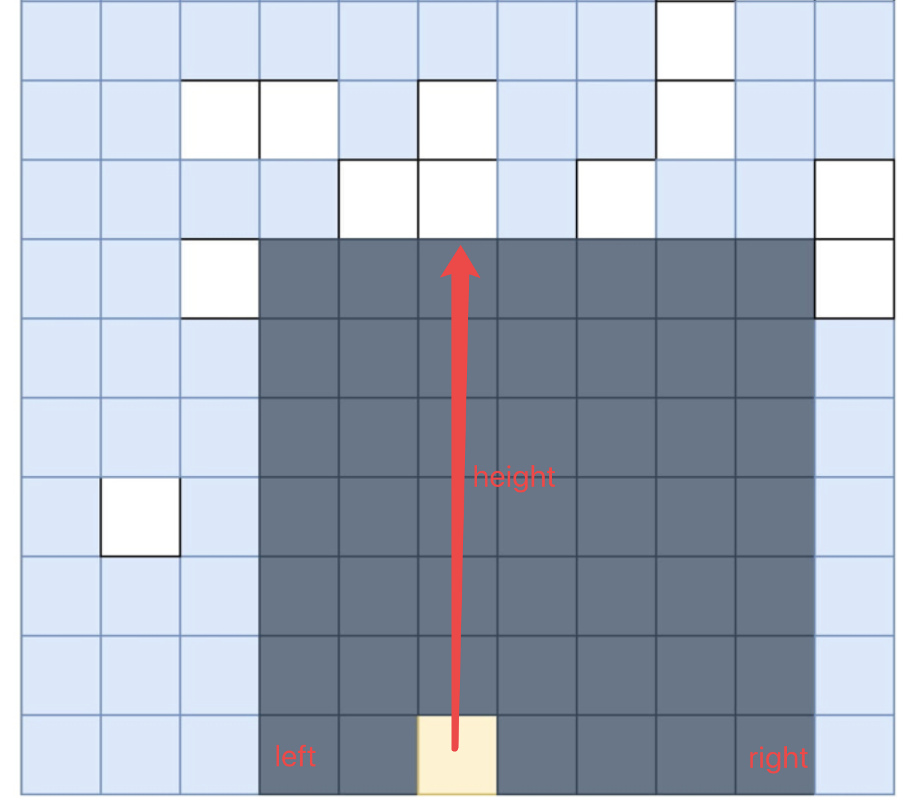
</div>

如果知道了高height和左右边界left、right，这样就可以计算出面积等于`height * (right - left + 1)`。

求height的方法和思路一是一样的，下面讨论求left和right。

设第`i-1`行的left和right已经求出来了分别为`old_left`和`old_right`，当前点为`matrix[i][j]`为`"1"`，
1. 求left
设`left_zero`为`matrix[i][j]`向左看第一个0的列坐标，那么易知`new_left[j] = max(old_left[j], left_zero + 1)`；

2. 求right
类似的，设`right_zero`为`matrix[i][j]`向右看第一个0的列坐标，那么易知`new_right[j] = min(old_right[j], right_zero - 1)`。

所以我们可以开辟一个一维数组`left`和`right`，然后对于每一行：从左往后更新`left`，从右往左更新`right`（就是动态规划的滚动数组思路）。

时间复杂度O(MN)，空间复杂度O(N)；其中M和N分别为高和宽。


# C++
## 思路一
``` C++
class Solution {
public:
    int maximalRectangle(vector<vector<char>>& matrix) {
        int m = matrix.size(); 
        if(!m) return 0;
        int n = matrix[0].size();
        
        int max_res = 0, res = 0;
        vector<int>heights(n + 1, 0); // 注意大小是n+1, 见84题解
        for(int i = 0; i < m; i++){
            for(int j = 0; j < n; j++){
                if(matrix[i][j] == '0') heights[j] = 0;
                else heights[j] += 1;
            }
            
            // 下面几行基本就是84题解
            stack<int>ascend_stk; res = 0;
            for(int k = 0; k <= n; k++){
                while(!ascend_stk.empty() && heights[ascend_stk.top()] >= heights[k]){
                    int height = heights[ascend_stk.top()]; ascend_stk.pop();
                    int width = ascend_stk.empty() ? k : k - 1 - ascend_stk.top();
                    res = max(res, height * width);
                }
                ascend_stk.push(k);
            }
            
            max_res = max(res, max_res);
        }
        return max_res;
    }
};
```

## 思路二
``` C++
class Solution {
public:
    int maximalRectangle(vector<vector<char>>& matrix) {
        int m = matrix.size(); 
        if(!m) return 0;
        int n = matrix[0].size();
        
        int res = 0, left_zero, right_zero;
        vector<int>heights(n, 0), left(n, -1), right(n, n);
        for(int i = 0; i < m; i++){
            // 更新高度
            for(int j = 0; j < n; j++)
                if(matrix[i][j] == '0') heights[j] = 0;
                else heights[j] += 1;
            
            // 更新左边界(可以和上面更新高度合在一个循环内)
            left_zero = -1;
            for(int j = 0; j < n; j++){
                if(matrix[i][j] == '0') {
                    left_zero = j;
                    left[j] = -1;
                }
                else left[j] = max(left_zero + 1, left[j]);
            }
            
            // 更新右边界
            right_zero = n;
            for(int j = n-1; j >= 0; j--){ // 逆向循环!!!
                if(matrix[i][j] == '0') {
                    right_zero = j;
                    right[j] = n;
                }
                else right[j] = min(right_zero - 1, right[j]);
                res = max(res, heights[j] * (right[j] - left[j] + 1));
            }
        }
        
        return res;
    }
};
```
# [86. Partition List](https://leetcode.com/problems/partition-list/)
# 思路
题目要求将链表中小于x的元素移动最前面来，要求保持元素间的相对位置不变。        
我们可以从前往后遍历链表，将小于x的节点取出来按照顺序组成一个新的链表，遍历完成后将这个新链表放在剩下的链表之前即可。
为了方便处理我们定义新的链表的头结点为`small_head`，剩下的链表的头结点为`big_head`，然后用指针small指向当前新链表的最后一个节点，用big指向当前剩余链表的最后一个节点。      
时间复杂度O(n)，空间复杂度O(1)

# C++
``` C++
class Solution {
public:
    ListNode* partition(ListNode* head, int x) {
        ListNode *small_head = new ListNode(-1), *big_head = new ListNode(-1);
        ListNode *small = small_head, *big = big_head;
        while(head){
            if(head -> val < x){
                small -> next = head;
                head = head -> next;
                small  = small -> next;
            }
            else{
                big -> next = head;
                head = head -> next;
                big = big -> next;
            }
        }
        small -> next = big_head -> next; // 将这个新链表放在剩下的链表之前
        big -> next = NULL;
        return small_head -> next;
    }
};
```

# [88. Merge Sorted Array](https://leetcode.com/problems/merge-sorted-array/description/)
# 思路
题意就是将两个已经有序的数组merge成一个有序的数组，最好想的思路就是开辟一个新的数组，但是能不能不用额外空间的呢？  
注意nums1的空间是足够容下两个数组的，所以考虑用nums1而不用开辟新数组  
为了不让已排好的数不覆盖掉未排好的数，我们需要从后往前遍历：  
最大的数放在nums1[n+m-1],次大的数放在nums1[n+m-2],以此类推直到其中一个数组遍历结束，然后将未遍历的部分依次复制到nums1即可。  
所以当nums1先遍历完成时，将nums2剩余的数依次复制到nums1对应的位置即可；当nums2先遍历完成时，不用做任何操作。
# C++
``` C++
class Solution {
public:
    void merge(vector<int>& nums1, int m, vector<int>& nums2, int n) {
        int i1 = m - 1,  i2 = n - 1, j = m + n - 1;
        while(i1 >= 0 && i2 >= 0){
            if(nums1[i1] > nums2[i2]) nums1[j--] = nums1[i1--];
            else nums1[j--] = nums2[i2--];
        }
        for(; i2 >= 0; i2--) nums1[j--] = nums2[i2]; // nums2剩余的数依次复制到nums1对应的位置
    }
};
```

# [89. Gray Code](https://leetcode.com/problems/gray-code/)
# 思路
## 思路一
就按照题目的意思进行模拟，用数组res和一个set来记录已经产生的结果，我们从0开始，遍历其二进制每一位，对其取反，
然后看其是否在set中出现过，如果没有，我们将其加入set和结果res中，然后再递归对这个数进行刚刚的操作，这样就可以得到所有的格雷码了。

## 思路二
如果对格雷码（可参考[维基百科](https://zh.wikipedia.org/wiki/%E6%A0%BC%E9%9B%B7%E7%A0%81)）熟悉的话这题其实就是将二进制转换为格雷码，
举个例子，3位的格雷码和二进制如下所示:
```
Int    Grey Code    Binary
 0  　　  000        000
 1  　　  001        001
 2   　 　011        010
 3   　 　010        011
 4   　 　110        100
 5   　 　111        101
 6   　 　101        110
 7   　　 100        111
```
参考维基百科及[这篇博客](http://www.omegaxyz.com/2017/11/16/grayandbi/)可很容易地写出代码。

## 思路三（最快）
参考[维基百科](https://zh.wikipedia.org/wiki/%E6%A0%BC%E9%9B%B7%E7%A0%81#%E9%8F%A1%E5%B0%84%E6%8E%92%E5%88%97)我们知道，**格雷码是按照镜面排列的**，n位元的格雷码可以从n-1位元的格雷码以上下镜射后加上新位元的方式快速的得到，如下图所示。    
    
可以在前面加上新位元（如上图绿色所示），这样就和思路二产生的一样了；也可以在后面添加新位元，也是满足要求的（相邻两个编码只有一个bit不同）。     


# C++
## 思路一
``` C++
class Solution {
private:
    void helper(vector<int> &res, set<int> &s, int code, int n){
        s.insert(code);
        res.push_back(code);
        
        for(int i = 0; i < n; i++){
            int mask = (1 << i);
            int t = code;
            if((t & mask) == 0)  // 第i位是0
                t |= mask;      // 把第i位变成1
            else            // 第i位是1
                t &= ~mask; // 把第i位变成0
            if(s.count(t)) continue;
            helper(res, s, t, n);
            break;
        }
    }
public:
    vector<int> grayCode(int n) {
        vector<int> res;
        set<int>s;
        helper(res, s, 0, n);
        return res;
    }
};
```
## 思路二
``` C++
class Solution {
public:
    vector<int> grayCode(int n) {
        vector<int> res;
        for (int i = 0; i < pow(2,n); ++i) {
            res.push_back((i >> 1) ^ i);  // ^ 是异或的意思
        }
        return res;
    }
};
```

## 思路三
``` C++
class Solution {
public:
    vector<int> grayCode(int n) {
        vector<int>res{0};
        for(int b = 0; b < n; b++){
            for(int i = res.size() - 1; i >= 0; i--) // 镜面复制
                res.push_back(res[i]);
            
            int half_size = res.size() >> 1;
            for(int i = 0; i < half_size; i++){
                // 在前面添加新位元
                res[i + half_size] += (1 << b);
                
                // 在后面添加新位元
                // res[i] <<= 1;
                // res[i + half_size] = (res[i + half_size] << 1) + 1;
            }
        }
        return res;
    }
};
```

# [90. Subsets II](https://leetcode.com/problems/subsets-ii/)
# 思路
这题就是[78. Subsets](https://leetcode.com/problems/subsets/)的升级版，做法也和此题类似，可参考之前[78. Subsets题解](https://github.com/ShusenTang/LeetCode/blob/master/solutions/78.%20Subsets.md)。
为了使相同的元素都是挨着的，我们首先需要对nums进行排序。
## 思路一、DFS
构造一棵二叉树，左子树表示选择该层处理的节点，右子树表示不选择，最终的叶节点就是所有子集合，以[1,2,2]为例，树的结构如下：

```
                        []        
                   /          \        
                  /            \     
                 /              \
              [1]                []
           /       \           /    \
          /         \         /      \        
       [1 2]       [1]       [2]     []
      /     \     /   \     /   \    / \
  [1 2 2] [1 2]  X   [1]  [2 2] [2] X  []
```
需要注意避免重复结果: 如果下一层对应元素满足`nums[level+1] == nums[level]`，若不打算访问当前层对应元素（`nums[level]`），那么也不应该访问下一层对应元素，所以在向右子树下降之前应该跳过重复值，详见代码。

## 思路二
此题也可以使用迭代的方式来完成此题。
参考[78. Subsets题解](https://github.com/ShusenTang/LeetCode/blob/master/solutions/78.%20Subsets.md)，当处理到第一个2时，此时的子集合为[], [1], [2], [1, 2]，
而这时再处理第二个2时，如果在[]和[1]后直接加2会产生重复，所以只能在上一个循环生成的后两个子集合后面加2。
所以我们用last来记录上一个处理的数字，然后判定当前的数字和上面的是否相同，若不同，则循环还是从0到当前子集的个数，若相同，
则新子集个数减去之前循环时子集的个数当做起点来循环，这样就不会产生重复了。


# C++
## 思路一
### 好理解版
``` C++
class Solution {
private:
    void DFS(const vector<int>&nums, vector<vector<int>>&res, vector<int>&out, int level){
        if(level == nums.size()){
            res.push_back(out);
            return;
        }
        
        // 左子树
        out.push_back(nums[level]);
        DFS(nums, res, out, level+1);
        out.pop_back();
        
        // 右子树
        int i = level + 1;
        while(i < nums.size() && nums[i] == nums[level]) i++; // 避免重复, 唯一和78. Subsets不同的地方
        DFS(nums, res, out, i);
    }
public:
    vector<vector<int>> subsetsWithDup(vector<int>& nums) {
        vector<vector<int>>res;
        vector<int>out;
        sort(nums.begin(), nums.end());
        DFS(nums, res, out, 0);
        return res;
    }
};
```
### 简洁版
``` C++
class Solution {
void DFS(vector<vector<int>> &res, int level, vector<int> &subset, vector<int> &nums) {
        res.push_back(subset);
        for (int i = level; i < nums.size(); ++i) {
            subset.push_back(nums[i]);
            DFS(res, i + 1, subset, nums);
            subset.pop_back();
            while (i + 1 < nums.size() && nums[i] == nums[i + 1]) ++i;
        }
    }
public:
    vector<vector<int>> subsetsWithDup(vector<int>& nums) {
        vector<vector<int>>res;
        vector<int>subset;
        vector<bool>visited(nums.size(), false);
        sort(nums.begin(), nums.end());
        DFS(res, 0, subset, nums);
        return res;
    }
};
```
## 思路二
``` C++
class Solution {
public:
    vector<vector<int>> subsetsWithDup(vector<int> &nums) {
        vector<vector<int>>res;
        res.push_back(vector<int>{});
        sort(nums.begin(), nums.end());
        int last = nums[0], size = 1;
        for(int i = 0; i < nums.size(); i++){
            if(last != nums[i]){
                last = nums[i];
                size = res.size();
            }
            int newSize = res.size();
            for (int j = newSize - size; j < newSize; ++j) {
                res.push_back(res[j]);
                res.back().push_back(nums[i]);
            }
        }
        return res;
    }
};
```

# [91. Decode Ways](https://leetcode.com/problems/decode-ways/)
# 思路
## 思路一
我们可以这样看待这个题。将`s`看成是一个充满障碍的路，每个数字代表一个障碍，我们需要从左到右通过这条路，需要满足的条件是: 
* 一次只能越过一个或者两个障碍;
* 一次性越过的（一个或两个）障碍所代表的数属于[1,26]。
```
Path s: _ 2 _ 2 _ 6 _
Index:  0   1   2   3
```
对于上例，可能的路径就是`0->1->2->3`、`0->2->3`、`0->1->3`。

所以我么可以通过动态规划解此题，开辟一个大小为`s.size()+1`的数组`dp`, `dp[i]`代表从最左边(index=0)到达index=i的所有情况数，最终所求即dp的最后一个元素。所以`dp[0]`初始为1, 有两种方式可到达i:
1. 从i-1越过障碍`s[i-1]`到达i；
2. 从i-2越过障碍`s[i-2]`和`s[i-1]`到达i；

情况1需要满足的条件是`s[i - 1] != 0`，情况2需要满足的条件是`s[i-2]`和`s[i-1]`组成的数字属于[1,26]。

时空复杂度均为O(n)

## 思路二
仔细分析思路一发现，我们每次循环只需要用到`dp[i]`、`dp[i - 1]`和`dp[i - 2]`，所以我们没必要开辟一个dp数组，而用`cur`、`pre`和`pre_pre`分别代表`dp[i]`、`dp[i - 1]`和`dp[i - 2]`就可以了。

时间复杂度O(n)，空间复杂度O(1)

# C++
## 思路一
``` C++
class Solution {
public:
    int numDecodings(string s) {
        if(s[0] == '0') return 0;
        vector<int>dp(s.size() + 1, 0);
        dp[0] = 1;
        for(int i = 1; i < dp.size(); i++){
            dp[i] = (s[i - 1] == '0') ? 0: dp[i - 1]; // 方式1
            if(i > 1){ // 方式2
                if(s[i - 2] == '1') dp[i] += dp[i - 2];
                else if(s[i - 2] == '2' && s[i - 1] < '7') dp[i] += dp[i - 2];
            }
        }
        return dp.back();
    }
};
```

## 思路二
``` C++
class Solution {
public:
    int numDecodings(string s) {
        if(s[0] == '0') return 0;
        int cur, pre = 1, pre_pre;
        for(int i = 1; i < s.size() + 1; i++){
            cur = (s[i - 1] == '0') ? 0: pre;
            if(i > 1){
                if(s[i - 2] == '1') cur += pre_pre;
                else if(s[i - 2] == '2' && s[i - 1] < '7') cur += pre_pre;
            }
            pre_pre = pre;
            pre = cur;
        }
        return cur;
    }
};
```

# [92. Reverse Linked List II](https://leetcode.com/problems/reverse-linked-list-ii/)
# 思路
首先还是开辟一个真正的头结点real_head, 其next指针指向head。然后向后移动`m - 1`步到达需要翻转的第一个节点的前一个节点，记为pre，如果按照下面的例子的话
pre就指向1，然后我们翻转pre后面的`n-m`个节点即可。
```
Input: 1->2->3->4->5->NULL, m = 2, n = 4
Output: 1->4->3->2->5->NULL
```

# C++
``` C++
class Solution {
public:
    ListNode* reverseBetween(ListNode* head, int m, int n) {
        ListNode *real_head = new ListNode(0);
        real_head -> next = head;
        ListNode *p, *pre = real_head, *tmp;
        n -= m;
        while(--m) pre = pre -> next;
        p = pre -> next;
        
        // reverse n-m nodes
        while(n--){
            tmp = p -> next;
            p -> next = tmp -> next;
            tmp -> next = pre -> next;
            pre -> next = tmp;   
        }
        return real_head -> next;
    }
};
```

# [93. Restore IP Addresses](https://leetcode.com/problems/restore-ip-addresses/)
# 思路
题目要求将一个全数字的字符串转换成所有可能的IP地址串。我们知道IP地址由32位二进制数组成，为便于使用，我们常将IP地址分成四段每段八位，这样每段的十进制范围就是0-255，另外要排除前导0如"01"这种情况，所以我们
可以先写一个判断一个字符串是否是合法IP一段的函数。

然后再将字符串进行分段，在输入字符串中插入三个点就可以将字符串分为四段。因为要求出所有情况，所以考虑用递归。
我们用k来表示当前还需要分的段数，如果k = 0，则表示三个点已经加入完成，四段已经形成，若这时剩余字符串刚好为空，则将当前分好的结果保存。
若k != 0, 则对于剩下的字符串，我们分别用一位，两位，三位来尝试对其分割，分别判断其合不合法，如果合法，则调用递归继续分剩下的字符串，最终和求出所有合法组合。

# C++
``` C++
class Solution {
private:
    bool isValid(string s) {
        if (s.empty() || s.size() > 3 || (s.size() > 1 && s[0] == '0')) return false;
        int res = atoi(s.c_str());
        return res <= 255 && res >= 0;
    }
    void helper(string s, int k, string out, vector<string> &res) {
        if (k == 0) {
            if (s.empty()) res.push_back(out);
            return;
        }
        for (int i = 1; i <= 3; ++i) { // 子串长度只可能是1、2或3
            if (s.size() >= i && isValid(s.substr(0, i))) {
                string tmp = out + s.substr(0, i);
                if (k > 1) tmp += ".";
                helper(s.substr(i), k - 1, tmp, res);
            }
        }
    }
public:
    vector<string> restoreIpAddresses(string s) {
        vector<string> res;
        helper(s, 4, "", res);
        return res;
    }
};
```

# [94. Binary Tree Inorder Traversal](https://leetcode.com/problems/binary-tree-inorder-traversal/)
# 思路
中序遍历二叉树。属于数据结构基本题。
## 思路一、递归
二叉树的中序、前序、后序遍历最方便的当然就是使用递归了。中序遍历某个节点时，先不访问它，先递归遍历其左子树，然后才访问该节点，最后递归遍历其右节点。

## 思路二、非递归
我们先定义一个栈，然后从根节点开始，进入循环，若当前节点不空那么将其入栈（暂不访问），然后向左下降进入下一循环；若为空则说明往左下降不动了，应该将栈顶元素取出
并访问，然后向右下降；循环直到栈空且当前节点也为空为止。

# C++
## 思路一
``` C++
class Solution {
private:
    void helper(TreeNode* root, vector<int> &res){
        if(!root) return;
        helper(root -> left, res);
        res.push_back(root -> val);
        helper(root -> right, res);
        
    }
public:
    vector<int> inorderTraversal(TreeNode* root) {
        vector<int>res;
        helper(root, res);
        return res;
    }
};
```

## 思路二
### 写法一
``` C++
class Solution {
public:
    vector<int> inorderTraversal(TreeNode* root) {
        vector<int>res;
        stack<TreeNode *>stk;
        TreeNode* p = root;        
        while(!stk.empty() || p){
            if(p){ // 左: 一路向左下降
                stk.push(p);
                p = p -> left; 
            }
            else{
                p = stk.top(); // 中: 下降不动了, 访问栈顶元素
                stk.pop();
                res.push_back(p -> val);
                p = p -> right; // 右: 访问右子树
            }
        }
        return res;
    }
};
```
### 写法二
``` C++
class Solution {
public:
    vector<int> inorderTraversal(TreeNode* root) {
        vector<int>res;
        stack<TreeNode*>stk;
        TreeNode *p = root;
        
        while(!stk.empty() || p){
            // 左: 一路向左下降
            while(p){ 
                stk.push(p);
                p = p -> left; 
            }
            // 中: 下降不动了, 访问栈顶元素
            p = stk.top(); stk.pop();
            res.push_back(p -> val);
            // 右: 访问右子树
            p = p -> right; 
        }
        
        return res;
    }
};
```

# [95. Unique Binary Search Trees II](https://leetcode.com/problems/unique-binary-search-trees-ii/)
# 思路
题目要求返回由节点1,2,...,n组成的所有二叉搜索树。这题其实是[96. Unique Binary Search Trees](https://leetcode.com/problems/unique-binary-search-trees/)的改版，
思路也是类似的，就是递归的思想，详情见[96题解思路一](https://github.com/ShusenTang/LeetCode/blob/master/solutions/96.%20Unique%20Binary%20Search%20Trees.md)。

我们很容易写出如下代码，但是下面的代码存在一个很严重的问题就是会存在大量的对象拷贝使得运行速度很慢。
所以有了接下来的改进版: 用指针来存储变量。即函数`generateSubTree`是一个指针函数
（关于指针函数，请参考[函数指针与指针函数](http://yulingtianxia.com/blog/2014/04/17/han-shu-zhi-zhen-yu-zhi-zhen-han-shu/)）, 
其返回的不是一个vector，而是指向一个vector的指针。 

> **注意下面两种方式的细微差别，包括初始化和成员函数的访问**


# C++
``` C++
class Solution {
private:
    vector<TreeNode*> generateSubTree(int from, int to){
        vector<TreeNode*>res;
        if(to < from) res.push_back(NULL);
        else if (to == from) res.push_back(new TreeNode(to));
        else{
            for(int i = from; i <= to; i++){
                vector<TreeNode*> left = generateSubTree(from, i - 1);
                vector<TreeNode*> right = generateSubTree(i + 1, to);
                for(int j1 = 0; j1 < left.size(); j1++)
                    for(int j2 = 0; j2 < right.size(); j2++){
                        TreeNode *root = new TreeNode(i);
                        root -> left = left[j1];
                        root -> right = right[j2];
                        res.push_back(root);
                    }
            }
        }
        return res;
    }
public:
    vector<TreeNode*> generateTrees(int n) { 
        if (n == 0) return vector<TreeNode*>(0);
        return generateSubTree(1, n);
    }
};
```
## 改进版*(避免了对象拷贝, 快很多)
``` C++
class Solution {
private:
    vector<TreeNode*> *generateSubTree(int from, int to){
        // 注意这里要让指针res指向某处,而不是vector<TreeNode*> *res;
        vector<TreeNode*> *res = new vector<TreeNode*>();
        if(to < from) res->push_back(NULL); // 或者(*res).push_back(NULL),下同
        else if (to == from) res->push_back(new TreeNode(to));
        else{
            for(int i = from; i <= to; i++){
                vector<TreeNode*> *left = generateSubTree(from, i - 1);
                vector<TreeNode*> *right = generateSubTree(i + 1, to);
                for(int j1 = 0; j1 < left->size(); j1++)
                    for(int j2 = 0; j2 < right->size(); j2++){
                        TreeNode *root = new TreeNode(i);
                        root -> left = (*left)[j1];
                        root -> right = (*right)[j2];
                        res->push_back(root);
                    }
            }
        }
        return res;
    }
public:
    vector<TreeNode*> generateTrees(int n) { 
        if (n == 0) return vector<TreeNode*>(0);
        return *generateSubTree(1, n);
    }
};
```

# [96. Unique Binary Search Trees](https://leetcode.com/problems/unique-binary-search-trees/)

# 思路
由节点1,2,...,n可以组成多少棵二叉搜索树。         
先来看看二叉搜索树的定义。它或者是一棵空树，或者是具有下列性质的二叉树： 
* 若它的左子树不空，则左子树上所有结点的值均小于它的根结点的值； 
* 若它的右子树不空，则右子树上所有结点的值均大于它的根结点的值； 
* 它的左、右子树也分别为二叉排序树。

## 思路一、动归
先来看一个例子，当n=3时:
```
 1               1                   2                    3             3
  \               \                /   \                 /             / 
   3               2              1     3               2             1
  /                 \                                  /               \
 2                   3                                1                 2
 ```

我们可以看到，以1为根的树有几个，完全取决于有二个元素的子树有几种。同理，以2为根的子树取决于一个元素的子树有几个。以3为根的情况，则与1相同。

定义`dp[i]`为用1,2,...,i能构成Unique Binary Tree的数目，特别的`dp[0] = dp[1] = 1`。

如果数组有两个元素{1,2}， 那么有如下两种可能
```
1                    2
 \                  /
  2                1
```
即
```
dp[2] = dp[0] * dp[1]  (1为根的情况)
      + dp[1] * dp[0]  (2为根的情况)
```

再看一遍三个元素的数组，可以发现BST的取值方式如下：
```
dp[3] = dp[0]*dp[2]  (1为根的情况)
      + dp[1]*dp[1]  (2为根的情况)
      + dp[2]*dp[0]  (3为根的情况)
```

所以，由此观察，可以得出递推公式为
```
dp[i] =  dp[0]*dp[i-1] + dp[1]*dp[i-2] + ... + dp[i-1]*dp[0]
```

## 思路二
我们知道前序遍历序列和中序遍历序列可以确定唯一一颗二叉树，中序遍历是递增的即1,2,...n的话一定是二叉搜索树，所以问题可以转换成给定中序序列，有多少种可能的前序序列？
根据中序和前序的递归算法，这个问题等价于给定进栈顺序，有多少种出栈的顺序。答案就是卡特兰数，即`C(2n,n) / (n + 1)`。所以我们可以直接计算这个值。

# C++
## 思路一
``` C++
class Solution {
public:
    int numTrees(int n) {        
        vector<int>dp(n + 1, 0);
        dp[0] = 1;
        dp[1] = 1;
        for(int i = 2; i <= n; i++)
            for(int j = 0; j < i; j++) dp[i] += dp[j]*dp[i - 1 - j];
        
        return dp[n];
    }
};
```

## 思路二
``` C++
class Solution {
public:
    int numTrees(int n) {
        long long res = 1, tmp = 1; // 注意用long long
        for(int i = 1; i <= n; i++){
            res *= (2 * n - i + 1);
            if(res % i == 0) res /= i;
            else tmp *= i;
            if(res % tmp == 0){
                res /= tmp;
                tmp = 1;
            }
            
        }
        return int((res / tmp) / (n + 1));
    }
};
```

# [97. Interleaving String](https://leetcode.cn/problems/interleaving-string/)

# 思路
仔细分析问题不难发现会涉及到大量子问题，所以我们考虑用动态规划求解。我们定义 dp[i][j] 表示 s1 的前 i 个元素和 s2 的前 j 个元素是否能交错组成 s3 的前 i + j 个元素。可得到初始状态和状态转移方程为：
```
初始态（即都为空串）：dp[0][0] = true
转移方程：dp[i][j] = (dp[i-1][j] && s3[i+j-1] == s1[i-1]) || (dp[i][j-1] && s3[i+j-1] == s2[j-1])
```
再考虑下边界条件就不难写出代码。另外由于 dp[i][j] 只和左上元素有关，故可以考虑使用滚动数组优化空间复杂度为O(s2.size())。


# C++
``` C++
class Solution {
public:
    bool isInterleave(string s1, string s2, string s3) {
        if(s1.size() + s2.size() != s3.size()) return false;
        int n1 = s1.size(), n2 = s2.size(), n3 = s3.size();
        if(n1 == 0) return s2 == s3;
        if(n2 == 0) return s1 == s3;
        
        // vector<vector<bool>>dp(n1 + 1, vector<bool>(n2 + 1, false));
        // for(int i = 0; i <= n1; i++){
        //     for(int j = 0; j <= n2; j++){
        //         if(i == 0 && j == 0) dp[i][j] = true;
        //         else if(i > 0 && dp[i-1][j] && s3[i+j-1] == s1[i-1]) dp[i][j] = true;
        //         else if(j > 0 && dp[i][j-1] && s3[i+j-1] == s2[j-1]) dp[i][j] = true;
        //         // else dp[i][j] = false; 
        //     }
        // }
        // return dp[n1][n2];

        // 滚动数组空间优化
        vector<bool>dp(n2 + 1, false);
        for(int i = 0; i <= n1; i++){
            for(int j = 0; j <= n2; j++){
                if(i == 0 && j == 0) dp[j] = true;
                else if(i > 0 && dp[j] && s3[i+j-1] == s1[i-1]) dp[j] = true;
                else if(j > 0 && dp[j-1] && s3[i+j-1] == s2[j-1]) dp[j] = true;
                else dp[j] = false; // 注意这里需重置成false, 因为dp[i-1][j]可能等于true
            }
        }
        return dp[n2];
    }
};
``` 
# [98. Validate Binary Search Tree](https://leetcode.com/problems/validate-binary-search-tree/)
# 思路
## 思路一
根据BST的定义。二叉搜索树或者是一棵空树，或者是具有下列性质的二叉树：
* 若它的左子树不空，则左子树上**所有**结点的值均小于它的根结点的值；
* 若它的右子树不空，则右子树上**所有**结点的值均大于它的根结点的值；
* 它的左、右子树也分别为二叉排序树。

> 注意“所有”。


实现过程中，为了检查左子树（已经是一个二叉搜索树）上**所有**结点的值是否均小于它的根结点的值，我们可以检查左子树上的最大值（一直沿右路下降即可）小于它的根结点的值即可。右子树亦然。

## 思路二
还可以检验中序遍历序列是否是严格递增的来判断是否是BST。       
我们可以用一个全局变量pre记录上一个中序遍历节点值，当前节点值必须大于pre才行。所以pre的初始值为`INT_MIN-1`（所以为了防止溢出，pre应该是long long型）。


# C++
## 思路一
``` C++
class Solution {
public:
    bool isValidBST(TreeNode* root) {
        if(root == NULL) return true;
        if(root -> left != NULL){
            if(!isValidBST(root -> left)) return false;
            TreeNode* p = root -> left;
            while(p -> right) p = p -> right; // 沿右路下降
            if(root -> val <= p -> val) return false;
        }
        if(root -> right != NULL){
            if(!isValidBST(root -> right)) return false;
            TreeNode* p = root -> right;
            while(p -> left) p = p -> left; // 沿左路下降
            if(root -> val >= p -> val ) return false;
            
        }
        return true;
    }
};
```

## 思路二
``` C++
class Solution {
private:
    long long pre = (long long)INT_MIN - 1;
    bool inorder(TreeNode *root){
        if(root == NULL) return true;
        if(!inorder(root -> left)) return false;
        if(root -> val <= pre) return false;
        pre = root -> val;
        if(!inorder(root -> right)) return false;
        return true;
    }
public:
    bool isValidBST(TreeNode* root) {
        pre = (long long)INT_MIN - 1;
        return inorder(root);
    }
};
```

# [99. Recover Binary Search Tree](https://leetcode.cn/problems/recover-binary-search-tree/)

# 思路
注意到搜索树的特点：中序遍历是有序的。而题目说恰好有两个结点被交换，那么如果我们对其进行中序遍历，那应该基本上是有序的，局部不满足有序的地方就是我们要找的两个节点。即假设中序遍历序列是vec，找到两个不满足有序的地方：vec[i] > vec[i+1]，vec[j] > vec[j+1]，那么节点 i 和 j+1 就是我们要找的两个节点，注意 i = j 的特殊情况。

所以复杂度就是取决于中序遍历的复杂度，时间复杂度为O(N)，N为节点个数；空间复杂度一般也为O(H)，但可优化为O(1)。

## 方法一、常规方法
最简单的方法就是递归，用一个数组存放中序遍历结果，此时空间复杂度为O(H+N)，H为树高（即递归栈所用空间），N为节点个数。由于我们只需找到 i 和 j，所以其实可以不用存放整个遍历序列，空间复杂度优化成O(H)。

## 方法二、Morris遍历（常数空间复杂度）

morris遍历的核心思想是利用叶子节点的大量空闲指针，实现空间开销的极限缩减。

要使用O(1)空间进行遍历，最大的难点在于，遍历到子节点的时候怎样重新返回到父节点（因为不能用栈作为辅助空间）。为了解决这个问题，Morris方法用到了线索二叉树（threaded binary tree）的概念，利用叶子节点中的左右空指针指向某种顺序遍历下的前驱节点或后继节点就可以了。以中序遍历为例：将左子树最右节点的右空闲指针在遍历中途指向根节点（根节点是左子树最右节点在中序遍历序列中的后继），当我们再次遍历到这个节点时，发现其有右孩子，就表示原根节点的左子树访问完毕，此时就可以访问根节点了。具体程序如下：

```
从根节点开始访问：
1）如果当前节点 p 不存在左子树，按中序遍历规则，访问 p 并进入其右子树进行遍历。
2）如果当前节点 p 存在左子树，就找到 p 的前驱节点（即左子树中的最右节点），并将其的右孩子指向 p，同时当前节点转入左子树进行遍历。
注意（2）中访问右子树时，如果节点本身没有右子树，则会直接转入其后继节点 p，此时 p 的左子树遍历完成。为了还原树结构，我们需要重新找到 p 的前驱节点，并将其右孩子设置为空。之后我们访问节点p，并进入其右子树进行遍历。
```

# C++
## 方法一、常规方法
``` C++
class Solution {
private:
    vector<TreeNode*>vec; // 存放中序遍历的结果
    void midVisit(TreeNode* root){
        if(!root) return;
        midVisit(root -> left);
        vec.push_back(root);
        midVisit(root -> right);
    }
public:
    void recoverTree(TreeNode* root) {
        if(!root) return;
        midVisit(root);

        vector<int>tmp;
        for(int i = 0; i < vec.size() - 1; i++){
            if(vec[i]->val > vec[i+1]->val) tmp.push_back(i);
        }

        int i = tmp[0];
        int j = tmp.size() == 1 ? tmp[0]: tmp[1];

        int tmp_val = vec[i] -> val;
        vec[i] -> val = vec[j+1] -> val;
        vec[j+1] -> val = tmp_val;
    }
};
```

## 方法二、Morris遍历（常数空间复杂度）
```C++
class Solution {
private:
    TreeNode *p = nullptr, *pre = nullptr;
    TreeNode *node_i = nullptr, *node_j = nullptr; // node_i和node_j是需要交换的节点
    void visit(){ // 访问函数
        if(pre && pre -> val > p -> val){
            if(!node_i) node_i = pre;
            node_j = p; 
        }
        pre = p;
        p = p -> right;
    }
public:
    void recoverTree(TreeNode* root) {
        if(!root) return;

        // Morris中序遍历算法: 能将非递归的中序遍历空间复杂度降为 O(1)
        p = root;
        while(p){
            if(p -> left == nullptr){ // 无左孩子, 访问即可
                visit();
            } 
            else{ // 有左孩子
                TreeNode* p_back = p;
                p = p -> left;
                while(p -> right && p -> right != p_back) p = p -> right; // 找到左子树上最右的节点
                if(!(p -> right)){ // 左子树最右节点的右子树为空
                    p -> right = p_back;
                    p = p_back -> left;
                }else{ //  左子树最右节点的右子树不为空, 说明左子树已访问
                    p -> right = nullptr;
                    p = p_back;
                    visit();
                }
            }
        }

        int tmp_val = node_i -> val;
        node_i -> val = node_j -> val;
        node_j -> val = tmp_val;
    }
};
```
 
# [100. Same Tree](https://leetcode.com/problems/same-tree/description/)
# 思路
判断两棵树是否完全相同。最简单的思路就是递归算法，两棵树非空树完全相同的充要条件是:
* 根的值相同;
* 且左子树和右子树都是分别完全相同的。

当然也可以考虑遍历两棵树直到遇到不相同的节点即可返回false，若同时遍历完则返回true。

# C++
``` C++
class Solution {
public:
    bool isSameTree(TreeNode* p, TreeNode* q) {
        if(p == NULL && q==NULL) return true;  // 都是空树
        if(p == NULL || q == NULL || (p -> val != q -> val)) return false;
        return isSameTree(p -> left, q -> left) && isSameTree(p -> right, q -> right);
    }
};
```

# [101. Symmetric Tree](https://leetcode.com/problems/symmetric-tree/description/)
# 思路
## 思路一: 递归
最简单的思路就是递归。若一个非空树是对称树，那么其左右子树是互为镜像的。类似[判断两颗树是否相等的题解](https://github.com/ShusenTang/LeetCode/blob/master/100.%20Same%20Tree.md)，
两棵非空树互为镜像的充要条件是:
* 根的值相同;
* 且树一的左子树和树二的右子树互为镜像，树一的右子树和树二的左子树互为镜像。
## 思路二: 非递归
采用类似层次遍历的方法。对于左子树从上往下**从左往右**层次遍历，对于右子树从上往下**从右往左**层次遍历，遍历过程中进行比较。注意遍历过程中如果某个节点的孩子为空也应将其孩子入队。

层次遍历用的队列，其实用栈也是可以的，代码几乎一样，这样就是分别用**根右左**和**根左右**来遍历左右子树，同理空孩子也需要入栈。

两种思路都相当于遍历一遍树，所以两种思路的时空复杂度均为O(n)。

# C++
## 思路一
``` C++
class Solution {
private:
    bool isSymmetricSameTree(TreeNode* p, TreeNode* q) { // 判断两棵树是否互为镜像
        if(!p && !q) return true;
        if(!p || !q || p->val != q->val) return false;
        return isSymmetricSameTree(p -> left, q -> right) && \
            isSymmetricSameTree(p -> right, q -> left);
    }
public:
    bool isSymmetric(TreeNode* root) {
        if(!root) return true;
        return isSymmetricSameTree(root -> left, root -> right);
    }
};
```
## 思路二
``` C++
class Solution {
public:
    bool isSymmetric(TreeNode* root) {
        if(!root) return true;
        
        queue<TreeNode *>container1, container2; // use queue
        // stack<TreeNode *>container1, container2; // use stack

        container1.push(root -> left);
        container2.push(root -> right);
        
        TreeNode *p1, *p2;
        while(!container1.empty() && !container2.empty()){
            p1 = container1.front(); p2 = container2.front(); // use queue
            // p1 = container1.top(); p2 = container2.top(); // use stack
           
            container1.pop(); container2.pop();
            
            if(p1 && p2){
                if(p1 -> val != p2 -> val) return false;
                container1.push(p1 -> left);
                container1.push(p1 -> right);
                container2.push(p2 -> right);
                container2.push(p2 -> left);
            }
            else if(!p1 && !p2) continue;
            else return false;
        }
        return true;
    }
};
```

# [102. Binary Tree Level Order Traversal](https://leetcode.com/problems/binary-tree-level-order-traversal/)
# 思路
层序遍历二叉树。已经在[107题题解](https://github.com/ShusenTang/LeetCode/blob/master/solutions/107.%20Binary%20Tree%20Level%20Order%20Traversal%20II.md)分析过了。

时空复杂度均O(n)

# C++
``` C++
class Solution {
public:
    vector<vector<int>> levelOrder(TreeNode* root) {
        vector<vector<int>>res;
        if(root == NULL) return res;
        queue<TreeNode *>q;
        TreeNode *p;
        
        q.push(root);
        while(!q.empty()){
            vector<int>level;
            for(int i = q.size(); i > 0; i--){
                p = q.front();
                q.pop();
                level.push_back(p -> val);
                if(p -> left) q.push(p -> left);
                if(p -> right) q.push(p -> right);
            }
            res.push_back(level);
        }
        return res;
    }
};
```

# [103. Binary Tree Zigzag Level Order Traversal](https://leetcode.com/problems/binary-tree-zigzag-level-order-traversal/)
# 思路
这题是[102层序遍历](https://leetcode.com/problems/binary-tree-level-order-traversal/)的推广，我们只需要在合适的层翻转原始访问顺序就可以了，
普通的层序遍历可参考[102题解](https://github.com/ShusenTang/LeetCode/blob/master/solutions/102.%20Binary%20Tree%20Level%20Order%20Traversal.md)，这里不再赘述。

# C++
``` C++
class Solution {
public:
    vector<vector<int>> zigzagLevelOrder(TreeNode* root) {
        vector<vector<int>>res;
        if(root == NULL) return res;
        queue<TreeNode *>q;
        TreeNode *p;
        
        bool left_to_right = true;
        q.push(root);
        while(!q.empty()){
            vector<int>level;
            for(int i = q.size(); i > 0; i--){
                p = q.front();
                q.pop();
                level.push_back(p -> val);
                if(p -> left) q.push(p -> left);
                if(p -> right) q.push(p -> right);
            }
            if(!left_to_right) reverse(level.begin(), level.end()); // 翻转原始访问顺序
            left_to_right = !left_to_right;               
            res.push_back(level);
        }
        return res;
    }
};
```

# [104. Maximum Depth of Binary Tree](https://leetcode.com/problems/maximum-depth-of-binary-tree/description/)
# 思路
## 思路一: 递归
最简单的思路就是递归。若树非空，则树高就是: 1 + max(左子树高，右子树高)，递归出口就是树为空。
## 思路二: 非递归
可考虑用层序遍历的方法计算树高。   
用last指针表示每一层的最后一个节点，每当遍历到这个节点即将树高加1并更新last指针。   
last初始为root，后面每当遍历完每层最后一个节点后，即将last更新成下一层的最后一个节点，为此需要用一个tmp来不断记录能确定的下一层的最右节点。

# C++
## 思路一
``` C++
class Solution {
public:
    int maxDepth(TreeNode* root) {
        if(root == NULL) return 0;
        else return 1 + max(maxDepth(root -> left), maxDepth(root -> right));
    }
};
```
## 思路二
``` C++
class Solution {
public:
    int maxDepth(TreeNode* root) {
        if(root == NULL) return 0;
        int res = 0;
        queue<TreeNode *>q;
        TreeNode *p, *tmp=NULL, *last=root;  // tmp用来更新last用
        q.push(root);
        while(!q.empty()){
            p = q.front();
            q.pop();
            if(p -> left){
                tmp = p -> left;
                q.push(tmp);
            }
            if(p -> right){
                tmp = p -> right;
                q.push(tmp);
            } // tmp记录了直到现在下一层最右的节点 
            if(p == last){ // 遇到了last
                res++; // 树高加1
                last = tmp; // 更新last
            }
        }
        return res;
    }
};
```

# [105. Construct Binary Tree from Preorder and Inorder Traversal](https://leetcode.com/problems/construct-binary-tree-from-preorder-and-inorder-traversal/)
# 思路
根据中序和前序遍历建树。        
由于先序遍历的第一个肯定是根，所以原二叉树的根节点可以知道，然后由于树中没有相同元素，所以我们可以在中序遍历中也定位出根节点的位置，
并以根节点的位置将中序遍历拆分为左右两个部分，分别对其递归调用原函数。其中在中序遍历中定位根节点可以用个for循环也可以通过hash（即unordered_map，更快）。

需要提一点的是，同时知道前序遍历（或后序遍历）和中序遍历就能够唯一确定一颗二叉树，而前序和后序则不能。

# C++
``` C++
class Solution {
private:
    TreeNode* helper(int num, vector<int>& preorder, int pre_start, 
                     vector<int>& inorder, int in_start, 
                     unordered_map<int, int>& mp){
        if(num == 0) return NULL;
        int val = preorder[pre_start];
        TreeNode *node = new TreeNode(val);
        int i = mp[val] - in_start;
        node -> left = helper(i, preorder, pre_start + 1, inorder, in_start, mp);
        node -> right = helper(num-i-1, preorder, pre_start+i+1, inorder, 
                               in_start+i+1, mp);
        return node;
    }
public:
    TreeNode* buildTree(vector<int>& preorder, vector<int>& inorder) {
        unordered_map<int, int>mp;
        // 用map记录某个节点在中序遍历数组中的索引
        for(int i = 0; i < inorder.size(); i++) mp[inorder[i]] = i;
        return helper(preorder.size(), preorder, 0, inorder, 0, mp);   
    }
};
```

# [106. Construct Binary Tree from Inorder and Postorder Traversal](https://leetcode.com/problems/construct-binary-tree-from-inorder-and-postorder-traversal/)
# 思路
根据中序遍历和后序遍历构建二叉树。       
其实和105题（根据中序遍历和前序遍历构建二叉树）是类似的，由于后序遍历的最后一个肯定是根，所以原二叉树的根节点可以知道，然后由于树中没有相同元素，
所以我们可以在中序遍历中也定位出根节点的位置，并以根节点的位置将中序遍历拆分为左右两个部分，分别对其递归调用原函数。
其中在中序遍历中定位根节点可以通过hash（即unordered_map）实现。

# C++
``` C++
class Solution {
private:
    TreeNode* helper(int num, vector<int>& postorder, int post_last, 
        vector<int>& inorder, int in_start, 
        unordered_map<int, int>& mp){
        if(num == 0) return NULL;
        int val = postorder[post_last];
        TreeNode *node = new TreeNode(val);
        int i = mp[val] - in_start; // i代表左子树有多少个节点
        node -> left = helper(i, postorder, post_last - num + i, inorder, in_start, mp);
        node -> right = helper(num-i-1, postorder, post_last-1, inorder, 
                               in_start+i+1, mp);
        return node;
    }
public:
    TreeNode* buildTree(vector<int>& inorder, vector<int>& postorder) {
        unordered_map<int, int>mp;
        // 用mp记录某个节点在中序遍历数组中的索引
        for(int i = 0; i < inorder.size(); i++) mp[inorder[i]] = i;
        int num = postorder.size();
        return helper(num, postorder, num - 1, inorder, 0, mp); 
        
    }
};
```


# [107. Binary Tree Level Order Traversal II](https://leetcode.com/problems/binary-tree-level-order-traversal-ii/description/)
# 思路
题目的意思就是层序遍历的变形，从下往上、从左往右层序遍历。为此我们先正常层序遍历并用一个stack记录每一层的节点。然后再依次出栈即可。

下面简单说一下正常的层序遍历（即从上往下、从左往右）: 建立一个queue，然后先把根节点放进去，进入while循环，记录此刻的queue大小(设为size)，
并用一个for循环依次出队并遍历size个元素,此过程要将左右两个子节点入队。一次while循环即可得到一层的所有节点，以此类推，可以完成层序遍历。
  
时间复杂度和空间复杂度都是O(n)

# C++
``` C++
class Solution {
public:
    vector<vector<int>> levelOrderBottom(TreeNode* root) {
        vector<vector<int>>res;
        if(root == NULL) return res;
        queue<TreeNode *>q;
        stack<vector<int>>stk;
        TreeNode *p;
        
        q.push(root);
        while(!q.empty()){
            vector<int>level; // 记录此层的所有节点
            for(int i = q.size(); i > 0; i--){
                p = q.front();
                q.pop();
                level.push_back(p -> val);
                if(p -> left) q.push(p -> left);
                if(p -> right) q.push(p -> right); // 如果想从下往上、从右往左层序遍历的话只需把词句和上一句调换位置即可
            }
            stk.push(level);
        }
        // 上面的过程就是正常的层序遍历过程
        
        while(!stk.empty()){
            res.push_back(stk.top());
            stk.pop();
        }
        return res;
    }
};
```


# [108. Convert Sorted Array to Binary Search Tree](https://leetcode.com/problems/convert-sorted-array-to-binary-search-tree/description/)
# 思路
题意就是将有序数组转换为平衡搜索树。注意解是不唯一的，例如题中的例子如下解也是可以的:
```
      0
    /   \
 -10     5
   \      \
   -3      9
```
为了达到平衡，肯定要用二分的思想: 树根肯定是数组中间的那个数，左子树的根是数组左半边中间(`mid=(left+right)/2`)的数(计算mid的时候向上取整和向下取整均可，
题目例子向上取整就是leetcode给的结果，向下取整就是我这里给的结果)，右子树的根是数组右半边中间的数。由此可见是一个递归算法。  
例如, [-10,-3,0,5,9]中间的数是0所以树根是0, 数组左半边[-10,-3]中间的数是-10，所以左子树的根是-10, 数组右半边[5,9]中间的数是5，所以右子树的根是5...如此递归下去即可。
# C++
``` C++
class Solution {
private:
    TreeNode* get_root(vector<int>& nums, int left, int right){
        if(left > right) return NULL;  // 递归出口
        int mid = left + (right - left) / 2; // 不写成mid=(left + right) / 2是为了防止溢出
        TreeNode* root = new TreeNode(nums[mid]);
        root -> left = get_root(nums, left, mid - 1);
        root -> right = get_root(nums, mid + 1, right);
        return root;
    }
public:
    TreeNode* sortedArrayToBST(vector<int>& nums) {
        return get_root(nums, 0, nums.size() - 1);
    }
};
```

# [109. Convert Sorted List to Binary Search Tree](https://leetcode.com/problems/convert-sorted-list-to-binary-search-tree/)
# 思路
根据一个有序链表建立一个平衡的搜索二叉树。        
## 思路一
由于需要平衡的，所以每次都应该找到链表中间那个元素作为根节点，找到链表中间节点的方法就是快慢指针法，慢指针每次移动一步，快指针每次移动两步，这样当快指针
到达链尾时慢指针就处在中间位置。                 
每次查找需要O(n)的复杂度，次数为进行O(logn)量级，所以总的复杂度应该是O(nlogn)

## 思路二
为了更快地查找到中间元素，我们还可以考虑将链表元素用一个数组来存放，这样就可以用二分了。           
每次查找复杂度变成了O(logn)，所以建树总的复杂度应该是O((logn)^2)，但是一开始建立数组时复杂度为O(n)，所以总的时间复杂度应该是O(n)级别（但实测此方法比思路一要慢）

# C++
## 思路一
``` C++
class Solution {
public:
    TreeNode *sortedListToBST(ListNode* head) {
        if (!head) return NULL;
        if (!head->next) return new TreeNode(head->val);
        ListNode *slow = head, *fast = head, *last = slow;
        while (fast->next && fast->next->next) {
            last = slow;
            slow = slow->next;
            fast = fast->next->next;
        }
        fast = slow->next;
        last->next = NULL;
        TreeNode *cur = new TreeNode(slow->val);
        if (head != slow) cur->left = sortedListToBST(head);
        cur->right = sortedListToBST(fast);
        return cur;
    }
};
```

## 思路二
``` C++
class Solution {
private:
    TreeNode* helper(vector<int>& nodes, int low, int high){
        if(low > high) return NULL;
        int mid = (high - low) / 2 + low;
        TreeNode* root = new TreeNode(nodes[mid]);
        root -> left = helper(nodes, low, mid - 1);
        root -> right = helper(nodes, mid + 1, high);
        return root;
    }
public:
    TreeNode* sortedListToBST(ListNode* head) {
        vector<int>nodes;
        while(head){
            nodes.push_back(head->val);
            head = head -> next;
        }
        return helper(nodes, 0, nodes.size()-1); 
    }
};
```

# [110. Balanced Binary Tree](https://leetcode.com/problems/balanced-binary-tree/description/)
# 思路

## 思路一
一棵非空树是平衡二叉树的充要条件是：
* 其左右子树的高相差不超过1；
* 且左右子树都是平衡二叉树。

因此可考虑用一个递归算法，为此还需要一个递归算法求某树的高。

## 思路二

思路一的代码十分简洁，但是要注意一个节点会被重复遍历多次因此不是最优的算法。为此我们可以考虑用类似后序遍历的思路，在判断左右子树是否是平衡的同时还需要返回左右子树的高（可以通过传入引用实现），这样就可以不用再递归求左右子树的高了，即整个过程只遍历一遍节点。


# C++

## 思路一
``` C++
class Solution {
private:
    int getDepth(TreeNode *root){
        if(root == NULL) return 0;
        return 1 + max(getDepth(root -> left), getDepth(root -> right));
    }
public:
    bool isBalanced(TreeNode* root) {
        if(root == NULL) return true;
        return (abs(getDepth(root -> left) - getDepth(root -> right)) <= 1) && isBalanced(root -> left) && isBalanced(root -> right);
    }
};
```

## 思路二
``` C++
class Solution {
private:
    bool helper(TreeNode* root, int &height){
        if(!root){
            height = 0;
            return true;
        }
        int l_h = -1, r_h = -1;
        if(helper(root -> left, l_h) && helper(root -> right, r_h)){
            // 此时l_h和r_h已被正确赋值为左右子树的高
            height = 1 + max(l_h, r_h);
            return abs(l_h - r_h) <= 1;
        }
        return false;
    }
public:
    bool isBalanced(TreeNode* root) {
        int height = -1;
        return helper(root, height);
    }
};
```

# [111. Minimum Depth of Binary Tree](https://leetcode.com/problems/minimum-depth-of-binary-tree/description/)
# 思路
求二叉树的最小深度。依次分为以下情况:
* 若为空树，则返回0；
* 否则，若左右子树都为空，返回1；
* 否则，若左子树为空，那么最小深度就为右子树的最小深度加1；若右子树为空，那么最小深度就为左子树的最小深度加1；
* 否则(即左右子树都不空)，那么最小深度就是min(1+左子树最小深度, 1+右子树最小深度)；

# C++
``` C++
class Solution {
public:
    int minDepth(TreeNode* root) {
        if(root == NULL) return 0;
        else if(root -> left == NULL && root -> right == NULL) return 1;
        else if(root -> left == NULL) return 1 + minDepth(root -> right);
        else if(root -> right == NULL) return 1 + minDepth(root -> left);
        return 1 + min(minDepth(root -> left), minDepth(root -> right));
    }
};
```

# [112. Path Sum](https://leetcode.com/problems/path-sum/description/)
# 思路
根据题意，若树空则肯定是false，若非空，则:
* 若没有左右子树（叶子），判断其值是否满足条件；
* 否则，递归判断其左右子树是否满足，只要有一个满足即满足(即或操作)。

# C++
``` C++
class Solution {
public:
    bool hasPathSum(TreeNode* root, int sum) {
        if(root == NULL) return false;
        if(root -> left == NULL && root -> right == NULL && sum == (root -> val)) return true; // 叶子节点
        return hasPathSum(root -> left, sum - (root -> val)) || hasPathSum(root -> right, sum - (root -> val));
    }
};
```

# [113. Path Sum II](https://leetcode.com/problems/path-sum-ii/)
# 思路
给定一棵二叉树，求所有根到叶子路径中和为sum的路径。       
考虑用DFS，遍历的时候用一维数组path记录当前经过的路径，每遍历一个节点就将其加入path，从这个结点返回时，需要把该节点从path中移除。如果当前节点是叶子节点而且
满足和为sum，即可将path加入到结果二维数组res中。           
注：实现的时候我们可以将path和res设置成全局的，免得传参。

相当于遍历一遍二叉树，所以时空复杂度均为O(n)

# C++
``` C++
class Solution {
private:
    vector<int>path;
    vector<vector<int>>res;
    void helper(TreeNode *root, int sum){
        path.push_back(root -> val);
        sum -= root -> val;
        if((!root->left) && (!root -> right) && 0 == sum) res.push_back(path);
        else{
            if(root -> left) helper(root -> left, sum);
            if(root -> right) helper(root -> right, sum);
        }
        // 返回父节点之前要删除路径上的当前节点
        path.pop_back();
    }
public:
    vector<vector<int>> pathSum(TreeNode* root, int sum) {
        path.clear(); res.clear();
        if(root) helper(root, sum);
        return res;
    }
};
```

# [114. Flatten Binary Tree to Linked List](https://leetcode.com/problems/flatten-binary-tree-to-linked-list/)

# 思路
要求把二叉树展开成链表，根据例子可以看到是先序遍历的顺序。
## 思路一
最容易想到的就是先序遍历一遍树。我们可以用一个全局的指针`list_last`记录当前链表的最后一个节点，每遍历到一个节点就将其接到`list_last`后面（右指针）。

## 思路二*
此题也可以直接递归来做。即如果root的左右子树都已经是被展开好的，那么只需要将左子树接在root的右边，再将右子树接在原来左子树的最下边就可以了，如下例。
```
  1               1
 / \               \
2   5     ===>      2            
 \   \               \
  3   6               3
   \                   \
    4                   4
                         \
                          5
                           \
                            6
```

## 思路三*
可以将思路二改成非递归版本。原理类似：当前工作指针p指向root，如果p有左子树，那么将其左子树接在p的右边，而原来的右子树接在左子树的最右下边节点，此为一次循环，然后工作指针p向右下移动一步，重复上述操作。下面举个例子：
```
原二叉树:
    1
   / \
  2   5
 / \   \
3   4   6

第一次工作指针p指向1，循环后:
   1
    \
     2
    / \
   3   4
        \
         5
          \
           6

第二次工作指针p指向2，循环后:  
   1
    \
     2
      \
       3
        \
         4
          \ 
           5
            \
             6
接下来每次循环p依次指向3、4、5、6，由于p没有左子树，所以不作任何操作。
```

# C++
## 思路一
``` C++
class Solution {
private:
    TreeNode *list_last = NULL;
    
    void helper(TreeNode *root){ // 先序遍历
        if(root == NULL) return;
        if(list_last != NULL)  // 不是第一个
            list_last -> right = root;
        
        list_last = root;
        
        // 由于后面要将左右指针置空,所以这里先记录一下
        TreeNode *left = root -> left; 
        TreeNode *right = root -> right;
        root -> left = NULL;
        root -> right = NULL;
        
        helper(left);
        helper(right);
        
    }
public:
    void flatten(TreeNode* root) {
        if(root == NULL) return;
        list_last = NULL;
        helper(root);
    }
};
```

## 思路二
``` C++
class Solution {
public:
    void flatten(TreeNode* root) {
        if(root == NULL) return; // 递归出口
        flatten(root -> left);
        flatten(root -> right);
        
        TreeNode *right = root -> right; // 先备份右子树
        root -> right = root -> left; // 将左子树放在右边
        root -> left = NULL;
        
        TreeNode *tmp = root;
        // 一路下降到最下面
        while(tmp -> right) tmp = tmp -> right;
        tmp -> right = right;
    }
};
```

## 思路三
``` C++
class Solution {
public:
    void flatten(TreeNode* root) {
        TreeNode *p = root;
        while(p){
            if(p -> left){
                // 先备份右子树
                TreeNode *right_bk = p -> right;
                p -> right = p -> left;
                p -> left = NULL;
                TreeNode *tmp = p;
                while(tmp -> right) tmp = tmp -> right;
                // 此时tmp指向p原来左子树的最右下节点
                tmp -> right = right_bk;
            }
            p = p -> right;
        }
    }
};
```
# [116. Populating Next Right Pointers in Each Node](https://leetcode.com/problems/populating-next-right-pointers-in-each-node/)
# 思路
题目要求将满二叉树同一层的节点用指针串起来，要求空间复杂度O(1)。

## 思路一、递归
最好想的还是递归: 如果root的左右子树都已经串好了的话，那么我们只需要将左子树每一层的最右边的节点的next指向右子树对应层最左边节点即可。

## 思路二、非递归
由于next指针将每一层的节点都串起来了，所以我们可以很方便地从第一层的最左边节点开始访问第二层的所有节点、从第二层的最左边节点开始访问第三层的所有节点...            
因此我们可以用这个思路从上往下依次将每一层串起来。我们用start表示每层的最左边节点，如果该层不是最后一层，那么我们应该将下一层所有节点串起来。       
该方法真正实现了空间复杂度O(1)。


# C++
## 思路一
``` C++
class Solution {
public:
    Node* connect(Node* root) {
        if(root == NULL) return NULL; // 递归出口
        Node *p_left = connect(root -> left); // 左子树都已经串好了
        Node *p_right = connect(root -> right);  // 右子树都已经串好了
        
        // 将左子树每一层的最右边的节点的next指向右子树对应层最左边节点
        while(p_left){
            p_left -> next = p_right;
            p_left = p_left -> right;
            p_right = p_right -> left;
        }
        return root;
    }
};
```

## 思路二
``` C++
public:
    Node* connect(Node* root) {
        if(root == NULL) return NULL;
        Node *start = root, *p = NULL;
        while(start){
            p = start; 
            // p从每层开始节点起往右移动
            while(p){
                if(p -> left) { // 如果不是最后一层
                    p -> left -> next = p -> right;
                    if(p -> next) // 如果不是本层的最后一个节点
                        p -> right -> next = p -> next -> left;
                }
                p = p -> next;
            }
            start = start -> left; // 处理下一层
        }
        return root;
    }
};
```

# [117. Populating Next Right Pointers in Each Node II](https://leetcode.com/problems/populating-next-right-pointers-in-each-node-ii/)

# 思路
题目要求将二叉树同一层的节点用指针串起来，要求空间复杂度O(1)。
这题是[116](https://leetcode.com/problems/populating-next-right-pointers-in-each-node/)的升级版，116中的二叉树是满二叉树，比较简单，但思路其实也是类似的，可先参考[116题解](https://github.com/ShusenTang/LeetCode/blob/master/solutions/116.%20Populating%20Next%20Right%20Pointers%20in%20Each%20Node.md)。
## 思路一
最好想的还是递归: 如果root的左右子树都已经串好了的话，那么我们只需要将左子树每一层的最右边的节点(代码中用last_left表示)的next指向右子树对应层最左边节点(代码中用start_right表示)即可。          
我们分别用start_left和start_right代表左右子树某层的最开始节点。然后我们可以从start_left一路向右(即一路next)找到左子树此层最右边那个节点last_left, 然后我们将其next指向start_right，然后更新指针start_left和start_right进入下一层。

## 思路二
也可以用非递归的方式。我们先new一个节点head作为每一层的头结点，然后从开始从左往右从上往下遍历，然后用cur记录当前节点（初始化为head），遇到下一个节点就将cur的next指向cur，然后更新cur。

# C++
## 思路一
``` C++
class Solution {
public:
    Node* connect(Node* root) {
        if(root == NULL) return NULL; // 递归出口
        Node *start_left = connect(root -> left);
        Node *start_right = connect(root -> right);
        
        while(start_left && start_right){
            Node *last_left = start_left;
            while(last_left -> next) last_left = last_left -> next;
            last_left -> next = start_right;
            
            // 更新start_left
            while(!start_left->left && // 无左子树
                  !start_left->right && // 无右子树
                  start_left -> next != start_right) // 不是此层最后一个节点
                start_left = start_left -> next;
            if(start_left -> left) start_left = start_left -> left;
            else start_left = start_left -> right;

            // 更新start_right
            while(!start_right->left && // 无左子树
                  !start_right->right && // 无右子树
                  start_right -> next) // 不是此层最后一个节点
                start_right = start_right -> next;
            if(start_right -> left) start_right = start_right -> left;
            else start_right = start_right -> right;
            
        }
        return root;
    }
};
```

## 思路二
``` C++
class Solution {
public:
    Node* connect(Node* root) {
        Node *head = new Node(0, NULL, NULL, NULL);
        Node *p = root, *cur = head;
        while(p){
            if(p -> left){
                cur -> next = p -> left;
                cur = cur -> next;
            }
            if(p -> right){
                cur -> next = p -> right;
                cur = cur -> next;
            }
            
            p = p -> next;
            if(!p){ // 到达一层的结尾
                p = head -> next;
                head -> next = NULL; // 清空头结点
                cur = head;
            }      
        }
        return root;
    }
};
```
# [118. Pascal's Triangle](https://leetcode.com/problems/pascals-triangle/description/)
# 思路
首先明白题目要求返回的是一个vector，其元素也是vector，按照题目规律构造每个vector即可。
# C++
``` C++
class Solution {
public:
    vector<vector<int>> generate(int numRows) {
        vector<vector<int> > result;
        for(int i = 0; i < numRows; i++){
            vector<int> tmp;
            tmp.push_back(1);
            for(int j = 1; j < i; j++){
                tmp.push_back(result[i-1][j-1] + result[i-1][j]);
            }
            if(i > 0) tmp.push_back(1);  
            result.push_back(tmp);
        }
        return result;  
    }
};
```

# [119. Pascal's Triangle II](https://leetcode.com/problems/pascals-triangle-ii/description/)
# 思路
类似第118题，不过这里要求只输出第rowIndex行，而且尽量使用O(k)的空间。  
我们可以依次迭代计算第0、第1...第rowIndex行结果，这是最外层循环，  
在得到第i-1行结果时，可以从前往后依次更新数组里的值来得到第i行的结果，这是内层循环。  
注意用一个pre来记录第i-1行里面第j个元素的前一个元素的值。
# C++
``` C++
class Solution {
public:
    vector<int> getRow(int rowIndex) {
        vector<int>result(rowIndex + 1);
        result[0] = 1;
        for(int i = 1; i <= rowIndex; i++){
            int tmp, pre = result[0];
            for(int j = 1; j < i; j++){
                tmp = result[j];
                result[j] += pre;
                pre = tmp;
            }
            result[i] = 1;
        }
        return result;          
    }
};
```

# [120. Triangle](https://leetcode.com/problems/triangle/)

# 思路
给了我们一个二维数组组成的三角形，让我们寻找一条自上而下的路径，使得路径和最短，要求从上一行到下一行只能走相邻的位置。要求空间复杂度O(n)。         

```
[
     [1],
    [2,3],
   [4,5,6],
  [7,8,9,10]
]
```

肯定是个动归，首先想到的是用一个二维的dp数组，但是题目要求空间复杂度O(n)，所以用一维行不行呢？
> 这种题不熟练的时候可以先用一个二维的dp数组通过后，在再此基础上改成一维dp数组。

我们开辟一个大小为n的一维数组dp，然后从最顶层往最底层循环，若当前走完了第`i`层，`dp[j]`就代表以`triangle[i][j]`为终点的最短路径和。循环完所有层后，dp数组中的最小值即所求。

那我们如何更新dp呢？若现在刚进入第`i`层，则此时dp存放有第`i-1`层的结果，即以`triangle[i-1][0, ..., i-1]`为终点的最短路径，更新dp即求以`triangle[i][0, ..., i]`为终点的最短路径。首先来看第一个点`triangle[i][0]`，它只能从上一层的第一个点到达，例如上例的2->4，所以更新即`dp[0] += triangle[i][0]`；后面的话就有两个可能了：从上一层的靠左边和靠右边到达，例如上例的2->5和3->5，我们需要从中选取最短的路径。但是需要注意的是以2为终点的最短路径和已经被上一次修改dp所覆盖了，所以我们需要在每一次修改dp前用pre做备份。则更新表达式为`dp[j] = triangle[i][j] + min(pre, dp[j])`，`pre`表示上一层的`dp[j-1]`。这样一直更新知道这一层的最后一个点，与第一个点类似，只能从上一层最后一个点到达这个点。

时间复杂度O(n^2)， 空间复杂度O(n)


# C++
``` C++
class Solution {
public:
    int minimumTotal(vector<vector<int>>& triangle) {
        int n = triangle.size();
        vector<int>dp(n, 0);
        dp[0] = triangle[0][0];
        int pre, tmp;
        for(int i = 1; i < n; i++){
            pre = dp[0]; 
            dp[0] += triangle[i][0]; // 第一个点
            for(int j = 1; j < i; j++){
                tmp = dp[j];
                dp[j] = triangle[i][j] + min(pre, dp[j]);
                pre = tmp;
            }
            dp[i] = pre + triangle[i][i]; // 最后一个点
        }
        int res = dp[0];
        for(int i = 1; i < n; i++) res = min(res, dp[i]);
        return res;
    }
};
```
# [121. Best Time to Buy and Sell Stock](https://leetcode.com/problems/best-time-to-buy-and-sell-stock/description/)

update: LeetCode六道股票买卖题目总结见我的博客文章[动态规划之股票买卖系列](https://shusentang.github.io/2019/11/03/Buy-and-Sell-Stock/)
# 思路
题目的意思就是求数组prices中，prices[i]-prices[j]的最大值,其中i > j。  
因此prices[j]肯定是prices[i]之前的元素中最小的那一个，所以从前往后遍历，并用min_price记录当前位置前的元素中最小的一个。  
另外注意单独判断空数组的情况。
# C++
``` C++
class Solution {
public:
    int maxProfit(vector<int>& prices) {
        if(prices.size() == 0) return 0;
        int max_profit = 0, min_price = prices[0];
        for(int i = 1; i < prices.size(); i++){
            if(prices[i] - min_price > max_profit) max_profit = prices[i] - min_price;
            if(min_price > prices[i]) min_price = prices[i];
        }
        return max_profit;
    }
};
```

# [122. Best Time to Buy and Sell Stock II](https://leetcode.com/problems/best-time-to-buy-and-sell-stock-ii/description/)

update: LeetCode六道股票买卖题目总结见我的博客文章[动态规划之股票买卖系列](https://shusentang.github.io/2019/11/03/Buy-and-Sell-Stock/)

# 思路
## 比较好想的思路
如果分别知道了前0到前i天的最大利润dp[0...i]，那么前i+1天的最大利润就为：  
max(dp[j] + max(prices[i+1] - prices[k])), 其中k属于j~i+1   
以上思路时间复杂度为O(n^2), 空间复杂度为O(n)  
## 改进
运用贪心的思想：只要有利润(即prices[i] > prices[i-1])就可以买入卖出, 即不错过任何利润。  
此时时间复杂度O(n), 空间复杂度为O(1)

# C++
改进前：
``` C++
class Solution {
public:
    int maxProfit(vector<int>& prices) {
        if(prices.size() == 0) return 0;
        int dp[prices.size()] = {0};
        int min_price;
        for(int i = 1; i < prices.size(); i++){
            min_price = prices[i];
            for(int j = i-1; j >= 0; j--){
                if(min_price > prices[j]) min_price = prices[j];
                if(dp[j] + prices[i] - min_price > dp[i]) dp[i] = dp[j] + prices[i] - min_price;    
            }
        }
        return dp[prices.size() - 1];
    }
};
```
改进后：
``` C++
class Solution {
public:
    int maxProfit(vector<int>& prices) {
        int max_profit = 0;
        for(int i = 1; i < prices.size(); i++)
            if(prices[i] > prices[i-1]) max_profit += (prices[i] - prices[i-1]);
        return max_profit;
    }
};
```

# [123. Best Time to Buy and Sell Stock III](https://leetcode.com/problems/best-time-to-buy-and-sell-stock-iii/)

允许两次交易的股票买卖问题，属于LeetCode六道股票买卖题目之一，见我的博客文章[动态规划之股票买卖系列](https://shusentang.github.io/2019/11/03/Buy-and-Sell-Stock/)。
# [124. Binary Tree Maximum Path Sum](https://leetcode.com/problems/binary-tree-maximum-path-sum/)

# 思路

给定一棵二叉树，求最大路径和，路径的起始和结尾可以是任意节点。

这题的难点就在于起始点和结尾点都可以是任意节点，如果要求起始点就是根节点那就好做很多。我们设`maxRootPathSum(root)`代表以`root`为起始结点的路径最大和，那题目要求的`maxPathSum(root)`是候选值可能是多少呢？很简单，我们可以计算`root`左右两个子结点的`maxRootPathSum`，那么`maxPathSum(root)`就可能等于`root->val + maxPathSum(root->left) + maxPathSum(root->right)`。所以我们可以用一个类似后序遍历的递归函数来实现`maxPathSum(root)`，在这个递归函数中用一个全局变量res记录遇到的最大的`maxPathSum`。

> 总结：由于二叉树本来就是通过递归定义的，所以二叉树的题很多可以用递归来做，而且多数时候就是类似遍历一遍二叉树。

相当于就是后序遍历，所以复杂度为O(n)。


# C++
``` C++
class Solution {
private:
    int res = INT_MIN;
    int maxRootPathSum(TreeNode* root){
        /*
          以root为起始结点的路径最大和
        */
        if(!root) return 0;
        int l = max(maxRootPathSum(root -> left), 0);
        int r = max(maxRootPathSum(root -> right), 0);
        res = max(res, root -> val + l + r);
        return root -> val + max(l, r);
    }
public:
    int maxPathSum(TreeNode* root) {
        maxRootPathSum(root);
        return res;
    }
};
```


# [125. Valid Palindrome](https://leetcode.com/problems/valid-palindrome/description/)
# 思路
题目要求判断当忽略非字母非数字字符后，给定字符串是否回文(忽略大小写)。   
为了方便两个字符是否相等，可以先定义一个transformer函数将字符映射到某个数字：
* 若是0 ~ 9的数字，则映射到数字 -1 ~ -10；
* 若是字母，则映射到数字0 ~ 9；
* 若是非字母非数字，全部映射到其他数如999；   

然后再用两个指针low和high从两头往中间遍历并比较大小即可。   
时间复杂度O(n),空间复杂度O(1)
# C++
``` C++
class Solution {
private:
    int transformer(char c){ // 将所有字符映射到整数以方便比较
        if('0' <= c && c <= '9') return (-1 * c - 1);
        if('a' <= c && c <= 'z') return c - 'a';
        if('A' <= c && c <= 'Z') return c - 'A';
        return 999;

    }
public:
    bool isPalindrome(string s) {
        int low = 0, high = s.size() - 1;
        while(low < high){
            while(low < high && transformer(s[low]) == 999) low++; // 跳过非字母非数字
            while(low < high && transformer(s[high]) == 999) high--;  // 跳过非字母非数字
            if(transformer(s[low++]) != transformer(s[high--])) return false;
        }
        return true;
        
    }
};
```

# [127. Word Ladder](https://leetcode.com/problems/word-ladder/)
# 思路
词句阶梯: 给了我们一个单词字典，里面有一系列很相似的单词，然后给了一个起始单词和一个结束单词，每次变换只能改变一个单词，并且中间过程的单词都必须是单词字典中的单词，让我们求出最短的变化序列的长度。            
要求最短路径长度，首先应该想到BFS。类似迷宫里面的最短路求法，迷宫每个点有上下左右四个方向可以走，而这里有26个字母，就是二十六个方向可以走，本质上没有区别。

另外由于需要频繁判断某个单词是否在字典中，所以我们用hashSet记录词典（代码中的`wordSet`）以快速进行判断。

## 思路一
采用递归的BFS。首先我们用一个词语数组`beginWords`来记录开始的词语，初始化为一个元素`beginWord`，此外类似走迷宫的题目我们还需要一个`visited`来记录当前词语是否被访问过，这里我们用hashSet来定义`visited`。递归出口是`beginWords`为空。


## 思路二、思路一改进
仔细分析我们可以发现了个hashSet`wordSet`和`visited`其实在功能上是有冗余的: 如果我们每访问一次`wordSet`里的词然后就把它从`wordSet`中去掉，这样不就不需要`visited`了吗？亲测会比思路一快很多。

## 思路三
思路二的非递归版本。此时就不需要`beginWords`了而需要一个队列。

# C++
## 思路一
``` C++
class Solution {
private:
    int BFS(vector<string>beginWords, unordered_set<string>&wordSet, 
            unordered_set<string>&visited, string &endWord){
        vector<string>next_beginWords;
        string word;
        for(int i = 0; i < beginWords.size(); i++){
            for(int j = 0; j < endWord.size(); j++){
                word = beginWords[i];
                if(word == endWord) return 1;
                for(char k = 'a'; k <= 'z'; k++){
                    word[j] = k;
                    if(!wordSet.count(word) || visited.count(word)) continue;
                    
                    visited.insert(word);
                    next_beginWords.push_back(word);
                }
            }
        }
        if(next_beginWords.empty()) return 0; // 递归出口
        return BFS(next_beginWords, wordSet, visited, endWord) + 1;
    }
    
public:
    int ladderLength(string beginWord, string endWord, vector<string>& wordList) {
        unordered_set<string>wordSet(wordList.begin(), wordList.end());
        unordered_set<string>visited{beginWord};
        if(wordSet.count(endWord) != 1) return 0;
        vector<string>beginWords{beginWord};
        return BFS(beginWords, wordSet, visited, endWord);   
    }
};
```

## 思路二
``` C++
class Solution {
private:
    int BFS(vector<string>beginWords, unordered_set<string>&wordSet, string &endWord){
        vector<string>next_beginWords;
        string word;
        for(int i = 0; i < beginWords.size(); i++){
            for(int j = 0; j < endWord.size(); j++){
                word = beginWords[i];
                if(word == endWord) return 1;
                char tmp_c = word[j];
                for(char k = 'a'; k <= 'z'; k++){
                    word[j] = k;
                    // tmp_c == k即新旧单词相同
                    if(!wordSet.count(word) || tmp_c == k) continue;

                    wordSet.erase(word);
                    next_beginWords.push_back(word);
                }
            }
        }
        if(next_beginWords.empty()) return 0; // 递归出口
        return BFS(next_beginWords, wordSet, endWord) + 1;
    }
    
public:
    int ladderLength(string beginWord, string endWord, vector<string>& wordList) {
        unordered_set<string>wordSet(wordList.begin(), wordList.end());
        if(wordSet.count(endWord) != 1) return 0;
        vector<string>beginWords{beginWord};
        return BFS(beginWords, wordSet, endWord);   
    }
};
```

## 思路三
``` C++
class Solution {
public:
    int ladderLength(string beginWord, string endWord, vector<string>& wordList) {
        unordered_set<string> wordSet(wordList.begin(), wordList.end());
        if (!wordSet.count(endWord)) return 0;
        queue<string> q;
        q.push(beginWord);
        int res = 0;
        while (!q.empty()) {
            for (int k = q.size(); k > 0; --k) {
                string word = q.front(); q.pop();
                if (word == endWord) return res + 1;
                for (int i = 0; i < word.size(); ++i) {
                    string newWord = word;
                    for (char k = 'a'; k <= 'z'; ++k) {
                        newWord[i] = k;
                        if (wordSet.count(newWord) && newWord != word) {
                            q.push(newWord);
                            wordSet.erase(newWord);
                        }   
                    }
                }
            }
            ++res;
        }
        return 0;
    }
};
```


# [128. Longest Consecutive Sequence](https://leetcode.com/problems/longest-consecutive-sequence/)

# 思路

给定一个无序的数组，找出最长的可组成连续序列的元素的个数，要求时间复杂度为O(n)。

## 思路一

看看暴力法怎样解此题：遍历一遍数组，对每个数num，我们假设num就是某个连续范围的最小值，所以我们需要判断num+1、num+2...是否在数组中。可见这样的时间复杂度为O(n^2)。

我们可以对暴力法优化一下：
* 由于要经常判断某个元素是否在数组中，所以我们可以事先用一个hash存放每个元素，查找复杂度为O(1)；
* 对于某个元素num，如果 num-1 也在数组中，直接跳过就可以了，因为我们处理 num-1 时就会处理到num、num+1...。即如果num是某个候选范围的起点时（即num-1不在数组中），我们才不断判断num+1、num+2...是否在数组中。

虽然有两层循环，但是每个范围只会被遍历一次，所以总的复杂度为O(n)

## 思路二

这题其实可以看做是区间合并的问题，可以采取类似并查集的思路。我们用一个名为mp的hashmap记录以这个数为端点(可能左也可能右端点)的连续范围的长度，例如果`mp[4] = 2`，说明存在一个以4为左端点的长度为2的连续范围（即4、5），或者存在一个以4为右端点的长度为2的连续范围（即3、4）。但是值得注意的是，如果数num不在某个范围的端点，那么`mp[num]`的值没有意义，我们也不会用它。

那么如果我们遍历到了数num，该怎样求得`mp[num]`呢。
* 首先如果之前已经遇到过num了，那直接跳过即可；
* 否则我们可以查看num-1和num+1是否之前出现过：
    * 如果出现过num-1，那么`mp[num-1]`一定表示以num-1为右端点的范围长度（因为num之前没出现过，所以num-1不可能是左端点，下同）；
    * 如果出现过num+1，那么`mp[num+1]`一定表示以num+1为左端点的范围长度；
    
    所以num可把左右两个范围连成一个大小为`mp[num-1] + mp[num+1] + 1`的范围，因此需要更新该大范围的左端点的值`mp[num - mp[num-1]]`和右端点的值`mp[num + mp[num+1]]`。至于`mp[num]`等于什么无关紧要，因为我们不需要用除了端点之外的值，所以我们随便赋一个值给`mp[num]`就行了，仅仅表明已经出现num了。

本思路相比于思路一的优势在于无需先将所有元素用一个hash存着，所以适合数组动态增长的情况。

只需要遍历一遍数组，所以总的时间复杂度为O(n)

# C++
## 思路一
``` C++
class Solution {
public:
    int longestConsecutive(vector<int>& nums) {
        unordered_set<int>num_set(nums.begin(), nums.end());
        int n = num_set.size();
        if(n <= 1) return n;
        
        int res = 1;
        for(int num: num_set){
            if(!num_set.count(num - 1)){ // 如果num是起点
                int cur_res = 1;
                while(num_set.count(num + cur_res)) cur_res++;
                res = max(cur_res, res);
            }
        }
        return res;
    }
};
```

## 思路二
``` C++
class Solution {
public:
    int longestConsecutive(vector<int>& nums) {
        //mp[num] = i 表示以num为端点(可能左也可能右端点)的连续范围的长度
        unordered_map<int, int>mp;
        int n = nums.size();
        if(n <= 1) return n;
        
        int res = 1;
        for(int num: nums){
            if(mp.count(num)) continue; // 这表明num已经出现过
            
            // 如果 mp.count(num-1) == 1 说明以num-1为右端点的连续范围长度为mp[num-1]
            int l = mp.count(num - 1) ? mp[num - 1] : 0;
            // 如果 mp.count(num+1) == 1 说明以num+1为左端点的连续范围长度为mp[num-1]
            int r = mp.count(num + 1) ? mp[num + 1] : 0;
            
            int total = r + l + 1; // 左右两个连续范围组成一个大的连续范围
            res = max(res, total);
            
            mp[num] = -1; // 这里可以赋成任意值, 因为我们不会用除了端点之外的值
        
            mp[num - l] = total; // 更新大范围的左端点的值
            mp[num + r] = total; // 更新大范围的右端点的值
        }
        return res;
    }
};
```
# [129. Sum Root to Leaf Numbers](https://leetcode.com/problems/sum-root-to-leaf-numbers/)
# 思路
采用递归的思路：用sum记录根到某节点组成数字的值，那么每遇到一个子结点的数字，要把之前sum的数字扩大10倍之后再加上当前节点的值。
如果遍历到叶结点了，就将当前的累加结果sum返回。如果不是，则对其左右子结点分别调用递归函数，将两个结果相加返回即可。

当然也可以改成非递归的，可以用当前节点的val记录上述的sum：将自己的val加上父节点的val乘10作为新的val，例如`node->left->val += 10 * node->val`，代码这里
就不放了。

# C++
``` C++
class Solution {
private:
    int helper(TreeNode* root, int sum){
        if(!root) return 0;
        sum = sum * 10 + root -> val;
        if(!root -> left && !root -> right) return sum;
        return helper(root -> left, sum) + helper(root -> right, sum);
    }
public:
    int sumNumbers(TreeNode* root) {
        return helper(root, 0);
    }
};
```

# [130. Surrounded Regions](https://leetcode.com/problems/surrounded-regions/)
# 思路
有一个二维的只包含O和X的矩形区域，题目要求将被X包住的O都变成X，边缘的O不算被包围。            
这题很容易想到的是遍历一遍矩形，若遇到了O，就从这个O出发进行DFS（或者BFS），看会不会遇到边界，如果遇不到则说明是被包围的，然后将这些O变成X。

但是上面的思路在矩形很大的时候亲测会超时，我们可以用反向思路考虑: 
扫描矩阵的四条边，如果有O，则用DFS遍历，将所有连着的O都变成另一个字符比如N，这样剩下的O都是被包围的，最后将这些O变成X，把N变回O就行了。
由于这个思路是只从矩形的四条边进行DFS，所以比最开始的思路复杂度要低很多（虽然理论复杂度都是O(m*n), m和n分别是矩形的高和宽）。


# C++
``` C++
class Solution {
private:
    vector<int>dx{1, -1, 0, 0};
    vector<int>dy{0, 0, 1, -1};
    int m, n;
    void DFS(vector<vector<char>>& board, int i, int j){
        if(i < 0 || j < 0 || i > m-1 || j > n-1) return; // 超出矩形区域
        if(board[i][j] == 'X' || board[i][j] == 'N') return;
        
        // board[i][j] == 'O'
        board[i][j] = 'N';
        int next_i, next_j;
        for(int k = 0; k < 4; k++) {
            next_i = i+dx[k];
            next_j = j+dy[k];
            // 提前判断一下会快不少
            if(next_i < 0 || next_j < 0 || next_i > m-1 || next_j > n-1) continue;
            DFS(board, next_i, next_j);
        }      
    }
public:
    void solve(vector<vector<char>>& board) {
        m = board.size();
        if(m == 0) return;
        n = board[0].size();
        
        for(int j = 0; j < n; j++){
            DFS(board, 0, j);
            DFS(board, m-1, j);
        }
        
        for(int i = 1; i < m-1; i++){
            DFS(board, i, 0);
            DFS(board, i, n-1);
        }
                          
        for(int i = 0; i < m; i++)
            for(int j = 0; j < n; j++){
                if(board[i][j] == 'N') board[i][j] = 'O';
                else if(board[i][j] == 'O') board[i][j] = 'X';
            }
    }
};
```

# [131. Palindrome Partitioning](https://leetcode.com/problems/palindrome-partitioning/)
# 思路
由于是**求所有情况，那一般就可以用DFS来考虑（要形成这种条件反射）**。

我们从s的开头往后遍历，用out数组来存放中间结果: 将已经检测好的回文子串放到字符串数组out中；每当s遍历完了之后，
将out加入结果res中。那么在DFS递归函数中我们必须要知道当前遍历到的位置，可用变量start来表示，所以在DFS递归函数中，
如果start等于字符串s的长度，说明已经遍历完成（递归出口），将out加入结果数组res中，并返回。否则就从start处开始进行深度优先搜索，
即判断一个字符，或两个字符，或三个字符...是否是回文串,若子串是回文串，那么我们将其加入out，并且调用DFS递归函数，
注意DFS后要恢复out的状态。

# C++
``` C++
class Solution {
private:
    bool isPalindrome(string &s, int low, int high){ // 判断s[start,...,end]是否是回文串
        while(low < high){
            if(s[low] != s[high]) return false;
            low++;
            high--;
        }
        return true;
    }
    void DFS(vector<vector<string>> &res, vector<string> &out, string &s, int start){
        if(start == s.size()){
            res.push_back(out);
            return;
        }
        for(int i = start; i < s.size(); i++){
            if(isPalindrome(s, start, i)){
                out.push_back(s.substr(start, i-start+1));
                DFS(res, out, s, i + 1);
                out.pop_back(); // 注意DFS后要恢复out的状态
            }
        }
    }

public:
    vector<vector<string>> partition(string s) {
        vector<vector<string>>res{};
        vector<string>out{};
        DFS(res, out, s, 0);
        return res;
    }
};
```

# [133. Clone Graph](https://leetcode.com/problems/clone-graph/)
# 思路
要想clone整个图，那么我们肯定要遍历一遍图，遍历图有两种基本的思路：DFS和BFS。即我们可以对某个节点访问时对其实现拷贝。

## 思路一、DFS
我们一般在用DFS时都会开辟一个visited数组来记录某个节点是否被访问过，此题也类似，
我们可以用一个map（或者更快的unordered_map）来记录某个节点是否已被拷贝，而且我们可以顺便用这个map记录原节点及其复本的映射关系，即
map存放的是一个节点到节点的映射。

## 思路二、BFS
也可以使用 BFS 来遍历图，使用队列 queue 进行辅助，还是需要一个map来建立原图节点与其复本之间的映射。
先拷贝当前结点，然后建立映射，并加入queue中，进行 while 循环。在循环中，取出队首结点，遍历其所有邻居，
若某邻居不在map中，说明这个邻居未被拷贝，则需要进行拷贝并建立映射然后将邻居送入queue中。
遍历完所有邻居后需要将当前节点的所有邻居的复本加入到当前节点的复本的neighbors数组，然后进入下一循环。

# C++

## 思路一
``` C++
class Solution {
private:
    Node* DFS_copy(Node* node, unordered_map<Node*, Node*>&mp){
        if(!node) return NULL;
        if(mp.count(node)) return mp[node]; # 之前已被拷贝
        
        Node* node_cp = new Node(node->val);
        mp[node] = node_cp;
        for(int i = 0; i < (node->neighbors).size(); i++){
            node_cp -> neighbors.push_back(DFS_copy((node->neighbors)[i], mp));
        }
        return node_cp;
    }
public:
    Node* cloneGraph(Node* node) {
        unordered_map<Node*, Node*>mp;
        return DFS_copy(node, mp);
    }
};
```

## 思路二
``` C++
class Solution {
public:
    Node* cloneGraph(Node* node) {
        if (!node) return NULL;
        unordered_map<Node*, Node*> m;
        queue<Node*> q;
        q.push(node);
        Node *node_cp = new Node(node->val);
        m[node] = node_cp;
        while (!q.empty()) {
            Node *t = q.front(); q.pop();
            for (Node *nb : t->neighbors) { // 注意这种写法
                if (!m.count(nb)) { // 如果没被拷贝
                    m[nb] = new Node(nb->val); //先访问再入队
                    q.push(nb);
                }
                // 此时所有邻居确保已被拷贝过
                m[t]->neighbors.push_back(m[nb]);
            }
        }
        return node_cp;
    }
};
```

# [134. Gas Station](https://leetcode.com/problems/gas-station/)
# 思路
首先要明确能走完整个环的前提是gas的总量要不小于cost的总量，即gas与cost的差的和大于等于0。这个前提很好判断，遍历一遍就完事，关键在于如何确定起点。
需要注意的是题目说了如果起点存在，那么一定是唯一的。

## 思路一
假设开始设置起点start=0, 用overage表示当前剩余gas, 从`i = start`出发向后遍历，
计算剩余gas`total_overage += (gas[i]-cost[i])`, 如果当前total_overage不小于0则可以继续前进，
此时到下一个站点，按照同样方法计算total_overage。当到达某一站点时，这个值小于0了，则说明从起点到这个点中间的任何一个点都不能作为起点。
即我们可以更新start为i+1, 然后重置total_overage为0, 继续向后遍历，直到遍历完成。
另外我们可以在遍历的过程中顺便累加gas与cost的差，这样整个过程只需要一次遍历即可。

时间复杂度O(n)，空间复杂度O(1)。

## 思路二
我们也可以从后往前遍历，用一个变量max_overage来记录当前剩余油量的最大值。如果gas与cost的差的和大于等于0，那么max_overage所在位置即起点。

时间复杂度O(n)，空间复杂度O(1)。

# C++
## 思路一
``` C++
class Solution {
public:
    int canCompleteCircuit(vector<int>& gas, vector<int>& cost) {
        int total_overage = 0, overage = 0, start = 0;
        for(int i = 0; i < gas.size(); i++){
            total_overage += (gas[i] - cost[i]);
            overage += (gas[i] - cost[i]);
            if(overage < 0){
                overage = 0;
                start = i+1;
            }
        }
        return (total_overage < 0)?-1:start;
    }
};
```

## 思路二
``` C++
class Solution {
public:
    int canCompleteCircuit(vector<int>& gas, vector<int>& cost) {
        int total_overage = 0, max_overage = -1, start = 0;
        for (int i = gas.size() - 1; i >= 0; --i) {
            total_overage += gas[i] - cost[i];
            if (total_overage > max_overage) {
                start = i;
                max_overage = total_overage;
            }
        }
        return (total_overage < 0) ? -1 : start;
    }
};
```

# [136. Single Number](https://leetcode.com/problems/single-number/description/)
# 思路
## 思路一 
最常规的思路就是用一个map或者散列(unordered_map)记录是否出现过。   
map: 时间复杂度O(nlogn), 空间复杂度O(n)   
unordered_map: 时间复杂度O(n), 空间复杂度O(N)

## 思路二*
若某个数出现两次，则异或操作后得0，所以可以考虑将数组所有元素进行异或操作，最终得到的值就是欲求值。   
时间复杂度O(n), 空间复杂度O(1), 完美
# C++
## 思路二
``` C++
class Solution {
public:
    int singleNumber(vector<int>& nums) {
        int res = 0;
        for(int num: nums) res = res ^ num;
        
        return res;
    }
};
```

# [137. Single Number II](https://leetcode.com/problems/single-number-ii/)
# 思路
这道题是 [136. Single Number](https://leetcode.com/problems/single-number/)的拓展，136的解法就是利用计算机按位储存数字的特性来做的，
这道题就是除了一个单独的数字之外，数组中其他的数字都出现了三次，由于需要线性复杂度，所以还是要利用位操作。 

## 思路一
我们可以建立一个32位的数字，来统计每一位上1出现的个数，我们知道如果某一位上为1的话，
那么如果该整数出现了三次，对3去余为0，我们把每个数的对应位都加起来对3取余，最终剩下来的那个数就是单独的数字。

## 思路二
将思路一的计数过程也改成位操作将会更简洁。我们用整数one表示出现了1次，two表示出现了2次，当出现3次的时候清零。
可以列出状态转换表（《数字电路》课程里面貌似叫做真值表）如下：

|编号| input | one | two| new_one |new_two| 备注|
|--| ---| --- | -- |------ |----- | ---|
|1| 0 | 0 | 0 | 0| 0|  |
|2| 0 | 0 | 1 | 0| 1| |
|3| 0 | 1 | 0 | 1| 0| |
|4| 1 | 0 | 0 | 1| 0| |
|5| 1 | 0 | 1 | 0| 0| 三个1，清零 |
|6| 1 | 1 | 0 | 0| 1| |

注意上表中不可能出现one和two都为1的情况。根据上表我们可以写出状态表达式:
```
根据表格第3、4行:
new_one = [(~input) & one & (~two)] | [input & (~one) & (~two)] = (input ^ one) & (~two) 

同理根据第2、6行:
new_two = [(~input) & two & (~new_one)] | [input & (~two) & (~new_one)] = (input ^ two) & (~new_one)
```
(学过《数字电路》的同学可能更好理解上述化简过程)


# C++
## 思路一
``` C++
class Solution {
public:
    int singleNumber(vector<int>& nums) {
        int res = 0;
        for(int i = 0; i < 32; i++){
            int count = 0;
            for(int j = 0; j < nums.size(); j++){
                count += ((nums[j] >> i) & 1);
            }
            count %= 3;
            res |= count * (1 << i);
        }
        return res;
    }
};
```

## 思路二
``` C++
class Solution {
public:
    int singleNumber(vector<int>& nums) {
        int one = 0, two = 0;
        for(auto &num: nums){
            one = (~two) & (one ^ num);
            two = (~one) & (two ^ num);
        }
        return  one;
    }
};
```

# [138. Copy List with Random Pointer](https://leetcode.com/problems/copy-list-with-random-pointer/)
# 思路
题目要求深拷贝一个链表，难点就在于如何处理随机指针的问题。

## 思路一
可以先不管random指针，遍历一遍链表并进行拷贝，同时用一个HashMap记录节点与其副本的隐射关系。第二次遍历再处理random指针。

## 思路二
也可以采用DFS的思路进行递归拷贝，这样就和[133. Clone Graph](https://leetcode.com/problems/clone-graph/)拷贝图中的DFS解法很类似了。

## 思路三*
前两种方法都需要开辟一个HashMap，如果不允许额外开辟空间呢？

我们开辟HashMap的目的是在处理副本节点的random指针时能够快速定位原节点random指向的节点的副本节点，即原节点到副本节点的映射。那如果我们一开始复制节点的时候将副本节点插入到原节点后面不就实现了原节点到副本节点的映射了吗。

我们可以遍历一遍链表，然后将每个节点后紧接上其对应副本节点（同样是先不管副本节点的random指针），遍历完成后即变成
```
原链表（省略random，下同）:
1 -> 2 -> 3.
将每个节点后接上其对应副本节点:
1 -> 1' -> 2 -> 2' -> 3 -> 3'.
```
然后再遍历一遍处理副本节点的random指针，最后将新的链表拆成新旧两个部分即可。即一共有三个步骤：
1. 复制节点并紧接在源节点后面；
2. 处理random指针
3. 拆分成两个链表

这样就不用开辟额外的空间了，完美。

# C++
## 思路一
``` C++
class Solution {
public:
    Node* copyRandomList(Node* head) {
        if(!head) return NULL;
        unordered_map<Node*, Node*>mp;
        Node *head_cp = new Node(head -> val);
        mp[head] = head_cp;
        Node *p1 = head_cp, *p2 = head -> next;
        while(p2){
            p1 -> next = new Node(p2 -> val);
            mp[p2] = p1 -> next;

            p1 = p1 -> next; p2 = p2 -> next;
        }
        p1 -> next = NULL;
        
        p1 = head_cp; p2 = head;
        while(p2){
            p1 -> random = mp[p2 -> random];
            p1 = p1 -> next; p2 = p2 -> next;
        }
        
        return head_cp;
        
    }
};
```

## 思路二
``` C++
class Solution {
private:
    Node* DFS(Node *node, unordered_map<Node*, Node *>&mp){
        if(!node) return NULL;
        if(mp.count(node)) return mp[node];
        else{
            Node *node_cp = new Node(node -> val);
            mp[node] = node_cp;
            node_cp -> next = DFS(node -> next, mp);
            node_cp -> random = DFS(node -> random, mp);
            return node_cp;
        }
    }
public:
    Node* copyRandomList(Node* head) {
        if(!head) return NULL;
        unordered_map<Node*, Node*>mp;
        return DFS(head, mp);
        
    }
};
```

## 思路三*
``` C++
class Solution {
public:
    Node* copyRandomList(Node* head) {
        if (!head) return NULL;
        Node *cur = head;
        
        // 1.复制节点并紧接在源节点后面
        while (cur) {
            Node *t = new Node(cur->val, NULL, NULL);
            t->next = cur->next;
            cur->next = t;
            cur = t->next;
        }
        
        // 2. 处理random指针
        cur = head;
        while (cur) {
            if (cur->random) cur->next->random = cur->random->next;
            cur = cur->next->next;
        }
        
        // 3. 拆分成两个链表
        cur = head;
        Node *res = head->next;
        while (cur) {
            Node *t = cur->next;
            cur->next = t->next;
            if (t->next) t->next = t->next->next;
            cur = cur->next;
        }
        return res;
    }
};
```

# [139. Word Break](https://leetcode.com/problems/word-break/)
# 思路
## 思路一 DFS
此题最好想的就是用hashset记录词典以加快查找速度, 再用一个DFS即可解决. 但由于DFS里面存在很多重复计算, 所以计算复杂度很高, 亲测是会超时的.

为了避免这些重复计算, 我们可以用一个长度和字符串s等长的数组cache(初始化全为-1)来记录之前已经计算的过程.其中cache[i]=1表示s[i,i+1,...]是一个
可以拆开的字符串, 则cache[i]=0表示s[i,i+1,...]是一个拆不开的字符串.然后就可以DFS了, 我们假设s[0, 1,..., start-1]是可以拆开的, DFS函数
的内容就是判断从start开始的s的子串是否可以拆开, 那么DFS函数可以这样组织:
* 如果start到达末尾了, 那即可返回true;
* 如果cache[start]不为-1, 说明之前计算过从start开始的子串是否可以拆开, 所以直接返回cache的结果即可;
* 否则就需要进行循环递归了, 得到结果后需要对cache[start]写入合适的值.

## 思路二 动态规划
思路一使用了cache数组, 就有点动态规划的意思了. 这里我们使用一个长度为s长度加一的dp数组, 
将dp最后一个值初始化为1其他全部初始化为0, 意义和思路一中cache代表的意义一样. 那么我们就可以从后往前开始遍历并进行和思路一同样的动归了.


# C++
## 思路一
``` C++
class Solution {
private:
    bool DFS(string &s, int start, unordered_set<string>&dict, vector<int>&cache){
        if(start == s.size()) return true;
        if(cache[start] != -1) return cache[start];
        
        for(int i = start; i < s.size(); i++){
            if(dict.count(s.substr(start, i - start + 1)) && DFS(s, i + 1, dict, cache)){
                cache[start] = 1;
                return true;
            }
        }
        cache[start] = 0;
        return false;
    }
public:
    bool wordBreak(string s, vector<string>& wordDict) {
        unordered_set<string>dict(wordDict.begin(), wordDict.end());
        vector<int>cache(s.size(), -1);
        return DFS(s, 0, dict, cache);
    }
};
```

## 思路二
```C++
public:
    bool wordBreak(string s, vector<string>& wordDict) {
        unordered_set<string>dict(wordDict.begin(), wordDict.end());
        vector<int>dp(s.size() + 1, 0);
        dp[s.size()] = 1;
        for(int start = s.size(); start >= 0; start--){
            for(int i = start; i < s.size(); i++){
                if(dp[i+1] && dict.count(s.substr(start, i-start+1))){
                    dp[start] = 1;
                    break;
                }
            }
        }
        return dp[0] == 1;
    }
};
```

# [140. Word Break II](https://leetcode.com/problems/word-break-ii/)

# 思路

这题是139. Word Break的升级版，139题只让我们判断给定的字符串s是否可以拆分成字典中的词，而这题让我们求出所有可以拆分成的情况。139题我们用的是动态规划或者带记忆的递归，此题其实也是类似的。我们用一个cache来记录已经求过的结果，即`cache[s]`就等于s被拆分的所有情况，那么我们就可根据`cache[s去掉某个前缀后的子串]`的结果求得`cache[s]`，伪代码如下：

```
cache[s] = {}
for word in wordDict:
    if word是s的前缀:
        sub_res = s去掉前缀word后的拆分结果(即递归调用)
        for ss in subres:
            cache[s].push(word + " " + ss)
```

# C++
``` C++
class Solution {
private:
    unordered_map<string, vector<string>>cache;
    vector<string> helper(string s, const vector<string>& wordDict){
        if(s.empty()) return {""}; // 注意不是空数组, 因为如果为空就代表了无法拆分
        if(cache.count(s)) return cache[s];
        
        vector<string>res;
        for(string word: wordDict){
            if(s.substr(0, word.size()) != word) continue;
            vector<string>subres = helper(s.substr(word.size()), wordDict);
            for(string &ss: subres)
                res.push_back(word + (ss.empty() ? "" : " ") + ss);
        }
        // 如果不能被拆分res将为空数组
        cache[s] = res;
        return res;
    }
public:
    vector<string> wordBreak(string s, vector<string>& wordDict) {
        return helper(s, wordDict);
    }
};
```

# [141. Linked List Cycle](https://leetcode.com/problems/linked-list-cycle/description/)
# 思路
判断一个链表是否是环。   
设置两个指针p1和p2，用步长分别为1和2从前往后遍历，若链表是环则p1和p2总会相遇。   
时间复杂度O(n)，空间复杂度O(1)
# C++
 ``` C++
 /**
 * Definition for singly-linked list.
 * struct ListNode {
 *     int val;
 *     ListNode *next;
 *     ListNode(int x) : val(x), next(NULL) {}
 * };
 */
class Solution {
public:
    bool hasCycle(ListNode *head) {
        if(head == NULL || head -> next == NULL) return false;
        ListNode *p1 = head, *p2 = head -> next;
        while(p1 && p2 && p2 -> next){
            if(p1 == p2) return true;
            p1 = p1 -> next;
            p2 = p2 -> next -> next;
        }
        return false;
    }
};
 ```

# [142. Linked List Cycle II](https://leetcode.com/problems/linked-list-cycle-ii/)
# 思路
判断一个链表是否有环并且找到环的开始位置.要求空间复杂度O(1)

## 思路一
和之前普通判断是否有环的思路是类似的, 依然是使用两个指针, 一快一慢, 快指针每次走两步慢指针每次走一步. 若两指针相遇了肯定有环否则遇到NULL则没环.
那么当有环时如何判断环的起始位置呢?

我们假设两指针走了k次后相遇, 链表头到环开始节点距离为S(即所求), 从环开始节点到两指针相遇节点距离为M, 环的长度为R;
则我们有:

* 快指针走的路程2k = S + M + xR, 其中x是快指针走过环的整圈数;
* 慢指针走的路程为k = S + M + yR, 其中y是慢指针走过环的整圈数;

则我们有S + M + xR = 2(S + M + yR), 化简得S + M = (x-2y)R. 即我们得到了一个重要的结论:
从表头到相遇节点的距离等于环长的整数倍. 那么我们如果使用两个指针分别从表头和相遇节点开始向后每次走一步, 那么这两个节点走了S步后一定会相遇, 这个相遇节点即所求.

## 思路二

还有个更好理解的思路，假设环长为R，如果去掉尾节点指向入口节点的指针，即形成单链表，则我们要求的就是这个单链表的倒数第R个节点，所以我们像求倒数第R个节点那样求入口节点：定义两个指针p1和p2，让p1先向后移动R步，然后两个指针再每次一步地向后移动，二者将在入口节点相遇。

问题是如何求得环长R呢，也很简单，先还是用快慢指针，两指针将在环内部相遇，记录好这个相遇节点，然后再用慢指针继续向后移动并记录移动次数，最后回到相遇节点时这个次数就是环长R。

# C++

## 思路一
```C++
class Solution {
public:
    ListNode *detectCycle(ListNode *head) {
        ListNode *fast = head, *slow=head;
        while(fast && fast -> next){
            fast = fast -> next -> next;
            slow = slow -> next;
            if(fast == slow) break;
        }
        if(!fast || !(fast -> next)) return NULL;
        
        fast = head;
        while(fast != slow){
            fast = fast -> next;
            slow = slow -> next;
        }
        
        return fast;
    }
};
```

## 思路二
``` C++
class Solution {
public:
    ListNode *detectCycle(ListNode *head) {
        ListNode *fast = head, *slow = head, *tmp = NULL;
        while(fast && fast -> next){
            slow = slow -> next;
            fast = fast -> next -> next;
            if(slow == fast) break;
        }
        if(!fast || !(fast -> next)) return NULL;
        
        int R = 1; // 环长度
        tmp = slow; slow = slow -> next;
        while(slow != tmp){
            R++;
            slow = slow -> next;
        }
        
        ListNode *p1 = head, *p2 = head;
        while(R--) p1 = p1 -> next;
        while(p1 != p2){
            p1 = p1 -> next;
            p2 = p2 -> next;
        }
        return p1;
    }
};
```

# [143. Reorder List](https://leetcode.com/problems/reorder-list/)

# 思路
仔细分析题意可将整个解法分成三个部分:
1. 找到链表中点位置(可用快慢指针实现), 并将链表从中点处断开，形成两个独立的链表;
2. 翻转第二个链表;
3. 将第二个链表的元素间隔地插入第一个链表中。

## 改进
上面的空间复杂度为O(1), 其实可以牺牲一下空间复杂度来加快速度: 用一个栈来存放后半部分节点, 这样就可以不用翻转链表而直接进行拼接了.

# C++
```
class Solution {
public:
    void reorderList(ListNode* head) {
        ListNode *fast = head, *slow = head;
        while(fast && fast -> next){
            fast = fast -> next -> next;
            slow = slow -> next;
        }
        if(slow == fast) return; // 不到三个节点
        
        // 翻转链表的后半部分
        ListNode *tmp1 = slow -> next, *tmp2;
        slow -> next = NULL;
        while(tmp1){
            tmp2 = tmp1 -> next;
            tmp1 -> next = slow -> next;
            slow -> next = tmp1;
            tmp1 = tmp2;
        }

        ListNode *p1 = head, *p2 = slow -> next;
        slow -> next = NULL;
        while(p2){
            tmp1 = p1 -> next;
            tmp2 = p2 -> next;
            p1 -> next = p2;
            p2 -> next = tmp1;
            
            p1 = p2 -> next;
            p2 = tmp2;
        }
    }
};
```

## 改进
```C++
class Solution {
public:
    void reorderList(ListNode* head) {
        ListNode *fast = head, *slow = head;
        while(fast && fast -> next){
            fast = fast -> next -> next;
            slow = slow -> next;
        }
        if(slow == fast) return; // 不到三个节点
        
        // 用一个栈存放后半部分
        stack<ListNode *>stk;
        ListNode *tmp1 = slow -> next;
        slow -> next = NULL;
        while(tmp1){
            stk.push(tmp1);
            tmp1 = tmp1 -> next;
        }

        ListNode *p1 = head, *p2;
        while(!stk.empty()){
            p2 = stk.top();
            stk.pop();
            
            tmp1 = p1 -> next;
            p1 -> next = p2;
            p2 -> next = tmp1;
            
            p1 = tmp1;
        }
    }
};
```

# [144. Binary Tree Preorder Traversal](https://leetcode.com/problems/binary-tree-preorder-traversal/)
# 思路 
要求进行二叉树的前序遍历, 属于务必掌握的基本题目。
## 思路一 递归
最简单的当然就是递归遍历了, 先遍历当前节点, 再递归遍历左子树, 再递归遍历右子树. 递归出口就是当前节点为空.

## 思路二 迭代
稍微难一点的就是迭代遍历. 这里一共有三种写法, 注意领会相互区别，关键点就是**右孩子比左孩子先入栈**。

# C++
## 思路一 递归
``` C++
class Solution {
private:
    void helper(vector<int>&res, TreeNode *root){
        if(!root) return;
        res.push_back(root -> val);
        helper(res, root -> left);
        helper(res, root -> right);
    }
public:
    vector<int> preorderTraversal(TreeNode* root) {
        vector< int>res;
        helper(res, root);
        return res;
    }
};
```

## 思路二 迭代

### 写法一
``` C++
class Solution {
public:
    vector<int> preorderTraversal(TreeNode* root) {
        vector<int> res;
        if (!root) return res;
        stack<TreeNode*> stk{{root}}; // 注意这种初始化方法
        TreeNode *p;
        while (!stk.empty()) {
            p = stk.top(); 
            stk.pop();
            
            res.push_back(p -> val); // 先访问
            if(p -> right) stk.push(p -> right); // 再将右子树入栈
            if(p -> left) stk.push(p -> left);
        }
        return res;
    }
};
```


### 写法二
``` C++
class Solution {
public:
    vector<int> preorderTraversal(TreeNode* root) {
        vector<int>res;
        if(!root) return res;
        
        TreeNode *p = root;
        stack<TreeNode *>stk;
        while(!stk.empty() || p){
            if(!p){ // 向左下降不动了, 从栈顶pop元素
                p = stk.top();
                stk.pop();
            }
            
            res.push_back(p -> val);
            if(p -> right) stk.push(p -> right); 
            p = p -> left;
        }
        return res;
    }
};
```


### 写法三
``` C++
class Solution {
public:
    vector<int> preorderTraversal(TreeNode* root) {
        vector<int>res;
        if(!root) return res;
        
        TreeNode *p;
        stack<TreeNode *>stk;
        stk.push(root);
        while(!stk.empty()){
            p = stk.top();
            stk.pop();
            
            while(p){ // 一路向左下降
                res.push_back(p -> val);
                if(p -> right) stk.push(p -> right); 
                p = p -> left;
            }
        }
        return res;
    }
};
```

# [145. Binary Tree Postorder Traversal](https://leetcode.com/problems/binary-tree-postorder-traversal/)

# 思路

二叉树的后序遍历。递归方式很简单，这里主要讨论非递归方式。

## 思路一
除了层序遍历，二叉树的前序、中序、后序遍历的非递归算法一般都是用栈。后序遍历中比较特殊的是每个节点会有两次出现在栈顶：
1. 第一次是当其左右子树都还没访问时，所以应该按序将其右、左子树入栈（注意不会将该结点出栈）；
2. 第二次是当其左右子树都遍历完毕时，所以应该将其出栈并访问。

可见我们需要记录一下每个结点是否已经在栈顶出现过一次了，可用hashset来记录。

## 思路二

思路一需要一个hashset来记录某个结点的左右子树是否已经访问完毕（即之前是否在栈顶出现过），空间复杂度比较大。

其实可以用一个指针pre达到上述目的，用pre指向前一个遍历的节点，栈顶元素分如下三种情况：
1. 如果栈顶元素是叶子，那么直接出栈并访问然后更新pre；
2. 如果栈顶元素的左孩子或右孩子是pre，说明左右子树都已经处理完毕，那么应该将当前元素出栈并访问然后更新pre；
3. 否则，说明左右子树还未访问，将左右孩子入栈。

需要说明的是pre的初始值原则上任意都可以，但是其实不能为NULL，否则如果某结点有一个空孩子，那么就会满足上面的第2个条件，这是不对的。
同理也不能初始化为树中其他结点以免错误判断上面的第2个条件（初始为root是可以的）。

## 思路三、修改前序遍历

我们知道前序遍历是按照"根左右"的原则遍历的，而后序遍历则是按照"左右根"的遍历原则。那么我们可以稍加修改前序遍历的代码，使其按照"根右左"遍历，最后再将结果翻转就得到了"左右根"遍历结果。

# C++
## 思路一
``` C++
class Solution {
public:
    vector<int> postorderTraversal(TreeNode* root) {
        vector<int>res;
        if(!root) return res;
        stack<TreeNode *>stk{{root}};
        set<TreeNode *>flag;
        TreeNode *p = NULL;
        while(!stk.empty()){
            p = stk.top();
            if(flag.find(p) == flag.end()){ // 第一次出现在栈顶
                flag.insert(p);
                if(p -> right) stk.push(p -> right);
                if(p -> left) stk.push(p -> left);
            }
            else{ // 第二次出现在栈顶
                res.push_back(p -> val);
                stk.pop();
            }
        }
        return res;
    }
};
```

## 思路二
``` C++
class Solution {
public:
    vector<int> postorderTraversal(TreeNode* root) {
        vector<int>res;
        if(!root) return res;
        stack<TreeNode *>stk{{root}};
        TreeNode *p = NULL, *pre = root; // pre不能为NULL!!
        while(!stk.empty()){
            p = stk.top();
            if((!p -> left && !p -> right) || p -> left == pre || p -> right == pre){
                res.push_back(p -> val);
                stk.pop();
                pre = p;
            }
            else{
                if(p -> right) stk.push(p -> right);
                if(p -> left) stk.push(p -> left);
            }
        }
        return res;
    }
};
```

## 思路三
``` C++
class Solution {
public:
    vector<int> postorderTraversal(TreeNode* root) {
        vector<int>res;
        if(!root) return res;
        stack<TreeNode *>stk{{root}};
        TreeNode *p = NULL;
        while(!stk.empty()){
            p = stk.top(); stk.pop();
            res.push_back(p -> val);
            // 前序遍历这里是先右后左
            if(p -> left) stk.push(p -> left); 
            if(p -> right) stk.push(p -> right);
        }
        
        reverse(res.begin(), res.end()); // 前序遍历无这句
        return res;
    }
};
```


# [146. LRU Cache](https://leetcode.com/problems/lru-cache/)

#  思路

题目要求设计一个最近最少使用（Least Recently Used, LRU）缓存。要求查询和插入都是O(1)，如果插入后容量超过最大容量则需要删除最近最少使用的一个，即删除元素也需O(1)。

由于时间复杂度限制为O(1)，所以肯定是要用hash，又因为我们需要删掉一个最不常用的元素，所以我们需要维护一个按照最近使用过的先后顺序的序列，这个序列要能在O(1)的时间复杂度在头部进行插入和在尾部进行删除，所以可以使用双向环形链表，即STL中的`list`。

综上，所以我们维护一个hashmap，存放key到list的迭代器的映射；还要维护一个存放value的`list`，其中的元素是一个pair(key, value)。

* `get`：在hashmap中查找对应list的迭代器，如果找到则需要将该元素移动到list头部（可以先删除再在头部插入或者直接使用STL中的`splice`）；
* `put`：现在hashmap中查找，如果找到了需要先删除原来的；再在list头部插入；最后检测是否超过最大容量，若是需要删除list尾部对应元素。

注意：

* 环形双向链表`list`的用法，如`push_front`、`pop_back`等。
* `rbegin()`返回容器最后一个元素的迭代器。
* `l.splice (iterator position, list& x, iterator i)`可以将list x的元素 i 插入到容器的position位置。

# C++
``` C++
class LRUCache {
private:
    int cap;
    list<pair<int,int>>values; // <key, value>
    unordered_map<int, list<pair<int,int>>::iterator>cache;
public:
    LRUCache(int capacity): cap(capacity){ } // 列表初始化
    
    int get(int key) {
        auto cache_iter = cache.find(key);
        if(cache_iter == cache.end()) return -1;
        else {
            auto value_iter = cache_iter -> second;
            int value = value_iter -> second;

            // values.splice(values.begin(), values, value_iter); // 也可以用下面三行代码
            values.erase(value_iter);
            values.push_front({key, value});
            cache[key] = values.begin();
            
            return value;            
        } 
    }
    
    void put(int key, int value) {
        auto cache_iter = cache.find(key);
        if(cache_iter != cache.end()) 
            values.erase(cache_iter -> second);

        values.push_front({key, value});
        cache[key] = values.begin();
        if(values.size() > cap){
            cache.erase(values.rbegin() -> first);
            values.pop_back();
        }
    }
};
```

# [148. Sort List](https://leetcode.com/problems/sort-list/)
# 思路
常见排序方法有插入排序，选择排序，堆排序，快速排序，冒泡排序，归并排序，桶排序等等。
但是时间复杂度为O(nlgn)只有快速排序，归并排序，堆排序, 而根据单链表的特点，最适于用归并排序(因为没法按索引访问元素所以快排不行, 而堆排序需要建堆空间不满足)。

## 思路一 归并排序递归版
归并排序的基本思想就是用递归: 
核心其实是分治法 Divide and Conquer，就是将链表从中间断开分成两部分，左右两边再分别调用排序的递归函数sortList，得到各自有序的链表后，再进行merge, 
当拆到链表只有一个结点时，无法继续拆分了，而此时只包含一个结点的链表一定是有序的(即递归出口). 我们可以用快慢指针法找到链表的中点. 

## 思路二 自底向上归并排序(非递归)
思路一由于使用了递归, 所以严格来讲空间复杂度是不满足要求的. 思路一是采用的自顶向下递归进行的, 而如果我们采用自底向上进行归并排序的话就不需要递归调用了.

整个流程是: 初始时把每个节点当做一个有序链表, 然后两两进行归并, 这样每两个节点就是有序的; 然后再将两个包含两个节点的有序子链表进行归并, 这样每四个就是有序的, 
这样一直迭代下去直到整个链表都是有序的.

# C++
## 思路一
``` C++
class Solution {
private:
    ListNode* merge(ListNode* p1, ListNode* p2){
        ListNode* head = new ListNode(-1);
        // head -> next = NULL;
    
        ListNode *p = head;
        while(p1 && p2){
            if(p1 -> val <= p2 -> val){
                p -> next = p1;
                p1 = p1 -> next;
            }
            else{
                p -> next = p2;
                p2 = p2 -> next;
            }
            p = p -> next;
        }
        p -> next = NULL;
        if(p1) p -> next = p1;
        else if(p2) p -> next = p2;

        return head -> next;
    }
public:
    ListNode* sortList(ListNode* head) {
        if(head == NULL || head -> next == NULL) return head;
        
        ListNode *fast = head, *slow = head, *pre_slow;
        while(fast && fast -> next){
            fast = fast -> next -> next;
            pre_slow = slow;
            slow = slow -> next;
        }
        pre_slow -> next = NULL;
        return merge(sortList(head), sortList(slow));
    }
};
```

## 思路二
``` C++
/**
 * 自底向上归并排序
 * 参考https://leetcode.com/problems/sort-list/discuss/46712/Bottom-to-up(not-recurring)-with-o(1)-space-complextity-and-o(nlgn)-time-complextity
*/
class Solution {
private:
    // 将链表分成两部分, 第一部分包含n个节点, 注意返回的是第二个链表的头
	ListNode* split(ListNode *head, int n){
		for(int i = 1; head && i < n; i++) head = head->next;
		
		if(!head) return NULL;
		ListNode *second = head->next;
		head->next = NULL;
		return second;
	}

    // merge两个有序链表, 并将merge后的链表接在head后面, 返回的是结果链表的最后一个节点
	ListNode* merge(ListNode* l1, ListNode* l2, ListNode* head){
		ListNode *cur = head;
		while(l1 && l2){
			if(l1->val > l2->val){
				cur->next = l2;
				cur = l2;
				l2 = l2->next;
			}
			else{
				cur->next = l1;
				cur = l1;
				l1 = l1->next;
			}
		}
		cur -> next = (l1 ? l1 : l2);
		while(cur->next) cur = cur->next;
		return cur;
	}
    
public:
	ListNode *sortList(ListNode *head) {
		if(!head || !(head->next)) return head;
		
		// 获得链表长度
		ListNode* cur = head;
		int length = 0;
		while(cur){
			length++;
			cur = cur->next;
		}
		
		ListNode *dummy = new ListNode(-1);
		dummy -> next = head;
		ListNode *left, *right, *tail;
		for(int step = 1; step < length; step <<= 1){ // 左移1位比乘2要快
			cur = dummy -> next;
			tail = dummy;
			while(cur){
				left = cur;
				right = split(left, step);
				cur = split(right,step);
				tail = merge(left, right, tail);
			}
		}
		return dummy -> next;
	}
};
```


# [149. Max Points on a Line](https://leetcode.com/problems/max-points-on-a-line/)

# 思路

给定一些二维的点，问共线的点最多有多少个。

## 思路一

我们知道，**一个点P和斜率k确定一条直线**。所以我们可以用两层循环，外层循环枚举所有点P，内层循环遍历其他点计算斜率k，同时用hash记录每个k出现了多少次。但这样会存在一个问题那就是斜率k的精度问题，所以我们考虑不将k算成小数而是用最简分数表示k，为了化简分数，我们只需要将分子和分母除以二者最大公倍数即可。

有两个注意点：
1. 内外层循环的两个点可能重合，此时应该跳过，跳过之前要用一个变量duplicate累积重复的次数，因为最终记录结果时这个点要算多次。

2. 算斜率时分子分母可能为负号，注意 (-1)/2 和1/(-2)的斜率都是-0.5，所以为了避免这种情况我们统一对其取绝对值，最后将可能存在的负号添加在分母上。

辗转相除法求a和b的最大公约数时间复杂度为log(a+b)，是很快的，不考虑这个时间。如果用的hash而不是treemap那么查询时间复杂度为O(1)，那么总的复杂度就是两层循环，为O(n^2)。

## 思路二

我们知道，**两个（不重合）的点也可以确定一条直线**，所以我们可以（用一个两层循环）遍历所有点对，然后再遍历其他点看这三点是否在一条直线上，所以总的是个三层循环。

如何判断三点相等呢，假设三个点分别是`(x1,y1), (x2,y2), (x3,y3)`；所以第一个点和第二个点可组成向量`v1 = (x1-x2, y1-y2) = (dx1, dy1)`，所以第一个点和第三个点可组成向量`v2=(x1-x3, y1-y3) = (dx2,dy2)`，要使三个点共线，那么向量`v1`和`v2`应该平行，而且要避免除法，所以有`dx1 * dy2 - dy1 * dx2 = 0`（这个式子难理解的话可以转换成v1与v2的法向量垂直，两向量垂直的条件是內积为0）。

同样要注意重合点，另外第三层循环是从0开始的！

时间复杂度O(n^3)，亲测确实比思路一慢一些。

# C++
## 思路一
``` C++
class Solution {
private:
    int gcd(int a, int b){
        return b == 0 ? a : gcd(b, a % b);
    }
    
public:
    int maxPoints(vector<vector<int>>& points) {
        int n = points.size();
        int res = min(2, n);
        for(int i = 0; i < n; i++){
            int duplicate = 1;
            map<pair<int, int>, int>mp;
            for(int j = i+1; j < n; j++){
                int dx = points[j][0] - points[i][0];
                int dy = points[j][1] - points[i][1]; // 斜率k = dy/dx
                if(dx == 0 && dy == 0) duplicate++;
                else{
                    int neg = (dx < 0 && dy > 0) || (dx > 0 && dy < 0) ? -1 : 1;
                    dx = abs(dx); dy = abs(dy);
                    int g = gcd(dx, dy);                    
                    mp[{neg * dx / g, dy / g}]++;
                }
            }
            res = max(res, duplicate);
            for(auto it: mp) res = max(res, duplicate + it.second);
        }
        return res;
    }
};
```

## 思路二

``` C++
class Solution {
public:
    int maxPoints(vector<vector<int>>& points) {
        int n = points.size();
        long long dx1, dy1, dx2, dy2;
        int cur, res = min(2, n);
        for(int i = 0; i < n; i++){
            int duplicate = 1;
            for(int j = i + 1; j < n; j++){
                dx1 = points[i][0] - points[j][0];
                dy1 = points[i][1] - points[j][1];
                if(dx1 == 0 && dy1 == 0) duplicate++;
                else{
                    cur = 0;
                    for(int k = 0; k < n; k++){ // 这里从0开始的!!
                        dx2 = points[i][0] - points[k][0];
                        dy2 = points[i][1] - points[k][1];
                        if(dx1*dy2 == dy1*dx2) cur++; 
                    }
                    res = max(res, cur);   
                }
            }
            res = max(res, duplicate);
        }
        return res;
    }
};
```
# [150. Evaluate Reverse Polish Notation](https://leetcode.com/problems/evaluate-reverse-polish-notation/)
# 思路
当时学栈的时候应该有学过逆波兰表达式, 逆波兰表达式就是把操作数放前面，把操作符后置的一种写法. 由于题目说了给的表达式肯定是合法的,
所以我们可以很容易用栈解决: 从前往后遍历一遍表达式, 若是数字则进栈, 若是四则符号之一, 则pop出栈顶的两个元素进行相应运算, 并将运算结果压入栈中. 
遍历完成后栈中只剩下一个元素即最终结果. 

空间和时间复杂度都是O(n)

注意我们可以使用函数`stoi()`很方便将字符串转换成整数. 

# C++
``` C++
class Solution {
public:
    int evalRPN(vector<string>& tokens) {
        stack<int> stk;
        int i = 0;
        for(int i = 0; i < tokens.size(); i++){
            if(tokens[i] != "+" && tokens[i] != "-" && tokens[i] != "*" && tokens[i] != "/") 
                stk.push(stoi(tokens[i]));
            else{
                int b = stk.top(); stk.pop();
                int a = stk.top(); stk.pop();
                if(tokens[i] == "+") stk.push(a + b);
                else if(tokens[i] == "-") stk.push(a - b);
                else if(tokens[i] == "*") stk.push(a * b);
                else if(tokens[i] == "/") stk.push(a / b);
            }
        }
        return stk.top();
    }
};
```

# [151. Reverse Words in a String](https://leetcode.com/problems/reverse-words-in-a-string/)
# 思路
翻转字符串中的单词，题目中给了我们写特别说明，如果单词之间遇到多个空格，只能返回一个，而且首尾不能有单词.

## 思路一
我们新建一个初始化为空的结果字符串res, 从后往前遍历字符串s将每个单词不断拼接到res的尾部就可以了.

## 思路二
题目还要求对使用C的同学满足O(1)的复杂度, 那我们就只能在s上进行修改了.

我们先整个字符串整体翻转一次，然后再分别翻转每一个单词，此时就能得到我们需要的结果了。

# C++
## 思路一
``` C++
class Solution {
public:
    string reverseWords(string s) {
        string res = "";
        int low, high = s.size() - 1;
        while(high >= 0){
            while(high >= 0 && s[high] == ' ') high--;
            if(high < 0) return res;
            low = high - 1;
            while(low >= 0 && s[low] != ' ') low--;
            
            if(res != "") res += " ";
            res += s.substr(low+1, high - low);
            high = low - 1;
        }
        return res;
    }
};
```

## 思路二
``` C++
class Solution {
public:
    string reverseWords(string s) {
        reverse(s.begin(), s.end());
        int len = 0; // 结果字符串的长度
        for(int i = 0; i < s.size(); i++){
            if(s[i] != ' '){
                if(len != 0) s[len++] = ' ';
                int j = i;
                while(j < s.size() && s[j] != ' ') s[len++] = s[j++];
                reverse(s.begin() + len - (j - i), s.begin() + len);
                i = j;
            }
        }
        s.resize(len); // 修改字符串长度
        return s;
    }
};
```

# [152. Maximum Product Subarray](https://leetcode.com/problems/maximum-product-subarray/)
# 思路
求最大连续子数组的积. 和之前的求最大连续子数组的和比较类似, 只是略微复杂一些, 因为遇到0会使整个乘积为0，而遇到负数，则会使最大乘积变成最小乘积.

## 思路一
采用动态规划的方法, 由于前面提到若遇到负数, 那么最小乘积会变成最大乘积, 所以我们不仅要记录最大乘积还要记录最小乘积.

我们开辟两个数组dp1和dp2, dp1[i]表示以nums[i]结尾的连续子数组的积的最大值,  dp2[i]表示以nums[i]结尾的连续子数组的积的最小值. 
那么不管nums[i]是正是负或者是0, 数组的更新方式均为:
* `dp1[i] = max(nums[i], dp1[i-1]*nums[i], dp2[i-1]*nums[i])`;
* `dp2[i] = min(nums[i], dp1[i-1]*nums[i], dp2[i-1]*nums[i])`;

我们在更新两个数组的过程中用res记录最大的乘积(`res = max(res, dp1[i])`), 最后返回res即可. 

时空复杂度均为O(n).

## 思路一改进版
仔细分析思路一的过程我们可以发现每次计算dp1[i]时只用到了dp1[i-1]和dp2[i-1], 那么我们其实没必要开辟数组, 直接用变量dp1和dp2就行了.
这样空间复杂度就减小为O(1).
> 这是常规减小动归空间复杂度的思路.


# C++
## 思路一
``` C++
class Solution {
public:
    int maxProduct(vector<int>& nums) {
        vector<int>dp1(nums.size(), 0);
        vector<int>dp2(nums.size(), 0);
        dp1[0] = nums[0]; dp2[0] = nums[0];
        int res = nums[0];
        for(int i = 1; i < nums.size(); i++){
            dp1[i] = max(dp1[i-1]*nums[i], max(dp2[i-1]*nums[i], nums[i]));
            dp2[i] = min(dp1[i-1]*nums[i], min(dp2[i-1]*nums[i], nums[i]));
            res = max(res, dp1[i]);
        }
        return res;
    }
};
```

## 思路一改进版
``` C++
class Solution {
public:
    int maxProduct(vector<int>& nums) {
        int dp1 = nums[0], dp2 = nums[0], tmp1, tmp2;
        int res = nums[0];
        for(int i = 1; i < nums.size(); i++){
            tmp1 = dp1*nums[i]; tmp2 = dp2*nums[i];
            dp1 = max(tmp1, max(tmp2, nums[i]));
            dp2 = min(tmp1, min(tmp2, nums[i]));
            res = max(res, dp1);
        }
        return res;
    }
};
```

# [153. Find Minimum in Rotated Sorted Array](https://leetcode.com/problems/find-minimum-in-rotated-sorted-array/)
# 思路
要求一个经过循环移位后的排序数组(无重复元素)中的最小值. 
其实这题是[33. Search in Rotated Sorted Array](https://github.com/ShusenTang/LeetCode/blob/master/solutions/33.%20Search%20in%20Rotated%20Sorted%20Array.md)
的前半部分, 所以搞懂33题了这题肯定完全没问题.

由于数组(移位前)是有序的所以肯定是二分, 设最小值在i处, 则数组A = nums[0,...,i-1]和B = nums[i,...,n-1]是分别递增的, 而且B的所有元素都小于A任意元素.
二分while循环中mid需要分三种情况:
1. 当`nums[low] > nums[mid]`时, 说明mid在B部分, 则i在区间[low, mid];
2. 否则即mid在A部分(B存不存在未知), 此时当`nums[low] > nums[high]`时, 说明B部分存在, 则i在区间[mid+1, high];
3. 否则, 即mid在A部分且B不存在, 即low到high是严格递增的, 最小值即nums[low], 直接返回即可.

或者考虑`nums[high]`和`nums[mid]`的大小关系（考虑`nums[low]`和`nums[mid]`关系不是一个好选择, 见[33题解](https://github.com/ShusenTang/LeetCode/blob/master/solutions/33.%20Search%20in%20Rotated%20Sorted%20Array.md)）也可以：
* 若`nums[mid] < nums[high]`，此时最小值只能是位于[low, mid]。
* 否则若`nums[mid] > nums[high]`，此时最小值只能是位于[mid+1, low]。
* 假设`nums[mid] == nums[high]`，此时low = mid = high，最小值就是nums[mid]。

> 注意边界情况.

# C++
``` C++
class Solution {
public:
    int findMin(vector<int>& nums) {
        int low = 0, high = nums.size() - 1, mid;
        
        while(low <= high){
            mid = low + (high - low) / 2;
            if(nums[low] > nums[mid]) high = mid;
            else if(nums[low] > nums[high]) low = mid + 1;
            else return nums[low];
            // 或者:
            // if(nums[mid] > nums[high]) low = 1 + mid;
            // else if(nums[mid] < nums[high]) high = mid;
            // else return nums[low];
        }
        return nums[low]; // 这一步应该是不会执行的
    }
};
```

# [155. Min Stack](https://leetcode.com/problems/min-stack/description/)
# 思路
实现最小栈，要求所有操作的时间复杂度都为O(1)。   
可考虑用两个站S1、S2，S1就正常记录minStack的值，而S2的栈顶记录了当前Minstack的最小值。S2的更新规则见代码。
# C++
``` C++
class MinStack {
private:
    stack<int> s1;
    stack<int> s2; // S2的栈顶记录了当前Minstack的最小值
public:
    /** initialize your data structure here. */
    MinStack() {
    }
    
    void push(int x) {
	    s1.push(x);
	    if (s2.empty() || x <= getMin())  s2.push(x); // 新来的x比getMin还小，说明是新的最小值，应该入栈S2	    
    }
    void pop() {
	    if (s1.top() == getMin())  s2.pop(); // 若pop掉了最小元素，则S2也应该pop一个
	    s1.pop();
    }
    int top() {
	    return s1.top();
    }
    int getMin() { // S2的栈顶记录了当前Minstack的最小值
	    return s2.top();
    }
};
```

# [160. Intersection of Two Linked Lists](https://leetcode.com/problems/intersection-of-two-linked-lists/description/)
# 思路
题目要求求两个链表的交集，需要注意的事实是只要两个链表有一个节点重合了，那么其后的节点也是重合的，这个节点也即所求，就如题图c1所示。   
先计算两个链表的长度差delta_len，然后设置两个工作指针p1和p2，保证p1所在的链表是较短的链表, 再让p2先往后移动delta_len步，最后p1、p2同时往后移动
直到p1 == p2即到达所求节点c1或者遇到NULL。   
时间复杂度O(n), 空间复杂度O(1)
# C++
``` C++
/**
 * Definition for singly-linked list.
 * struct ListNode {
 *     int val;
 *     ListNode *next;
 *     ListNode(int x) : val(x), next(NULL) {}
 * };
 */
class Solution {
public:
    ListNode *getIntersectionNode(ListNode *headA, ListNode *headB) {
        if(!(headA && headB)) return NULL;
        int delta_len = 0;
        ListNode *p1 = headA, *p2 = headB, *tmp = NULL;
        while(p1 && p2){
            p1 = p1 -> next;
            p2 = p2 -> next;
        }
        if(p1) tmp = p1;
        else tmp = p2;
        while(tmp){
            delta_len++;
            tmp = tmp -> next;
        }
        //以上代码求链表长度差
          
        if(p1){ // 保证p1长度不大于p2
            p1 = headB;
            p2 = headA;
        }
        else{
            p1 = headA;
            p2 = headB;
        }
        
        while(delta_len--) p2 = p2 -> next;
        while(p1 && p1 != p2){
            p1 = p1 -> next;
            p2 = p2 -> next;
        }
        return p1;
    }
};
```

# [162. Find Peak Element](https://leetcode.com/problems/find-peak-element/)
# 思路
寻找一个数组中的极大值. 由于要求对数复杂度, 所以我们很容易想到二分法. 
由于题目说了nums[-1]和nums[n]为负无穷, 那么极大值一定存在(想象一下被山谷包围的山脉). 

那么在二分的循环中:
1. 若`mid == 0 || nums[mid-1] < nums[mid]`, 即mid左边是上升趋势, 那么mid或者其右边一定存在极大值;
2. 满足1且`mid == n - 1 || nums[mid] > nums[mid+1]`, 即mid就是极大值;
3. 满足1但不满足2, 那么其右边一定存在极大值, 此时更新`low = mid + 1`;
4. 否则, mid左边一定存在极大值, 此时更新`high = mid - 1`;

# C++
``` C++
class Solution {
public:
    int findPeakElement(vector<int>& nums) {
        int n = nums.size();
        int low = 0, high = n - 1, mid;
        while(low < high){
            mid = low + (high - low) / 2;
            if(mid == 0 || nums[mid-1] < nums[mid]){
                if(mid == n - 1 || nums[mid] > nums[mid+1]) return mid; // 找到
                else low = mid + 1;
            }
            else high = mid - 1;
        }
        return low;
    }
};
```

# [165. Compare Version Numbers](https://leetcode.com/problems/compare-version-numbers/)

# 思路
版本号比较。

## 思路一
采用双指针的办法从前往后遍历得到每一层的版本子串位置，然后转换成数字再进行比较。

> 注: string转int可以用函数`stoi`。

## 思路二
由于这道题我们需要将版本号以'.'分开，那么我们可以借用强大的字符串流stringstream的功能来实现分段和转为整数，使用这种方法写的代码很简洁。

标准库sstream.h定义了三种类型的字符串流： 
* istringstream，由 istream 派生而来，提供读 string 的功能。 
* ostringstream，由 ostream 派生而来，提供写 string 的功能。 
* stringstream，由 iostream 派生而来，提供读写 string 的功能。

这里我们使用istringstream。

学习几个这里需要用到的stringstream的成员函数:
* `good()`: 判断是否没有错误；
* `bad()`: 与`good()`相反，判断是否存在错误；
* `eof()`: 判断是否到达end-of-file；

**注意学习这种将字符串按照某个字符分割开的处理方法！！！**


# C++
## 思路一
``` C++
class Solution {
public:
    int compareVersion(string version1, string version2) {
        int n1 = version1.size(), n2 = version2.size();
        int low1 = 0, low2 = 0, high1, high2;
        while(low1 < n1 || low2 < n2){
            high1 = low1; high2 = low2;
            while(high1 < n1 && version1[high1] != '.') high1++;
            while(high2 < n2 && version2[high2] != '.') high2++;
            
            int num1 = (high1 > n1 ? 0:stoi(version1.substr(low1, high1 - low1)));
            int num2 = (high2 > n2 ? 0:stoi(version2.substr(low2, high2 - low2)));
            if(num1 > num2) return 1;
            else if(num1 < num2) return -1;
            
            low1 = high1 + 1; low2 = high2 + 1;  
        }
        return 0;
    }
};
```

## 思路二
``` C++
class Solution {
public:
    int compareVersion(string version1, string version2) {
        istringstream is1(version1 + '.'), is2(version2 + '.');
        int num1, num2;
        char cdot;
        
        # define OK1 is1.good() // 或者 !is1.fail(), !is1.eof()
        # define OK2 is2.good()
        while(OK1 || OK2){
            num1 = num2 = 0;
            if(OK1) is1 >> num1 >> cdot;
            if(OK2) is2 >> num2 >> cdot;
            
            if(num1 > num2) return 1;
            else if(num1 < num2) return -1;
        } 
        
        return 0;
    }
};
```

# [166. Fraction to Recurring Decimal](https://leetcode.com/problems/fraction-to-recurring-decimal/)
# 思路
求两个整数的除法, 并以字符串的形式精确返回其结果, 难点在于无限小数的处理. 

> 根据小学知识我们知道, 有理数化成小数形式一定是有限小数或者无限循环小数, 不可能是无限不循环小数. 

首先考虑结果的正负, 我们可以先判断正负再将除数和被除数取绝对值, 由于int型的取值范围是-2147483648～2147483647所以取绝对值前应该先转成long long型.

然后就是整数部分, 这个很简单直接分子整除分母即可, 此时得到余数r;

最后就是对余数r的处理, 如果不考虑无限循环小数那么也很简单: 
每次循环先对r乘10, 再分别求其对denominator的商和余数, 得到的商就可以接在结果字符串的最后面, 而余数赋值给r, 循环直到r为0;

考虑无限循环小数该怎么办呢? 前面说到, 在循环里r是会不断更新的, 所以我们需记录每次循环r的值, 这样当r重复时, 就可以将两次循环之间得到的结果用括号括起来.

**注意整数转字符串可以很方便地用to_string(), 另外insert对字符串进行插入.**


# C++
``` C++
class Solution {
public:
    string fractionToDecimal(int numerator, int denominator) {
        long long num = abs((long long)numerator), den = abs((long long)denominator);
        long long r, tmp;
        string res = "";
        if((numerator > 0 && denominator < 0) || (numerator < 0 && denominator > 0)) res += "-";
        
        res += to_string(num / den);
        r = num % den;
        if(!r) return res;
        
        res += ".";
        unordered_map<long long, int>mp; // r值到循环次数的映射
        int pos = res.size();
        while(r){
            if(mp.count(r)){ // 遇到了重复r值
                res.insert(mp[r], "(");
                res += ")";
                return res;
            }
            
            mp[r] = pos++;
            r *= 10;
            res += to_string(r / den);
            r = r % den;
        }
        return res;
    }
};
```


# [167. Two Sum II - Input array is sorted](https://leetcode.com/problems/two-sum-ii-input-array-is-sorted/description/)
# 思路
## 思路一
先遍历一遍numbers用一个map记录每个元素的下标(从1开始)，然后遍历一遍查看mp[target - numbers[i]]是否不为0，是则找到。  
仔细观察可知两个循环可以合并在一起，但是要注意是先判断再用map记录，否则假如target刚好是某个元素的两倍的话就会返回两个同样的下标。
map查找的复杂度为O(logn),所以总的时间复杂度O(nlogn), 空间复杂度O(n)
## 思路二
思路一没有运用到数组已经排序的这一信息，复杂度较高。  
同时从首尾向中间遍历，若元素和大于target，则尾指针前移；若元素和小于target，首指针前移。  
此时时间复杂度O(n), 空间复杂度O(1).
# C++
## 思路一
``` C++
class Solution {
public:
    vector<int> twoSum(vector<int>& numbers, int target) {
        map<int, int>mp;
        vector<int>result;
        for(int i = 0; i < numbers.size(); i++) {
            if(mp[target - numbers[i]] != 0){
                result.push_back(mp[target - numbers[i]]);
                result.push_back(i + 1);
                return result;
            }
            mp[numbers[i]] = i + 1;
        }     
    }
};
```
## 思路二
``` C++
class Solution {
public:
    vector<int> twoSum(vector<int>& numbers, int target) {
        int low = 0, high = numbers.size() - 1;
        while(1){
            if(numbers[low] + numbers[high] == target) 
                return vector<int>({low+1, high+1});
            else if(numbers[low] + numbers[high] < target)
                low++;
            else 
                high--;
        }
    }
};
```

# [168. Excel Sheet Column Title](https://leetcode.com/problems/excel-sheet-column-title/description/)
# 思路
题目的要求相当于是十进制转二十六进制。用一个循环每次对n取模然后n除26进入下一次循环即可。   
不过需要注意的是，题目给的是1-26对应A-Z而不是0-25对应A-Z，所以每次循环时都要对n作自减操作。
# C++
``` C++
class Solution {
public:
    string convertToTitle(int n) {
        string res;
        while (n > 0) {
            res = (char)('A' + (--n) % 26) + res;
            n /= 26;
        }
        return res;
    }
};
```

# [169. Majority Element](https://leetcode.com/problems/majority-element/description/)
# 思路
题目要求就是求数组主元素，主元素就是在数组中出现次数超过元素个数一半的元素，题目保证主元素一定存在。
## 思路一: 排序
若对数组nums进行排序，则nums[n/2]就是主元素。    
时间复杂度为O(nlogn)。 

## 思路二: 摩尔投票算法  
因为主元素总是存在。所以每出现两个不一样的数就可以忽视这两个数。最终剩下的就是主元素。  
我们可以从前往后遍历，如果某数和当前major相同那么count++，否则count--，如果count为零了，那么当前major应该改成当前这个数。    
时间复杂度O(n)。
> 摩尔投票法的核心就是成对抵消，即删除不同的数。
举一个形象的例子[（例子来源）](https://www.zhihu.com/question/49973163/answer/617122734)：玩一个诸国争霸的游戏，假设你方人口超过天下总人口一半以上，并且能保证每个人口出去干仗都能一对一同归于尽。最后还有人活下来的国家就是胜利。最差情况就是所有其他国家的人都联合起来对付你国（对应你每次选择作为计数器的数都是众数），但其实还存在其他国家也会相互攻击（会选择其他数作为计数器的数）的情况，但只要你们不要内斗，最后能剩下的必定是自己人，即最后肯定你国赢。

## 思路三: 位运算
如果将每个数都转换为二进制的话，那么对于每一位上就只能是0或1。对每一位，取出现次数较多的数(0或1)，这样组成的数就是主元素。   

时间复杂度O(n)。

## 思路四: 求中位数

思路一对nums进行了排序，然后nums[n/2]就是主元素。其实不用完全排序，我们可以用快排partition的思想在O(n)的平均时间复杂度内求得中位数（见[215求第k大的数题解](215.%20Kth%20Largest%20Element%20in%20an%20Array.md)）。我们可以使用STL中的`nth_element`，`nth_element`保证第k(从0开始)个元素是位于最终排序位置的，所以我们令 k = size/2 即把中位数放在了最终位置。


# C++
## 思路一
``` C++
// 提交结果为16ms
class Solution {
public:
    int majorityElement(vector<int>& nums) {
        sort(nums.begin(), nums.end());
        return nums[nums.size() / 2];
    }
};
```
## 思路二
``` C++
// 提交结果为12ms，较思路一有提升
class Solution {
public:
    int majorityElement(vector<int>& nums) {
        int major = nums[0], count = 0;
        for(int num : nums){ // 范围for语句
            if(major == num) count++;
            else if(count == 1) major = num;
            else count--;   
        }
        return major;     
    }
};
```
## 思路三
``` C++
// 提交结果20ms
class Solution {
public:
    int majorityElement(vector<int>& nums) {
        vector<int>bit(32);
        for (int num: nums){
            for (int i = 0; i < 32; i++) 
                if(num & (1 << i)) bit[i]++;   
        }

        int major=0;
        for (int i = 0; i < 32; i++)
            if(bit[i] > nums.size() / 2) major |= (1 << i);
        return major;
    }
};
```

## 思路四
``` C++
class Solution {
public:
    int majorityElement(vector<int>& nums) {
        nth_element(nums.begin(), nums.begin() + nums.size() / 2, nums.end());
        return nums[nums.size() / 2];
    }
};
```

# [171. Excel Sheet Column Number](https://leetcode.com/problems/excel-sheet-column-number/description/)
# 思路
第[168题](https://leetcode.com/problems/excel-sheet-column-title/description/)是将10进制转换为26进制，这题是将26进制转换为10进制.    
例：将k进制数"abcd"转换为10进制数：`res = d * k^0 + c * k^1 + b * k^2 + a * k^3`.
# C++
``` C++
class Solution {
public:
    int titleToNumber(string s) {
        int res = 0, multiplier = 1;
        for(int i = s.size() - 1; i >= 0; i--){
            res += (int)(s[i] - 'A' + 1) * multiplier;
            multiplier *= 26;
        }
        return res;
    }
};
```

# [172. Factorial Trailing Zeroes](https://leetcode.com/problems/factorial-trailing-zeroes/description/)
# 思路
求某个数的阶乘有多少个0.   
我们知道要想产生10只能是因子2与5相乘。要想产生因子2比较简单，只要是偶数就行；而产生因子5只能是5的倍数例如5、10、15、20...由此可知我们不用考虑怎么产生2
（因为2实在是太多了，每个一个数就有一个，而5则需要每隔4个数才有一个）。     
所以题目转换成1-n这n个数因式分解后有多少个5。很明显5的倍数至少有一个5的因子，但是我们需要注意到25、50等等其实是蕴含了两个5的因子，125、250等蕴含了三个5的因子...   
例子：   
n = 4617:  
* 5^1 : 4617 ÷ 5 = 923.4, 所以一共得到923个因子5；   
* 5^2 : 4617 ÷ 25 = 184.68, 所以又得到额外的184个因子5；   
* 5^3 : 4617 ÷ 125 = 36.936, 所以又得到额外的36个因子5；   
* 5^4 : 4617 ÷ 625 = 7.3872, 所以又得到额外的7个因子5；   
* 5^5 : 4617 ÷ 3125 = 1.47744, 所以又得到额外的1个因子5；   
* 5^6 : 4617 ÷ 15625 = 0.295488, 结果小于1，停止循环。

所以 4617! 有 923 + 184 + 36 + 7 + 1 = 1151 个尾0.     
[参考](https://leetcode.com/problems/factorial-trailing-zeroes/discuss/52373/Simple-CC++-Solution-(with-detailed-explaination))
# C++
``` C++
class Solution {
public:
    int trailingZeroes(int n) {
        int res = 0, k = 5;

        while(n >= k){
            res += n / k;
            if(k > INT_MAX / 5) break; //avoid overflow
            k *= 5;
        }
        return res;
    }
};
```

# [179. Largest Number](https://leetcode.com/problems/largest-number/)
# 思路
题目给定一个数组，让我们对其合理排序使得拼接成数尽可能大。所以这题其实就是一个排序题。
问题是排序的规则的定义。

给定两个数n1和n2，那么谁排在前面呢？我们可以先将其转换成字符串a和b，判断一下a+b和b+a谁大就可以了。

**注意sort自定义的比较函数必须是静态函数。**
> 因为：非静态成员函数是依赖于具体对象的，而`std::sort`这类函数是全局的，因此无法在`sort`中调用非静态成员函数。
静态成员函数或者全局函数是不依赖于具体对象的, 可以独立访问，无须创建任何对象实例就可以访问。同时静态成员函数不可以调用类的非静态成员。

# C++
``` C++
class Solution {
private:
    // 必须是静态函数
    static bool comp(const string &a, const string &b){
        return a + b > b + a;
    }
public:
    string largestNumber(vector<int>& nums) {
        vector<string>nums_str;
        for(auto &n: nums)
            nums_str.push_back(to_string(n)); // 先将所有数转换成字符串
        
        sort(nums_str.begin(), nums_str.end(), comp);
        string res = "";
        for(auto &n: nums_str)
            res += n;
        
        int i = 0;
        while(i < res.size() && res[i] == '0') i++; // 前导0
        return i == res.size() ? "0": res.substr(i, res.size() - i);
    }
};
```

也可以将自定义函数直接写在sort函数里：
``` C++
class Solution {
public:
    string largestNumber(vector<int>& nums) {
        vector<string>nums_str;
        for(auto &n: nums)
            nums_str.push_back(to_string(n)); // 先将所有数转换成字符串
        
        sort(nums_str.begin(), nums_str.end(), 
             [](const string &a, const string &b){
                 return a + b > b + a;
             }
        );
        string res = "";
        for(auto &n: nums_str)
            res += n;
        
        int i = 0;
        while(i < res.size() && res[i] == '0') i++; // 前导0
        return i == res.size() ? "0": res.substr(i, res.size() - i);
    }
};
```

# [187. Repeated DNA Sequences](https://leetcode.com/problems/repeated-dna-sequences/)

# 思路
## 思路一
最直观的思路，从前往后遍历s，并用一个集合substr_set记录所有长度为10的子串集合，遇到重复出现的重复子串就将其加入结果集合output_set中，
最后转换成数组返回。

> **注意代码for循环中不能写成`for(int i = 0; i <= s.size() - 10; i++)`，
原因见我之前写的博客[实际应用中关于size_t的一个容易忽略的坑](https://shusentang.github.io/2018/12/08/size-t/)。**

## 思路二
思路二是针对思路一的改进，因为思路一中的substr_set是字符串型的，所以在进行查找的时候是比较慢的（而且空间复杂度也较大），
这个集合只是记录某个子串是否重复，所以我们有必要记录完整的子串吗？
答案当然是不用，如果我们能将每个子串唯一地映射到某个（所占空间更小的）值，那我们只需记录后者就可以了。

由于给定的s中字符只有四种情况，那我们用两个bit就可以把四种情况全部编码了，例如00表示A，01表示C，10表示G，11表示T。
那么10个字符只需要20位，比一个int值（32bit）所占空间还小，所以我们就可以用一个int值代表某个长度为10的子串，大大减小空间和查找的时间。

# C++
## 思路一
``` C++
class Solution {
public:
    vector<string> findRepeatedDnaSequences(string s) {
        unordered_set<string>substr_set;
        unordered_set<string>output_set;
        for(int i = 0; i <= (int)s.size() - 10; i++){ // 不能写成 i <= s.size() - 10
            string sub_str = s.substr(i, 10);
            if(substr_set.count(sub_str)) 
                output_set.insert(sub_str);
            else
                substr_set.insert(sub_str);
        }
        return vector<string>(output_set.begin(), output_set.end());
    }
};
```

## 思路二
``` C++
class Solution {
public:
    vector<string> findRepeatedDnaSequences(string s) {
        unordered_set<int>substr_set;
        unordered_set<string>output_set;
        unordered_map<int, int> mp{ {'A', 0}, {'C', 1}, {'G', 2}, {'T', 3} }; // 注意学习这种初始化方法
        
        int cur = 0; // 当前子串对应的int值
        for (int i = 0; i < 9; ++i) cur = (cur << 2) | mp[s[i]];
        for (int i = 9; i < s.size(); i++) {
            // 先只保留低18位再左移2位, 再更新低两位
            cur = ((cur & 0x3ffff) << 2) | mp[s[i]];
            if (substr_set.count(cur)) 
                output_set.insert(s.substr(i - 9, 10));
            else substr_set.insert(cur);
        }
        return vector<string>(output_set.begin(), output_set.end());
    }
};
```


# [188. Best Time to Buy and Sell Stock IV](https://leetcode.com/problems/best-time-to-buy-and-sell-stock-iv/)

允许k次交易的股票买卖问题，属于LeetCode六道股票买卖题目之一，见我的博客文章[动态规划之股票买卖系列](https://shusentang.github.io/2019/11/03/Buy-and-Sell-Stock/)。
# [189. Rotate Array](https://leetcode.com/problems/rotate-array/description/)
# 思路
题意就是循环右移k步，如果仔细观察结果可知，结果相当于先对数组整体进行翻转，再对前k个元素和后面的元素分别进行翻转的结果。  
例如[1,2,3,4,5,6,7], k = 3:  
先整体翻转:[7,6,5,4,3,2,1];  
再对前3个元素翻转:[5,6,7,4,3,2,1];  
再对后面的元素翻转:【5,6,7,1,2,3,4]。   
时间复杂度O(n), 空间复杂度O(1)。
# C++
``` C++
class Solution {
public:
    void rotate(vector<int>& nums, int k) {
        k %= nums.size(); // 注意先取模
        if(k == 0) return;
        reverse(nums.begin(), nums.end());
        reverse(nums.begin(), nums.begin() + k);
        reverse(nums.begin() + k, nums.end());       
    }
};
```

# [190. Reverse Bits](https://leetcode.com/problems/reverse-bits/description/)
# 思路
将给定的数的二进制进行翻转。
## 思路一、常规思路
定义res为32位无符号型且初始值为0，可从低位到高位依次取得给定的数的32位bit值，再用或运算赋值给res的最低位，res不断左移。     
可将给定的数与一个mask进行与操作取得特定位数上的值，mask只有一位是1。可通过对mask移位(如下代码)或者对给定的数移位来达到取特定位的目的。  
## 思路二、巧妙思路
* 1、若只有两位: ab, 则将第一位右移一位、将第二位左移一位即可得到ba; 
* 2、若只有四位: abcd, 则先将前两位右移两位、后两位左移两位，再分别对两个两位进行情况1的操作即可得到dcba;
* 3、若只有八位: abcdefgh, 则先将前四位右移四位、后四位左移四位，再依次进行情况1、2的操作即可得到hgfedcba;
* ......

则针对此题的具体步骤是:
* 将前16位右移16位，将后16位左移16位;
* 将0-7、16-23位右移八位，将8-15、24-31位左移八位(最低位为31位);
* ......

# C++
## 思路一
``` C++
class Solution {
public:
    uint32_t reverseBits(uint32_t n) {
        uint32_t res = 0;
        uint32_t mask = 1;
        for (uint32_t i = 0; i < 32; ++i) {
            // n & mask取得第i位
            res = (res << 1) | ((n & mask) >> i);
            mask = mask << 1;
        }
        return res;
    }
};
```
## 思路二
``` C++
class Solution {
public:
    uint32_t reverseBits(uint32_t n) {
        n = (n >> 16) | (n << 16);
        n = ((n & 0xff00ff00) >> 8) | ((n & 0x00ff00ff) << 8);
        n = ((n & 0xf0f0f0f0) >> 4) | ((n & 0x0f0f0f0f) << 4);
        n = ((n & 0xcccccccc) >> 2) | ((n & 0x33333333) << 2);
        n = ((n & 0xaaaaaaaa) >> 1) | ((n & 0x55555555) << 1);
        return n;
    }
};
```

# [191. Number of 1 Bits](https://leetcode.com/problems/number-of-1-bits/description/)
# 思路
## 思路一
不断循环，每次循环得到最低位的值，最后可得到所有位1的个数。怎样得到最低位的值，两种方法:
* 1、若num为奇数，则num的最低位肯定为1; 
* 2、用一个只有低位是1的mask与num进行与操作即可得到最低位（或者保持输入不变而不断左移mask）；

**需要注意的是如果输入不是无符号型而是有符号型，那么如果输入的是负数，即符号位为1，那么右移高位会填1，最终会变成0xFFFFFFFF而陷入死循环。解决办法是保持输入不变而不断左移无符号的mask来判断输入的每一位是否为1.**


## 思路二*
依然是循环，但是每次循环不是得到最低位的值，而是每次循环去掉最低位的1，用一个count计数即可得到答案。**我们把原数减1，将结果和原数做与运算即可去掉最低位的1，即`n &= (n - 1)`。**

**此方法同样适用于输入为有符号型的情况。**


# C++
## 思路一
``` C++
// 方法1
class Solution {
public:
    int hammingWeight(uint32_t n) {
        int res = 0;
        while(n != 0){
            res += (n % 2);
            n >>= 1; // 除法效率比移位低很多
        }
        return res;
    }
};

// 方法2
class Solution {
public:
    int hammingWeight(uint32_t n) {
        int res = 0;
        uint32_t mask = 1;
        for(int i = 0; i < 32; i++){
            res += (n & mask);
            n = n >> 1;
        }
        return res;
    }
};
```
## 思路二*
``` C++
class Solution {
public:
    int hammingWeight(uint32_t n) {
        int count = 0;
        while (n) {
            n &= (n - 1); // 去掉最后的1
            count++;
        }
        return count;
    }
};
```

# [198. House Robber](https://leetcode.com/problems/house-robber/description/)
# 思路
## 思路一
简单动态规划。    
设直到第i个街道小偷能获得最大的收益为dp[i], 有两种情况：
* 若不偷这个街区，则dp[i] = dp[i-1]；
* 若偷这个街区，则dp[i] = dp[i-2] + nums[i]。

即`dp[i] = max(dp[i - 1], dp[i - 2] + nums[i])`.   
时间复杂度和空间复杂度都为O(n)    
## 思路一空间优化
很明显可以用动归常用的空间优化方法滚动数组来优化空间，即用pre记录dp[i-1]，空间复杂度为o(1)

## 思路二
还可以用更直观的方法，用两个变量 rob 和 notRob 分别表示抢当前的房子和不抢当前的房子所获最大钱数，那么在遍历的过程中，先用两个变量 preRob 和 preNotRob 来分别记录更新之前的值，则
* 由于 rob 是要抢当前的房子，那么前一个房子一定不能抢，即更新`rob = preNotRob + nums[i]`;
* 然后 notRob 表示不能抢当前的房子，那么之前的房子就可以抢也可以不抢，即更新`notRob = max(preRob, preNotRob)`。

最后返回`max(rob, notRob)`即可。时间复杂度O(n)，空间复杂度也是O(1)

# C++
## 思路一
``` C++
class Solution {
public:
    int rob(vector<int>& nums){
        if(nums.empty()) return 0;
        if(nums.size() == 1) return nums[0];
        vector<int>dp(nums.size());
        dp[0] = nums[0];
        dp[1] = max(nums[0], nums[1]);
        for(int i = 2; i < nums.size(); i++) dp[i] = max(dp[i - 1], dp[i - 2] + nums[i]);
        return dp[nums.size() - 1];
    }
};
```

## 思路一空间优化
``` C++
class Solution {
public:
    int rob(vector<int>& nums){
        if(nums.empty()) return 0;
        if(nums.size() == 1) return nums[0];
        int tmp, res, pre = nums[0];
        res = max(nums[0], nums[1]);
        for(int i = 2; i < nums.size(); i++) {
            tmp = res;
            res = max(res, pre + nums[i]);
            pre = tmp;
        }
        return res;
    }
};
```

## 思路二
``` C++
class Solution {
public:
    int rob(vector<int>& nums) {
        int rob = 0, notRob = 0, n = nums.size();
        for (int i = 0; i < n; ++i) {
            int preRob = rob, preNotRob = notRob;
            rob = preNotRob + nums[i];
            notRob = max(preRob, preNotRob);
        }
        return max(rob, notRob);
    }
};
```

# [199. Binary Tree Right Side View](https://leetcode.com/problems/binary-tree-right-side-view/)

# 思路
此题属于二叉树层序遍历的应用，关于[二叉树层序遍历之前分析](https://github.com/ShusenTang/LeetCode/blob/master/solutions/102.%20Binary%20Tree%20Level%20Order%20Traversal.md)过这里就不说了。

# C++
## 写法一
每次循环只访问一个节点，用last指针指向当前层的最后一个节点。
``` C++
class Solution {
public:
    vector<int> rightSideView(TreeNode* root) {
        vector<int>res;
        if(!root) return res;
        queue<TreeNode *>q;
        TreeNode *last = root, *p = NULL;
        q.push(root);
        
        while(!q.empty()){
            p = q.front(); q.pop();
            if(p -> left) q.push(p -> left);
            if(p -> right) q.push(p -> right);
            
            if(last == p){
                res.push_back(last -> val);
                last = q.back();
            }
        }
        return res;
    }
};
```

## 写法二
每次循环访问一层节点。
``` C++
class Solution {
public:
    vector<int> rightSideView(TreeNode* root) {
        vector<int>res;
        if(!root) return res;
        queue<TreeNode *>q;
        TreeNode *p = NULL;
        q.push(root);
        
        while(!q.empty()){
            res.push_back(q.back() -> val);
            
            for(int i = q.size(); i > 0; i--){
                p = q.front(); q.pop();
                if(p -> left) q.push(p -> left);
                if(p -> right) q.push(p -> right);
            }
        }
        return res;
    }
};
```

# [200. Number of Islands](https://leetcode.com/problems/number-of-islands/)
# 思路
求岛屿数量. 简单用DFS或者BFS就可以了. 下面代码用的DFS.

> 亲测visited数组定义成bool型要比定义成int型慢不少.

# C++
``` C++
class Solution {
    private:
    vector<int>dx{-1, 1, 0, 0}; // 上下左右四个方向
    vector<int>dy{0, 0, -1, 1};
    void DFS(int i, int j, const vector<vector<char>>& grid, vector< vector<int>>& visited){
        if(i < 0 || i >= grid.size() || j < 0 || j >= grid[0].size()) return;
        if(visited[i][j] || grid[i][j] == '0') return;
        
        visited[i][j] = 1;
        for(int k = 0; k < 4; k++)
            DFS(i + dx[k], j + dy[k], grid, visited);
    }
public:
    int numIslands(vector<vector<char>>& grid) {
        int m = grid.size(), res = 0;
        if(!m) return 0;
        int n = grid[0].size();
        
        vector< vector<int>>visited(m, vector<int>(n, 0)); // int比bool型数组快
        for(int i = 0; i < m; i++){
            for(int j = 0; j < n; j++){
                if(visited[i][j] || grid[i][j] == '0') continue;
                DFS(i, j, grid, visited);
                res++;
            }
        }
        return res;
    }
};
```

# [201. Bitwise AND of Numbers Range](https://leetcode.com/problems/bitwise-and-of-numbers-range/)

# 思路
给定两个整数m和n，求m到n之前所有数按位与后的结果。这题如果按照题目的意思暴力解的话肯定会超时，需要思考巧妙的方法。

我们看看5到7三个数的例子：
``` 
5: 101
6: 110
7: 111
-> 100
```
结果为100，仔细观察我们可以得出，结果是该数字范围内所有的数的高位公共部分。
进一步观察得出，结果是m和n的高位公共部分，原因是：由于 m <= n，所以如果m和n在高x位bit值都相同，那么其中间的数在高x位也与m和n相同。

因此，题目转换成求m和n的二进制的高位公共部分。有以下几种思路。

## 思路一
建立一个全1的mask，然后每次向左移一位，比较`(m & mask)`和`(n & mask)`是否相同，不同再继续左移一位，直至相同，最后`m & mask`就是最终结果。

## 思路二
不用mask，将m和n不断右移直到相等，若移动了x次，再将m左移x位即结果。

## 思路三
考虑不断去掉n最低位的1直到`m >= n`，可以采用**n不断与上n-1实现去掉n最低位的1**。

# C++
## 思路一
``` C++
class Solution {
public:
    int rangeBitwiseAnd(int m, int n) {
        long long mask = 0xffffffff;
        while ((m & mask) != (n & mask)) {
            mask <<= 1;
        }
        return m & mask;
    }
};
```

## 思路二
``` C++
class Solution {
public:
    int rangeBitwiseAnd(int m, int n) {
        int count = 0;
        while (m != n) {
            m >>= 1;
            n >>= 1;
            count++;
        }
        return m << count;
    }
};
```

## 思路三
``` C++
class Solution {
public:
    int rangeBitwiseAnd(int m, int n) {
        while (m < n) n &= (n - 1);
        return n;
    }
};
```

# [202. Happy Number](https://leetcode.com/problems/happy-number/description/)
# 思路
按照题目的意思进行循环，判断每次循环结果是否为1，若是则返回true，否则用map记录结果，然后修改n进行下一次循环。  
# C++
``` C++
class Solution {
private:
    int count_sum(int n){ // 定义题目中所述的求和函数
        int sum = 0;
        while(n > 0){
            sum += (n % 10) * (n % 10);
            n /= 10;
        }
        return sum;
    }
public:
    bool isHappy(int n) {
        map<int, int>mp;
        while(n){
            if(n == 1) return true;
            if(mp[n] == 1) return false;
            mp[n] = 1;
            n = count_sum(n);
        }
        return false;
    }
};
```

# [203. Remove Linked List Elements](https://leetcode.com/problems/remove-linked-list-elements/description/)
# 思路
删除链表中值满足条件的节点，常规操作。   
设两个指针pre和p，p为工作指针，pre为p的前一个节点，判断p的值是否为val:
* 若是，将pre的next指向p的next，再删除节点p；
* 若不是，将pre指向p即可。

最后将p指向pre的next。  
为了操作方便，可以设置一个头结点。
# C++
``` C++
/**
 * Definition for singly-linked list.
 * struct ListNode {
 *     int val;
 *     ListNode *next;
 *     ListNode(int x) : val(x), next(NULL) {}
 * };
 */
class Solution {
public:
    ListNode* removeElements(ListNode* head, int val) {
        ListNode *list_head = new ListNode(0); // 设一个头结点便于操作
        list_head -> next = head;
        ListNode *pre = list_head, *p = head, *target;
        
        while(p){
            if(p -> val == val){
                target = p;
                pre -> next = p -> next;
                target -> next = NULL;
                delete target;
            }
            else pre = p;
            p = pre -> next;
        }
        return list_head -> next;
    }
};
```

# [204. Count Primes](https://leetcode.com/problems/count-primes/description/)
# 思路
## 思路一
不断循环，判断某个数是否是素数，判断思路：  
对于大于1的整数n，若n能被2、3...sqrt(n)中任意一个数整除，则n不是素数，否则是素数。  
时间复杂度O(n^(3/2)), 空间复杂度O(1)

## 思路二*(厄拉多塞筛法)
求解有多少个小于某个数的素数的快速方法--厄拉多塞筛法([参考博客](https://blog.csdn.net/lisonglisonglisong/article/details/45309651))   
西元前250年，希腊数学家厄拉多塞(Eeatosthese)想到了一个非常美妙的质数筛法，减少了逐一检查每个数的的步骤，可以比较简单的从一大堆数字之中，筛选出质数来，这方法被称作厄拉多塞筛法(Sieve of Eeatosthese)。   
具体操作：先将 2~n 的各个数放入表中，然后在2的上面画一个圆圈，然后划去2的其他倍数；第一个既未画圈又没有被划去的数是3，将它画圈，再划去3的其他倍数；现在既未画圈又没有被划去的第一个数 是5，将它画圈，并划去5的其他倍数……依次类推，一直到所有小于或等于 n 的各数都画了圈或划去为止。这时，表中画了圈的以及未划去的那些数正好就是小于 n 的素数。  
时间复杂度O(n)，空间复杂度O(n)


# C++
## 思路一
``` C++
class Solution {
private:
    bool isPrime(int n){
        if(n < 2) return false;
        for(int i = 2; i <= sqrt(n); i++)
            if(n % i == 0) return false;
        return true;
    }
public:
    int countPrimes(int n) {
        int count = 0;
        for(int i = 2; i < n; i++)
            if(isPrime(i)) count++;
        return count;
    }
};
```
## 思路二
``` C++
class Solution {
public:
    int countPrimes(int n) {
        vector<bool>Prime(n + 1, true);
        int res = 0;
        for(int i = 2; i < n; i++){
            if(Prime[i]){
                res++;
                for(int j = i; j <= n / i; j++) Prime[i*j] = false;
            }
        }
        return res;
    }
};
```

# [205. Isomorphic Strings](https://leetcode.com/problems/isomorphic-strings/description/)
# 思路
题意就是判断两个字符串是否是同形的，重点就是理解对这个同形的意思。   
若把字符串s中的某几种字符用另外某几种字符全部代替(只能是一一对应，即全部的字符x都要变成同一个字符y，x可以等于y)就变成字符串t，则s和t就是同形的。   
由此可见，若将s和t中个每个字符都用一个数代替, 这个数代表了该字符是第几个出现的(如paper -> 12134, title -> 12134), 则结果应该是一样的。  
为了记录是否出现过，用map来实现，此外还用一个count计数。   
时间复杂度O(nlogn)
# C++
``` C++
class Solution {
public:
    bool isIsomorphic(string s, string t) {
        map<char, int>mp1, mp2;
        int count = 1;
            
        for(int i = 0; i < s.size(); i++){
            if(mp1[s[i]] != mp2[t[i]]) return false; // 判断当前字符转变后是否相等 
            
            if(mp1[s[i]] == 0){
                mp1[s[i]] = count;
                mp2[t[i]] = count++;
            }
        }
        return true;   
    }
};
```

# [206. Reverse Linked List](https://leetcode.com/problems/reverse-linked-list/description/)
# 思路
## 思路一：迭代
先设置一个头结点List_head，其next指向NULL。然后从待翻转链表中一次取一个节点p出来，将p的next指向List_head的next，List_head的next指向p。
循环上述操作直到p为NULL。   
## 思路二：递归
也可以采用递归的方式：
* 递归出口：若head == NULL 或者 head -> next == NULL，直接返回head即可；
* 递归主体：用q记录head的下一个节点，然后令p等于reverseList(q)，则p的最后一个非空节点就是q，将q的next令为head，head的next令为NULL，再返回p即可。

# C++
## 思路一
``` C++
/**
 * Definition for singly-linked list.
 * struct ListNode {
 *     int val;
 *     ListNode *next;
 *     ListNode(int x) : val(x), next(NULL) {}
 * };
 */
class Solution {
public:
    ListNode* reverseList(ListNode* head) {
        ListNode *List_head = new ListNode(0);
        List_head -> next = NULL;
        
        ListNode *p = head, *tmp;
        while(p){
            tmp = p -> next;
            p -> next = List_head -> next;
            List_head -> next = p;
            p = tmp;
        }
        return List_head -> next;
        
    }
};
```
## 思路二
``` C++
/**
 * Definition for singly-linked list.
 * struct ListNode {
 *     int val;
 *     ListNode *next;
 *     ListNode(int x) : val(x), next(NULL) {}
 * };
 */
class Solution {
public:
    ListNode* reverseList(ListNode* head) {
        if(head == NULL || head -> next == NULL) return head;
        ListNode *p, *q;
        
        q = head -> next;
        p = reverseList(q);
        q -> next = head;
        head -> next = NULL;
        return p;
    }
};
```

# [207. Course Schedule](https://leetcode.com/problems/course-schedule/)
# 思路
仔细分析题目可知这道题的本质就是在有向图中检测环。而在有向图中检测环又可以看作是拓扑排序(不懂拓扑排序的童鞋可[参考此处](https://www.jianshu.com/p/b59db381561a))的应用. 
拓扑排序又有两种基本思路: BFS和DFS.

## BFS
BFS对有向无环图(DAG, Directed Acyclic Graph)进行拓扑排序的基本思路是:
1. 从DAG中选择一个 没有前驱（即入度为0）的顶点并输出;
2. 从DAG中删除该顶点和所有以它为起点的有向边;
3. 重复 1 和 2 直到当前的 DAG 图为空。

稍加改动即可判断有向图中是否存在环:
1. 先将所有入度(in degree)为0的顶点入栈(或队列);
2. 从栈顶取出一个元素并用count自加计数, 将所有以其为起点的边的终点的入度减1, 此时若该终点入度为0则入栈;
3. 栈非空时, 重复2;
4. 最后判断count是否等于图的顶点数, 若不相等则说明有环.

为了方便找到以某个顶点为起点的所有边, 我们首先需要建一个二维数组G记录所有边, G[i]记录着以顶点i为起点的所有边的终点. DFS同.

**时间复杂度分析:**
设图有n个顶点，e条边，在拓扑排序的过程中，搜索入度为零的顶点所需的时间是O(n)。
在正常情况下，每个顶点进一次栈，出一次栈，所需时间O(n)。每个顶点入度减1的运算共执行了e次(若图基于邻接表)。所以总的时间复杂为O(n+e)。

## DFS
和常见的DFS一样, 我们需要一个一维数组 visited 来记录访问状态，但这里有三种状态:
* 0 表示还未访问过, 需要进一步调用递归函数;
* 1 表示已经访问了, 直接返回true即可;
* -1 表示正在访问, 表示遇到了两次, 有环, 返回false。

时间复杂度同BFS.


# C++
## BFS
``` C++
class Solution {
public:
    bool canFinish(int numCourses, vector<vector<int>>& prerequisites) {
        int arc_num = prerequisites.size();
        stack<int>stk;
        vector<int>in_degree(numCourses, 0);
        vector<vector<int>>G(numCourses, vector<int>{});
        
        for(auto &arc : prerequisites){ // 建图
            in_degree[arc[0]]++;
            G[arc[1]].push_back(arc[0]);
        }
        
        for(int i = 0; i < numCourses; i++) // 先将所有入度为0的顶点入栈
            if(!in_degree[i]) stk.push(i);
        
        int count = 0;
        while(!stk.empty()){
            int course = stk.top(); stk.pop();
            count++;
            for(int c: G[course]){ // 所有以course为起点的边的终点
                if(!(--in_degree[c])) stk.push(c);
            }
        }
        return count == numCourses;
    }
};
```
 ## DFS
 ``` C++
 class Solution {
private:
    bool DFS(vector<vector<int>>&G, vector<int>& visited, int i) {
        if (visited[i] == -1) return false;
        if (visited[i] == 1) return true;
        visited[i] = -1;
        for (auto a : G[i]) {
            if (!DFS(G, visited, a)) return false;
        }
        visited[i] = 1;
        return true;
    }
public:
    bool canFinish(int numCourses, vector<vector<int>>& prerequisites) {
        vector<vector<int>> G(numCourses, vector<int>());
        vector<int> visited(numCourses, 0);
        
        for (auto &arc : prerequisites) {
            G[arc[1]].push_back(arc[0]);
        }
        
        for (int i = 0; i < numCourses; ++i)
            if (!DFS(G, visited, i)) return false;
            
        return true;
    }
};
 ```


# [208. Implement Trie (Prefix Tree)](https://leetcode.com/problems/implement-trie-prefix-tree/)

# 思路

要求实现一个字典树（Trie），又称为前缀树（Prefix Tree），字典树是一种很实用的数据结构。

字典树主要有如下三点性质：

1. 根节点不包含字符，除根节点外每个节点只包含一个字符。
2. 从根节点到某一个节点，路径上经过的字符连接起来，为该节点对应的字符串。
3. 每个节点的所有子节点包含的字符串不相同。

如何存储孩子，一般有三种方法：
1. 对每个结点开一个字母集大小的数组，对应的下标是儿子所表示的字母，内容则是这个儿子对应的位置（例如指向这个儿子的指针）；
2. 每个结点挂一个链表（或一个动态增长的数组），按一定顺序记录所有儿子；
3. 使用左儿子右兄弟表示法记录这棵树。

三种方法，各有特点。第一种易实现，但实际的空间要求较大；第二种，较易实现，空间要求相对较小，但比较费时；第三种，空间要求最小，但相对费时且不易写。 

由于题目说了只可能是小写字母，所以字母集大小就为26，下面代码我们就按照方法一来写。

另外在实现节点类时需要加一个bool型的属性`is_last_letter`，代表这个字母是否是某个单词的结尾，即是否是叶子节点。

# C++
``` C++
struct TrieNode{
    bool is_last_letter;    // 是否是某个单词的结尾, 即是叶子
    char letter; // 其实是多余的, 因为我们可以通过其父节点知道当前节点的字符
    vector<TrieNode *>next; // 孩子们
    TrieNode(char cc): is_last_letter(false), letter(cc),
                       next(vector<TrieNode *>(26, NULL)){}
};

class Trie {
private:
    TrieNode *root;
    
public:
    /** Initialize your data structure here. */
    Trie() {
        root = new TrieNode('\0'); // 根节点不包含字符
        root -> is_last_letter = true;
    }
    
    /** Inserts a word into the trie. */
    void insert(string word) {
        if(word.empty()) return;
        TrieNode *pre = root, *p = NULL;
        for(int i = 0; i < word.size(); i++){
            p = (pre -> next)[word[i] - 'a'];
            if(!p){ // 没找到, 插入即可
                p = new TrieNode(word[i]);
                (pre -> next)[word[i] - 'a'] = p;
            }
            pre = p;
        }
        p -> is_last_letter = true;
    }
    
    // 返回word最后一个字母对应的在树中的节点指针
    TrieNode *final_char(string word){
        TrieNode *pre = root, *p = NULL;
        for(int i = 0; i < word.size(); i++){
            p = (pre -> next)[word[i] - 'a'];
            if(!p) return NULL;
            pre = p;
        }
        return p;
    }
    
    /** Returns if the word is in the trie. */
    bool search(string word) {
        TrieNode *tmp = final_char(word);
        return tmp && tmp -> is_last_letter;
    }
    
    /** Returns if there is any word in the trie that starts with the given prefix. */
    bool startsWith(string prefix) {
        return final_char(prefix) != NULL;
    }
};
```

# [209. Minimum Size Subarray Sum](https://leetcode.com/problems/minimum-size-subarray-sum/)

# 思路
给定一个全为正数的数组和一个数字，让求连续子数组之和大于等于给定值的最小子数组长度，要求用O(n)和O(nlogn)两种思路。

## 思路一
先看O(n)的解法，我们维护一个整数sum和两个指针left和right表示子数组的范围，初始均为0，然后向右移动right并累加sum直到`sum >= s`，
然后尝试（需保证`sum >= s`）右移左指针left，此时`right - left + 1`即一个候选长度。

## 思路二
再看O(nlogn)的思路，由于给定数组全是正数，所以从左往右累加结果是递增的，即我们可以考虑二分法。
思路是，建立一个比原数组长一位的 sums 数组，其中 `sums[0]=0; sums[i] = sum(nums[0,...,i-1])`，
对于每个i使得`sums[i] >= s`, 我们用二分法找到一个j使得满足`sums[j] > sums[i] - s (j < i)`，即可得到候选长度`i-j+1`。

> **注意不用自己实现二分，STL里lower_bound和upper_bound已经实现好了，注意学习其用法。**


# C++
## 思路一
``` C++
class Solution {
public:
    int minSubArrayLen(int s, vector<int>& nums) {
        int n = nums.size();
        int left = 0, right = 0, sum = 0, res = INT_MAX;
        
        for(; right < n; right++){ // 不断向右移动right
            sum += nums[right];
            while(sum >= s){ // 尝试右移左指针left
                res = min(res, right - left + 1);
                sum -= nums[left++];
            }
        }
        return res == INT_MAX ? 0 : res;
    }
};
```

## 思路二
``` C++
class Solution {
public:
    int minSubArrayLen(int s, vector<int>& nums) {
        int n = nums.size(), res = INT_MAX;
        vector<int> sums(n + 1, 0);
        for (int i = 1; i <= n; i++) {
            sums[i] = sums[i - 1] + nums[i - 1];
        }
        for (int i = n; i >= 0 && sums[i] >= s; i--) {
            int j = upper_bound(sums.begin(), sums.end(), sums[i] - s) - sums.begin();
            res = min(res, i - j + 1);
        }
        return res == INT_MAX ? 0 : res;
    }
};
```

# [210. Course Schedule II](https://leetcode.com/problems/course-schedule-ii/)
# 思路
这题是`207. Course Schedule`的变体，207题要求判断是否可以完成整个课程，即判断有向图是否有环，然后我们用拓扑排序来判断是否有环。
而这题其实就是求有向图的拓扑排序，也分为BFS和DFS两种，思路和207一样的，所以这里不再赘述，可参考[207题解](https://github.com/ShusenTang/LeetCode/blob/master/solutions/207.%20Course%20Schedule.md)。

# C++
## BFS
``` C++
class Solution {
public:
    vector<int> findOrder(int numCourses, vector<vector<int>>& prerequisites) {
        int arc_num = prerequisites.size();
        stack<int>stk;
        vector<int>in_degree(numCourses, 0);
        vector<vector<int>>G(numCourses, vector<int>{});
        vector<int>res;
        
        for(auto &arc : prerequisites){ // 建图
            in_degree[arc[0]]++;
            G[arc[1]].push_back(arc[0]);
        }
        
        for(int i = 0; i < numCourses; i++) // 先将所有入度为0的顶点入栈
            if(!in_degree[i]) stk.push(i);
        
        while(!stk.empty()){
            int course = stk.top(); stk.pop();
            res.push_back(course);
            for(int c: G[course]){ // 所有以course为起点的边的终点
                if(!(--in_degree[c])) stk.push(c);
            }
        }
        return res.size() == numCourses ? res : vector<int>{};
    }
};
```

## DFS
``` C++
class Solution {
private:
   bool DFS(vector<vector<int>>&G, vector<int>& visited, vector<int>& res, int i) {
       if (visited[i] == -1) return false;
       if (visited[i] == 1) return true;
       visited[i] = -1;
       for (auto a : G[i]) {
           if (!DFS(G, visited, res, a)) return false;
       }
       res.push_back(i);
       visited[i] = 1;
       return true;
   }
public:
   vector<int> findOrder(int numCourses, vector<vector<int>>& prerequisites) {
       vector<vector<int>> G(numCourses, vector<int>());
       vector<int>visited(numCourses, 0);
       vector<int>res;
       
       for (auto &arc : prerequisites) {
           G[arc[1]].push_back(arc[0]);
       }
       
       for (int i = 0; i < numCourses; ++i)
           if (!DFS(G, visited, res, i)) return vector<int>{};
       
       // 注意最后要翻转一下
       reverse(res.begin(), res.end());
       return res;
   }
};
```

# [211. Add and Search Word - Data structure design](https://leetcode.com/problems/add-and-search-word-data-structure-design/)

# 思路

 这题其实就是[208. Implement Trie(Prefix Tree)](https://leetcode.com/problems/implement-trie-prefix-tree/)的升级版，会做208题此题就没啥问题了。
 不同的地方就是查询时`.`可以代替任意字符，所以一旦有了`.`，就需要查找所有的子树，典型的DFS的问题。
 
 # C++
 ```C++
class TrieNode{
public:
    bool isLeaf;
    vector<TrieNode *>nexts = vector<TrieNode *>(26, NULL);
    TrieNode(bool _isLeaf){
        isLeaf = _isLeaf;
    } 
};

class WordDictionary {
private:
    TrieNode *root = new TrieNode(false);
public:
    /** Initialize your data structure here. */
    WordDictionary() {}
    
    /** Adds a word into the data structure. */
    void addWord(string word) {
        TrieNode *p = root;
        for(char c: word){
            if(p -> nexts[c-'a'] == NULL){
                TrieNode *node = new TrieNode(false);
                p -> nexts[c-'a'] = node;
                p = node;
            }
            else p = p -> nexts[c-'a'];
        }
        p -> isLeaf = true;
    }
    
    bool DFS(const string &word, TrieNode *node, int start){
        if(start == word.size()) return node -> isLeaf;
        
        if(word[start] == '.'){
            for(TrieNode *p: node -> nexts)
                if(p != NULL && DFS(word, p, start+1)) return true;
            return false;
        }
        
        TrieNode *p = node -> nexts[word[start] - 'a'];
        if(!p) return false;
        return DFS(word, p, start + 1);
    }
    
    /** Returns if the word is in the data structure. A word could contain the dot character '.' to represent any one letter. */
    bool search(string word) {
        return DFS(word, root, 0);
    }
};
 ```

# [212. Word Search II](https://leetcode.com/problems/word-search-ii/)

# 思路

这题是[79. Word Search](https://leetcode.com/problems/word-search/)的升级版，79题是判断某个单词是否存在与board中，而此题是给了一堆单词，让返回所有存在的单词。

亲测按照79那样直接搜索是会超时的（不然就不是hard题了），那我们只好考虑更加高效的方法。由于是在一个单词集合中查询，那么我们考虑用字典树（Trie），所以我们可以直接把[208题](208.%20Implement%20Trie%20(Prefix%20Tree).md)的字典树实现拿过来用，不过只用到了`insert`操作。

字典树建好后，我们就可以DFS了，一旦遇到了字典树某个节点`is_last_letter == true`就说明找到了，将此时对应的单词加入结果数组中；为了避免下一次DFS时重复找到这个单词，我们应该将这里的`is_last_letter`设为false，表示单词集里面没有这个单词了。

代码中使用了一个小技巧，类似[79题思路二](79.%20Word%20Search.md)那样，我们使用DFS时不另开visited数组，而是用原数组board来记录某个元素是否被访问过，若被访问过就将board对应位置改成字符`*`，注意DFS结束前要改回来。

# C++
``` C++
struct TrieNode{
    bool is_last_letter;    // 是否是某个单词的结尾
    char letter;
    vector<TrieNode *>next; // 孩子们
    TrieNode(char cc): is_last_letter(false), letter(cc),
                       next(vector<TrieNode *>(26, NULL)){}
};

class Trie {
private:
    TrieNode *root;
public:
    Trie() {
        root = new TrieNode('\0'); // 根节点不包含字符
        root -> is_last_letter = true;
    }
    
    TrieNode* getRoot(){return root;}
    
    /** Inserts a word into the trie. */
    void insert(string word) {
        if(word.empty()) return;
        TrieNode *p = root;
        for(int i = 0; i < word.size(); i++){
            int idx = word[i] - 'a';
            if(NULL == (p -> next)[idx]) // 没找到, 插入即可
                (p -> next)[idx] = new TrieNode(word[i]);
            p = (p -> next)[idx];
        }
        p -> is_last_letter = true;
    }
};

class Solution {
private:
    int row, col;
    vector<string>res;
    const vector<int>dx = {0,0,1,-1}, dy = {1,-1,0,0};
    void DFS(vector<vector<char>>& board,
             vector<TrieNode *>&nodes, int i, int j, string word){
        if(i < 0 || i >= row || j < 0 || j >= col || board[i][j] == '*') return;
        
        TrieNode *node = nodes[board[i][j] - 'a'];
        if(!node) return;
        
        word.append(1, board[i][j]);
        char tmp = board[i][j]; board[i][j] = '*';
        if(node -> is_last_letter) {
            res.push_back(word);
            // 避免下一次DFS时重复找到这个单词
            node -> is_last_letter = false;
        }
        for(int k = 0; k < 4; k++)
            DFS(board, node -> next, i+dx[k], j+dy[k], word);

        board[i][j] = tmp;
    }
    
public:
    vector<string> findWords(vector<vector<char>>& board, vector<string>& words) {
        row = board.size();
        if(!row || words.empty()) return res;
        col = board[0].size();
        
        Trie tree;
        for(string word: words) tree.insert(word); 
        
        for(int i = 0; i < row; i++)
            for(int j = 0; j < col; j++)
                DFS(board, tree.getRoot() -> next, i, j, "");
        
        return res;
    }
};
```
# [213. House Robber II](https://leetcode.com/problems/house-robber-ii/)

# 思路
这道题是198.House Robber拓展，现在房子排成了一个圆圈，则如果抢了第一家，就不能抢最后一家，因为首尾相连了。

此题的关键点就在于：如果把第一家和最后一家分别去掉，各算一遍能抢的最大值，两个值较大的一个即为所求。

知道了这个关键点后此题就和198题没有任何区别了，198有两个思路，所以此题也有两种思路，时间复杂度均为O(n)，空间复杂度均为O(1)，
详见[198题解](https://github.com/ShusenTang/LeetCode/blob/master/solutions/198.%20House%20Robber.md)，这里直接给出代码。

# C++
## 思路一
``` C++
class Solution {
private:
    int rob_helper(vector<int>& nums, int start, int end){
        if(start > end) return 0;
        if(start == end) return nums[end];
        
        int tmp, dp1 = nums[start], dp2 = max(nums[start], nums[start + 1]);
        for(int i = 2; i < end - start + 1; i++){
            tmp = dp2;
            dp2 = max(dp2, nums[start + i] + dp1);
            dp1 = tmp;
        }
        return dp2;
    }
public:
    int rob(vector<int>& nums) {
        int n = nums.size();
        if (n <= 1) return nums.empty() ? 0 : nums[0];
        return max(rob_helper(nums, 0, n - 2), rob_helper(nums, 1, n - 1));
    }
};
```

## 思路二
``` C++
class Solution {
private:
    int rob_helper(vector<int> &nums, int left, int right) {
        int rob = 0, notRob = 0;
        for (int i = left; i <= right; i++) {
            int preRob = rob, preNotRob = notRob;
            rob = preNotRob + nums[i];
            notRob = max(preRob, preNotRob);
        }
        return max(rob, notRob);
    }
public:
    int rob(vector<int>& nums) {
        int n = nums.size();
        if (n <= 1) return nums.empty() ? 0 : nums[0];
        return max(rob_helper(nums, 0, n - 2), rob_helper(nums, 1, n - 1));
    }
};
```

# [215. Kth Largest Element in an Array](https://leetcode.com/problems/kth-largest-element-in-an-array/)

# 思路
给定一个数组, 要求返回其中第k大的数. 这应该属于常考的面试题了, 务必掌握. 有两个基本的思路: 快排划分的思想和最大(小)堆. 

## 思路一、快排划分
我们回忆一下快排中的partition函数:
每次先(任意)确定一个中枢值pivot，然后遍历其他所有的数字，像这道题从大往小排的话，就把大于中枢点的数字放到左半边，
把小于中枢点的放在右半边，这样中枢点是整个数组中第几大的数字就确定了，虽然左右两部分各自不一定是完全有序的.

所以我们只需要调用partition函数,
* 若得到pivot的最终位置pos刚好就是k-1, 那直接返回nums[k-1];
* 若得到的pos比k-1小, 那在pos右边继续调用partition;
* 否则, 在pos左边继续调用partition.

其实STL中`nth_element`已经帮我们实现了上述过程, 注意学习使用:
``` C++
nth_element(vc.begin(), vc.begin()+5, vc.end(), cmp); // 没有返回值
```
**`nth_element`只保证第n(从0开始)个元素是位于最终排序位置的, 但其左右两边的元素则不一定有序.**

时间复杂度平均O(n)（最坏O(n^2)），空间复杂度O(1)

> * 平均时间复杂度粗略证明：假设每次都是对半划分，那么第一次划分我们需要遍历约n个数，第二次需要遍历约n/2个数，... 所以总的遍历次数大概就是 n + n/2 + n/4 + n/8 + ...，用一个等比序列求和可得上式的极限（n很大时）为2n。所以这个**平均时间复杂度是与k具体多少无关的，例如当k=n/2时还是这个复杂度，即求中位数的平均复杂度也是O(n)。**
> * 可以先将nums顺序随机打乱，这样就不会出现最坏时间复杂度的情况。


## 思路二、堆
用最小堆, 维护一个大小为k的最小堆(实际不是堆是个二叉树)，新来一个元素后如果大小超过了k就去掉top元素（是最小的）即可, 到最后堆里就是最大的k个数，堆顶为第k大的数。

由于堆大小为k，**初始建堆时间复杂度是线性的**即O(k)，后面删除堆顶元素和插入新元素时间都是O(logk)，所以总的时间复杂度是O(nlogk)；空间复杂度O(k)

> 也可以用最大堆，用最大堆的话需要将所有元素都进堆，然后再删除堆顶的元素 k-1 次。
初始建堆复杂度O(n)，再加上 k-1 次删除操作，所以总的时间复杂度为O(n + klogn)；堆大小为n，所以空间复杂度O(n)。
**所以但当n很大时是用最大堆不合理的，将消耗大量空间。**


在STL中, `priority_queue`和`multiset`都可用来作为最小(大)堆, 代码以前者为例, 用`multiset`可以参考[此处](https://leetcode.com/problems/kth-largest-element-in-an-array/discuss/60309/C%2B%2B-STL-partition-and-heapsort)

**注意用priority_queue如何实现最大(小)堆, 即如何自定义比较方法(和sort、nth_element、partial_sort函数自定义比较函数写法不一样)**

其实, STL里有一个函数可以实现部分排序即`partial_sort`, 给定位置k, 该函数会将位置k前(不包含k)的元素排好序, 而k及之后元素则不一定有序. 


> 建议详读[讨论区总结](https://leetcode.com/problems/kth-largest-element-in-an-array/discuss/60309/C%2B%2B-STL-partition-and-heapsort)


## 思路三、桶排序

如果数组里的元素的范围是固定的（有限的），还可以用桶排序。


# C++
## 思路一
``` C++
class Solution {
private:
    int partition(vector<int> &nums, int low, int high){
        int i = low, j = high;
        int pivot = nums[low];
        
        while(i < j){
            while(i < j && nums[j] < pivot) j--;
            nums[i] = nums[j]; // 将比pivot大的元素移到pivot左边
            
            while(i < j && nums[i] >= pivot) i++;
            nums[j] = nums[i]; // 将比pivot小的元素移到pivot右边
        }
        
        nums[i] = pivot;
        return i;
    }
public:
    int findKthLargest(vector<int>& nums, int k){
        int low = 0, high = nums.size() - 1, pos;
        while(true){
            pos = partition(nums, low, high);
            
            if(pos == k - 1) return nums[pos];
            if(pos < k - 1) low = pos + 1;
            else high = pos - 1;
        }
    }
};

```

## 思路一STL版
``` C++
class Solution {
public:
    int findKthLargest(vector<int>& nums, int k) {
        // greater和less都重载了操作符()
        nth_element(nums.begin(), nums.begin() + k - 1, nums.end(), greater<int>());
        return nums[k - 1];
    }
};
```

## 思路二
``` C++
class Solution {
static bool comp_func(const int &a, const int &b){
    return a > b;
}
struct comp_class{
  bool operator()(const int &a, const int &b){
    return a > b;
  }
};
public:
    int findKthLargest(vector<int>& nums, int k){
        // 以下三种写法都是可以的. 默认为最大堆: priority_queue<int, vector<int> > pq;
        // priority_queue<int, vector<int>, greater<int>> pq; 
        // priority_queue<int, vector<int>, bool (*)(const int &a, const int &b) > pq(comp_func);
        priority_queue<int, vector<int>, comp_class > pq;

        for (int num : nums) {
            pq.push(num);
            if (pq.size() > k) {
                pq.pop();
            }
        }
        return pq.top();
    }
};

```

## 思路二STL版
``` C++
class Solution {
public:
    int findKthLargest(vector<int>& nums, int k) {
        partial_sort(nums.begin(), nums.begin() + k, nums.end(), greater<int>());
        return nums[k - 1];
    }
};
```

# [216. Combination Sum III](https://leetcode.com/problems/combination-sum-iii/)

# 思路
从1-9十个数字中选出k个数字和为n, 要求返回所有组合. 

这种求所有组合的题一般就是DFS, 此题为了避免重复, 我们需要一个start标记, 每次从start开始进行递归DFS调用而不是每次都从1. 
另外, 由于有了start标记, 我们也不需要使用visited数组了.

# C++
``` C++
class Solution {
private:
    void DFS(int start, int k, int n, vector<vector<int>>&res, vector<int>&out){
        if(k < 0 || n < 0) return;
        if(k == 0 || n == 0){
            if(n == k) res.push_back(out);
            return;
        }
        // 每次从start开始进行递归调用而不是每次都从1
        for(int i = start; i <= 9; i++){
            out.push_back(i);
            DFS(i + 1, k - 1, n - i, res, out);
            out.pop_back();
        }
    }
    
public:
    vector<vector<int>> combinationSum3(int k, int n) {
        vector<vector<int>>res;
        vector<int>out;
        
        DFS(1, k, n, res, out);
        return res;
    }
};
```

# [217. Contains Duplicate](https://leetcode.com/problems/contains-duplicate/description/)
# 思路
先对数组进行排序，排序后重复的数一定是相邻的，再遍历一遍即可。
# C++
``` C++
class Solution {
public:
    bool containsDuplicate(vector<int>& nums) {
        sort(nums.begin(), nums.end());
        for(int i = 1; i < nums.size(); i++)
            if(nums[i] == nums[i-1]) return true;
        return false;
    }
};
```

# [218. The Skyline Problem](https://leetcode.com/problems/the-skyline-problem/)

# 思路

**扫描法**

想象一下从左到右扫描，如果当前扫描线穿过的building的最大高度与上一次的最大高度不一样，说明遇到了转折点，记录这个转折点即可。

首先为了从左到右扫描，我们需要将所有边界（包括左边界和右边界）与高度的pair按照水平位置排序（为了区分左右边界，将左边界的高度存为负数，建立左边界和负高度的pair）；

然后，我们还需要用一个容器记录当前扫描线穿过的building的所有高度，而且能够快速获得最大高度以及删除某个高度，那么`multiset`就很不错。我们先插入高度0为初始高度，然后开始扫描排好序的<边界,高度>pair:
* 如果遇到高度为负值的pair，说明是左边界，那么将高度插入multiset中；
* 否则说明遇到了右边界，即扫描线马上就会离开这个building，应该从multiset中删除这个高度。然后取出此时multiset中最高的高度，判断是否等于上一轮的最大高度，若不是则表示遇到了转折，需要存放到结果数组中。

> 需要注意的是这里我们使用`multiset`的`erase`方法时应该传入的是一个`iterator`而不是某个高度值，因为后者会删除所有等于该高度值的元素，而正确的应该是一次只删除一个。

扫描过程动图可参考[此处](https://leetcode-cn.com/problems/the-skyline-problem/solution/218tian-ji-xian-wen-ti-sao-miao-xian-fa-by-ivan_al/)

时间复杂度O(nlogn)；空间复杂度O(n)

# C++
``` C++
class Solution {
public:
    vector<vector<int>> getSkyline(vector<vector<int>>& buildings) {
        vector<pair<int,int>>all;
        vector<vector<int>>res;
        multiset<int>st;
        
        for(auto &b: buildings){
            all.push_back({b[0], -b[2]}); // 左边界, -高度
            all.push_back({b[1], b[2]});  // 右边界, 高度
        }
        sort(all.begin(), all.end()); // 将边界排好序
        
        int pre_h = 0, cur_h;
        st.insert(0);
        for(auto &b: all){ // 从左至右扫描
            if(b.second < 0) st.insert(-b.second);
            else st.erase(st.find(b.second)); // 保证只删除一个
            // else st.erase(b.second); // 这会删除所有b.second, 错误
            
            cur_h = *st.rbegin(); // 当前最高高度
            if(cur_h != pre_h){
                res.push_back({b.first, cur_h});
                pre_h = cur_h;
            }
        }
        return res;
    }
};
```


# [219. Contains Duplicate II](https://leetcode.com/problems/contains-duplicate-ii/description/)
# 思路
判断数组是否有重复元素，而且重复元素下标差的绝对值不大于k。

## 思路一
为了记录元素到下标的映射，我们可以使用hashmap，key即元素值，value即该元素的下标，这样就很方便的判断某元素是否出现过且下标差是否不大于k。

hashmap的为常数时间复杂度，所以总的时间复杂度为O(n)

## 思路二
还也可以用pair记录数组元素的值和下标，然后再对所有pair按照元素值的大小进行排序，排序后重复元素肯定相邻，再判断下标是否满足条件即可。

由于要排序，所以时间复杂度为O(nlogn)

# C++

## 思路一
``` C++
class Solution {
public:
    bool containsNearbyDuplicate(vector<int>& nums, int k) {
        unordered_map<int, int>mp;
        for(int i = 0; i < nums.size(); i++){
            auto iter = mp.find(nums[i]);
            if(iter != mp.end() && i - iter -> second <= k) return true;
            mp[nums[i]] = i;
        }
        return false;
    }
};
```

## 思路二
``` C++
class Solution {
public:
    bool containsNearbyDuplicate(vector<int>& nums, int k) {
        vector<pair<int, int>>num_is;
        for(int i = 0; i < nums.size(); i++) num_is.push_back({nums[i], i});
        
        sort(num_is.begin(), num_is.end()); // 默认会按照pair的第一个值进行排序
        for(int i = 1; i < nums.size(); i++)
            if(num_is[i].first == num_is[i-1].first && 
               abs(num_is[i].second - num_is[i-1].second) <= k) return true;
        return false;
    }
};
```

# [220. Contains Duplicate III](https://leetcode.com/problems/contains-duplicate-iii/)

# 思路
给定一个数组. 判断是否满足: 存在两个元素，两个元素的下标差的绝对值不能大于k，值差的绝对值不能大于t。

基本思路很好想: 用一个大小为k起始下标为i+1的滑窗, 
判断滑窗内是否存某个元素使nums[i]与此元素之差的绝对值不大于t(即找到滑窗内与nums[i]最接近的那个元素判断二者之差的绝对值是否不大于t). 

如果我们暴力地遍历一遍滑窗内元素来判断"是否存某个元素使nums[i]与此元素之差的绝对值不大于t"的话每次判断复杂度为O(k), 
但是如果我们始终将滑窗内的元素维护成有序的话查找复杂度就为log(k)了, 而平衡二叉树(或其改进版)红黑树)的插入,删除,查找的复杂度都是logN级别, 满足我们需要. 
而在STL中, 内部实现为红黑树的容器有set和map(其实还有multimap和multiset). 

另外为了找到与nums[i]最接近的x使`|nums[i]-x| <= t`, 即`nums[i]-x <= t`且`nums[i]-x >= -t`, 即`nums[i]-t <= x`且`x-nums[i] <= t`, 
我们可以先用二分法lower_bound找到满足`nums[i]-t <= x`的x, 再判断是否满足`x-nums[i] <= t`即可. 

* 注意map和set在插入时写法不同, 另外根据迭代器访问值的写法也不一样.
* 灵活运用lower_bound和upper_bound.

# C++
## 用map
``` C++
class Solution {
public:
    bool containsNearbyAlmostDuplicate(vector<int>& nums, int k, int t) {
        map<long long, int> window; // 用long long是为了防止溢出
        
        for(int i = 0; i < nums.size(); i++){
            if(i > k) window.erase(nums[i - k - 1]); // 保持k个值
            auto x = window.lower_bound((long long)nums[i] - t); 
            if(x != window.end() && (x -> first - nums[i]) <= t) 
                return true;
            window[nums[i]] = i; // 等于任意值都可以
        }
        return false;
    }
};
```

## 用set
``` C++
class Solution {
public:
    bool containsNearbyAlmostDuplicate(vector<int>& nums, int k, int t) {
        set<long long> window;
        
        for(int i = 0; i < nums.size(); i++){
            if(i > k) window.erase(nums[i - k - 1]); // 去除掉窗口范围外的值
            auto x = window.lower_bound((long long)nums[i] - t);
            if(x != window.end() && (*x - nums[i]) <= t) // 注意写法
                return true;
            window.insert(nums[i]); // 注意写法
        }
        return false;
    }
};
```

# [221. Maximal Square](https://leetcode.com/problems/maximal-square/)

# 思路
求一个0/1二维数组中包含的最大正方形的面积，要求这个正方形所含区域全1。 

## 思路一 暴力法一
我们遍历一遍二维数组，把数组中每个点都当成正方形的左上顶点。例如遍历到[i,j]时，边长从1开始逐渐增大搜索以matrix[i][j]为左上顶点的最大正方形边长。

时间复杂度分析：      
若数组为长宽都为n，那么把第一行每个点都当成正方形的左上顶点最坏需要访问 $ n^2 + (n-1)^2 + ... + 1^2 \sim O(n^3) $次数组, 所以总的复杂度为O(n^4)级别。

> 虽然看起来这个复杂度很高，但是实测其实也挺快的。

## 思路二 暴力法二
还有一种暴力法，也是遍历一遍数组，与思路一不同的是这次把每个点当做正方形的右下顶点。我们首先需要动态规划地计算一个累加数组sum，sum[i][j]代表matrix数组在[i,j]及其左上方区域的和（即矩形区域matrix[0~i, 0~j]），则有`sum[i][j] = sum[i-1][j]+sum[i][j-1]-sum[i-1][j-1]`。sum计算好后就可以方便搜索以matrix[i][j]为右下顶点的最大正方形了，方法和计算sum数组的思想类似，就是从1开始不断增加正方形边长len, 根据sum计算左上顶点matrix[i-len][j-len]与右下顶点matrix[i][j]构成的正方形区域的元素和是否等于`len*len`，若是则说明这个方形区域全1。

时间复杂度O(n^3), 空间复杂度O(n^2)。

## 思路三 动态规划
前面两种复杂度都比较高，我们可以用动态规划的方法将复杂度降至O(n^2)级别。用一个二维数组dp, dp[i][j]表示以matrix[i][j]为右下角的全1正方形区域的最大边长。那么如何更新dp呢？有以下几种情况:
* 若`matrix[i][j] == '0'`，那dp[i][j]肯定为0；
* 否则，若`i == 0 || j == 0`，那么dp[i][j]为1；
* 否则，`dp[i][j] = min(dp[i-1][j-1], min(dp[i-1][j], dp[i][j-1])) + 1`（可以画个图帮助理解）。

在更新过程中不断记录最大边长sqrt_res，最后返回其平方即可。

时空复杂度均为O(n^2)。

## 思路四 动态规划空间改进
仔细分析思路三中dp的更新过程我们可以发现其实不用开辟一个二维数组而只需要一个一维数组就可以了。(这是动归常见空间改进思路)

我们用一个一维数组dp, 然后从左向右从上往下遍历matrix，若此时刚结束第i-1行的遍历，则此时dp[j]表示思路三的dp[i-1][j]，那在遍历第i行的过程中如何更新dp呢？我们需要用到辅助变量cur来表示dp[j]的应该更新的值(先用cur记录，但先不更新dp[j])，用pre代表上次循环的cur，即pre代表dp[j-1]应该更新的值，则思路三中的更新策略对应为：
* 若`matrix[i][j] == '0'`，则cur肯定为0；
* 否则，若`i == 0 || j == 0`，那么cur为1；
* 否则，`cur = min(dp[j-1], min(dp[j], pre)) + 1`。
* 最后我们再更新`dp[j-1] = pre`以及`pre = cur`。

注意每一行循环完毕之后需要更新一下dp最后一个元素为cur，因为在循环中没更新的。

时间复杂度O(n^2), 空间复杂度O(n)。

## 思路五、转换成求直方图包含的最大正方形

这题和[85. Maximal Rectangle](https://leetcode.com/problems/maximal-rectangle/)有点像，不同点就是85题只需要矩形而本题要求区域是正方形。如果把二维矩阵的第 i 行及上面的部分可以看成是一个直方图，那么85题又转化成了[84. Largest Rectangle in Histogram](https://leetcode.com/problems/largest-rectangle-in-histogram/)（见[85题思路一](85.%20Maximal%20Rectangle.md)）。顺着这个思路，我们也可以利用84题来解此题。

具体来说，我们把二维矩阵的第 i 行及上面的部分可以看成是一个直方图（假设用数组hs表示），然后采用[84思路一](84.%20Largest%20Rectangle%20in%20Histogram.md)求出直方图里包含的最大正方形：
求出`hs[i]`向左第一个比他小的数`hs[j1]`和向右第一个比他小的数`hs[j2]`。那么此时能容纳的正方形的边长就为高和宽的较小者，即`min(heights[i], j2 - j1 - 1)`。

求数组中每个元素的左（右）边第一个比他大（小）的元素可利用单调栈在O(n)时间内求出，关于单调栈可以参考[我的总结](../algorithm/array/monotonic_stack_queue.md)。


总的时间复杂度O(n^2), 空间复杂度O(n)。

## 思路一
``` C++
class Solution {
public:
    int maximalSquare(vector<vector<char> >& matrix) {
        if (matrix.empty() || matrix[0].empty()) return 0;
        int sqrt_res = 0;
        int m = matrix.size(), n = matrix[0].size();
        for (int i = 0; i < m; i++) {
            for (int j = 0; j < n; j++) {
                if(matrix[i][j] == '0') continue;
                int len = 1, max_len = min(m - i, n - j);
                if(max_len < sqrt_res) continue; // 剪枝
                // 逐渐增大边长
                for(; len <= max_len; len++){
                    if(i + len >= m || j + len >= n) break;
                    int flag = 1;
                    for(int k = 0; flag && k <= len; k++) 
                        if(matrix[i+len][j+k] == '0') flag = 0;
                    for(int k = 0; flag && k < len; k++)
                        if(matrix[i+k][j+len] == '0') flag = 0;
                    if(!flag) break;
                }
                sqrt_res = max(sqrt_res, len);
            }
        }
        return sqrt_res * sqrt_res;
    }
};
```

## 思路二
``` C++
class Solution {
public:
    int maximalSquare(vector<vector<char> >& matrix) {
        if (matrix.empty() || matrix[0].empty()) return 0;
        int sqrt_res = 0;
        int m = matrix.size(), n = matrix[0].size();
        vector<vector<int>>sum(m, vector<int>(n, 0));
        for (int i = 0; i < m; i++) {
            for (int j = 0; j < n; j++) {
                int cur_sum = matrix[i][j] - '0';
                if(i > 0) cur_sum += sum[i-1][j];
                if(j > 0){
                    cur_sum += sum[i][j-1];
                    if(i > 0) cur_sum -= sum[i-1][j-1];
                }
                sum[i][j] = cur_sum;
                
                int len, max_len = min(i, j) + 1;
                // len从sqrt_res + 1开始以剪枝
                for(len = sqrt_res + 1; len <= max_len; len++){
                    int area = cur_sum;
                    if(i - len >= 0) area -= sum[i-len][j];
                    if(j - len >= 0){
                        area -= sum[i][j - len];
                        if(i - len >= 0)
                            area += sum[i-len][j-len];
                    }
                    if(area == len*len) sqrt_res = max(sqrt_res, len);
                }
            }
        }
        return sqrt_res * sqrt_res;
    }
};
```

## 思路三
``` C++
class Solution {
public:
    int maximalSquare(vector<vector<char> >& matrix) {
        if (matrix.empty() || matrix[0].empty()) return 0;
        int sqrt_res = 0;
        int m = matrix.size(), n = matrix[0].size();
        vector<vector<int>>dp(m, vector<int>(n, 0));
        for (int i = 0; i < m; i++) {
            for (int j = 0; j < n; j++) {
                if( matrix[i][j] == '0') continue;
                if(i == 0 || j == 0) dp[i][j] = 1;
                else dp[i][j] = 1 + min(dp[i-1][j-1], min(dp[i-1][j], dp[i][j-1]));
                sqrt_res = max(sqrt_res, dp[i][j]);
            }
        }
        return sqrt_res * sqrt_res;
    }
};
```

## 思路四
``` C++
class Solution {
public:
    int maximalSquare(vector<vector<char> >& matrix) {
        if (matrix.empty() || matrix[0].empty()) return 0;
        int sqrt_res = 0, pre, cur;
        int m = matrix.size(), n = matrix[0].size();
        vector<int>dp(n, 0);
        for (int i = 0; i < m; i++) {
            for (int j = 0; j < n; j++) {
                if(matrix[i][j] == '0') cur = 0;
                else if(i == 0 || j == 0) cur = 1;
                else cur = 1 + min(dp[j-1], min(dp[j], pre));
                
                if(j > 0) dp[j-1] = pre;
                pre = cur;
                sqrt_res = max(sqrt_res, cur);
            }
            // 每一行循环完毕之后需要更新一下dp最后一个元素
            dp[n - 1] = cur;
        }
        return sqrt_res * sqrt_res;
    }
};
```

## 思路五
``` C++
class Solution {
private:
    int helper(const vector<int>&hs){ // 求直方图能容纳的最大正方形, 类似84题
        int n = hs.size(), max_l = 0;
        vector<int>pre_smaller(n, -1), next_smaller(n, n); // 存的是下标
        stack<int>stk1, stk2; // 存的也是下标
        
        for(int i = 0; i < n; i++){
            while(!stk1.empty() && hs[stk1.top()] >= hs[i]) stk1.pop();
            if(!stk1.empty()) pre_smaller[i] = stk1.top();
            stk1.push(i);
            
            int j = n - i - 1; // 相当于反向遍历: for(int j = n-1; j >= 0; j--)
            while(!stk2.empty() && hs[stk2.top()] >= hs[j]) stk2.pop();
            if(!stk2.empty()) next_smaller[j] = stk2.top();
            stk2.push(j);
        }

        for(int i = 0; i < n; i++)
            max_l = max(max_l, min(hs[i], next_smaller[i] - pre_smaller[i] - 1));
        
        return max_l * max_l;
    }
public:
    int maximalSquare(vector<vector<char>>& matrix) {
        if(matrix.empty()) return 0;
        int m = matrix.size(), n = matrix[0].size(), res = 0;
        
        vector<int>hs(n, 0);
        
        for(int i = 0; i < m; i++){
            for(int j = 0; j < n; j++){
                if(matrix[i][j] == '1') hs[j]++;
                else hs[j] = 0;                
            }
            res = max(res, helper(hs));
        }
        return res;
    }
};
```

# [222. Count Complete Tree Nodes](https://leetcode.com/problems/count-complete-tree-nodes/)
# 思路
计算一颗完全二叉树的节点个数. 先来看看完全二叉树的定义:
> 对于一颗二叉树，假设其深度为d（d>1）。除了第d层(即最底层)外，其它各层的节点数目均已达最大值，且第d层所有节点从左向右连续地紧密排列，
这样的二叉树被称为完全二叉树；

我们首先考虑如果这颗完全二叉树最后一层也是满的(这样的二叉树叫完美二叉树), 那节点数就好求了, 直接是2^d - 1, 那如何判断最后一层是否是满的呢?
我们只需要分别向左和向右下降, 若两种方式得到的深度是相等的则说明最后一层是满的, 这棵树是完美二叉树, 此时直接返回节点数. 

那么如果不是完美的呢? 此时, 我们可以考虑递归计算其左右子树的节点数, 因为其左右子树总有一颗是完美的.

# C++
``` C++
class Solution {
public:
    int countNodes(TreeNode* root) {
        if(!root) return 0;
        TreeNode *left = root, *right = root;
        int right_high = 0;
        while(right){
            right = right -> right;
            left = left -> left;
            right_high++;
        }
        if(!left) return pow(2, right_high) - 1;
        
        return countNodes(root -> left) + countNodes(root -> right) + 1;
    }
};
```

# [223. Rectangle Area](https://leetcode.com/problems/rectangle-area/)
# 思路
给定两个矩形的位置信息，求两个矩形并集区域面积。            
基本思路：先直接将两个矩形面积相加，然后再判断是否有交集，若有则需要减去交集区域面积。

> 注意: 虽然题目说了最终结果不会超过int型，但是不代表中间结果（两矩形面积相加）不会超过，所以我们可以转成long long，或者注意运算顺序；

# C++
``` C++
class Solution {
public:
    int computeArea(int A, int B, int C, int D, int E, int F, int G, int H) {
        // 不直接加起来是为了防止溢出
        int area1 = (C - A) * (D - B), area2 = (H - F) * (G - E);
        if (E >= C || F >= D || B >= H || A >= G) return area1 + area2;
        // 先减后加是也为了防止溢出
        return area1 - ((min(G, C) - max(A, E)) * (min(D, H) - max(B, F))) + area2;
    }
};
```

# [225. Implement Stack using Queues](https://leetcode.com/problems/implement-stack-using-queues/description/)
# 思路
用队列实现栈。   
栈是先进后出，队列是后进先出，所以要想用队列实现栈时为了返回栈顶元素就得完整pop一遍队列里的元素，或者在进队的时候就将栈顶元素移到队头，下面的代码采用后者思路。
因为pop和top都要求找到栈顶元素，采用前者思路的话会产生混乱。    
注意学习stl中queue的一些操作：push、pop、front
# C++
``` C++
class MyStack {
private:
    queue<int>q;
public:
    /** Initialize your data structure here. */
    MyStack() {
    }
    
    /** Push element x onto stack. */
    void push(int x) {  // 先将x进队，然后再将x前面的元素依次pop出来并入队尾，这样x就位于队头了。
        q.push(x);
        int tmp;
        for(int i = 0; i < q.size() - 1; i++){
            tmp = q.front();
            q.pop();
            q.push(tmp);
        }
    }
    
    /** Removes the element on top of the stack and returns that element. */
    int pop() {
        int res = q.front();
        q.pop();
        return res;
    }
    
    /** Get the top element. */
    int top() {
        return q.front();    
    }
    
    /** Returns whether the stack is empty. */
    bool empty() {
        return q.empty();
    }
};
```

# [226. Invert Binary Tree](https://leetcode.com/problems/invert-binary-tree/description/)
# 思路
翻转二叉树。 

## 思路一
递归算法的话很简单:
* 若为空树则返回空即可。
* 令左子树指向翻转后的右子树，将右子树指向翻转后的左子树。

## 思路二

非递归算法的话类似层序遍历，因为我们要交换所有节点的左右孩子，所以我们用一个队列存放左右孩子还未交换的节点，初始为root。然后开始循环直到队列为空：出队首节点然后交换其左右孩子，然后再将其左右孩子入队（如果不为空的话）。

两个思路都相当于遍历二叉树，所以时间复杂度均为O(n)，空间复杂度也均为O(n)。

# C++

## 思路一
``` C++
class Solution {
public:
    TreeNode* invertTree(TreeNode* root) {
        if(root == NULL) return NULL;
        TreeNode *tmp = root -> left;
        root -> left = invertTree(root -> right);
        root -> right = invertTree(tmp);
        return root;
    }
};
```

## 思路二
``` C++
class Solution {
public:
    TreeNode* invertTree(TreeNode* root) {
        if(root == NULL) return NULL;
        queue<TreeNode *>q;
        q.push(root);
        
        TreeNode *p = NULL, *tmp = NULL;
        while(!q.empty()){
            p = q.front(); q.pop();
            tmp = p -> left;
            p -> left = p -> right;
            p -> right = tmp;
            if(p -> left) q.push(p -> left);
            if(p -> right) q.push(p -> right);
        }
        return root;
    }
};
```

# [227. Basic Calculator II](https://leetcode.com/problems/basic-calculator-ii/)

# 思路
计算一个简单的算术表达式的值，表达式只包含数字、空格、加减乘除。 此题的难点就在于乘除应该优先计算。

由于乘除优先，所以我们使用一个栈保存计算乘除后的结果，还需要用一个标记记录当前数字前的运算符：
* 若当前数字之前的符号是加，那么把当前数字压入栈中；
* **若当前数字之前的符号是减，那么把当前数字的相反数压入栈中；**
* 若当前数字之前的符号是乘或除，那么从栈顶取出一个数字和当前数字进行乘或除的运算，再把结果压入栈中。

这样完成一遍遍历后，所有的乘或除都运算完了，再把栈中所有的数字都加起来就是最终结果了。

# C++
``` C++
class Solution {
public:
    int calculate(string s) {
        int res = 0, num = 0, n = s.size();
        char op = '+';
        stack<int>stk;
        for(int i = 0; i < n; i++){            
            if(s[i] >= '0' && s[i] <= '9')
                num = 10 * num + (int)(s[i] - '0');

            if(i == n - 1 || s[i] == '+' || s[i] == '-' || s[i] == '*' || s[i] == '/'){
                if(op == '+') stk.push(num);
                else if(op == '-') stk.push(-1*num);
                else{ // * or /
                    int tmp = stk.top(); stk.pop();
                    if(op == '*') stk.push(tmp * num);
                    else stk.push(tmp / num);
                }
                num = 0;
                op = s[i]; 
            }
        }
        
        while(!stk.empty()){
            res += stk.top();
            stk.pop();
        }
        
        return res;
    }
};
```

# [228. Summary Ranges](https://leetcode.com/problems/summary-ranges/)
# 思路

题意就是要求找出连续的区间。我们可以用start_i代表每个连续区间的开始下标，
然后不断检查下一个数是不是连续的直到不连续为止，然后就将这个区间的结果push进结果数组，然后更新start_i处理下一个连续区间。

# C++
``` C++
class Solution {
public:
    vector<string> summaryRanges(vector<int>& nums) {
        if(nums.empty()) return vector<string>{};
        int n = nums.size();
        vector<string>res;
        int start_i = 0, i = 0;
        while(i < n){
            while(i + 1 < n && nums[i] + 1 == nums[i + 1]) i++;
            
            string out = to_string(nums[start_i]);
            if(i != start_i)
                out += ("->" + to_string(nums[i]));
            res.push_back(out);
            
            start_i = ++i;
        }
        return res;
    }
};
```

# [229. Majority Element II](https://leetcode.com/problems/majority-element-ii/)
# 思路
给定一个数组，找到所有出现次数大于n/3的元素，其中n为元素个数。           
题意要求返回“所有”满足要求的元素，但我们稍加分析即知满足题意的元素最多两个（反证：若有三个，那这三个元素出现总次数大于3*n/3=n了）。

这题其实是[169. Majority Element](https://leetcode.com/problems/majority-element/description/)的升级版，因此解法也是参考[169题解](https://github.com/ShusenTang/LeetCode/blob/master/solutions/169.%20Majority%20Element.md)，
即摩尔投票法。不过这里有可能有两个结果，所以我们需要保持两个候选结果，遍历完成后再验证活下来的两个候选结果是否满足题意即可。

# C++
``` C++
class Solution {
public:
    vector<int> majorityElement(vector<int>& nums) {
        vector<int> res;
        
        int a = 0, b = 1, cnt1 = 0, cnt2 = 0, n = nums.size();
        for (int &num : nums) {
            if (num == a) cnt1++;
            else if (num == b) cnt2++;
            else if (!cnt1) { a = num; cnt1 = 1; }
            else if (!cnt2) { b = num; cnt2 = 1; }
            else {cnt1--; cnt2--;}
        }
        cnt1 = cnt2 = 0;
        for (int &num : nums) {
            if (num == a) cnt1++;
            else if(num == b) cnt2++;
        }
        // cnt1 = count(nums.begin(), nums.end(), a);
        // cnt2 = count(nums.begin(), nums.end(), b);
        
        if (cnt1 > n / 3) res.push_back(a);
        if (cnt2 > n / 3) res.push_back(b);
        return res;
    }
};
```

# [230. Kth Smallest Element in a BST](https://leetcode.com/problems/kth-smallest-element-in-a-bst/)

# 思路
题意要求返回一棵二叉搜索树中第k大的元素。

## 思路一
二叉搜索树有什么特点？二叉搜索树的中序遍历是有序的。因此我们可以用中序遍历解此题，我们需要维护一个count初始为k，每遍历一个节点count就自减1，当count为
0时当前节点即所求。


## 思路二
还可以采取分治的思路，即先判断所求节点是在左子树还是右子树。为此我们需要首先得到左子树的节点数left_node_num：
* 若`left_node_num == k - 1`，即当前root即所求；
* 否则，若`left_node_num > k - 1`，即所求节点在左子树，递归进入左子树求解。
* 否则，即所求节点在左子树，递归进入右子树求解。


# C++
## 思路一
``` C++
class Solution {
private:
    void inorder(TreeNode *root, int &res, int &count){
        if(!root) return;
        inorder(root -> left, res, count);
        if(!(--count)) res = root -> val; // find it
        else inorder(root -> right, res, count);
    }
public:
    int kthSmallest(TreeNode* root, int k) {
        int res = -1;
        inorder(root, res, k);
        return res;
    }
};
```

## 思路二
``` C++
class Solution {
private:
    int node_num(TreeNode *root){
        if(!root) return 0;
        return node_num(root -> left) + node_num(root -> right) + 1;
    }
public:
    int kthSmallest(TreeNode* root, int k) {
        int left_node_num = node_num(root -> left);
        if(left_node_num == k - 1) return root -> val;
        if(left_node_num > k - 1) return kthSmallest(root -> left, k);
        return kthSmallest(root -> right, k - left_node_num - 1);
    }
};
```

# [231. Power of Two](https://leetcode.com/problems/power-of-two/description/)
# 思路
求n是否是2的幂。   
1. 首先若n不是正数肯定直接返回false，若n为1直接返回true；   
2. 若n是不为1的奇数返回false；
3. 令n = n / 2，若n=1则返回true否则返回第2步。   
# C++
``` C++
class Solution {
public:
    bool isPowerOfTwo(int n) {
        if(n <= 0) return false;
        if(n == 1) return true;
        while(n > 1){
            if(n % 2 == 1) return false;
            n /= 2;
        }
        return true;
    }
};
```

# [232. Implement Queue using Stacks](https://leetcode.com/problems/implement-queue-using-stacks/description/)
# 思路
用两个栈实现队列。   
设置两个栈stk1和stk2，基本思路是stk1用作input（入队）, stk2用作output（出队）。 

入队：无脑入栈stk1即可；
出队：若stk2为空，那么先将stk1所有元素依次pop然后push进stk2，此时stk2栈顶元素就是最开始入队的元素，所以pop即可。

# C++
``` C++
class MyQueue {
private:
    stack<int>stk1; // input
    stack<int>stk2; // output
public:
    /** Initialize your data structure here. */
    MyQueue() {}
    
    /** Push element x to the back of queue. */
    void push(int x) {
        stk1.push(x);
    }
    
    /** Removes the element from in front of queue and returns that element. */
    int pop() {
        int res = peek();
        stk2.pop();
        return res;
    }
    
    /** Get the front element. */
    int peek() {
        if(stk2.empty()){
            int tmp;
            while(!stk1.empty()){
                tmp = stk1.top();
                stk1.pop();
                stk2.push(tmp);
            }
        }
        return stk2.top();
    }
    /** Returns whether the queue is empty. */
    bool empty() {
        return stk1.empty() && stk2.empty();
    }
};
```

# [233. Number of Digit One](https://leetcode.com/problems/number-of-digit-one/)

# 思路

给定整数n，求1~n这n个数中数字1出现的个数，例如 n = 2345的结果可以根据 n = 345 和 n = 999 来求得。

## 思路一
比较好想的是递归法，核心思想就是每次去掉最高位。
* 递归出口：当`n < 1`时直接返回0；
* 否则我们假设n表示成"aB"的形式，其中a代表n的最高位，B代表其余位，例如若 n = 2345 则a=2，B=345。我们还令M为与n位数相同的最小的数，即若 n=2345 则 M = 1000。所以很明显我们有等式`n = a * M + B`。
    * 先考虑出现在最高位的1的个数。所以这里需要考虑a是否为1，若是则有B+1个否则有M个；例如若n = 1234那么千位的1就有235个（即1000至1234），若n = 2234则有1000个（即1000至1999）。
    * 再考虑非最高位的1的个数。0到`a*M`中出现在非最高位的1的个数为`a*countDigitOne(M-1)`，例如0~3000中出现在非最高位（即个十百位）的1的个数为`3*countDigitOne(999)`；`a*M+1`到`a*M+B`中出现在非最高位的1的个数为`a*countDigitOne(B)`，例如3001到3421中出现在非最高位（即个十百位）的1的个数为`countDigitOne(421)`。
    * 综上，总的1的个数为`a * countDigitOne(M - 1) + countDigitOne(B) + (a == 1 ? B + 1 : M)`。

每次递归都去掉了最高位，所以递归次数和位数相同，即时间复杂度为O(logn)，空间复杂度O(logn)。

## 思路二

再来看看迭代的思路。

核心思想就是统计出每位（个十百千...）上1出现的个数，累加起来就是1出现的总个数。

例如现在统计百位上1出现的次数。
* 先将n根据百位分成两部分：`n = 100*a + b`。
* 此时a的个位的值有三种情况：
    * a的个位大于1。例如 n = 31456，则 a = 314，a的个位是4。此时1-n的百位是1的次数为：`32*100`（即形为A1B，A为0-31，B为0-99）；
    * a的个位等于1。即n的百位是1，例如 n = 31156，则 a = 311。此时0-n的百位是1的次数为：`31*100 + 56 + 1`（即形为A1B，A为0-30，B为0-99；或者311C，C为0到56）；
    * a的个位等于0。即n的百位是0，例如 n = 31056，则 a = 310。此时0-n的百位是1的次数为：`31*100`（即形为A1B，A为0-30，B为0-99）；

|n的百位| 0到n的百位是1的次数 | n举例 | a | b | 0到n的百位是1的次数 |
|--- | --- | --- | --- | --- | --- |
| 大于1 | `(a/10 + 1) * 100` | 31456 | 314 | 56 | `32*100` |
| 等于1 | `(a/10) * 100 + b + 1` | 31156 | 311 | 56 | `31*100 + 56 + 1` |
| 等于0 | `(a/10) * 100` | 31056 | 310 | 56 | `31*100` |

上述三个情况可以用一个表达式写出：
```
(a+8)/10 * 100 + (a % 10 == 1) * (b + 1)
```

有了上述分析，我们就可以写出代码了，注意避免溢出。

时间复杂度为O(logn)，空间复杂度O(1)。


# C++
## 思路一
``` C++
class Solution {
public:
    int countDigitOne(int n) {
        if(n < 1) return 0;
        // else if(n < 10) return 1;
        
        // n = 2345 -> a=2, M=1000, B=345
        int a = n, M = 1, B = 0;
        while(a >= 10){
            a /= 10;
            M *= 10;
        }
        B = n % M;
        
        int res = a * countDigitOne(M - 1) + countDigitOne(B); //非最高位的1的个数
        res += (a == 1 ? B + 1 : M); //最高位的1的个数
        
        return res;
    }
};
```

## 思路二
``` C++
class Solution {
public:
    int countDigitOne(int n) {
        int ones = 0;
        for (long long m = 1; m <= n; m *= 10) {
            int a = n / m, b = n % m;
            ones += (a + 8) / 10 * m + (a % 10 == 1) * (b + 1);
        }
        return ones;
    }
};
```

# [234. Palindrome Linked List](https://leetcode.com/problems/palindrome-linked-list/description/)
# 思路
判断所给链表是不是回文的，要求线性时间复杂度且空间复杂度为O(1)。  
可以考虑现将链表的后半部分（或前半部分）反转一下，然后再设置两个指针p和q，初始分别指向前、后半部分的第一个节点，然后同时往后移动并判断值是否相等。

``` C++
/**
 * Definition for singly-linked list.
 * struct ListNode {
 *     int val;
 *     ListNode *next;
 *     ListNode(int x) : val(x), next(NULL) {}
 * };
 */
class Solution {
public:
    bool isPalindrome(ListNode* head) {
        ListNode *p = head, *q, *tmp;
        int count = 0;
        while(p){
            count++;
            p = p -> next;
        }
        if(count <= 1) return true; // 若链表长度不超过1则肯定是回文的
        
        p = head;
        for(int i = 1; i < count/2; i++) p = p -> next;
        if(count % 2 == 1) p = p -> next; // 链表长为奇数，p需要再往后移动一个节点
        // 此时p指向后半部分的第一个节点的前一个节点
        
        // 迭代法翻转后半部分链表
        q = p -> next; // 此时q指向后半部分的第一个节点
        p -> next = NULL;
        while(q){
            tmp = q -> next;
            q -> next = p -> next;
            p -> next = q;
            q = tmp;
        }
        

        q = p -> next; // q指向后半部分的第一个节点
        p = head; // p指向前半部分的第一个节点
        for(int i = 0; i < count/2; i++){
            if(p -> val != q -> val) return false;
            p = p -> next;
            q = q -> next;
        }
            
        return true;  
    }
};
```

# [235. Lowest Common Ancestor of a Binary Search Tree](https://leetcode.com/problems/lowest-common-ancestor-of-a-binary-search-tree/description/)
# 思路
求一棵搜索树(BST)中两个节点的最低公共祖先( lowest common ancestor, LCA).  
求二叉树中节点的最低公共祖先比较麻烦(要用到非递归的后序遍历算法)，但是这里是搜索树，由于搜索树中的节点是排好序的，所以这题就简单了。   
若有前提p < q, 那么一共有三种情况:
* 若p > root, 说明LCA应该在root的右子树内;
* 若q < root, 说明LCA应该在root的左子树内;
* 否则，即 p < root < q, 那么root就是LCA。(递归出口)

由此可见很容易写出一个递归算法。不过也可以很容易用while循环实现，见下面的代码。

# C++
``` C++
class Solution {
public:
    TreeNode* lowestCommonAncestor(TreeNode* root, TreeNode* p, TreeNode* q) {
        TreeNode *tmp;
        if(p -> val > q -> val){ // 保证 p -> val <= q -> val
            tmp = q;
            q = p;
            p = tmp;
        }
        tmp = root;
        while(tmp){
            if(p -> val > tmp -> val) tmp = tmp -> right;
            else if(q -> val < tmp -> val) tmp = tmp -> left;
            else return tmp;
        }
    }
};
```

# [236. Lowest Common Ancestor of a Binary Tree](https://leetcode.com/problems/lowest-common-ancestor-of-a-binary-tree/)

# 思路
给定一棵二叉树和其中的两个节点，求这两个节点的最小公共祖先。

## 思路一
比较好想的是先分别把p和q的祖先都求出来，再从最高往下比较两者的祖先们即可。

所以此题转换成求根到某个节点的所有祖先。我们可以采取先序遍历的思路进行递归求解，并用一个path数组保存路径。

## 思路二
也可以直接递归求解，递归出口就是当root为空或这root为p、q任意一个，否则我们在左右子树中分别递归求解得到left_lca和right_lca:
* 若`left_lca`为空，说明pq都在右子树，那么应该返回right_lca；
* 否则，若`right_lca`为空，说明pq都在左子树，那么应该返回left_lca；
* 否则，即二者皆为空，说明pq分别在左右子树，那么lca就是root。

> 上述过程有一个前提：当树中只有p（或q）时，lca等于p（或q）

# C++
## 思路一
``` C++
class Solution {
private:
    // 若已经访问到target则返回true
    bool root_path(TreeNode* root, TreeNode* target, vector<TreeNode*>& path){
        if(!root) return false;
        path.push_back(root);
        if(root -> val == target -> val) return true;
        if(root_path(root -> left, target, path)) return true;
        if(root_path(root -> right, target, path)) return true;
        path.pop_back();
        return false;
    }
    
public:
    TreeNode* lowestCommonAncestor(TreeNode* root, TreeNode* p, TreeNode* q) {
        vector<TreeNode* >p_path;
        vector<TreeNode* >q_path;
        
        root_path(root, p, p_path);
        root_path(root, q, q_path);
        
        int i = 1;
        for(; i < min(p_path.size(), q_path.size()); i++)
            if(p_path[i] != q_path[i]) return p_path[i-1];
        
        return p_path[i-1];   
    }
};
```

## 思路二
``` C++
public:
    TreeNode* lowestCommonAncestor(TreeNode* root, TreeNode* p, TreeNode* q) {
            // 当树中只有p（或q）时，lca等于p（或q）
            if (!root || root == p || root == q) return root;
            TreeNode* left_lca = lowestCommonAncestor(root->left, p, q);
            TreeNode* right_lca = lowestCommonAncestor(root->right, p, q);
            if(!left_lca) return right_lca; // pq全在右边
            if(!right_lca) return left_lca; // pq全在左边
            return root; // 左右都有       
    }
};
```

# [237. Delete Node in a Linked List](https://leetcode.com/problems/delete-node-in-a-linked-list/description/)
# 思路
首先要搞清楚题目的意思，题意是给定某个未知链表中的一个节点node，删除这个节点。 
## 思路一
由于我们不知道这个链表，那么也没法知道node的前一个节点，也就没法按照常规方法删除node。   
但是我们知道node及其之后的节点，而删除之后的链表相当于node之后的每个节点的值都向前移动了一个单位。
## 思路二(思路一改进)
为什么要移动所有节点的值呢，我们仅仅需要移动node后面第一个元素值就可以了。即令node -> val = node -> next -> val, 然后删除node->next即可。
# C++
## 思路一
``` C++
/**
 * Definition for singly-linked list.
 * struct ListNode {
 *     int val;
 *     ListNode *next;
 *     ListNode(int x) : val(x), next(NULL) {}
 * };
 */
class Solution {
public:
    void deleteNode(ListNode* node) {
        ListNode *pre;
        while(node -> next){
            node -> val = node -> next -> val;
            pre = node;
            node = node -> next;
        }
        pre -> next = NULL;
        delete node;
    }
};
```
## 思路二
```C++
/**
 * Definition for singly-linked list.
 * struct ListNode {
 *     int val;
 *     ListNode *next;
 *     ListNode(int x) : val(x), next(NULL) {}
 * };
 */
class Solution {
public:
    void deleteNode(ListNode* node) {
        ListNode *tmp = node -> next;
        node -> val = tmp -> val;
        node -> next = tmp -> next;
        tmp -> next = NULL;
        delete tmp;
    }
};
```

# [238. Product of Array Except Self](https://leetcode.com/problems/product-of-array-except-self/)
# 思路
给定一个元素个数不少于2个的数组nums，要求返回一个结果数组output，要求output[i]为nums[0,...,i-1,i+1,...,n-1]共n-1个元素的乘积。题目要求不能使用除法且线性复杂度。

## 思路一
所以我们可以把output[i]分成两个部分相乘组成:
1. nums[0,...,i-1]共i个元素的乘积;
2. nums[i+1,...,n-1]共n-i-1个元素的乘积;

所以我们可以分别从前往后和从后往前遍历两次数组得到两个数组left和right数组，这两个数组就分别代表以上两个部分，最后再将二者相乘即可。

时间和空间复杂度均为O(n)。

## 思路二
仔细分析思路一可发现其空间复杂度可以继续优化：

我们没必要开辟数组来保存上述两部分而只需在从前往后和从后往前遍历时用两个累积变量left_product和right_product保存这两个值同时更新output就可以了。

优化后就变成了常数空间复杂度，时间复杂度为O(n)。

# C++
## 思路一
``` C++
class Solution {
public:
    vector<int> productExceptSelf(vector<int>& nums) {
        int n = nums.size();
        vector<int>left(n, 1);
        vector<int>right(n, 1);
        vector<int>output(n, 1);
        
        for(int i = 1; i < n; i++)
            left[i] = left[i - 1] * nums[i - 1];
        
        for(int i = n - 2; i >= 0; i--)
            right[i] = right[i + 1] * nums[i + 1];
        
        for(int i = 0; i < n; i++)
            output[i] = left[i] * right[i];
        
        return output;
    }
};
```

## 思路二
``` C++
class Solution {
public:
    vector<int> productExceptSelf(vector<int>& nums) {
        int n = nums.size();
        vector<int>output(n);
        
        int left_product = 1;
        for(int i = 0; i < n; i++){
            output[i] = left_product;
            left_product *= nums[i];
        }
        
        int right_product = 1;
        for(int i = n - 1; i >= 0; i--){
            output[i] *= right_product;
            right_product *= nums[i];
        }
        return output;
    }
};
```

# [239. Sliding Window Maximum](https://leetcode.com/problems/sliding-window-maximum/)

# 思路

给定一个数组和一个窗口大小k，让窗口从左往右滑动，返回每次窗口内的数字的最大值。

## 思路一

此题最容易想到的就是利用插入、删除和找到最值都不算慢的数据结构，将窗口内的元素维护在这个数据结构中。所以我们可以利用类似搜索二叉树的结构，例如STL中的map、set和multiset等，但是由于有重复元素，所以我们可以用multiset。

有几个注意点：
* multiset默认是从小到大排序，所以最大值为最后一个元素，即`*st.rbegin()`或`*prev(st.end())`；
* 我们定义multiset的时候可以传入`greater<int>`类使从大到小排序，这样最大值为`*st.begin()`。
* 由于有重复数字，但每次只想删除一个，而 `erase(val)` 是将所有val都删掉，所以我们只能提供一个迭代器，代表一个确定的删除位置，即用`erase(find(val))`删除。

由于插入删除都是对数级别，所以总的时间复杂度为O(nlogk)，额外的空间开辟就是multiset，为O(k)。

## 思路二、双向取max
当k比较大的时候思路一的时间复杂度就显得有点高了，此题还有两个O(n)复杂度的思路，即思路二和思路三。


用一个例子来说明: nums = [2,1,3,4,6,3,8,9,10,12,56], k = 4
```
1. 将数组根据窗口大小换分成若干块（最后一块可能不足k）：
              2, 1, 3, 4 | 6, 3, 8, 9 | 10, 12, 56

2. 从左到右记录到目前位置的最大值，注意每一块分别计算：
left_max[]  = 2, 2, 3, 4 | 6, 6, 8, 9 | 10, 12, 56

3. 类似的，从右到左记录到目前位置的最大值，注意每一块分别计算：
right_max[] = 4, 4, 4, 4 | 9, 9, 9, 9 | 56, 56, 56

4. 现在，若某个滑动窗口最右元素为nums[i]，那么这个窗口内的最大值就为 max(left_max[i], right_max[i-k+1]);
```
简单证明一下，根据当前窗口是否刚好落在之前划分的某一块，可分为两种情况：
1. 若是，即`(i + 1) % k == 0`，那么`left_max[i]`和`right_max[i-k+1])`相等，均等于窗口内最大值；
2. 若不是，即窗口会横跨某相邻两块的交界线，这个交界线将窗口划分成左右两个部分，`left_max[i]`即右部分最大值而`right_max[i-k+1])`为左部分最大值。

时间复杂度O(n)，空间复杂度O(n)


## 思路三、单调队列

还有一个O(n)的比较难想的思路，需要用到双向队列deque。

核心思想是我们**不把窗口内所有元素都送入deque而是只将有可能成为最大值的元素（的下标）送入deque**。从左往右滑动窗口，若窗口即将把nums[i]包含进来，
1. 首先，若队首元素下标小于`i - k`，即在窗口之外了，所以应该删除队首元素；
2. 然后，由于我们仅保留有可能成为最大值的元素（的下标），所以我们应该从**队尾**开始不断去掉比nums[i]小的那些元素（的下标），因为只要窗口内有nums[i]，那么去掉的这些元素就不可能成为最大值。
3. 最后，我们将nums[i]（的下标）送入队尾。

因此，按照上述过程维护的队列里面的元素是单调递减的，队首的元素即每次窗口内的最大值。

这里需要掌握几个修改deque的操作：
* `push_back`：从队尾加入队列；
* `push_front`：从队首加入队列；
* `pop_back`：删除队尾元素；
* `pop_front`：删除队首元素。

时间复杂度O(n)，空间复杂度O(n)

# C++
## 思路一
``` C++
class Solution {
public:
    vector<int> maxSlidingWindow(vector<int>& nums, int k) {
        if(nums.empty()) return {};
        int n = nums.size();
        vector<int>res(n - k + 1);
        
        multiset<int>st; // 从小到大排序
        //multiset<int, greater<int>>st; // 从大到小排序
        
        for(int i = 0, j = 0; i < n; i++){
            if(i >= k) st.erase(st.find(nums[i-k])); // 不能st.erase(nums[i-k])
            st.insert(nums[i]);
            if(i >= k-1) res[j++] = *prev(st.end()); // 或st.rbegin()
        }
        
        return res;
    }
};
```

## 思路二
``` C++
class Solution {
public:
    vector<int> maxSlidingWindow(vector<int>& nums, int k) {
        if(nums.empty()) return {};
        int n = nums.size();
        vector<int>res(n - k + 1);
        vector<int>left_max(n), right_max(n);
        
        int maximum = INT_MIN;
        for(int i = 0; i < n; i++)
            left_max[i] = maximum = (i % k == 0) ? nums[i] : max(maximum, nums[i]);
        
        maximum = nums.back();
        for(int i = n-1; i >= 0; i--)
            right_max[i] = maximum = ((i + 1) % k == 0) ? nums[i] : max(maximum, nums[i]);
        
        for(int i = k-1, j = 0; i < n; i++)
            res[j++] = max(left_max[i], right_max[i-k+1]);
        
        return res;
    }
};
```

## 思路三
``` C++
class Solution {
public:
    vector<int> maxSlidingWindow(vector<int>& nums, int k) {
        vector<int>res;
        deque<int>win;

        for(int i = 0; i < nums.size(); i++){
            if (!win.empty() && win.front() == i - k) win.pop_front();
            
            while(!win.empty() && nums[win.back()] <= nums[i]) win.pop_back();
            
            win.push_back(i);
            
            if(i >= k - 1) res.push_back(nums[win.front()]);
        }
        return res;
    }
};
```
# [240. Search a 2D Matrix II](https://leetcode.com/problems/search-a-2d-matrix-ii/)

# 思路
在一个二维矩阵中查找，二维矩阵满足从左到右、从上到下递增有序。

由于我们对一维有序数组查找很熟悉，即使用二分法，所以此题很容易陷入死胡同——寻找到复杂度为`log(m) + log(n)`的算法，其中m和n为高宽。
但其实是找不到的，详见[讨论](https://leetcode.com/problems/search-a-2d-matrix-ii/discuss/66154/Is-there's-a-O(log(m)%2Blog(n))-solution-I-know-O(n%2Bm)-and-O(m*log(n)))。

此题最简单也是（一般情况下）最优的解法是**马鞍搜索法**：
1. 从数组的左下角（或右上角，类似的）开始搜索;
2. 如果目标数值比当前值小，那么它如果在数组存在一定在当前值上方，向上移动一个元素;
3. 如果目标数值比当前值大，那么它如果在数组存在一定在当前值右面，向右移动一个元素;
4. 回到第二步，再次开始搜索直到找到或者超出边界。

时间复杂度O(m+n)。

> 当m或者n很小（甚至为1）时二维矩阵退化成一维，此时线性复杂度就显得有点高了，针对此种特殊情况，Richard S. Bird对其[做出了相关改进](http://www.cs.ox.ac.uk/publications/publication2664-abstract.html)，
关于此题更详细的分析见[此处](https://stackoverflow.com/questions/2457792/how-do-i-search-for-a-number-in-a-2d-array-sorted-left-to-right-and-top-to-botto/2458113#2458113)。

# C++
``` C++
class Solution {
public:
    bool searchMatrix(vector<vector<int> > &matrix, int target) {
        if (matrix.empty() || matrix[0].empty()) return false;
        
        int m = matrix.size(), n = matrix[0].size();
        // if (target < matrix[0][0] || target > matrix[m-1][n-1]) return false;
        
        int x = m - 1, y = 0;
        while (x >= 0 && y < n) {
            if (matrix[x][y] > target) --x;
            else if (matrix[x][y] < target) ++y;
            else return true;
        }
        return false;
    }
};
```

# [241. Different Ways to Add Parentheses](https://leetcode.com/problems/different-ways-to-add-parentheses/)

# 思路
给定一个可能含有加减乘的表达式，让我们在任意位置添加括号，求出所有可能表达式的不同值, 我们假设输入的表达式都是合法的. 

由于每个括号内都是一个子表达式, 所以我们考虑用递归来做. 先考虑递归出口, 当表达式就是一个数, 那我们直接返回一个只包含这个数的数组就可以了. 
再考虑一般情况, 我们可以从前往后遍历输入字符串, 每当遇到运算符我们就把这个位置作为切分点, 递归计算左右两个部分的结果, 
然后将左右两个结果合并起来push进最终结果数组中. 

我们还可以进一步改进: 用一个hashmap来缓存计算过的表达式的值, 这样如果下次再遇到就不用再次计算了. 

# C++
``` C++
class Solution {
public:
    vector<int> diffWaysToCompute(string input) {
        if(input.empty()) return vector<int>();

        vector<int> res;
        for (int i = 1; i < input.size(); ++i) {
            // 从运算符分开分别递归计算两边
            if (input[i] == '+' || input[i] == '-' || input[i] == '*') {
                vector<int> left = diffWaysToCompute(input.substr(0, i));
                vector<int> right = diffWaysToCompute(input.substr(i + 1));
                for (int j: left) {
                    for (int k: right) {
                        if (input[i] == '+') res.push_back(j + k);
                        else if (input[i] == '-') res.push_back(j - k);
                        else res.push_back(j * k);
                    }
                }
            }
        }
        if (res.empty()) res.push_back(stoi(input));
        return res;
    }
};
```
## hashmap改进
``` C++
class Solution {
public:
    unordered_map<string, vector<int>> cache;
    vector<int> diffWaysToCompute(string input) {
        if(input.empty()) return vector<int>();
        if(cache.count(input)) return cache[input];
        vector<int> res;
        for (int i = 1; i < input.size(); ++i) {
            // 从运算符分开分别递归计算两边
            if (input[i] == '+' || input[i] == '-' || input[i] == '*') {
                vector<int> left = diffWaysToCompute(input.substr(0, i));
                vector<int> right = diffWaysToCompute(input.substr(i + 1));
                for (int j: left) {
                    for (int k: right) {
                        if (input[i] == '+') res.push_back(j + k);
                        else if (input[i] == '-') res.push_back(j - k);
                        else res.push_back(j * k);
                    }
                }
            }
        }
        if (res.empty()) res.push_back(stoi(input));
        cache[input] = res;
        return res;
    }
};
```

# [242. Valid Anagram](https://leetcode.com/problems/valid-anagram/description/)
# 思路
题意就是：若s和t由同样的元素组成只是排列顺序不一样则返回true，否则返回false。
## 思路一
用两个长度为26的数组count1和count2分别记录s和t中字母a-z的出现的次数，最后比较两个数组的对应元素值是否相等，若全部相等则返回true，否则返回false；
## 思路二*
思路一的改进，令数组count = count1 - count2，则最后count中所有的元素全为0时返回true否则返回false。   
由此可见，只用分配一个数组即可，对s中出现的字母进行次数累加，对t中的出现的字母进行次数累减。
# C++
## 思路一
``` C++
class Solution {
public:
    bool isAnagram(string s, string t) {
        if(s.size() != t.size()) return false;
        
        vector<int>count1(26), count2(26);
        for(int i = 0; i < s.size(); i++){
            count1[s[i] - 'a']++;
            count2[t[i] - 'a']++;
        }
        for(int i = 0; i < 26; i++)
            if(count1[i] != count2[i]) return false;
        return true;
    }
};
```
## 思路二
``` C++
class Solution {
public:
    bool isAnagram(string s, string t) {
        if(s.size() != t.size()) return false;
        
        vector<int>count(26, 0);
        for(int i = 0; i < s.size(); i++){
            count[s[i] - 'a']++;
            count[t[i] - 'a']--;
        }
        for(int i = 0; i < 26; i++)
            if(count[i] != 0) return false;
        return true;
    }
};
```

# [257. Binary Tree Paths](https://leetcode.com/problems/binary-tree-paths/description/)
# 思路
递归算法，用一个curr_path记录当前的path，每当遇到叶子节点时就将curr_path push到一个字符串数组里。

# C++
``` C++
class Solution {
private:
    vector<string>res;
    string curr_path;
    void find_leaf(TreeNode* root){
        if(root == NULL) return;
        if(!curr_path.empty()) curr_path += "->"; // 不是第一个数，应该先加上“->”
        curr_path += (to_string(root -> val));
        
        if(root -> right == NULL && root -> left == NULL) res.push_back(curr_path);
        
        find_leaf(root -> left);
        find_leaf(root -> right);
        
        // 将当前节点从curr_path中删掉,注意可能是负数所以不能用“-”作为箭头的标志
        while(!curr_path.empty() && curr_path[curr_path.size()-1] != '>'){ // 删除最后一个字符直到curr_path空了或者遇到箭头的标志">"
            curr_path.erase(curr_path.end() - 1);
        }
        if(!curr_path.empty()) curr_path.erase(curr_path.size() - 2, 2); // 删除末尾的"->"
    }
public:
    vector<string> binaryTreePaths(TreeNode* root) {
        find_leaf(root);
        return res;
    }
};
```

# [258. Add Digits](https://leetcode.com/problems/add-digits/description/)
# 思路
没什么好说的，按照题目的意思，用两个while循环即可。
# C++
``` C++
class Solution {
public:
    int addDigits(int num) {
        int res = 0;
        while(num >= 10){
            while(num > 0){
                res += (num % 10);
                num /= 10;
            }
            num = res;
            res = 0;
        }
        return num;
    }
};
```

# [260. Single Number III](https://leetcode.com/problems/single-number-iii/)

# 思路
这道题是之前 [136 Single Number](https://github.com/ShusenTang/LeetCode/blob/master/solutions/136.%20Single%20Number.md) 和[137 Single Number II](https://github.com/ShusenTang/LeetCode/blob/master/solutions/137.%20Single%20Number%20II.md)的再次拓展，依然是用位操作解决。


这题和136唯一不同就是此题有两个出现了一次的数, 所以我们按照136题类似的遍历一遍数组然后得到所有数字异或结果是待求两个数(设为res1和res2)的异或结果`res1^res2`, 所以我们不能直接这样做.  既然同时存在两个只出现过一次的数, 那么如果我们将数组分成两部分且这两部分数组分别包含了res1和res2, 然后再采用136完全一样的思路不就解决了吗。

所以**问题转换成如何将数组分成两个部分且这两部分分别包含res1和res2**. 还是利用位操作, 我们可以根据res1和res2不同的某一位来划分数组, 例如若二者第3位分别为0和1, 那么我们就根据"第三位为0还是为1"来划分数组. 我们不妨取二者不同位的最低(即最右)的那位, 即二者异或结果`res1^res2`最低位的1. 设`res=res1^res2`, 那么`res&(-res)`即res最低位的1。

总结一下这一类题：
| # | 要求 | 例题 | 基本思路 |
|---|---|---|---|
| 1 | 除一个数外，其他都出现两次 | [136. Single Number](https://leetcode.com/problems/single-number/) | 异或所有数 |
| 2 |除一个数外，其他都出现k（k > 1）次 | [137. Single Number II](https://leetcode.com/problems/single-number-ii/) | 计算每一位1出现的次数（模k） |
| 3 |除两个数外，其他都出现两次 | [260. Single Number III](https://leetcode.com/problems/single-number-iii/) | 根据异或结果将数组分成两份，转换为情况1求解 |


# C++
``` C++
class Solution {
public:
    vector<int> singleNumber(vector<int>& nums) {
        int res = 0, res1 = 0, res2 = 0;
        for(auto num: nums) res ^= num;
        int mask = res & (-res);
        for(auto num: nums){
            if(num & mask) res1 ^= num;
            else res2 ^= num;
        }
        return vector<int>{res1, res2};
        // return vector<int>{res1, res1 ^ res};
    }
};
```

# [263. Ugly Number](https://leetcode.com/problems/ugly-number/description/)
# 思路
判断一个整数是否是‘丑陋的’。若一个整数是正数且其质因子仅包括2、3、5, 那么这个数是‘丑陋的’。特例，1也是’丑陋的‘。  
首先若n非正，则直接返回false。否则将其分别除以2、3、5直到不能除进，若最后的结果是1则返回true否则返回false。 
# C++
``` C++
class Solution {
public:
    bool isUgly(int num) {
        if(num <= 0) return false;
        while(num % 2 == 0) num /= 2;
        while(num % 3 == 0) num /= 3;
        while(num % 5 == 0) num /= 5;
        if(num == 1) return true;
        return false;
    }
};
```

# [264. Ugly Number II](https://leetcode.com/problems/ugly-number-ii/)
# 思路
要求第n个ugly数. 由于ugly集合相对于整个int集合是很小的, 所以此题用蛮力法不断判断某个数是否ugly肯定会超时. 所以我们应该从直接构造ugly数着手.

那么如何直接构造ugly数呢? 根据ugly数的定义可知, 如果x, y, z都是ugly的, 那么2x, 3y, 5z都是ugly数, 所以我们可以从初始x=y=z=1开始不断构造ugly数.

题目要求第n大的ugly数, 所以可以维护一个从小到大的ugly数组, 每次取2x, 3y, 5z三者最小的push进数组作为下一个ugly数, 详情可见代码. 

时空复杂度均为O(n)

# C++
``` C++
class Solution {
public:
    int nthUglyNumber(int n) {
        vector<int>ugly{1};
        
        int idx2 = 0, idx3 = 0, idx5 = 0;
        int tmp2 = 2, tmp3 = 3, tmp5 = 5, next;
        while(--n){
            next = min(tmp2, min(tmp3, tmp5));
            ugly.push_back(next);

            if(next == tmp2) tmp2 = ugly[++idx2] * 2;
            if(next == tmp3) tmp3 = ugly[++idx3] * 3;
            if(next == tmp5) tmp5 = ugly[++idx5] * 5;
        }
        return ugly.back();
    }
};
```

# [268. Missing Number](https://leetcode.com/problems/missing-number/description/)
# 思路
## 思路一
先将数组进行排序，然后从前往后遍历，若某元素与其下标不等，说明缺失了下标这个数。   
时间复杂度O(nlogn)
## 思路二
因为没有缺失的数组的和是很容易知道的，用这个和减去实际和就是缺失值。  
想知道没有缺失的数组的和，先应该找出数组的最大值max_num，若最大值为size-1，则缺失的就是size这个值，直接返回即可。  
否则缺失值就为 `result = (max_num + 1)*max_num/2 - sum `。   
注意上式子第一项很容易存在溢出，所以将上式子拆成 `2*result = ∑(max_num + 1 - 2 * nums[i])`, 这样就不容易溢出了。  
时间复杂度O(n), 空间复杂度O(1)
## 思路三
使用一个例子来看一下算法的运算过程：   
nums:  0 1 2 4 5 6 7 (缺失3)   
index: 0 1 2 3 4 5 6   
可见如果再加上一个nums.size()和缺失值的话，所有的数字都是成对的，对这些数字进行异或操作会最终会得0。  
所以如果不加缺失值，异或得到的结果就是缺失值。  
此算法就肯定不会溢出了, 时间复杂度O(n), 空间复杂度O(1)
# C++
## 思路二
``` C++
class Solution {
public:
    int missingNumber(vector<int>& nums) {
        int max_num = -1;
        for(int num: nums) 
            if(max_num < num) max_num = num;
    
        if(max_num == nums.size() - 1) 
            return nums.size();
        
        int result_2 = 0;
        for(int num: nums)
            result_2 += (max_num + 1 - 2 * num);
        
        return result_2 / 2;
    }
};
```
## 思路三
```C++
class Solution {
public:
    int missingNumber(vector<int>& nums) {
        int result = 0, i = 0;
        for (i = 0; i < nums.size(); i++) {
            result = result ^ i ^ nums[i];
        }
        return result ^ nums.size();
    }
};
```

# [274. H-Index](https://leetcode.com/problems/h-index/)
# 思路
这道题让我们求H指数，如果一个人的学术文章有n篇至少被引用了n次，那么H指数就是满足条件的最大的n。

## 思路一
根据定义我们可以很好想到先将引用量数组从大到小排个序, 再从后往前遍历直到`i >= citations[i]`成立, 此时i就是H指数. 

## 思路二
完整的排序复杂度是O(nlogn), 但其实我们没必要排序, 只需要用快排partition的思想不断划分, 例如我们按照从小到大的顺序划分, 
若某次划分点索引为k:
* 若 `n - k == citations[k]`, 说明有citations[k]个论文引用量大于等于citations[k], 返回citations[k]即可. 
* 否则若`n - k > citations[k]`, 说明结果在右边;
* 否则, 说明结果是citations[k]或左边. 

注意边界条件.

# C++
## 思路一
``` C++
class Solution {
public:
    int hIndex(vector<int>& citations) {
        int n = citations.size();
        if (!n) return 0;
        sort(citations.begin(), citations.end(), greater<int>());
        int i = 0;
        for (; i < n; i++) 
            if(i >= citations[i]) break;

        return i;
    }
};
```

## 思路二
``` C++
class Solution {
private:
    // 标准的快排划分(非常重要)
    int partition(vector<int> &arr, int left, int right){
        int pivot = arr[left];
        while(left < right){
            while(left < right && pivot <= arr[right]) right--;
            arr[left] = arr[right]; 
            while(left < right && pivot >= arr[left]) left++;
            arr[right] = arr[left];
        }
        arr[left] = pivot;
        return left;
    }
public:
    int hIndex(vector<int>& citations) {
        int n = citations.size();
        if(!n) return 0;
        int left = 0, right = n - 1;
        while(left < right){
            int k = partition(citations, left, right);
            if(n - k == citations[k]) return citations[k];
            if(n - k > citations[k]) left = k + 1;
            else right = k;
        }
        return min(citations[left], n - left); // left == right
    }
};
```

# [275. H-Index II](https://leetcode.com/problems/h-index-ii/)
# 思路
这题实际上是[274. H-Index](https://leetcode.com/problems/h-index/)的简化版，274题引用列表没有排好序此题已经排序了。
所以会做274题的话此题肯定没问题，[274题思路二](https://github.com/ShusenTang/LeetCode/blob/master/solutions/274.%20H-Index.md)其实就和此题的解法类似，复杂度为O(logn)，这里不再赘述。

# C++
``` C++
class Solution {
public:
    int hIndex(vector<int>& citations) {
        int n = citations.size();
        if(!n) return 0;
        int left = 0, right = n - 1;
        while(left < right){
            int mid = (left + right) >> 1;
            if(n - mid == citations[mid]) return citations[mid];
            if(n - mid > citations[mid]) left = mid + 1;
            else right = mid;
        }
        return min(citations[left], n - left); // left == right
    }
};
```

# [278. First Bad Version](https://leetcode.com/problems/first-bad-version/description/)
# 思路
思路很简单，就是二分法。    
但是这题会超时，其实问题不是时间复杂度高(二分法的时间复杂度已经是理论最低了)，而是因为在计算`mid = (low + high) / 2`时low + high会溢出而产生不可预料的值。   
所以，我们不应该用`mid = (high + low) / 2`来更新mid而应该`mid = low + (high - low) / 2`。   
> **以后的二分法都应该这样更新mid以防溢出！！！**
# C++
```C++
// Forward declaration of isBadVersion API.
bool isBadVersion(int version);

class Solution {
public:
    int firstBadVersion(int n) {
        int low = 1, high = n, mid;
        while(low <= high){
            mid = low + (high - low) / 2; // mid = (high + low) / 2 会溢出！！！
            if(isBadVersion(mid)) high = mid - 1;
            else low = mid + 1;
        }
        return low;
    }
};
```

# [279. Perfect Squares](https://leetcode.com/problems/perfect-squares/)
# 思路
求n最少由多少正整数平方和得到. 

## 思路一
很容易想到用动态规划, 我们先开辟一个长度为n+1初始值全为INT_MAX的数组dp, dp[i]表示正整数i能少能由多个完全平方数组成, 则dp[0]=0.
我们从前往后更新dp[i]:
```
for all 1 <= j <= sqrt(i):
  dp[i]=min(dp[i - j*j] + 1)
```
更新完毕后返回dp[n]即可.

## 思路二
再看一个数学解法. 首先需要知道两个定理:
1. [四平方和定理](https://zh.wikipedia.org/wiki/四平方和定理): 每个正整数均可表示为4个整数(可为0)的平方和;
2. [Legendre三平方和定理](https://en.wikipedia.org/wiki/Legendre%27s_three-square_theorem): 当且仅当n不能表示成(4^a)*(8b+7)时n才可以表示成3个整数(可为0)的平方和,其中a和b是任意非负整数. 

所以结果只可能是1,2,3或4, 而且如果m = 4*n, 那么m的结果和n的结果是一样的. 

# C++
## 思路一
``` C++
class Solution {
public:
    int numSquares(int n) {
        vector<int> dp(n + 1, 0);
        int tmp;
        for(int i = 1; i <= n; i++){
            tmp = INT_MAX;
            for(int j = 1; j <= int(sqrt(i)); j++)
                tmp = min(tmp, dp[i - j*j] + 1);
            dp[i] = tmp;
        }
        return dp[n];
    }
};
```
## 思路二
``` C++
class Solution {
public:
    int numSquares(int n) {
        while (n % 4 == 0) n /= 4; // 如果m = 4*n, 那么m的结果和n的结果是一样的
        if (n % 8 == 7) return 4; // 不满足Legendre三平方和定理
        // 判断是否可以用1个或两个正数的平方和表示
        for (int a = 0; a * a <= n; ++a) {
            int b = sqrt(n - a * a);
            if (a * a + b * b == n) {
                return a == 0 ? 1 : 2;
            }
        }
        return 3;
    }
};
```

# [283. Move Zeroes](https://leetcode.com/problems/move-zeroes/description/)
# 思路
题意就是将所有的0移到数组最后，要求非0元素的相对顺序不变。  
因为要求非0元素相对位置不变，所以从后往前遍历遇到非0元素就前移合适的位置即可。  
为了找到这个合适的位置，用变量not_0记录当前元素之前有多少非0元素，若当前元素也是非0元素，则将该元素移到下标为not_0位置即可。  
时间复杂度O(n)，空间复杂度O(1)  
# C++
```C++
class Solution {
public:
    void moveZeroes(vector<int>& nums) {
        int not_0 = 0;
        for(int i = 0; i < nums.size(); i++)
            if(nums[i] != 0) 
                nums[not_0++] = nums[i];
        for(int i = not_0; i < nums.size(); i++)
            nums[i] = 0;
    }
};
```

# [284. Peeking Iterator](https://leetcode.com/problems/peeking-iterator/)

# 思路 

我们有了一个只支持`next`和`hasNext`方法的迭代器类，让我们实现一个子类，要求增添一个`peek`方法。

## 思路一
我们想实现的`peek`是只返回当前元素而不考虑指针后移。但每次调用基类的`next`时，返回当前元素后都会后移指针。那么我们可以考虑用一个变量`value`在调用基类的`next`时缓存当前元素，这样的话即使指针后移了，我们调用`peek`时也能直接返回value。为此我们需要一个bool变量`flag`来指示`value`是否存放了在之后调用`peek`和`next`应该返回的值。


## 思路二
还有一个比较tricky的方法：`peek`时创建一个当前指针对应的副本，由于是局部变量，所以调用结束后会被销毁，所以并没有任何内存问题。

# C++

## 思路一
``` C++
class PeekingIterator : public Iterator {
private:
    bool flag;
    int value;
    
public:
    PeekingIterator(const vector<int>& nums) : Iterator(nums) {
	flag = false; // value是否存放了peek和next应该返回的值
    }
	
    int peek(){
        if(!flag) value = Iterator::next();
        flag = true;
        return value;
    }

    int next() {
        if(!flag) return Iterator::next();
        flag = false;
        return value;
    }

    bool hasNext() const {
        return flag || Iterator::hasNext();
    }
};
```

## 思路二
``` C++
class PeekingIterator : public Iterator {
public:
    PeekingIterator(const vector<int>& nums) : Iterator(nums) {}
	
    int peek(){
        // 调用Iterator(const Iterator& iter)创造一个副本
        return Iterator(*this).next();
    }

//     int next() {} 
//     bool hasNext() const {}
};
```


# [287. Find the Duplicate Number](https://leetcode.com/problems/find-the-duplicate-number/)

# 思路
给定一个长度为n+1的只读数组，里面所有的元素都位于[1, n]，所以很明显有重复元素，题目假设只有一个重复数字（但可以重复多次），求这个重复数字。要求空间复杂度为常数且时间复杂度小于O(n^2)。

## 思路一、二分法
题目说的时间复杂度要小于O(n^2)，那么我们可以想到比这个复杂度小一个量级的常见复杂度O(nlogn)，由此可想到二分法。
由于重复值肯定是在[1, n]之间，所以我们可以首先得到这个范围的中点mid，然后遍历整个数组，统计所有小于等于mid的数的个数count：
* 如果`count <= mid`，则说明重复值一定是大于mid（可以自己举例子理解），应进入右半部分继续二分；
* 否则，重复值不大于mid。

此时时间复杂度就是O(nlogn)

## 思路二、位操作

由于要求常数空间复杂度，所以就不能用hash什么的；然后要求时间复杂度小于O(n^2)，暴力计数也不行。既然直接计数不行，那么我们可以考虑位操作:
计算32位中每一位当中1出现的次数。具体来讲，对于第i位（0 <= i <= 31），我们用count1代表整个nums数组中所有元素第i位是1的个数，
用count2代表0~n这些数中第i位是1的个数。若 count1 > count2，说明最终所求的重复元素在第i位是1，否则是0。这样我们就可以通过分别计算32位1出现的次数来得到结果。

时间复杂度为O(n)

**注意此思路work的前提是数组中重复元素只有一个！**

## 思路三
此题还有一个十分巧妙的方法[可参考[此处](https://leetcode.com/problems/find-the-duplicate-number/discuss/72846/My-easy-understood-solution-with-O(n)-time-and-O(1)-space-without-modifying-the-array.-With-clear-explanation.)]。此时要把nums数组看成一个链表：`nums[i] = j`表示链表中结点i的next结点为j，例如数组
```
index  : 0 1 2 3 4 
nums[i]: 3 1 3 4 2
```
表示的链表为
```
0 -> 3 -> 4 -> 2
     ^         |
     |_________|
```
可以看到这个链表是有环的，为什么有环呢，就是因为数组nums中存在重复元素3。仔细分析我们可以发现，链表中环的开始结点即为重复元素，
即题目转变为求一个带环链表中环的开始结点，这其实就是[142. Linked List Cycle II](https://leetcode.com/problems/linked-list-cycle-ii/)，可参见这题我的[题解](https://github.com/ShusenTang/LeetCode/blob/master/solutions/142.%20Linked%20List%20Cycle%20II.md)，这里直接给出代码。

**注意此思路work的前提是数组中元素不可能为0，即0一定不在环内！**

## 若可改变数组
本题要求数组nums是只读的，即不能改变nums，如果可改变nums，那么此题还有其他时间复杂度O(n)空间复杂度O(1)的解法（剑指offer第二版面试题3）。

### 思路四
由于所有元素都在区间[1, n]之内，所以如果没有重复的数字，那当数组排序后数字m会排在第m位（即下标是m-1）。
所以我们可以重排这个数组。用while循环从头到尾扫描这个数组，当扫描到nums[i]时，
1. 如果`i == nums[i] - 1`，则这个数字已经在它该在的位置，i加1然后进入下一循环即可；
2. 否则，如果`nums[i] == nums[nums[i]-1]`，即`nums[i]`出现了两次，找到了重复值，返回即可。
3. 否则，即`nums[i] != nums[nums[i]-1]`，应该交换`nums[i]`和`nums[nums[i]-1]`，进入下一循环（i不加1）。

因为调用swap的次数是线性的，所以时间复杂度还是O(n)，而没有引入额外的数组，所以空间复杂度是O(1)。

### 思路五
由于不能有额外的数组或者数据结构如hashmap来标记某个数字之前是否出现过，但是注意数组里数字的范围保证在[1, n]之间，所以可以利用现有数组设置标志，当一个数字被访问过后，可以将它索引到的数减n（也可加n，只是溢出风险大一些），之后如果发现当前元素索引到的数小于等于0就说明当前元素之前出现过一次了。此方法相对于思路四的优点是算法结束前可以将数组恢复原样。


## 需要注意此题的几个变种
1. 重复数字可能有多个（如剑指offer面试题3），此时思路二不再适用；
2. 元素范围为[0, n-1]（如剑指offer面试题3_1），此时思路三不再适用。

# C++

## 思路一
``` C++
class Solution {
public:
    int findDuplicate(vector<int>& nums) {
        int n = nums.size() - 1;
        
        int low = 1, high = n;
        while(low < high){
            int mid = low + (high - low) / 2;
            int count = 0;
            
            for(auto &num: nums)
                if(num <= mid) count++;
            
            if(count <= mid) low = mid + 1;
            else high = mid;
        }
        return low;
    }
};
```

## 思路二
``` C++
class Solution {
public:
    int findDuplicate(vector<int>& nums) {
        int res = 0, mask = 1, n = nums.size() - 1;
        
        for(int i = 0; i < 32; i++){
            int count1 = 0, count2 = 0;
            for(int j = 0; j <= n; j++){
                if(mask & nums[j]) count1++;
                if(mask & j) count2++;
            }
            if(count1 > count2) res += mask;
            if(i < 31) mask <<= 1;
        }
        return res;
    }
};
```

## 思路三
``` C++
class Solution {
public:
    int findDuplicate(vector<int>& nums) {
        int slow = 0, fast = 0;
        while(true){
            slow = nums[slow];
            fast = nums[nums[fast]];
            if(slow == fast) break;
        }
        
        int p = 0;
        while(true){
            if(p == slow) break;
            slow = nums[slow];
            p = nums[p];
        }
        return slow;
    }
};
```

## 若可改变数组
### 思路四
``` C++
class Solution {
public:
    int findDuplicate(vector<int>& nums) {
        int n = nums.size() - 1;        
        int i = 0;
        while(i <= n){            
            if(i == nums[i] - 1) i++;
            else if(nums[i] != nums[nums[i]-1]) swap(nums[i], nums[nums[i]-1]);
            else return nums[i];
        }
        return 0;
    }
};
```
### 思路五
``` C++
class Solution {
public:
    int findDuplicate(vector<int>& nums) {
        int n = nums.size() - 1;
        for(int i = 0; i <= n; i++){
            int tmp = nums[i];
            if(tmp <= 0) tmp += n; // 当前元素实际值
            // tmp索引到的数小于等于0说明tmp之前出现过
            if(nums[tmp] <= 0) return tmp;
            nums[tmp] -= n;
        }
        // 算法结束前可以再遍历一遍数组将其恢复原样
        return 0;
    }
};
```

# [289. Game of Life](https://leetcode.com/problems/game-of-life/)
# 思路

给定一个二维数组每个元素代表一个细胞，元素的值代表细胞当前的死活，1为活细胞，0为死细胞，要求下一时刻所有细胞的死活状态。

细胞的下一个时刻的死活由如下条件决定：
1. 如果活细胞周围八个位置的活细胞数少于两个，则该位置活细胞下一时刻死亡；
2. 如果活细胞周围八个位置有两个或三个活细胞，则该位置活细胞下一时刻仍然存活；
3. 如果活细胞周围八个位置有超过三个活细胞，则该位置活细胞下一时刻死亡；
4. 如果死细胞周围正好有三个活细胞，则该位置死细胞下一时刻复活；

由于题目中要求in-place，所以就不能新建一个相同大小的数组，那么只能更新原有数组，但是我们不能直接更新到下一时刻的状态，
所以我们可以考虑更新到一个中间态，这个中间态可以随意定义，只要能区分开来就可以了，例子如下：

||当前状态|下一状态|中间状态|
| :-: |  :-:  | :-: | :-: |
|情形一| 0 | 0 | 0 |
|情形二| 0 | 1 | -1 |
|情形三| 1 | 0 | 2 |
|情形四| 1 | 1 | 1 |

最后需要再遍历一遍把中间态改为最终态。

时间复杂度O(n)，线性复杂度O(1)

# C++
``` C++
class Solution {
    const int dx[8] = {-1, 0, 1, -1, 1, -1, 0, 1};
    const int dy[8] = {-1, -1, -1, 0, 0, 1, 1, 1};
    int m, n;
private:
    int live_nbs(vector<vector<int>>& board, int i, int j){
        int count = 0, nx, ny;
        for(int k = 0; k < 8; k++){
            nx = i + dx[k];
            ny = j + dy[k];
            if(nx >= 0 && nx < m && ny >= 0 && ny < n && board[nx][ny] > 0)
                count++;
        }
        return count;
    }
public:
    void gameOfLife(vector<vector<int>>& board) {
        // 00 0, 01 -1, 10 2, 11 1 
        m = board.size();
        n = board[0].size();
        for(int i = 0; i < m; i++)
            for(int j = 0; j < n; j++){
                int count = live_nbs(board, i, j);
                if(board[i][j]){
                    if(count < 2 || count > 3) board[i][j] = 2;
                }
                else if(count == 3) board[i][j] = -1;
            }
        
        for(int i = 0; i < m; i++)
            for(int j = 0; j < n; j++){
                if(board[i][j] == 2) board[i][j] = 0;
                else if(board[i][j] == -1) board[i][j] = 1;
            }
    }
};
```

# [290. Word Pattern](https://leetcode.com/problems/word-pattern/description/)
# 思路
类似[205. Isomorphic Strings](https://leetcode.com/problems/isomorphic-strings/description/), 所以解题思路基本一样。   
将pattern和str中个每个元素都用一个数代替,这个数代表了该元素是第几个出现的(如 "abba" -> 1221, "dog cat cat dog" -> 1221), 则结果应该是一样的。
为了记录是否出现过，pattern用一个长度为26的数组实现，str用map来实现，此外还用一个count计数。

更新：

可以用`istringstream`很方便地将`str`按照空格分开。

# C++
```C++
class Solution {
public:
    bool wordPattern(string pattern, string str) {
        map<string, int>mp;
        vector<int>vc(26, 0);
        string sub_str;
        int count = 1, pos = 0, pre; // pos记录空格的下一个位置，pre为上一个空格位置的下一个位置
        for(int i = 0; i < pattern.size(); i++){
            if(pos >= str.size()) return false; // str中元素少于pattern中的元素
            pre = pos;
            while(str[pos] != ' ' && pos < str.size()) pos++; // 此时pos为空格的位置或str结束位置
            // s.substr(pos1,n)返回字符串s从pos1开始n个字符组成的串
            sub_str = str.substr(pre, pos - pre);
            pos++; // pos记录空格的下一个位置
            
            // 以下代码基本同205题
            if(vc[pattern[i] - 'a'] != mp[sub_str]) return false;
            if(vc[pattern[i] - 'a'] == 0){
                vc[pattern[i] - 'a'] = count;
                mp[sub_str] = count++;
            } 
        }
        if(pos != str.size() + 1) return false; // str中元素多余pattern中的元素
        return true;
    }
};
```

更新：
``` C++
class Solution {
public:
    bool wordPattern(string pattern, string str) {
        unordered_map<char, int>c_mp;
        vector<int>c2int;
        unordered_map<string, int>str_mp;
                
        int count = 0;
        for(char c: pattern){
            if(c_mp.find(c) == c_mp.end()) c_mp[c] = count++;
            c2int.push_back(c_mp[c]);
        }
        
        count = 0;
        int i = 0;
        string cur;
        istringstream iss(str);
        while(iss.good()){ // or !iss.eof()
            iss >> cur;
            if(str_mp.find(cur) == str_mp.end()) str_mp[cur] = count++;
            if(i >= c2int.size() || c2int[i] != str_mp[cur]) return false;
            i++;
        }
        
        return i == c2int.size();
    }
};
```

# [292. Nim Game](https://leetcode.com/problems/nim-game/)
# 思路
A、B人交替数数，每个人每次只能数1、2、或3个数，谁先数到n谁赢，A先数。AB两人都想自己赢。   
* 若n = 1、2或3, 那么A肯定赢;
* 若n = 4, 那么不管A数1、2还是3个数A都会输;
* 若n = 5、6或7, 那么A可以分别数1、2和3个数然后转换成n = 4且B先数的情况，则最终A赢；
* 若n = 8, 那么不管A数完第一次后n = 5、6、7，然后该B数，由上条分析知最终A输；
* ......

由此可见，当n是4的倍数时A会输，否则赢。
# C++
``` C++
class Solution {
public:
    bool canWinNim(int n) {
        return !(n % 4 == 0);
    }
};
```

# [295. Find Median from Data Stream](https://leetcode.com/problems/find-median-from-data-stream/)

# 思路
有一个数据流，求中位数。

## 思路一、平衡二叉搜索树

维护一个始终有序的容器，而且插入的时间复杂度要尽可能低，所以可以考虑平衡二叉搜索树，在STL中就有现成的set和multiset，其内部实现为红黑树。这里我们使用multiset，因为数据可能重复，为了快速获取中位数，我们还要用一个始终指向中位数的指针mid（若元素数目为偶数我们规定mid指向较小的那个，或者用两个指针也是可以的），所以在插入新元素时需要合理调整mid：

* 若之前元素个数为奇数，插入新元素后变成偶数个：
    * 若`num < *mid`，则此时mid应该指向他前面的某个元素，所以应该将其前移一步，即`mid = prev(mid)`或者`mid--`；
    * 若`num > *mid`，此时mid刚好指向的就是两个中位数中较小的那个，所以mid保持不变；
    * 若`num == *mid`，由于[STL规定](https://zh.cppreference.com/w/cpp/container/multiset/insert)插入到上界，所以和`num > *mid`情况是一样的，mid保持不变。

* 若之前元素个数为偶数，插入新元素后变成奇数个：
    * 若`num < *mid`，此时mid刚好就指向中位数，所以mid保持不变；
    * 若`num >= *mid`，此时mid指向的是中位数前面的那个元素，所以应该将其后移一步，即`mid = next(mid)`或`mid++`；

将上面的情况总结一下，就是
* 若之前的元素个数为奇数且`num < *mid`，则`mid = prev(mid)`或者`mid--`；
* 否则，若之前元素个数为偶数且`num >= *mid`，则`mid = next(mid)`或`mid++`；

最后求中位数就很方便了，见代码。

`addNum`的时间复杂度为O(logn)，`findMedian`的时间复杂度为O(1)。

注意：
* **迭代器一般（vector除外）没有加减操作，只能自加和自减**，所以代码最后的`*next(mid)`不能写成`*(mid+1)`；
* 要想实现迭代器前移和后移可用 **`prev(it, n=1)`和`next(it, n=1)`分别表示前移和后移n步**。

## 思路二、大小堆

此题最经典的解法应该就是大小堆了，
* 用一个最大堆存放较小的那一半的元素，
* 用一个最小堆存放较大的那一半元素。

另外还需要保持两个堆元素均匀，这样就可以根据两个堆的堆顶元素在常数复杂度内求的中位数。

我们规定如果元素总数为奇数那么最大堆元素个数比最小堆元素个数多一个。那么插入元素算法为：

* 若之前元素个数为奇数，则最小堆需要新添加一个元素，这个元素是最大堆所有元素和新元素num中的最大值；
* 若之前元素个数为偶数，则最大堆需要新添加一个元素，这个元素是最小堆所有元素和新元素num中的最小值；

由于堆的插入和删除复杂度都是O(logn)，所以`addNum`时间复杂度为O(logn)；获取堆顶元素为常数复杂度，所以`findMedian`时间复杂度为O(1)。


# C++

## 思路一
``` C++
class MedianFinder {
private:
    int n = 0;
    multiset<int>st;
    multiset<int>::iterator mid;
public:
    /** initialize your data structure here. */
    MedianFinder() {}
    
    void addNum(int num) {
        st.insert(num);
        if(!n) mid = st.begin();
        else if(n & 1 && num < *mid) mid--; // 或 mid = prev(mid);
        else if(!(n & 1) && num >= *mid) mid++;// 或 mid = next(mid);
        n++;
    }
    
    double findMedian() {
        // *next(mid) 不能写成 *(mid + 1)
        return 0.5 * (*mid + (n & 1 ? *mid : *next(mid)));
    }
};
```

## 思路二

``` C++
class MedianFinder {
private:
    int n = 0;
    priority_queue<int>max_heap;
    priority_queue<int, vector<int>, greater<int>>min_heap;
public:
    /** initialize your data structure here. */
    MedianFinder() {}
    
    void addNum(int num) {
        if(n & 1){
            if(num < max_heap.top()){
                max_heap.push(num);
                num = max_heap.top(); max_heap.pop();
            }
            min_heap.push(num);
        }
        else{
            if(!min_heap.empty() && num > min_heap.top()){                
                min_heap.push(num);
                num = min_heap.top(); min_heap.pop();
            }
            max_heap.push(num);
        }
        n++;
    }
    
    double findMedian() {
        return 0.5 * (max_heap.top() + (n & 1 ? max_heap.top() : min_heap.top()));
    }
};
```
# [297. Serialize and Deserialize Binary Tree](https://leetcode.com/problems/serialize-and-deserialize-binary-tree/)

# 思路
对二叉树进行序列化和去序列化的操作。

## 思路一
本质上就是遍历二叉树，那我们考虑用递归前序遍历二叉树。
* 序列化：
    * 如果节点为空则添加"# "（用空格作为分隔符，这样就可以用字符串流）；
    * 否则添加节点值（要紧跟一个空格）再递归进入左右孩子。

* 去序列化：
    * 如果当前字符为"#"，则返回空；
    * 否则根据字符串的值新建节点，然后递归求其左右孩子。

我们可以用输入/输出字符串流`istringstream`/`ostringstream`来进行处理，详见代码。

## 思路二
我们还可以用非递归的层序遍历，这样就类似LeetCode使用的方法了。

* 序列化：
    * 将根节点入队列，循环直到队列为空：出队首元素，若其为空则添加"# "；否则添加节点值（要紧跟一个空格），另外还要将其左右孩子入队（即使孩子为空）。

* 去序列化：
    * 先处理得到根节点，然后将根节点入队，循环直到队列空：处理得到队首节点的左孩子，即将队首元素的左指针指向当前处理得到的节点，若这个左孩子不为空还要将其入队；再用类似的方法处理得到队首节点的右孩子；最后将队首元素出队。

同样用输入/输出字符串流`istringstream`/`ostringstream`来进行处理，详见代码。

本质都是遍历二叉树，所以两个思路时空复杂度均为O(n)

# C++
## 思路一
``` C++
class Codec {
private:
    void serialize(TreeNode* root, ostringstream &out){
        if(!root) out << "# ";
        else{
            out << root -> val << " ";
            serialize(root -> left, out);
            serialize(root -> right, out);
        }
    }
    TreeNode* deserialize(istringstream &in){
        string val;
        in >> val;
        if(val == "#") return NULL;
        
        TreeNode *root = new TreeNode(stoi(val));
        root -> left = deserialize(in);
        root -> right = deserialize(in);
        return root;
    }
        
public:

    // Encodes a tree to a single string.
    string serialize(TreeNode* root) {
        if(!root) return "";
        ostringstream out;
        serialize(root, out);
        return out.str();   
    }

    // Decodes your encoded data to tree.
    TreeNode* deserialize(string data) {
        if(!data.size()) return NULL;
        
        istringstream in(data);
        return deserialize(in);
    }
};
```

## 思路二
``` C++
class Codec {
public:
    // Encodes a tree to a single string.
    string serialize(TreeNode* root) {
        if(!root) return "";
        ostringstream out;
        
        TreeNode *p;
        queue<TreeNode *>q;
        q.push(root);
        
        while(!q.empty()){
            p = q.front(); q.pop();
            if(!p) out << "# ";
            else{
                out << p -> val << " ";
                q.push(p -> left);
                q.push(p -> right);
            }
        }
        return out.str();
    }

    // Decodes your encoded data to tree.
    TreeNode* deserialize(string data) {
        int len = data.size();
        if(!len) return NULL;
        
        queue<TreeNode *>q;
        TreeNode *p = NULL, *root = NULL;
        
        istringstream in(data);
        string val;
        
        // 根节点
        in >> val;
        p = new TreeNode(stoi(val)); root = p;
        q.push(p);
        
        while(!q.empty()){
            in >> val; // 左孩子
            if(val != "#"){
                p = new TreeNode(stoi(val)); 
                q.push(p);
                q.front() -> left = p;
            }
            
            in >> val; // 右孩子
            if(val != "#"){
                p = new TreeNode(stoi(val)); 
                q.push(p);
                q.front() -> right = p;
            }
            q.pop();
        }
        return root;
    }
};
```
# [299. Bulls and Cows](https://leetcode.com/problems/bulls-and-cows/)

# 思路
A的个数比较简单，只需要挨个位置比较即可。B的个数，需要先用一个数组记录secret中各数字出现的个数（需排除A情况），再遍历一遍看guess中的数字是否在secret中出现过，若是，则B个数加一。


# C++


```C++
class Solution {
public:
    string getHint(string secret, string guess) {
        int a = 0, b = 0;
        vector<int>mp(10, 0);
        for(int i = 0; i < secret.size(); i++){
            if(secret[i] != guess[i]) mp[secret[i] - '0']++;
        }
        for(int i = 0; i < secret.size(); i++){
            if(secret[i] == guess[i]) a++;
            else if(mp[guess[i] - '0'] > 0){
                b++;
                mp[guess[i] - '0']--;
            }
        }
        
        return to_string(a) + "A" + to_string(b) + "B";
    }
};
```
也可以只遍历一遍：
```C++
class Solution {
public:
    string getHint(string secret, string guess) {
        int a = 0, b = 0;
        vector<int>mp1(10, 0);
        vector<int>mp2(10, 0);
        for(int i = 0; i < secret.size(); i++){
            if(secret[i] != guess[i]){
                mp1[secret[i] - '0']++;
                mp2[guess[i] - '0']++;
            }else{
                a++;
            }

        }
        for(int i = 0; i < 10; i++){
            b += min(mp1[i], mp2[i]);
        }
        
        return to_string(a) + "A" + to_string(b) + "B";
    }
};
```
# [300. Longest Increasing Subsequence](https://leetcode.com/problems/longest-increasing-subsequence/)
# 思路
给定一个数组，求最长递增子序列的长度。

## 思路一、O(n^2)
很明显是一个动态规划题，我们可以用dp[i]表示以nums[i]为结尾的最长子序列的长度。这样更新dp[i]的转移方程就为
```
for all j in [0, i-1]:
  if nums[i] >= nums[j]:
    dp[i] = max(dp[i], dp[j] + 1)
```
从转移方程可以看出有两层循环，所以时间复杂度为O(n^2)。

## 思路二、O(nlogn)
思路一比较好想，O(nlogn)的就不太好想了，可参考[这里](https://segmentfault.com/a/1190000003819886)，讲得比较清楚。

核心思路就是：
> 维护一个长度可变的数组tails, tails[i]表示长度为i+1的所有递增子序列中最小的那个末尾元素，这样更新完毕后tails的长度即结果。

下面举个[例子](https://segmentfault.com/a/1190000003819886)说明: 
在`1,3,5,2,8,4,6`这个例子中，当到6时，我们一共可以有四种长度的递增子序列，在每种子序列中我们取末尾元素最小的，那么这四个序列分别是
```
1
1,2
1,3,4
1,3,5,6
```
为什么要选末尾元素最小的呢，是因为在长度一定的情况下，末尾元素最小的是未来最有可能成为最长序列的候选人。这样，每来一个新的数，
我们便按照以下规则更新这些序列：
1. 如果nums[i]比所有序列的末尾都大，说明有更长的递增序列产生，我们把最长的序列复制一遍，并加上这个nums[i]。
2. 否则，我们从前往后找，找到第一个末尾大于等于自己的那个序列，更新这个末尾。

比如这时，如果再来一个9，那就是第1种情况，更新序列为
```
1
1,2
1,3,4
1,3,5,6
1,3,5,6,9
```

如果再来一个3，那就是第2种情况，更新序列为
```
1
1,2
1,3,3
1,3,5,6
```
如果再来一个0，还是第2种情况，更新序列为
```
0
1,2
1,3,3
1,3,5,6
```

我们用一个长度可变的tails数组存储上述所有序列的末尾值（因为我们只用到了末尾值），因此tails是个递增数组，这样在第2种情况进行查找的时候就可以使用二分查找了，使复杂度降为O(nlogn)。

注意二分查找有现成的库函数：
* lower_bound(first, last, val): 返回有序数组或容器的[first, last)范围内**第一个大于或等于**val的元素的位置(指针或者迭代器,下同);
* upper_bound(first, last, val): 返回有序数组或容器的[first, last)范围内**第一个大于**val的元素的位置;

可见这里我们应该使用`lower_bound`找到第一个大于等于target的位置。


# C++
## 思路一
``` C++
class Solution {
public:
    int lengthOfLIS(vector<int>& nums) {
        int n = nums.size();
        if(n <= 1) return n;
        vector<int>dp(n, 1);
        
        int res = 1;
        for(int i = 1; i < n; i++){
            // j >= 0 可优化成 j >= dp[i]-1
            for(int j = i-1; j >= 0; j--)
                if(nums[i] > nums[j])
                    dp[i] = max(dp[i], dp[j] + 1);
            
            res = max(res, dp[i]);
        }
        return res;
    }
};
```

## 思路二
``` C++
class Solution {
public:
    int lengthOfLIS(vector<int>& nums) {
        int n = nums.size();
        if(n <= 1) return n;
        
        vector<int>tails;
        tails.push_back(nums[0]);
        for(int i = 1; i < n; i++){
            if(nums[i] > tails.back()) tails.push_back(nums[i]);
            else{
                tails[lower_bound(tails.begin(), tails.end(), nums[i]) - tails.begin()] = nums[i];
                // 上面这句等价于下面注释部分
                // int low = 0, high = tails.size() - 1;
                // while(low < high){
                //     int mid = low + (high - low) / 2;
                //     if(tails[mid] < nums[i]) low = mid + 1;
                //     else high = mid;
                // }
                // tails[low] = nums[i];
            }
        }
        return tails.size();
    }
};
```

# [301. Remove Invalid Parentheses](https://leetcode.com/problems/remove-invalid-parentheses/)

# 思路

## 思路一、暴力BFS

由于要求去掉最少的字符，所以考虑用BFS（不能DFS）：把给定字符串入队，然后取出检测其是否合法，若合法就将其存放到结果数组res；不合法的话，对其进行遍历，依次穷举去掉每个括号然后得到一个新串，如果这个字符串之前没有遇到过（所以需要用一个set来记录出现过的字符串），将其入队。

注意：一旦res不为空，就说明上一轮循环已经找到了合法的串，再进行循环的话会继续去掉更多括号，所以没必要继续循环。

本方法存在大量重复计算，所以比较耗时。


## 思路二、DFS
注意到要求去掉最少的字符，所以返回的所有字符串的长度都是固定的（而且分别删除多少左右括号也是固定的）。而且我们可以提前把这个长度算出来，这样就可以使用DFS了。

为此，我们首先先统计多余的括号的数量，用left表示多余的左括号，right表示多余的右括号，一次遍历就可算出left和right，例
```
0 1 2 3 4 5 6 7
( ) ) ) ( ( ( )  

i = 0, left = 1, right = 0
i = 1, left = 0, right = 0
i = 2, left = 0, right = 1
i = 3, left = 0, right = 2
i = 4, left = 1, right = 2
i = 5, left = 2, right = 2
i = 6, left = 3, right = 2
i = 7, left = 2, right = 2
```
上例有两个多余的左括号，两个多余的右括号。

然后我们就可以使用DFS：
* 当`left == 0 && right == 0`时，判断是否合法，若合法则存入结果数组res中；
* 否则，需要进行递归。遍历当前字符串，如果当前字符为左括号且`left > 0`，那么表示可以删掉这个左括号，然后递归调用；右括号同理。

注意为了避免重复计算，我们用变量start表示当前递归开始的位置，遍历时只需从start开始就可以了而不需要每次都从头开始。而且，对于相邻的相同括号，只需要删除第一个，比如 "())"，这里有两个右括号，不管删第一个还是删第二个右括号都会得到 "()"，没有区别，所以只用算一次就行了。

相比于思路一，本思路避免了很多重复计算，因此高效很多。

# C++

## 思路一
``` C++
class Solution {
private:
    bool valid(const string &s){ // 判断字符串是否合法
        int cnt = 0;
        for(int i = 0; i < s.size(); i++){
            if(s[i] == '(') cnt++;
            else if(s[i] == ')' && (--cnt < 0)) return false;
        }
        return cnt == 0;
    }
    
public:
    vector<string> removeInvalidParentheses(string s) {
        vector<string>res;
        queue<string>q; q.push(s);
        unordered_set<string>visited; visited.insert(s);

        while(!q.empty()){
            string ss = q.front(); q.pop();
            if(valid(ss)) res.push_back(ss);            
            else{
                if(!res.empty()) continue; // 在上一轮已经找到了最长的合法串, 接下来的肯定要短些
                // 穷举:删除每个括号
                for(int i = 0; i < ss.size(); i++){
                    if(ss[i] != '(' && ss[i] != ')') continue;
                    if(i > 0 && ss[i] == ss[i-1]) continue;
                    string subs = ss.substr(0, i) + ss.substr(i+1);
                    if(visited.find(subs) == visited.end()) {
                        q.push(subs);
                        visited.insert(subs);
                    }
                }
            }
        }
        
        return res;
    }
};
```

## 思路二

``` C++
class Solution {
private:
    bool valid(const string &s){
        int cnt = 0;
        for(int i = 0; i < s.size(); i++){
            if(s[i] == '(') cnt++;
            else if(s[i] == ')' && (--cnt < 0)) return false;
        }
        return cnt == 0;
    }
    
    void DFS(string s, int left, int right, int start, vector<string> &res){
        if(!left && !right){
            if(valid(s)) res.push_back(s);
            return;
        }
        for(int i = start; i < s.size(); i++){
            if(i > start && s[i] == s[i-1]) continue; // 去重
            
            if(left > 0 && s[i] == '(') 
                DFS(s.substr(0, i) + s.substr(i+1), left-1, right, i, res);
            else if(right > 0 && s[i] == ')')
                DFS(s.substr(0, i) + s.substr(i+1), left, right-1, i, res);
        }
    }
    
public:
    vector<string> removeInvalidParentheses(string s) {
        vector<string> res;
        
        int left = 0, right = 0;
        for(int i = 0; i < s.size(); i++){
            if(s[i] == '(') left++;
            else if(s[i] == ')'){
                if(left > 0) left--;
                else right++;
            }
        }
        
        DFS(s, left, right, 0, res);
        return res;
    }
};
```
# [303. Range Sum Query - Immutable](https://leetcode.com/problems/range-sum-query-immutable/description/)
# 思路
用一个数组sums记录和，sums[i]代表nums[0]到nums[i]的和，那么sumRange(i, j)就应该等于sum[i] - sum[i-1], 注意单独判断i得0时。    
注意这种面向对象的代码风格。
# C++
```C++
class NumArray {
private:
    vector<int> sums;
public:
    NumArray(vector<int> nums) {
        int tmp = 0;
        for(int num: nums) {
            tmp += num;
            sums.push_back(tmp);
        }
    }
    
    int sumRange(int i, int j) {
        if(i == 0) return sums[j];
        else return sums[j] - sums[i - 1];
    }
};
```

# [304. Range Sum Query 2D - Immutable](https://leetcode.com/problems/range-sum-query-2d-immutable/)
# 思路
题目要求一个二维区域和的检索，这其实是上一题[303. Range Sum Query - Immutable](https://github.com/ShusenTang/LeetCode/blob/master/solutions/303.%20Range%20Sum%20Query%20-%20Immutable.md)的二维版本，
思路其实也是一样的。

我们建立一个大小和nums一样的区域和数组sum，然后根据边界值的加减法来快速求出给定区域之和。其中sum[i][j]表示累计区间(0, 0)到(i, j)这个矩形区间所有的数字之和，
那么此时如果我们想要快速求出(r1, c1)到(r2, c2)的矩形区间时，只需`sum[r2][c2] - sum[r2][c1 - 1] - sum[r1 - 1][c2] + sum[r1 - 1][c1 - 1]`即可。
为了避免判断边界值，可以使用一个小技巧，把sum开辟大一点，并令sum[i+1][j+1]表示累计区间(0, 0)到(i, j)这个矩形区间所有的数字之和，见代码。

# C++
``` C++
class NumMatrix {
private:
    int m, n;
    vector<vector<int>>sum;
    
public:
    NumMatrix(vector<vector<int>>& matrix) {
        m = matrix.size();
        n = m ? matrix[0].size() : 0;
        if(!n) return;
        sum = vector<vector<int>>(m + 1, vector<int>(n + 1, 0));
        for(int i = 0; i < m; i++){
            int row_sum = 0;
            for(int j = 0; j < n; j++){
                row_sum += matrix[i][j];
                sum[i+1][j+1] = row_sum + sum[i][j+1];
            }
        }
    }
    
    int sumRegion(int row1, int col1, int row2, int col2) {
        return sum[row2+1][col2+1] -  sum[row2+1][col1] - sum[row1][col2+1] + sum[row1][col1];
    }
};
```

# [306. Additive Number](https://leetcode.com/problems/additive-number/)
# 思路
定义一种加法序列：除前两个数外，每个数字都是其前面两个数字的和。题目要求一个字符串序列是否可以分割成一个加法序列。

这题其实没有很好的方法，就是brute force。因为加法序列有一个特点：一旦前两个数确定了，那么后面每个数就确定了。所以我们暴力枚举前两个数的所有情况，然后再
不断得到下一个数的值并判断得到的字符串是否和目标串相同，若是则返回True。由于follow up说了要处理int整数溢出的情况，所以我们可以使用long long型，或者自己写一个大数相加的函数（就是题[415. Add Strings](https://leetcode.com/problems/add-strings/)）。

# C++
``` C++
class Solution {
private:
    string big_add(string n, string m){ // 大数相加
        string res;
        int i=n.size() - 1, j= m.size() - 1, carry = 0;
        while(i>=0 || j>=0){
            int sum=carry+(i>=0 ? (n[i--]-'0') : 0) + (j>=0?  (m[j--]-'0') : 0);
            res.push_back(sum % 10+'0');
            carry=sum/10;
        }
        if(carry) res.push_back(carry+'0');
        reverse(res.begin(), res.end());
        return res;
    }
public:
    bool isAdditiveNumber(string num) {
        int len = num.size();
        for(int i = 1; i <= len / 2; i++){
            if(num[0] == '0' && i > 1) continue; // 前导0
            for(int j = 1;j <= len / 2; j++){
                if(num[i] == '0' && j > 1) continue; // 前导0
                string num1_str = num.substr(0, i);
                string num2_str = num.substr(i, j);
                string accum_str = num1_str + num2_str;
                
                if(accum_str != num.substr(0, accum_str.size())) continue;
                while(accum_str.size() < len){
                    // string num3_str = to_string(stol(num1_str) + stol(num2_str));
                    string num3_str = big_add(num1_str, num2_str);
                    
                    if(num3_str != num.substr(accum_str.size(), num3_str.size())) break;           
                    accum_str += num3_str;
                    if(accum_str.size() == len) return true;
        
                    num1_str = num2_str;
                    num2_str = num3_str;
                }
            }
        }
        return false;
    }
};
```

# [307. Range Sum Query - Mutable](https://leetcode.com/problems/range-sum-query-mutable/)

此题可以用树状数组和线段树解决，具体题解见我的博客：[Range Sum Query - Mutable (区间查询)](https://tangshusen.me/2019/11/17/range-sum-query-mutable/)

# [309. Best Time to Buy and Sell Stock with Cooldown](https://leetcode.com/problems/best-time-to-buy-and-sell-stock-with-cooldown/)

带冷却的股票买卖问题，属于LeetCode六道股票买卖题目之一，见我的博客文章[动态规划之股票买卖系列](https://shusentang.github.io/2019/11/03/Buy-and-Sell-Stock/)。
# [310. Minimum Height Trees](https://leetcode.com/problems/minimum-height-trees/)
# 思路
给定一个可以表示成树的无向图, 可知存在很多种表示法方法, 要求树高最小的树的根节点. 

brute force思路就是从每个结点出发分别bfs把树高求出来, 然后返回树高最小的对应的根节点就行了. 但是这样要对每个结点进行bfs, 时间复杂度很高会超时. 

## 思路一

题目给了一个提示: How many MHTs can a graph have at most? 稍加思考可以得出最多有两棵, 
而且根节点就是直径(即距离最长的两个叶子间的距离)路径的中心结点, 如果直径为奇数那么只有一棵, 如果直径为偶数则有两棵. 
所以我么可以先把这个直径求出来: 

从任意点bfs到深度最大叶子，再从该叶子节点bfs到最远节点，第二遍bfs的时候记录每个点的父节点, 最后就可以得到直径路径, 然后返回直径路径的中心结点就行了. 

时空复杂度为O(n)

## 思路二

上面的思路需要两次bfs. 其实此题还有个更加简便的方法求直径的中心结点:
* 去掉当前图的所有叶子节点，重复此操作直到只剩下一个或两个结点。

相当于是从最外面向内部进行dfs, 这个思路有点类似拓扑排序, 即题目[210. Course Schedule II](https://leetcode.com/problems/course-schedule-ii/), 可
参考[210题解](https://github.com/ShusenTang/LeetCode/blob/master/solutions/210.%20Course%20Schedule%20II.md)中的bfs思路.

# C++
## 思路一
```C++
class Solution {
private:
    vector<int>furthest_path_BFS(vector<vector<int>>&G, int start){
        /*
        从start开始bfs到深度最大叶子的一条路径
        */
        int n = G.size(), cur;
        vector<bool>visited(n, false);
        
        vector<int>path(n, -1); // path[i] = j 表示访问路径中节点j的父亲是i
        queue<int>q{{start}};
        
        while(!q.empty()){
            cur = q.front(); q.pop();
            visited[cur] = true;
            
            for(int i: G[cur]){
                if(!visited[i]){
                    q.push(i);
                    path[i] = cur;
                }
            }
        }
        // 此时cur就是bfs能到达的最远的节点之一
        vector<int>res;
        while(cur != -1){
            res.push_back(cur);
            cur = path[cur];
        }

        return res;
    }
public:
    vector<int> findMinHeightTrees(int n, vector<vector<int>>& edges) {
        vector<vector<int>>G(n);
        
        for(auto &e: edges){
            G[e[0]].push_back(e[1]);
            G[e[1]].push_back(e[0]);
        }
        
        vector<int>tmp = furthest_path_BFS(G, 0);
        vector<int>diameter = furthest_path_BFS(G, tmp[0]); // 最长直径
                
        int d = diameter.size();
        if(d % 2) return {diameter[d/2]};
        return {diameter[d/2 - 1], diameter[d/2]};
    }
};
```
## 思路二
``` C++
class Solution {
public:
    vector<int> findMinHeightTrees(int n, vector<vector<int>>& edges) {
        vector<vector<int>>G(n, vector<int>());
        for(int i = 0; i < edges.size(); i++){
            G[edges[i][0]].push_back(edges[i][1]);
            G[edges[i][1]].push_back(edges[i][0]);
        }
        
        queue<int>leafs; // 存放当前所有叶子
        for(int i = 0; i < n; i++)
            if(G[i].size() <= 1) leafs.push(i);
        
        while(n > 2){
            int cur_size = leafs.size();
            n -= cur_size;
            while(cur_size--){
                int leaf = leafs.front(); leafs.pop();
                int to = G[leaf][0];
                for(int j = 0; j < G[to].size(); j++)
                    if(G[to][j] == leaf){
                        G[to].erase(G[to].begin()+j);
                        break;
                    }
                if(G[to].size() == 1) leafs.push(to);
            }
        }
        
        vector<int>res;
        while(!leafs.empty()){
            res.push_back(leafs.front());
            leafs.pop();
        }
        return res;
    }
};
```

# [312. Burst Balloons](https://leetcode.com/problems/burst-balloons/)

# 思路、区间动归
题目介绍了一种打气球的游戏，每个气球上面都有一个数字，每次打爆一个气球，得到的金币数是被打爆的气球及其两边的气球上的三个数字之积，如果旁边没有气球了，则按1算。求将所有气球打爆能得到的最多金币总数。

如果我们将首尾各插入一个数字为1的气球，那么首尾这两个气球是不能打的，这样这题就和[Poj 1651:Multiplication Puzzle](http://bailian.openjudge.cn/practice/1651/)基本一样了。那么在这种情况下该怎么打气球呢？

（首尾各插入一个数字为1的气球后，）有以下几种情况：
1. 如果不到三个气球，那么得到的金币总数显然为0；
2. 如果刚好三个气球，那么得到的金币总数也可以直接算出来就是中间气球上的数字；
3. 如果大于三个气球，假设我们将第k（i < k < j）个气球作为分界线，那么先按照最优策略打爆k之前的剩下第一个气球，再按照最优策略打爆k之后的剩下最后一个气球，那么此时还剩下三个气球：首尾加上第k个，最后将第k个气球打爆，结束。

如果dp[i][j]表示第i个气球到第j个气球的最优打法所获得的金币总数，那么上面第3中情况即代表了转移方程：
```
for all k in [i+1, ..., j-1]:
  dp[i][j] = max(dp[i][j], dp[i][k] + dp[k][j] + nums[i]*nums[k]*nums[j]);
```

**需要注意的是上述的`dp[i][k]`和`dp[k][j]`都代表的是最优策略，而因为`i < k`所以在最外层循环i是从最大值往0递减循环
而不是从0开始递增循环！**

# C++
``` C++
class Solution {
public:
    int maxCoins(vector<int>& nums) {
        nums.insert(nums.begin(), 1);
        nums.push_back(1);
        
        int N = nums.size();
        vector<vector<int>>dp(N, vector<int>(N, 0));
        // 注意这里i是从最大值递减循环!
        for(int i = N - 1; i >= 0; i--){
            for(int j = i + 1; j < N; j++){
                // if(j == i + 1) dp[i][j] = 0;
                // else if(j == i + 2) dp[i][j] = nums[i] * nums[i+1] * nums[i+2];
                // else{
                    for(int k = i+1; k < j; k++)
                        dp[i][j] = max(dp[i][j], dp[i][k] + dp[k][j] + nums[i]*nums[k]*nums[j]);
                // }
            }
        }

        return dp[0][N-1];
    }
};
```

# [313. Super Ugly Number](https://leetcode.com/problems/super-ugly-number/)
# 思路
此题要求第n个超级丑陋的数, 与[264. Ugly Number II.md](https://leetcode.com/problems/ugly-number-ii/)是类似的, 只是这里质数可以任意给定, 
加大了难度, 但本质是一样的. 大致思路就是直接从给定的质数构造ugly数, 可参见[264 题解](https://github.com/ShusenTang/LeetCode/blob/master/solutions/264.%20Ugly%20Number%20II.md).

## 思路一
在求k个候选值的最小值时, 可以采用直接遍历一遍的思路, 这样总的复杂度就是O(kn). 
> STL中`min_element`和`max_element`可以求一个vector的最小/大值, 返回的是迭代器.

## 思路二
当k比较大时候思路一就显得可优化了, 我们可以维护一个大小为k的候选值最小堆, 每个元素包含两个域: value和idx, 分别代表值和由哪一个质数得来, 可以用pair实现. 

每当我们从堆顶pop出一个元素, 这个元素的value就是下一个丑陋的数(注意可能重复), 这个元素的idx就代表从哪一个质数得来, 应该将该质数的idx加一, 再向堆中插入下一个候选值. 
由于向堆中插入和pop都是对数级别的, 所以总的时间复杂度就是O(nlogk). (但亲测慢很多)

> 注意学习`pair`以及`priority_queue`的用法. 

更新:
## 思路二改进
思路二会比思路一慢很多, 应该有两个原因:
1. 测试样例的k不是很大;
2. 因为堆里面包含大量重复元素, 所以while循环不止执行n次, 所以复杂度应该不止O(nlogk).

所以我们考虑让重复值不要进入堆, 网上只找到了代码没有解释, 代码我也没咋看懂, 这里只给出代码, 有空了再好好想想. 

亲测会比思路二快很多. 

# C++
## 思路一
``` C++
class Solution {
public:
    int nthSuperUglyNumber(int n, vector<int>& primes) {
        vector<int>nums(n, INT_MAX), candidate(primes.begin(), primes.end()), idx(n, 0);
        nums[0] = 1;
        for(int i = 1; i < n; i++){
            // nums[i] = *min_element(candidate.begin(), candidate.end());
            for(int &c: candidate) nums[i] = min(nums[i], c);
            
            for(int j = 0; j < primes.size(); j++)
                if(candidate[j] == nums[i])
                    candidate[j] = nums[++idx[j]] * primes[j];
        }
        return nums.back();
    }
};
```

## 思路二
``` C++
class Solution {
public:
    int nthSuperUglyNumber(int n, vector<int>& primes) {
        vector<int> nums(n, INT_MAX), idx(prime_n, 0);
        nums[0] = 1;
        
        int prime_n = primes.size();
        // value, produce_by_which_prime
        priority_queue<pair<int, int>, vector<pair<int, int>>, greater<pair<int,int>>> minheap;
        for(int i = 0; i < prime_n; i++)
            minheap.push({primes[i], i});
            
        int count = 1;
        while(count < n){
            pair<int, int>next = minheap.top();
            minheap.pop();
            
            if(nums[count - 1] != next.first){
                nums[count] = next.first;
                count++;
            } // 避免重复
            
            idx[next.second]++;
            minheap.push({nums[idx[next.second]] * primes[next.second], next.second});
        }
        return nums.back();
    }
};
```

## 思路二改进
``` C++
class Solution {
public:
    int nthSuperUglyNumber(int n, vector<int>& primes) {
        int prime_n = primes.size();
        vector<int>nums(n, 0), idx(prime_n, 0), last_factor(n, 0);
        nums[0] = 1;
        
        // pair: UglyNumber, produce_by_which_prime
        priority_queue<pair<int, int>, vector<pair<int, int>>, greater<pair<int,int>>> minheap;
        for(int i = 0; i < prime_n; i++)
            minheap.push({primes[i], i});
       
        for(int i = 1; i < n; i++){
            pair<int, int>next = minheap.top(); minheap.pop();
            nums[i] = next.first;
            last_factor[i] = next.second;
            
            idx[next.second]++;
            // skip duplicates
            while(last_factor[idx[next.second]] > next.second)
                idx[next.second]++;
            
            minheap.push({nums[idx[next.second]] * primes[next.second], next.second});
        }
        for(int a: last_factor) cout << a << " ";
        return nums.back();
    }
};
```


# [315. Count of Smaller Numbers After Self](https://leetcode.com/problems/count-of-smaller-numbers-after-self/)

# 思路
给定一个数组，计算每个数字右边所有小于这个数字的个数。

## 思路一、BST

我们从后往前遍历数组，如果某个数字的右边所有数字都是有序的，那么我们就可以使用二分计算该数字右边所有小于这个数字的个数，但是如何维护有序呢，如果使用插入排序，那每次维护有序数组的时间复杂度为O(n)，所以总的复杂度为O(n^2)，这和暴力法是一样的。

除了有序数组之外，二叉搜索树也可以进行二分。而每次向二叉树里插入元素的复杂度平均为O(logn)，所以总的时间复杂度平均就为O(nlogn)。另外，每个节点需要存放以这个节点为根的树有多少个节点。

时间复杂度平均为O(nlogn)，空间复杂度为O(n)。注意BST可能会退化成链表，这样时间复杂度就为O(n^2)了。

## 思路二、归并排序

如果某个元素`nums[i]`大于其右边的某个元素`nums[j]`（j > i），那么这元素`<i, j>`就构成了一个逆序对，所以我们只需要求出以`nums[i]`为第一个元素的逆序对个数。

求逆序对最经典的方法就是分治，即归并排序。所以这题我们也可以用归并排序，只需要新增一行代码：在进行`merge`时，记录有多少个以`nums[i]`开头的逆序对。

时间复杂度为O(nlogn)，空间复杂度为O(n)。

## 思路三、线段树/树状数组

此题还可以用线段树/树状数组做，我们知道线段树和树状数组可以求前缀和，而这题可以转换成求前缀和。具体转换过程如下：

1. 我们先遍历一遍数组，确定数组中元素的最小值`MIN`和`MAX`，然后想象有一个大小为`MAX - MIN`的全0数组`arr`，`arr[i]=j`表示`i+MIN`出现了j次。然后在这个数组上构建线段树/树状数组；
2. 然后从后往前遍历数组nums，将`arr[nums[i]-MIN]++`，表示出现次数加1，更新线段树/树状数组，这样就可很方便求得右侧比它小的元素个数。

时间复杂度O(nlogN)，空间复杂度O(N)，其中`N = MAX - MIN`；

关于线段树和树状数组可参考我的博客[Range Sum Query - Mutable (区间查询)](https://tangshusen.me/2019/11/17/range-sum-query-mutable/)


# C++
## 思路一
``` C++
struct BstNode{
    int val, node_num; // node_num记录这棵树有多少节点
    BstNode *left, *right;
    BstNode(int x): val(x), node_num(1), left(NULL), right(NULL){}
};

class Solution {
private:
    void BST_insert(BstNode *root, BstNode *node){
        root -> node_num += 1;
        if(node -> val >= root -> val){ // 插入到右子树
            if(root -> right) BST_insert(root -> right, node);
            else root -> right = node;
        }
        else{ // 插入到左子树
            if(root -> left) BST_insert(root -> left, node);
            else root -> left = node;
        }
    }
    
    int count(BstNode *root, int target){
        if(!root) return 0;
        
        if(root -> val < target) 
            return 1 + (root -> left == NULL ? 0 : root -> left -> node_num) \
            + count(root -> right, target);

        else return count(root -> left, target);
    }
   
public:
    vector<int> countSmaller(vector<int>& nums) {
        vector<int>res(nums.size(), 0);
        if(nums.empty()) return res;
        BstNode *root = new BstNode(nums.back());
        for(int i = nums.size() - 2; i >= 0; i--){
            res[i] = count(root, nums[i]);
            BstNode *node = new BstNode(nums[i]);
            BST_insert(root, node);
        }
        return res;
    }
};
```

## 思路二
``` C++
class Solution {
private:
    vector<int>res;
    void merge_sort(vector<pair<int, int>>&nums_with_idx, int l, int r){
        if(l >= r) return;
        int mid = (l + r) / 2;
        merge_sort(nums_with_idx, l, mid);
        merge_sort(nums_with_idx, mid+1, r);
        merge(nums_with_idx, l, mid, r);
    }
    
    void merge(vector<pair<int, int>>&nums_with_idx, int l, int mid, int r){
        vector<pair<int, int>>merged;
        int i = l, j = mid + 1;
        while(i <= mid && j <= r){
            if(nums_with_idx[i].first <= nums_with_idx[j].first){ 
                // 与普通归并排序相比新增的一步, 即记录逆序数:
                res[nums_with_idx[i].second] += j - mid - 1; // nums[i]大于nums[mid+1,...,j-1]
                merged.push_back(nums_with_idx[i++]);
            }
            else merged.push_back(nums_with_idx[j++]);
        }
        while(i <= mid){
            res[nums_with_idx[i].second] += j - mid - 1;
            merged.push_back(nums_with_idx[i++]);
        }
        //while(j <= r) merged.push_back(nums_with_idx[j++]);
        for(int k = 0; k < merged.size(); k++) nums_with_idx[k+l] = merged[k];
    }
    
public:
    vector<int> countSmaller(vector<int>& nums) {
        vector<pair<int, int>>nums_with_idx;
        res = vector<int>(nums.size(), 0);
        for(int i = 0; i < nums.size(); i++) 
            nums_with_idx.push_back({nums[i], i});
        merge_sort(nums_with_idx, 0, nums.size() - 1);
        return res;
    }
};
```
## 思路三、线段树
``` C++
class SegTree{
private:
    int n; 
    vector<int>tree; // 用一个长为2n的数组来表示树
public:
    SegTree(vector<int>& nums) {
        /* 对数组nums建线段树, 方便求sum(nums[i,...,j])以及更新nums[i]*/
        n = nums.size();
        tree = vector<int>(n*2, 0); 
        
        for(int i = 0; i < n; i++) // 建树
            update(i, nums[i]);
    }
    
    void update(int i, int diff) {
        /*更新操作: 将nums[i]的值加上diff*/
        i += n; // 转换为线段树下标
        while(i > 0){
            tree[i] += diff;
            i >>= 1;
        }
    }
    
    int sumRange(int i, int j) {
        /**求nums[i,...,j]的和*/
        if(i > j) return 0;
        
        i += n; j += n; // 转换为线段树下标
        int res = 0;
        for(; i <= j; i >>= 1, j >>=1){
            if(i & 1) res += tree[i++]; // 是右孩子
            if(!(j & 1)) res += tree[j--];
        }
        return res;
    }
};
class Solution {
public:
    vector<int> countSmaller(vector<int>& nums) {
        int n = nums.size();
        vector<int>res(n, 0);
        if(!n) return res;
        
        int min_num = nums[0], max_num = nums[0];
        for(int &num: nums){
            min_num = min(min_num, num);
            max_num = max(max_num, num);
        }
        
        // nums_for_SegTree[i] = j 表示数字i出现了j次, 初始全0次
        vector<int>nums_for_SegTree(max_num - min_num + 1, 0);

        SegTree st = SegTree(nums_for_SegTree);
          
        for(int i = n - 1; i >= 0; i--){
            res[i] = st.sumRange(0, nums[i] - min_num - 1);
            st.update(nums[i] - min_num, 1); // 出现次数+1, 更新树
        }
        
        return res;
    }
};
```

## 思路三、树状数组
[来源](https://leetcode-cn.com/problems/count-of-smaller-numbers-after-self/solution/c-shu-zhuang-shu-zu-by-mryx/)
``` C++
class Solution {
public:
    int* tree, n;
    int lowbit(int x){
        return x&(-x);
    }
    void update(int pos, int delta){
        while (pos <= n){
            tree[pos] += delta;
            pos += lowbit(pos);
        }
    }
    int getSum(int pos){
        int ret = 0;
        while (pos){
            ret += tree[pos];
            pos -= lowbit(pos);
        }
        return ret;
    }
    vector<int> countSmaller(vector<int>& nums) {
        n = nums.size();
        vector<int> ret(n);
        if (n == 0) return ret;
        
        int minn = -50000, maxx = 50000;
        for (int i=0;i<n;++i){
            maxx = max(maxx, nums[i]);
            minn = min(minn, nums[i]);
        }
        n = maxx - minn + 2;
        tree = new int[n+1];
        memset(tree, 0, sizeof(int)*n);
        for (int i=nums.size()-1;i>=0;--i){
            ret[i] = getSum(nums[i] - minn);
            update(nums[i]-minn+1, 1);
        }
        return ret;
    }
};
```

# [316. Remove Duplicate Letters](https://leetcode.cn/problems/remove-duplicate-letters/)

# 思路
题目有两个要求：1）每个字符只出现一次；2）字典序最小。要求1比较好办，记录下每个字符出现的次数，如果出现过就去掉即可。为了满足条件2，需要**尽可能把小字符放在前面**，所以需要找到满足 s[i]>s[i+1] 且 后面还存在字符 s[i] 的下标 i，然后去掉 s[i] 。

在理解这点之后，一个直观的题解思路是：对于字符串 s，从左往右遍历，找到满足条件的 s[i]，去除它后得到新的字符串 s，然后不断进行这样的循环直到不存在重复字符。但是这种解法会创建大量的中间字符串，复杂度较高。由于在删除s[i]之后，下一个需要被删除的字符串只可能在之后，所以我们其实只需要遍历一次即可找到所有s[i]并将其删除，类似与单调栈，只是有一些限制条件（因为需要保留所有出现过的字符）。

为此，我们首先需要先遍历一遍s统计每个字符的剩余出现次数。然后维护一个初始为空的最终结果字符串stk，并遍历一遍s：
1）对于当前字符 c，如果已经在stk中，说明应该去掉c（因为有更靠前的c）；
2）否则，如果stk末尾字符大于c且stk末尾字符在s后面还会出现，那应该去掉stk末尾字符，循环直至条件不成立，然后将c加入stk；

# C++

```C++
class Solution {
public:
    string removeDuplicateLetters(string s) {
        if(s.size() <= 1) return s;

        vector<int>remain(256, 0);
        for(char c: s) remain[c]++;  // 标记字符c剩余多少个

        string stk;
        vector<bool>in_stk(256, false); // 是否已经在stk中
        for(char c: s){
            if(!in_stk[c]){  // 如果不在stk中
                while(!stk.empty() && stk.back() > c){  //如果c比栈顶字符小
                    if(remain[stk.back()] == 0) break;  // 如果后面没有栈顶字符,那么不应该pop
                    in_stk[stk.back()] = false;
                    stk.pop_back();
                }
                stk.push_back(c);
                in_stk[c] = true;
            }
            remain[c]--;
        }
        return stk;
    }
};
```
# [318. Maximum Product of Word Lengths](https://leetcode.com/problems/maximum-product-of-word-lengths/)
# 思路

给定单词数组，求两个没有相同字母的单词的长度之积的最大值。因此此题关键就是如何快速判断两个单词是否有相同字母。

由于题目说了只可能是小写字母，小写字母只有26个，那么我们可以考虑用一个32位的int变量表示某个单词的字母出现情况，
这样判断两个单词是否有相同字母就可以简单使用与操作。

是个二重循环，因此时间复杂度O(n^2)；需要开辟一个数组存放每个单词的int表示，因此空间复杂度O(n)。

# C++
``` C++
class Solution {
public:
    int maxProduct(vector<string>& words) {
        int res = 0;
        vector<int>bits(words.size(), 0);
        for(int i = 0; i < words.size(); i++){
            for(int j = 0; j < words[i].size(); j++)
                bits[i] |= (1 << (words[i][j] - 'a'));
                
            for(int k = 0; k < i; k++)
                if(!(bits[i] & bits[k]))
                    res = max(res, int(words[i].size() * words[k].size()));
        }
               
        return res;
    }
};
```

# [319. Bulb Switcher](https://leetcode.com/problems/bulb-switcher/)

# 思路
有n个初始全灭的灯泡，第一次更改所有灯泡的状态（即全部打开），第二次更改2、4...灯泡的状态，第三次更改第3、6...灯泡的状态，以此类推，第n次更改第n个更改灯泡的状态。然我们求最后亮灯泡的个数。

由题意可知，某个灯泡最后的状态取决于它被更改了多少次，如果被更改了偶数次那么就回到初始灭态，若被更改了奇数次就是亮态。
那么第i个灯泡被更改了多少次呢？由题意分析可知被更改了dp[i]次，dp[i]代表i的所有因数个数。那如何求1-n共n个数的各自的因数个数呢？
我们知道，若`m*n = k`，那么m和n都是k的因数（注意考虑m是否等于n），所以我们可以写一个二重循环来不断更新dp：
```
for i in [1, sqrt(n)]:
  for j in [i, n/i]:
      dp[i*j] += (i == j ? 1:2)
```
因此最后的完整代码就为：
``` C++
class Solution {
public:
    int bulbSwitch(int n) {
        vector<int>dp(n+1, 0);
        int res = 0;
        for(int i = 1; i <= int(sqrt(n)); i++){
            for(int j = i; j <= n / i; j++)
                dp[j*i] += (i == j ? 1:2);
            
            res += (dp[i] % 2);
        }
        
        return res;
    }
};
```

稍加分析上述代码可以发现：在第二重循环中若`i != j`时会增加两个因数，但是我们最后会对因数对2取模，也就是说其实是不用考虑`i != j`情况的，
则循环代码就变成
``` C++
for(int i = 1; i <= int(sqrt(n)); i++){
    dp[i*i] += 1;
    res += (dp[i*i] % 2); // 即 res += 1
}
```

> 直观上也很好理解，若k不是平方数，对于任意k的因数m，一定能找到唯一的`n = k/m`也是k的因数，其中`m != n`，因此k的因数个数一定是偶数。

也就是说求1-n有多少个平方数，那我们直接返回`sqrt(n)`就可以了，所以最后的代码很简单，如下。


# C++
``` C++
class Solution {
public:
    int bulbSwitch(int n) {
        return sqrt(n);
    }
};
```

# [322. Coin Change](https://leetcode.com/problems/coin-change/)

# 思路
换零钱，给定一个钱的价值amount和一些面值，假设每个面值的硬币数都是无限的，问我们最少能用几个硬币组成给定的价值。

## 思路一
此题很容易想到直接搜索所有可能然后保持一个全局的结果res，但是直接搜索很容易超时。因此需要做一些剪枝，为了剪枝剪得更狠，我们可以先对面值数组coins从大到小
排个序，这样做的原因是如果某个amount可以直接被某个面值整除，那就可以直接返回整除的结果而不用考虑比这个面值小的面值了。

我们定义一个搜索函数helper，传入排好序的coins、面值开始索引start（初始为0）、当前目标target（初始为amount）、当前已用硬币数（初始为0）、全局结果res（初始为INT_mAX，引用传入）:
* 当start超出coins数组的范围，直接返回即可；
* 当target可以被 coins[start] 整除，那么全局res就更新为`min(res, cur + target / coins[start])`然后返回。
* 否则就需要进行递归搜索了，此时我们需要采取贪心的策略，即从最多可加入硬币coins[start]的数目`target / coins[start]`开始逐渐递减（代码中这个次数为i），
一旦遇到`cur + i >= res - 1`直接break，因为当前的i递归下去最少需要的硬币数`cur + i + 1`不会比res小，所以就不用进行搜索了；而再循环下去（即i--）res也不可能比当前res小（想想为什么），因此也不用再循环下去了。
这个剪枝很关键，少了这个剪枝就会超时，加上这个剪枝直接击败99%。若不满足这个剪枝条件，那么递归下去就是。

## 思路二
熟悉动态规划的童鞋一眼就可以看出这其实就是个背包问题，具体来说是一个恰好装满的完全背包问题，
我在我的博客文章[动态规划之背包问题系列](https://tangshusen.me/2019/11/24/knapsack-problem/)中对常见的几类背包问题做了个总结，此题的分析见5.2节，这里只给出代码。


# 思路
## 思路一
``` C++
class Solution {
public:
    int coinChange(vector<int>& coins, int amount) {
        int res = INT_MAX, n = coins.size();
        sort(coins.begin(), coins.end(), greater<int>());
        helper(coins, 0, amount, 0, res);
        return (res == INT_MAX) ? -1 : res;
    }
    void helper(vector<int>& coins, int start, int target, int cur, int& res) {
        if (start >= coins.size()) return;
        if (target % coins[start] == 0){
            // 能整除的话肯定不用再递归了, 因为coins已从大到小排好序
            res = min(res, cur + target / coins[start]);
            return;
        }
        for (int i = target / coins[start]; i >= 0; --i) {
            // 满足这个条件就不用搜索也不用循环了
            if (cur + i >= res - 1) break;
            helper(coins, start + 1, target - i * coins[start], cur + i, res);
        }
    }
};
```

## 思路二
``` C++
class Solution {
public:
    int coinChange(vector<int>& coins, int amount) {
        vector<int>dp(amount + 1, INT_MAX);
        dp[0] = 0;
        
        for(int i = 1; i <= coins.size(); i++)
            for(int j = coins[i-1]; j <= amount; j++){
                // 下行代码会在 1+INT_MAX 时溢出
                // dp[j] = min(dp[j], 1 + dp[j - coins[i-1]]);
                if(dp[j] - 1 > dp[j - coins[i-1]])
                    dp[j] = 1 + dp[j - coins[i-1]];   
            }
        
        return dp[amount] == INT_MAX ? -1 : dp[amount];
            
    }
};
```

# [324. Wiggle Sort II](https://leetcode.com/problems/wiggle-sort-ii/)

# 思路
题目给定一个无序数组，让我们排序成摆动数组，满足nums[0] < nums[1] > nums[2] < nums[3]...。

## 思路一
我们可以先给数组排序，知道每个数的大小关系后就好按照题意进行调整了。
我们从中间把有序数组从中间分成两部分：
1. 前半部分S: nums[0,...,n/2)；
2. 后半部分B: nums[n/2,...,n-1]。

这样就保证了B段所有数都大于等于S段的所有数。然后从前半段S的末尾取一个，在从后段B的末尾去一个，这样保证了第一个数小于第二个数，然后从前半段取倒数第二个，从后半段取倒数第二个，这保证了第二个数大于第三个数，且第三个数小于第四个数，以此类推直至都取完。

> 需要注意的是，因为存在重复元素，所以我们需要把S中比较大的数和B中比较小的数放的越远越好。所以应该先取S中较大的数，最后取B中较小的数，即必须都从末尾开始取。
比如当数组为[1,2,2,3]时，只有都从末尾取才能得到正确结果[2,3,1,2]。


由于排序的时间复杂度为O(nlogn), 所以时间复杂度为O(nlogn)。最后交替取数的时候需要开辟一个数组备份排好序的nums，所以空间复杂度为O(n)。

## 思路二
思路一排序的目的仅仅是等分成两段S和B使S中的元素都不大于B中的元素，那么我们完全没必要排序，只需要找到中位数然后根据中位数划分就行了。

1. 我们可以用O(n)的时间复杂度和O(1)空间复杂度查找数组中第k大的数，这就是第[215题](https://github.com/ShusenTang/LeetCode/blob/master/solutions/215.%20Kth%20Largest%20Element%20in%20an%20Array.md)干的事情，这里我们用STL中现成的函数`nth_element`：
  ``` C++
  nth_element(vc.begin(), vc.begin()+k, vc.end()); // 保证第 k 小的元素在第k个位置（返回空！）
  ```
2. 找到中位数后，需要将数组划分为三段依次为：大于中位数（L）、等于中位数（M）和小于中位数（S），即荷兰国旗问题，即[75题](https://github.com/ShusenTang/LeetCode/blob/master/solutions/75.%20Sort%20Colors.md)干的事情，采用快排划分的思想，时间复杂度O(n)，空间复杂度O(1)。

然后就可以按照思路一的交替取值思想获得最终结果了。时间复杂度为O(n)，由于还是要交替取数，所以需要开辟备份数组，空间复杂度为O(n)。

## 思路二空间改进版
思路二最后的交替取值实际上是将索引重新映射的过程，而且这个映射是固定的。举两个例子
```
例 1
n = 5
索引:           0 1 2  3 4
交替取值后的索引: 4 2 0  3 1

例 2
n = 6
索引:           0 1 2  3 4 5
交替取值后的索引: 4 2 0  5 3 1
```
仔细观察可得出这个固定的映射是`func(i) = (2*n - 2*i - 1) % (n | 1)`，所以我们可以在划分的时候就进行这个映射，这样就不用最后再进行交替取值，空间优化到O(1)。


# C++
## 思路一
``` C++
class Solution {
public:
    void wiggleSort(vector<int>& nums) {
        vector<int>tmp = nums;
        sort(tmp.begin(), tmp.end());
        
        int n = nums.size();
        int p1 = (n - 1) / 2, p2 = n - 1;

        for(int i = 0; i < n; i++){
            if(i & 1) nums[i] = tmp[p2--];
            else nums[i] = tmp[p1--];
        }
    }
};
```

## 思路二
``` C++
class Solution {
public:
    void wiggleSort(vector<int>& nums) {
        int n = nums.size();
        auto mid_ptr = nums.begin() + n / 2;
        nth_element(nums.begin(), mid_ptr, nums.end());
        int mid = *mid_ptr;
        
        // [0,small_right)全部小于mid
        // (big_left, n-1]全部大于mid
        int small_right = 0, big_left = n - 1;
        int i = 0;
        
        while(i <= big_left){
            if(nums[i] < mid) 
                swap(nums[small_right++], nums[i++]);
            else if(nums[i] == mid) i++;
            else swap(nums[big_left--], nums[i]); // 这里不更新i!!!
        }
    
        vector<int>tmp = nums;
        int p1 = (n - 1) / 2, p2 = n - 1;
        for(int i = 0; i < n; i++){
            if(i & 1) nums[i] = tmp[p2--];
            else nums[i] = tmp[p1--];
        }
    }
};
```

## 思路二空间优化
``` C++
class Solution {
public:
    void wiggleSort(vector<int>& nums) {
        int n = nums.size();
        auto mid_ptr = nums.begin() + n / 2;
        nth_element(nums.begin(), mid_ptr, nums.end());
        int mid = *mid_ptr;
        
        int small_right = 0, big_left = n - 1;
        int i = 0;
        
        #define A(i) nums[(2*n - 2*i - 1) % (n | 1)]
        
        while(i <= big_left){
            if(A(i) < mid) 
                swap(A(small_right++), A(i++));
            else if(A(i) == mid) i++;
            else swap(A(big_left--), A(i)); // 这里不更新i!!!
        }
    }
};
```

# [326. Power of Three](https://leetcode.com/problems/power-of-three/description/)
# 思路
题目求给定数是否是3的幂。而且要求不能运用循环和递归。    
由于3是质数，所以若对n进行质因子分解可以得到3^k的形式，则是3的幂。因此，用一个很大的3的幂(3^M)除以n，
若能除进,即3^M = m * n，则n是3的幂(因为3^M分解因子只能是3^x形式)，否则则不是。很大的3的幂可以设置成int型不溢出的最大的3的幂。     
 **以上方法适用于判断某数是否是某个质数(如2、3、5..)的幂的问题！！！**   
更多解法参考[此处](https://leetcode.com/problems/power-of-three/discuss/77876/**-A-summary-of-all-solutions-(new-method-included-at-15:30pm-Jan-8th))
# C++
```C++
class Solution {
public:
    bool isPowerOfThree(int n) {
        // int maxPowerOf3 = (int)pow(3, (int)(log(INT_MAX) / log(3))); // = 1162261467;
        int maxPowerOf3 = 1162261467;
        return n > 0 && maxPowerOf3 % n == 0;
    }
};
```

# [328. Odd Even Linked List](https://leetcode.com/problems/odd-even-linked-list/)

# 思路
题给定一个链表，要重新排列链表，要求所有奇节点在前，偶节点在后。
我们可以用两个奇偶指针odd和even分别指向奇偶节点，初始分别为`head`和`head->next`，从前往后将奇节点和偶节点分别串起来。另外需要一个单独的指针even_head来保存偶节点的起点位置，因为最后
需要将偶节点链表接在奇节点链表后。

# C++
```C++
class Solution {
public:
    ListNode* oddEvenList(ListNode* head) {
        if(!head) return head;
        
        ListNode *odd  = head, *even = head -> next, *even_head = even;
        
        while(even && even -> next){
            odd -> next = odd -> next -> next; // 将奇节点串起来
            even -> next = even -> next -> next; // 将偶节点串起来
            odd = odd -> next; // 工作指针右移
            even = even -> next; // 工作指针右移
        }
        odd -> next = even_head;
        return head;
    }
};
```


# [329. Longest Increasing Path in a Matrix](https://leetcode.com/problems/longest-increasing-path-in-a-matrix/)

# 思路

给定一个二维矩阵，求矩阵中最长的递增路径。我们可以从尝试从每个位置出发进行DFS，计算出以每个位置为起始的最长递增路径，最后返回最长即可。注意到DFS会存在大量重复，所以我们需要开辟一个二维记忆数组`cache`，`cache[i][j]`表示以位置ij为起始的最长递增路径长度，初始为0。当我们进行DFS时，如果发现`cache[i][j] > 0`，说明之前已经计算过了，无需再进行计算，直接返回`cache[i][j]`即可。

# C++
``` C++
class Solution {
private:
    int m, n;
    vector<vector<int>>cache;
    int DFS(const vector<vector<int>>& matrix, int i, int j){
        if(cache[i][j] > 0) return cache[i][j];
        
        int sub_res = 0;
        if(i > 0 && matrix[i-1][j] > matrix[i][j]) sub_res = max(sub_res, DFS(matrix, i-1, j));
        if(j > 0 && matrix[i][j-1] > matrix[i][j]) sub_res = max(sub_res, DFS(matrix, i, j-1));
        if(i < m-1 && matrix[i+1][j] > matrix[i][j]) sub_res = max(sub_res, DFS(matrix, i+1, j));
        if(j < n-1 && matrix[i][j+1] > matrix[i][j]) sub_res = max(sub_res, DFS(matrix, i, j+1));
        
        cache[i][j] = 1 + sub_res;
        return cache[i][j];
    }
public:
    int longestIncreasingPath(vector<vector<int>>& matrix) {
        m = matrix.size();
        if(!m) return 0;
        n = matrix[0].size();
        
        cache = vector<vector<int>>(m, vector<int>(n, 0));
        int res = 0;
        for(int i = 0; i < m; i++)
            for(int j = 0; j < n; j++)
                res = max(res, DFS(matrix, i, j));

        return res;
    }
};
```
# [331. Verify Preorder Serialization of a Binary Tree](https://leetcode.com/problems/verify-preorder-serialization-of-a-binary-tree/)

# 思路
题目给定一个字符串，判断这个字符串能否表示成一个二叉树。

字符串中每个节点用逗号分割，所以我们可以先用`istringsteam`将这个字符串转换成输入流，然后用`getline`并设置分隔符delim为逗号（默认是换行符）不断获得每个节点node。
``` C++
istringstream in(preorder);
string node;
while(getline(in, node, ',')){
   .....
}
```

## 思路一

这题的分类是栈，我们可以用栈解决，参考[讨论区](https://leetcode.com/problems/verify-preorder-serialization-of-a-binary-tree/discuss/78566/Java-intuitive-22ms-solution-with-stack)。

开辟一个栈，然后不断检查获得的节点node，有两种情况:
1. node为一个数，说明接下来会开辟一个以这个节点为根的子树，所以我们将其压栈；
2. node为#，此时根据栈顶划分又有两种情况：
```
  2.1 栈顶为一个数，说明当前的#为左空节点，压栈就可以了（等待它的兄弟）。
  2.2 栈顶为#，说明当前#为右空节点，栈顶为其左兄弟，应该出栈两次将其左兄弟及父亲删除，
      然后回到第2.1开始不断循环，直到栈顶为一个数或者栈空，最后才将当前#入栈。
```
2.2中出栈两次是连贯的过程，所以如果第一次出栈后栈就空了则可以直接返回false。检查完毕后，如果栈中只剩下一个元素且就为#即可返回true，否则返回false。

以"9,3,4,#,#,1,#,#,2,#,6,#,#"为例的话上述过程如下图所示：


时空复杂度均为O(n)。

## 思路二
看[讨论区](https://leetcode.com/problems/verify-preorder-serialization-of-a-binary-tree/discuss/78551/7-lines-Easy-Java-Solution)发现有一个不用栈的方法，常数时间复杂度。

在二叉树中，如果把空节点#当做是叶子，那么
* 所有非空节点有2个出度1个入度（除了根节点）；
* 所有空节点（即#）有0个出度1个入度。

我们维持一个变量diff代表 出度减去入度，初始为1（因为根节点入度为0而不是1）。遇到当前节点node时，先将diff减去1（因为不管node是否为空都有1个入度），
如果非空（即不是#），那还应该将diff加上2。这个过程中如果一旦遇到diff小于0则可返回false，最后返回 `diff==0`。

时间复杂度O(n), 空间复杂度O(1)。


# C++
## 思路一
``` C++
class Solution {
public:
    bool isValidSerialization(string preorder) {  
        istringstream in(preorder);
        string node;
        
        stack<char>stk;
        while(getline(in, node, ',')){
            if(node != "#") stk.push('n');
            else{
                while(!stk.empty() && stk.top() == '#'){
                    stk.pop();
                    if (stk.empty()) return false;
                    stk.pop();
                }
                stk.push('#');
            }
        }
        return stk.size() == 1 && stk.top() == '#';
    }
};
```

## 思路二
``` C++
class Solution {
public:
    bool isValidSerialization(string preorder) {  
        istringstream in(preorder);
        string node;
        
        int diff = 1;
        while(getline(in, node, ',')){
            if (--diff < 0) return false;
            if (node != "#") diff += 2;
        }
        return diff == 0;
    }
};
```

# [332. Reconstruct Itinerary](https://leetcode.com/problems/reconstruct-itinerary/)

# 思路
这道题给我们一堆飞机票，让我们安排行程路线，必须用完所有机票，如果有多种方法，取其中字母顺序小的那种方法。


## 思路一、Brute Force

这道题目可以转化成一个图来描述。图中每一个点就是一个地点，每张票代表的就是一个有向的边（需要注意的是图中可以存在环）。题目转换成要求一条搜索路径，要求走完所有边且每条边只能走一次。

所以最直接的想法就是直接普通的DFS，尝试所有可能的路径，具体步骤如下：
1. 把输入转换成为图的形式，要求给定一个地点，就能快速地知道它所连接的邻居点们，并且可以lexical order的顺序的访问它们，我们可以用数据结构`unordered_map<string, vector<string>>`来表示这个图。
2. 在构造的图上从JFK开始做DFS，访问所有能走的路，同时记录已访问过的边，一旦边数达到票数加1，说明已经用完所有票，直接return，否则应该回溯。


## 思路二、欧拉路径（Hierholzer算法）

题目要求的这个路径其实叫做欧拉路径，欧拉路径是指一条包含图中所有边的一条路径，该路径中所有的边会且仅会出现一次。

```
一个无向图中存在欧拉路径，当且仅当下面两条性质同时满足：
* 图是连通的
* 图中每个顶点的度均为偶数

而一个有向图存在欧拉路径，当且仅当下面两条性质同时满足：
* 图是连通的
* 图中每个顶点入度和出度相同
```

那么，这个题目就可以转化成：已知有向图中存在欧拉路径，如何找到一个欧拉路径？

Hierholzer算法是求欧拉路径的一个经典算法，它其实也是DFS，其伪代码如下：
```
// path逆序记录着欧拉路径
DFS(u){
    While u存在未被访问的边e(u,v):
        记录边e(u,v)为访问
        DFS(v)
    path.push(u)
}
```
由于上述过程不用回溯，所以我们不用visited数组来记录某条边已被访问过而是直接将改边删除即可，即
```
// path逆序记录着欧拉路径
DFS(u){
    While u存在边e(u,v):
        删除边e(u,v)
        DFS(v)
    path.push(u)
}
```

上述过程的图示举例可参考[此博文](https://www.geeksforgeeks.org/hierholzers-algorithm-directed-graph/)。由于每条边访问后就被删掉了，所以时间复杂度为O(E)，E为边数。


这道题目运用经典的hierholzer算法需要注意的是，由于我们需要优先访问 lexical order 比较小的点，所以我们用multiset存放每个节点的所有邻居，这样可以维持有序。


# C++
## 思路一
``` C++
class Solution {
private:
    int tickets_num;
    void DFS(unordered_map<string, vector<string>>&G, string from, 
             unordered_map<string, vector<int>>&visited,
             vector<string> &res){
        res.push_back(from);
        if(res.size() == tickets_num + 1) return;
        
        int size = G[from].size();
        for(int i = 0; i < size; i++){
            string next = G[from][i];
            if(visited[from][i]) continue;

            visited[from][i] = 1;
            DFS(G, next, visited, res);
            if(res.size() == tickets_num + 1) return;
            // 回溯
            visited[from][i] = 0;
            res.pop_back();
        }
    }
public:
    vector<string> findItinerary(vector<vector<string>>& tickets) {
        unordered_map<string, vector<string>>G;
        unordered_map<string, vector<int>>visited;
        set<string>city;
        tickets_num = tickets.size();
        for(int i = 0; i < tickets.size(); i++){
            G[tickets[i][0]].push_back(tickets[i][1]);
            city.insert(tickets[i][0]);
            city.insert(tickets[i][1]);
        }
            
        for(auto &a: city){
            sort(G[a].begin(), G[a].end()); // 按照字符顺序排序
            visited[a] = vector<int>(G[a].size(), 0);
        }
        
        vector<string>res;
        DFS(G, "JFK", visited, res);
        return res;
    }
};
```

## 思路二
``` C++
class Solution {
private:
    unordered_map<string, multiset<string>>G;
    vector<string>res;
    // Hierholzer算法
    void DFS(string from){
        while(!G[from].empty()){
            auto next_ptr = G[from].begin();
            string next = *next_ptr;
            G[from].erase(next_ptr);
            DFS(next);
        }
        res.push_back(from);
    }
public:
    vector<string> findItinerary(vector<vector<string>>& tickets) {
        for(auto &t: tickets)
            G[t[0]].insert(t[1]);
        
        DFS("JFK");
        reverse(res.begin(), res.end());
        return res;
    }
};
```
# [334. Increasing Triplet Subsequence](https://leetcode.com/problems/increasing-triplet-subsequence/)

# 思路
这道题让我们求一个无序数组中是否包含一个三个元素的递增子序列，并要求时间复杂度O(n)空间复杂度O(1)。

时间复杂度O(n)很好满足，但是空间复杂度要想O(1)就有点难想了。
因为我们可以用两个dp数组dp1和dp2（可以优化成只用一个dp数组），dp1[i]和dp2[i]分别代表nums[i]前面的最小值和后面的最大值，
然后再判断是否存在`dp1[i] < nums[i] < dp2[i]就可以了`，这种方法时间复杂度是满足的，但是空间复杂度为O(n)，不满足题意。

我们从前往后遍历nums数组，定义
* m2为到目前为止最有可能构成三元递增序列第二个元素的候选者，即需满足m2尽可能小且在m2之前存在比m2小的数。

这样定义之后，如果我们一旦遇到某个数nums[i]比m2大，说明找到了三元递增序列。问题关键在于如何维持m2。

为此，我们需要再
* 定义一个数m1表示到目前为止最有可能构成三元递增序列第一个元素的候选者，也即到目前为止的最小值；

> 需要注意的是，前面说了**在m2之前一定存在比m2小的数，但这个数不一定是m1！！！**，m1可能是m2之后的数，例如nums=[3,4,1,6]，当遍历完1后m2=4而m1=1，网上绝大多数博客都没提及这一点。

更新m1和m2的方式为：
* 初始时设置 `m1 = m2 = INT_MAX`；
* 若 `nums[i] <= m1`， 说明遇到了更小的值，更新`m1 = nums[1]`即可（这里的更新就是在m2前且比m2小的数不一定就是m1的原因）；
* 否则，即`nums[i] > m1`，说明在nums[i]之前肯定有一个数（就是当前的m1）比nums[i]小，又因为我们想m2尽可能小，所以如果`nums[i] <= m2`，应更新`m2 = nums[i]`；
* 否则说明`nums[i] > m2`，找到了递增子序列，return true。

这样空间复杂度就为O(1)了，上述思路还可以推广到子序列长度为4、5...无非就是多开辟几个mx罢了。


# C++
``` C++
public:
    bool increasingTriplet(vector<int>& nums) {
        int m1 = INT_MAX, m2 = INT_MAX;
        
        for(int num: nums){
            if(num <= m1) m1 = num;
            else if(num <= m2) m2 = num;
            else return true;
        }
        return false;
    }
};
```


# [337. House Robber III](https://leetcode.com/problems/house-robber-iii/)

# 思路
此题是198. House Robber的拓展，只是此时不是在一个数组上偷而是在二叉树上偷，限制依然是相邻节点不能全偷。

思路和198题也是差不多的。

## 思路一
首先就是最容易想到的思路，类似[198题思路一](https://github.com/ShusenTang/LeetCode/blob/master/solutions/198.%20House%20Robber.md)的动归思路，
即当前的dp值取决于其左右子树的dp值，不过198采用的是自底向上的动归而此题要自顶向下，而且dp也不是数组而是一个hash。

## 思路二
思路一额外开辟了hash来记录已经计算过的结果避免重复计算，其实也可以不用开辟hash达到这个目的，
详见代码，需要注意的是代码中`helepr`的的参数`l`和`r`传入的是引用!


# C++
## 思路一
``` C++
class Solution {
private:
    unordered_map<TreeNode*, int>dp;
    int helper(TreeNode* root){
        if(!root) return 0;
        if(dp.count(root)) return dp[root];
        
        int res1 = helper(root -> left) + helper(root -> right); // 不偷root
        int res2 = root -> val; // 偷root
        if(root -> left) 
            res2 += helper(root -> left -> left) + helper(root -> left -> right);
        if(root -> right) 
            res2 += helper(root -> right -> left) + helper(root -> right -> right);
        
        res1 = max(res1, res2);
        dp[root] = res1;
        return res1;
        
    }
public:
    int rob(TreeNode* root) {
        return helper(root);
    }
};
```

## 思路二
``` C++
class Solution {
public:
    int rob(TreeNode* root) {
        int l = 0, r = 0;
        return helper(root, l, r);
    }
    int helper(TreeNode* node, int &l, int &r) {
        if (!node) return 0;
        int ll = 0, lr = 0, rl = 0, rr = 0;
        l = helper(node->left, ll, lr);
        r = helper(node->right, rl, rr);
        // 因为传入的是引用, 所以此时ll, lr, rl, rr都已经更新为了正确的是而不是0
        return max(node->val + ll + lr + rl + rr, l + r);
    }
};
```

# [338. Counting Bits](https://leetcode.com/problems/counting-bits/)

# 思路
这道题给我们一个整数n，然我们统计从0到n每个数的二进制中的1的个数，存入一个一维数组中返回。

设结果数组为`res`，那么问题的关键就在于`res[i]`怎样从`res[0,...,i-1]`快速计算得出。有很多思路，例如
* `res[i] = res[i / 2] + (i & 1)`: i 为偶数时`res[i] = res[i / 2]`否则`res[i] = res[i / 2] + 1`；
* `res[i] = res[i & (i-1)] + 1`: 因为`i & (i-1)`表示去掉二进制中末尾1后的值。

这样只用一遍遍历即可得出结果。

# C++
``` C++
class Solution {
public:
    vector<int> countBits(int num) {
        vector<int>res(num + 1, 0);
        for(int i = 1; i <= num; i++)
            res[i] = res[i >> 1] + (i & 1);
            // res[i] = res[i & (i-1)] + 1;
        
        return res;
    }
};
```

# [341. Flatten Nested List Iterator](https://leetcode.com/problems/flatten-nested-list-iterator/)

# 思路

这道题让我们将嵌套链表压平。

## 思路一

思路很简单，因为链表的元素可能还是链表，所以是个递归（或者用栈转成非递归），我们先创建一个记录压平后所有元素的全局数组nums，
然后定义helper递归函数，传入一个`NestedInteger`记为`nest`:
* 若`nest.isInteger() == True`，即`nest`是个数，将`nest.getInteger()`push进nums即可；
* 否则，即`nest`是个列表，那么对`nest.getList()`的每个元素递归调用helper。

NestedIterator构造函数里面，我们对nestedList每个元素调用一下`helper`以建立nums，建立好nums后，`hasNext()`和`next()`就好写了。

## 思路二

思路一是提前将链表压平，用一个数组存放压平后的元素。这样对空间复杂度要求比较高，如果能在每次调用`next()`的过程中进行压平，就不需要用一个数组来存放压平后的元素了。

总体思路是用一个栈，栈里的元素是一个pair: `pair<vector<NestedInteger>::iterator, vector<NestedInteger>::iterator>`，表示尚未访问的某个`NestedInteger`数组的始末迭代器；然后还需要用两个迭代器变量`start`和`end`记录当前正在访问的位置即终点位置，在访问每个元素的过程中：
* 如果`start == end`，说明正在访问的位置到达了终点，应该将其更新为栈顶的元素，然后递归访问；
* 否则，若`start -> isInteger() == True`，即是个数，则返回这个数即可，然后迭代器`start`后移一个位置；
* 否则，即是个列表，那么需要把当前的`start`和`end`入栈，然后将`start`和`end`更新为这个列表的`begin()`和`end()`，再递归进行访问；

需要注意的是，为了处理`[[]]`这种情况，我们采用提前用一个变量`next_val`记录下一个应该访问的值，还要用一个bool变量`valid_next`标记`next_val`所记录的值是否是有效的。那么`hasNext()`只需返回`valid_next`即可。

# C++
## 思路一
``` C++
class NestedIterator {
private:
    int cur_index, size;
    vector<int>nums;
    void helper(NestedInteger &nest){
        if(nest.isInteger())
            nums.push_back(nest.getInteger());
        else{
            auto &list = nest.getList();
            for(auto &a: list)
                helper(a);
        }     
    }
    
public:
    NestedIterator(vector<NestedInteger> &nestedList) {
        cur_index = 0;
        for(auto & a: nestedList)
            helper(a);
        size = nums.size();
    }

    int next() {
        return nums[cur_index++];
    }

    bool hasNext() {
        return cur_index < size;
    }
};
```

## 思路二
``` C++
class NestedIterator {
private:
    stack< pair<vector<NestedInteger>::iterator, vector<NestedInteger>::iterator> >stk;
    vector<NestedInteger>::iterator start;
    vector<NestedInteger>::iterator end;
    int next_val;    // 存放了调用next()应该返回的值
    bool valid_next; // next_val中存放的值是否是有效的

public:
    NestedIterator(vector<NestedInteger> &nestedList) {
        start = nestedList.begin();
        end = nestedList.end();
        valid_next = true;
        next_val = DFS();
    }
    
    int DFS() {
        if(start == end){
            if(stk.empty()) {
                valid_next = false;
                return -1; // 无效的next_val
            }
            start = stk.top().first; end = stk.top().second;
            stk.pop();
            return DFS();
        }
        
        if(start -> isInteger()){
            int res = start -> getInteger();
            start++;
            return res;
        }
        else{
            auto new_start = (start -> getList()).begin();
            auto new_end = (start -> getList()).end();
            
            start++;
            if(start != end) stk.push({start, end});
            start = new_start;
            end = new_end;
            return DFS();
        }
    }
    
    int next(){
        int tmp = next_val;
        next_val = DFS();
        return tmp;
    }
    
    bool hasNext() {
        return valid_next;
    }
};

```

# [342. Power of Four](https://leetcode.com/problems/power-of-four/description/)
# 思路
判断一个整数是否是4的幂，要求不能用循环或者递归。   
## 思路一
我们知道4的幂有1、4、16、64......，将其转换为二进制有:
* 1 ->  00000001
* 4 ->  00000100
* 16 -> 00010000
* ........ 

可以发现一个正数是4的幂的充要条件是: 
* 1、其二进制只有一个1;
* 2、且1的位置从低位起只能是位于0、2、4...(即全为偶数)处。 

第1个条件等价于去掉最后的那个1后整个数变为0，即 `num & (num - 1) == 0`；(**注意学习这种去掉二进制最后一个1的方法**)   
第2个条件等价于 `(num | mask) == mask`, 其中`mask = 0b01010101010101010101010101010101`。

## 思路二
还是基于思路一的两个条件，我们知道如果只满足思路一的条件1的数可能是`2^n`也可能是`4^n`, 怎样排除掉`2^n`呢？   
我们知道：   
<div align=center>
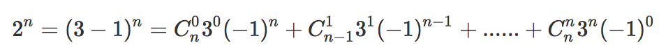
</div>

所以, 

* 1.n为偶数时既是2的幂也是4的幂，此时`(-1)^n==1`所以`(2^n - 1）% 3==0`;
* 2.n为奇数是只是2的幂但不是4的幂, 此时`(-1)^n=-1`所以`(2^n - 1）% 3==1`；

故可以用`(2^n-1）% 3`是否等于0来等价判断思路一的条件2, 将2的幂和4的幂区分开。
# C++
## 思路一
``` C++
class Solution {
public:
    bool isPowerOfFour(int num) {
        int mask = 0b01010101010101010101010101010101;
        return num > 0 && (num & (num - 1)) == 0 && (num | mask) == mask;
    }
};
```
## 思路二
``` C++
class Solution {
public:
    bool isPowerOfFour(int num) {
        return num > 0 && (num & (num - 1)) == 0 && (num - 1) % 3 == 0;
    }
};
```

# [343. Integer Break](https://leetcode.com/problems/integer-break/)

# 思路
把数n拆成多个数字的和，求这些数字的乘积的最大值。

## 思路一
这种有很多种拆分情况的题让人很容易想到动态规划，即数i的结果可以根据比i小的数的结果得出:
```
for j in [0, i):
   dp[i] = max(dp[i], max(j * (i - j), j * dp[i - j]));
```

## 思路二
此题还有一些需要数学知识的解法，这里只说一个我想到的而且没在讨论区见过的，更多此题的数学解法可见[讨论区](https://leetcode.com/problems/integer-break/discuss)

第一眼看到这个题目就感觉有高中数学题的影子:
```
若三个正数满足 x + y + z = 1, 求 xyz 的最大值。
```
答案就是三个数相等的时候。

所以我们可以把数n尽可能等分成2、3、4...份，然后计算这些情况中的最大乘积就可以了。
如何尽可能等分呢，如果想把n尽可能分成i份，则有`residue` 个等于`quotient + 1`, 其余等于`quotient`，其中`quotient = n / i; residue = n % i;`

# C++
## 思路一
``` C++
class Solution {
public:
    int integerBreak(int n) {
        vector<int> dp(n + 1, 1);
        for (int i = 3; i <= n; ++i) {
            for (int j = 1; j < i; ++j) {
                dp[i] = max(dp[i], max(j * (i - j), j * dp[i - j]));
            }
        }
        return dp[n];
    }
};
```

## 思路二
``` C++
class Solution {
public:
    int integerBreak(int n) {
        int res = 0, quotient, residue;
        bool flag = true;
        for(int i = 2; i <= n; i++){
            quotient = n / i;
            residue = n % i;
            
            // i个数中, 有residue个等于 quotient + 1, 其余等于quotient
            int cur = pow(quotient + 1, residue) * pow(quotient, i - residue);            
            if(cur > res) res = cur;
            // else break; // 这里可以其实提前跳出
        }
        return res;
    }
};
```

# [344. Reverse String](https://leetcode.com/problems/reverse-string/description/)
# 思路
翻转字符串。   
注意：交换元素时，最好用标准库里的swap，快一些。
# C++
```C++
class Solution {
public:
    string reverseString(string s) {
        int low = 0, high = s.size() - 1;
        while(low < high){
            swap(s[low++], s[high--]); // 库里的swap比自己写的要快一些
        }
        return s;
        
    }
};
```

# [345. Reverse Vowels of a String](https://leetcode.com/problems/reverse-vowels-of-a-string/description/)
# 思路
翻转字符串中的元音字母，即A、E、I、O、U、a、e、i、o、u。常规题  
# C++
```C++
class Solution {
private:
    bool isVowel(char c){
        if('A' <= c && c <= 'Z') c = c - 'A' + 'a';
        if(c == 'a' || c == 'e' || c == 'i' || c == 'o' || c == 'u') return true;
        return false;
    }
public:
    string reverseVowels(string s) {
        int low = 0, high = s.size() - 1;
        while(low < high){
            while(low < high && !isVowel(s[low])) low++;
            while(low < high && !isVowel(s[high])) high--;
            if(low < high) swap(s[low++], s[high--]);
        }
        return s;
    }
};
```

# [347. Top K Frequent Elements](https://leetcode.com/problems/top-k-frequent-elements/)

# 思路

要求数组里面出现频次最高的k个数。如果我们遍历一遍数组把每个数频次都用hash记录下来，那这题就和和[215. 数组中第k大的数](https://leetcode.com/problems/kth-largest-element-in-an-array/)是差不多的，
即用快排划分或者堆的思想，请参见[215题解](https://github.com/ShusenTang/LeetCode/blob/master/solutions/215.%20Kth%20Largest%20Element%20in%20an%20Array.md)。

## 思路一、堆

这里求的是频率最高的k个数，所以我们用最小堆，从前往后先将k个频次入堆，堆size达到k后，需要判断：
* 若新来的频次比堆顶大，说明堆顶的频次应该被淘汰，并将新来的频次push进堆；
* 否则说明新来的频次不够大，那跳过即可。

注意堆的size始终是k，初始建堆复杂度O(k)，每次从堆顶删除元素和插入元素复杂度都是O(k)，有大约n次操作，所以时间复杂度为O(nlogk)；空间复杂度O(k)。

几个注意点：
* 也可以用最大堆，但是需要注意的是用最大堆要先把所有元素都加入堆，堆大小就为n，再不断pop出k个元素。由于堆大小为n级别，所以建堆复杂度为O(n)，总的时间复杂度为O(n + klogn)；空间复杂度O(n)。**当n很大时用最大堆是不好的，将耗费大量空间。**
* STL中堆用`priority_queue`实现，不过默认是最大堆，这里我们需要最小堆，需要传入`greater`类（而不是函数）。
* 代码实现中堆的元素是一个pair, 由于pair排序默认对first排序，所以first我们定义成频次，second定义成元素值。

时间复杂度O(nlogk)

## 思路二、快排划分

我们得到每个数的频次后，可以先计算出第k大的频次（记为time_k），这是可以利用快排划分的思想在平均O(n)的复杂度计算出来的。然后再判断每个数的频次是否大于等于time_k。

计算无序数组中第k大的数在STL中即`nth_element`，几个注意点：
* `nth_element`默认是从小到大排序，所以这里需要传入`greater<int>()`函数；
* `nth_element`没有返回值，它只是保证第n(从0开始)个元素是位于最终排序位置的。

时间复杂度平均为O(n)


## 思路三、桶排序

求数组中第k大的数时，如果数组的所有元素是固定范围的（有限的），那么就可以使用桶排序。

对于此题来说，频次数组中元素最大也不过于`nums.size()`，所以可以使用桶排序。
为此，我们可以开辟一个一维大小为`nums.size() + 1`的二维数组`buckets`，`buckets[i]`代表出现频次为i的所有数。代码就不给了很简单。

时间复杂度O(n)


## 思路一
``` C++
class Solution {
public:
    vector<int> topKFrequent(vector<int>& nums, int k) {
        unordered_map<int, int>count;
        for(int & num: nums) count[num]++;
        
        // pair<频次, num>, 因为对pair排序默认对first排序
        // greater表示用最小堆(不指定的话默认最大堆)
        priority_queue<pair<int, int>, vector<pair<int,int>>, 
                       greater<pair<int, int>> >min_heap;
        
        for(auto it = count.begin(); it != count.end(); it++){
            if(min_heap.size() == k && min_heap.top().first < it->second)
                min_heap.pop();
            if(min_heap.size() < k)
                min_heap.push({it -> second, it -> first});
            
            // min_heap.push({it -> second, it -> first});
            // if(min_heap.size() > k) min_heap.pop();
        }
        
        vector<int>res;
        while(!min_heap.empty()){
            res.push_back(min_heap.top().second);
            min_heap.pop();
        }
        //reverse(res.begin(), res.end()); // 题目好像没说要正序
        return res;
    }
};
```

## 思路二
``` C++
class Solution {
public:
    vector<int> topKFrequent(vector<int>& nums, int k) {
        unordered_map<int, int>count;
        for(int & num: nums) count[num]++;
        
        vector<int>times;
        for(auto it = count.begin(); it != count.end(); it++) 
            times.push_back(it -> second);
                
        nth_element(times.begin(), times.begin() + k - 1, times.end(), greater<int>());
        int time_k = times[k - 1];
                
        vector<int>res;
        for(auto it = count.begin(); it != count.end(); it++){
            if(it -> second >= time_k)
                res.push_back(it -> first);
        }
            
        return res;
    }
};
```

# [349. Intersection of Two Arrays](https://leetcode.com/problems/intersection-of-two-arrays/description/)
# 思路
题目欲求两个数组的交集，注意集合里元素都是唯一的。可以考虑将两个数组进行排序，再用两个指针分别遍历两个有序数组，合理更新指针即可获取两个数组的重复元素。
为了没有重复的元素，可以设置一个pre来记录上一个相同的元素是什么。   
时间复杂度O(nlogn)    
当然也可以用map来查看是否有相同元素。
# C++
```C++
class Solution {
public:
    vector<int> intersection(vector<int>& nums1, vector<int>& nums2) {
        sort(nums1.begin(), nums1.end());
        sort(nums2.begin(), nums2.end());
        vector<int>res;
        int p1 = 0, p2 = 0, pre;
        while(p1 < nums1.size() && p2 < nums2.size()){
            if(nums1[p1] < nums2[p2]) p1++;
            else if(nums1[p1] > nums2[p2]) p2++;
            else{
                if(res.empty() || pre != nums1[p1]){
                    res.push_back(nums1[p1]);
                    pre = nums1[p1];
                }
                p1++;
                p2++;
            }
        }
        return res;
    }
};
```

# [350. Intersection of Two Arrays II](https://leetcode.com/problems/intersection-of-two-arrays-ii/description/)
# 思路
基本同[349. Intersection of Two Arrays](https://leetcode.com/problems/intersection-of-two-arrays/description/), 只是题结果中可以出现重复元素，
则先对两个数组进行排序，然后再用两个指针遍历一遍数组，合理更新指针即可获得两个数组的相同元素。   
时间复杂度O(nlogn)
# C++
```C++
class Solution {
public:
    vector<int> intersect(vector<int>& nums1, vector<int>& nums2) {
        sort(nums1.begin(), nums1.end());
        sort(nums2.begin(), nums2.end());
        vector<int>res;
        int p1 = 0, p2 = 0;
        while(p1 < nums1.size() && p2 < nums2.size()){
            if(nums1[p1] < nums2[p2]) p1++;
            else if(nums1[p1] > nums2[p2]) p2++;
            else{
                res.push_back(nums1[p1]);
                p1++;
                p2++;
            }
        }
        return res;
    }
};
```

# [357. Count Numbers with Unique Digits](https://leetcode.com/problems/count-numbers-with-unique-digits/)

# 思路一

给定一个整数n，求范围[0,10^n]内有多少个各位上不均相同的数字，例如134这种。

这其实就是个数学题，我们考虑一下如何构造一个共i位且各位各不相同的数：
* 先从0-9这10个数字中选取i个数字;
* 再将选取的i个数字进行排列，需注意0不能排在最前面；

由高中数学排列组合知识知，从10个数选取i个再排列一共有A(10,i)种情况，再除去0排在前面的共A(9,i)，所以最后一共有 A(10,i) - A(9,i) = 9*A(9, i-1)。
> A(m, n) = m * (m-1) * ... * (m-n+1)

需要注意的是如果位数超过10那就没法组成每位都不相同的数了。

知道通项公式后，我们就可以根据n的大小，把[1, n]区间位数通过通项公式算出来累加起来即可。


如果没想到数学解法，本题也可以直接进行搜索。

# C++
``` C++
// 此代码还可优化, 算阶乘那里重复计算了
class Solution {
private:
    int helper(int n){
        if(n == 0) return 1;
        if(n > 10) return 0;
        int res = 9;
        for(int i = 9; i > 9 - n + 1; i--)
            res *= i;
        return res;
    }
public:
    int countNumbersWithUniqueDigits(int n) {
        int res = 0;
        for(int i = 0; i <= n; i++)
            res += helper(i);
        
        return res;
    }
};
```

# [365. Water and Jug Problem](https://leetcode.com/problems/water-and-jug-problem/)

# 思路
给定两个容量分别为 x 和 y 升但是没有刻度的量杯，问能不能量出z升水。

举个例子，若 x=4，y=3，z=2，能不能行呢？我们先将4升杯装满，然后将其倒入3升杯子里面，还剩下1升，再将3升杯子清空将4升杯子剩下的1升水倒入3升杯子里，
然后再将4升杯子装满，再往3升杯子里倒入2升后3升杯子就满了，4升杯子剩下的就是2升水。

这题其实是个数学题（或者叫脑筋急转弯题？），参考[讨论区](https://leetcode.com/problems/water-and-jug-problem/discuss/83720/Clear-Explanation-of-Why-Using-GCD)，
假设我们有一个容量无限的大杯子，有两个容量分别为x和y的杯子，这题相当于问我们通过用两个小杯子往大杯子里倒水和往出舀水，问能不能使大杯子中的水刚好为z升。转换成数学就是问
```
z = m * x + n * y
```
有没有解。其中m，n为舀水和倒水的次数，正数表示往里舀水，负数表示往外倒水，那么上面的例子可以写成: 2 = 2 * 4 + (-2) * 3。

那上式在什么条件下有解呢？根据[裴蜀定理](https://zh.wikipedia.org/wiki/%E8%B2%9D%E7%A5%96%E7%AD%89%E5%BC%8F)，当且仅当 z 是 x 和 y 的最大公约数（greatest common divisor, gcd）的倍数时有解。

我们可以用辗转相除法算出最大公约数`gcd(x, y)`，即
* 如果`y == 0`，`gcd(x, 0) = x`;
* 否则，`gcd(x, y)` = `gcd(y, x % y)`。

算出后，再判断z是不是其倍数即可，不过此题还有一个条件就是两个杯子的容量和不能小于z，即 `x+y >= z`。

# C++
``` C++
class Solution {
private:
    int gcd(int x, int y){
        return y == 0 ? x: gcd(y, x % y);
    }
public:
    bool canMeasureWater(int x, int y, int z) {
        return (z == 0) || (x + y >= z && z % gcd(x, y) == 0);
    }
};
```

# [367. Valid Perfect Square](https://leetcode.com/problems/valid-perfect-square/description/)
# 思路
题目要求判断一个数是否是一个某个数的平方。要求不能调用库里的sqrt函数。   
可以考虑二分搜索1到num/2范围的数mid, 判断mid的平方是否等于num。   
注意：如果直接计算`if(mid * mid == num)` 会存在溢出的情况，所以应该`if(num % mid == 0 && num / mid == mid)`。
# C++
```C++
class Solution {
public:
    bool isPerfectSquare(int num) {
        if(num == 1) return true;
        int low = 1, high = num / 2, mid;
        while(low <= high){
            mid = (low + high) / 2;
            if(num % mid == 0 && num / mid == mid) return true;
            if(mid <= num / mid) low = mid + 1;
            else high = mid - 1;
        }
        return false;
    }
};
```

# [368. Largest Divisible Subset](https://leetcode.com/problems/largest-divisible-subset/)
# 思路

给定一个全为正数的集合（集合内的元素是互不相等且无序的），要求返回一个子集，使得子集中任意两个元素都能整除。

由于考虑是否满足整除的时候需要先考虑两数的大小，比较麻烦，所以我们可以先对nums数组进行排序。
排序还有一个好处就是如果集合{x0, x2}（x0 < x2）是满足要求的集合，那么如果此时新来一个更大的元素x3，我们只需判断x3能否被x2整除，如果能就那x3加进去；
而不用再判断x3是否能被x0整除，因为x2能被x0整除，所以如果x3能被x2整除那么它肯定也能被x0整除。

可见上述过程可以用一个动归来建模，由于最后返回的是集合而不是集合大小，所以我们需要两个动归数组：
* `len[i]`表示以`nums[i]`结尾（即最大元素是`nums[i]`）的满足题意的最大集合的大小；
* `pre[i]`表示上述最大集合中排在`nums[i]`前面的元素（即次大的元素）是`nums[pre[i]]`。

`pre`数组是为了最后能够从结果集合的最后一个元素不断追踪回去得到整个集合。

转移方程类似求最长递增子序列的动归过程：
```
// 注意更新时要同时更新pre[i]
for all j < i and (nums[i] % nums[j] == 0):
    len[i] = max(len[i], len[j] + 1) 
```

题目返回的是全局的结果，所以我们需要两个全局变量分别表示`len[:]`的最大值及对应的下标。

排序复杂度是O(nlogn)，但是动归的时候是个两层循环，时间复杂度为O(n^2)，空间复杂度为O(n)。
由于这里求的是集合而不是集合大小，所以没法用滚动数组将空间优化到O(1)，至少开辟一个pre数组。

# C++
``` C++
class Solution {
public:
    vector<int> largestDivisibleSubset(vector<int>& nums) {
        if(nums.size() <= 1) return nums;
        
        sort(nums.begin(), nums.end());
        
        vector<int>len(nums.size(), 1);
        vector<int>pre(nums.size(), -1);
        
        int max_len = 0, max_i = -1;
        for(int i = 1; i < nums.size(); i++){
            for(int j = i - 1; j >= 0; j--){
                if(nums[i] % nums[j] == 0 && len[i] < len[j] + 1){
                    len[i] = len[j] + 1;
                    pre[i] = j;
                }
            }
            
            if(max_len < len[i]){
                max_len = len[i];
                max_i = i;
            } 
        }
        
        vector<int>res;
        while(max_i >= 0){
            res.push_back(nums[max_i]);
            max_i = pre[max_i];
        }
        return res;
    }
};
```

# [371. Sum of Two Integers](https://leetcode.com/problems/sum-of-two-integers/description/)
# 思路
求两个数的和，要求不能使用操作符+、-。   
我们知道计算机底层中的四则运算都是用门电路通过简单的逻辑操作实现的, 例如对于一位的二进制加法: 

|  a  |  b  | sum(和) | cin(进位) |
| :-: | :-: |   :-:  |     :-:   |
|  0  |  0  |    0   |      0    |
|  0  |  1  |    1   |      0    |
|  1  |  0  |    1   |      0    |
|  1  |  1  |    0   |      1    |

所以一位加法规则是: `sum = a ^ b, cin = a & b`.    
对于多位的加法，我们可以先分别求出sum和cin, 再用sum和左移一位的cin相加求出新的sum和cin, 循环直到cin为0.   

# C++
``` C++
class Solution {
public:
    int getSum(int a, int b) {
        int res = a ^ b, cin = a & b; // 异或操作'^': 相同为0不同为1
        while(cin != 0){
            a = cin << 1;
            b = res;
            res = a ^ b;
            cin = a & b;
        }
        return res;
    }
};
```

# [372. Super Pow](https://leetcode.com/problems/super-pow/)

# 思路
题目让实现一个超级pow函数，最后结果对1337取模。

先不考虑对1337取模的话实现pow函数是很简单的，就是一个二分的思想:

``` C++
int pow(int x, int y){ // x >=0, y >= 0
  if(y == 0) return 1;
  if(y == 1) return x;
  return pow(x, y/2) * pow(x, y - y/2);
}

```

由于此题的结果可能很大，需要对1337取模，所以我们在计算的过程中能对1377取模的地方就对1337取模:
``` C++
int pow(int x, int y){ // (x^y) % 1337
    if(y == 0) return 1;
    x %= 1337;
    if(y == 1) return x;
    return pow(x, y/2) * pow(x, y - y / 2) % 1337;
}
```

剩下就好写了，见下面完整代码。

# C++
``` C++
class Solution {
private:
    int pow(int x, int y){ // (x^y) % 1337
        if(y == 0) return 1;
        x %= 1337;
        if(y == 1) return x;
        return pow(x, y/2) * pow(x, y - y / 2) % 1337;
    }
public:
    int superPow(int a, vector<int>& b) {
        int res = 1;
        for(int i = 0; i < b.size(); i++)
            res = pow(res, 10) * pow(a, b[i]) % 1337;
        
        return res;
    }
};
```

# [373. Find K Pairs with Smallest Sums](https://leetcode.com/problems/find-k-pairs-with-smallest-sums/)

# 思路

给定两个有序数组，让我们从每个数组中任意取出一个数字来组成不同的数字对，返回前k个和最小的数字对。

直接的思路就是直接将所有pair排序，复杂度O(nlogn)，n为两个数组的平均长度；
因为只求前k个最小的，所以稍微改进一点的就是类似[347. Top K Frequent Elements](https://leetcode.com/problems/top-k-frequent-elements/)的思路，
利用堆复杂度O(nlogk)，利用快排复杂度O(n)，可参考[347题解](https://github.com/ShusenTang/LeetCode/blob/2adb057f3ff1faa2f7b02b360afc1e471b1fff7d/solutions/347.%20Top%20K%20Frequent%20Elements.md)。

上面的思路复杂度最小可至O(n)，但是都没有利用题目给的两个数组都是有序的这个条件，所以还有优化空间。
参考[讨论区](https://leetcode.com/problems/find-k-pairs-with-smallest-sums/discuss/84569/Java-9ms-heap-queue-solution-k-log(k))，
我们可以根据数组有序这个条件以O(klogk)的复杂度解此题。

由于数组都是有序的，所以和最小的pair只能是从
```
(nums1[0], nums2[0]), (nums1[1], nums2[0]), (nums1[2], nums2[0]).....(nums1[k-1], nums2[0])
```
这k个候选者中取
（这里我们暂时假设k不超过nums1的大小），假设就是(nums1[i], nums2[0])；那么下一个最小的pair该怎么选呢：应该是从刚刚剩下的k-1个候选者和
(nums1[i], nums2[1])这k个候选者中选最小的那个，假设就是(nums1[j], nums2[k])；那么再下一个最小的pair该怎么选呢：
应该是从刚刚剩下的k-1个候选者和(nums1[j], nums2[k+1])这k个候选者中选最小的那个, 以此类推直到选取了k个。
上述过程我们只需要维护一个大小为k的最小堆就可以了，建堆时间复杂度O(k)，然后有k次pop和push共O(klogk)，所以总的复杂度为O(klogk)。

上述思想的核心就是将所有的pair分成k类：第一个数为nums1[0]、第一个数为nums1[k]、......第一个数为nums1[k-1]；每一类又是一个从小到大排好序的队列。
我们每次只需要将这k个队的队头进行比较然后选取最小的那个就可以了，这有点类似多路归并排序的归并过程。

几个注意点：
* 自定义结构体如何使用`priority_queue`，有三种常见的写法，见代码。
* k有可能比较大以至于超过了所有pair数。

时间复杂度为O(klogk)，空间复杂度O(k)。

# C++
``` C++
struct mypair{
    int a, b, sum;
    int b_idx; // 在nums2中的idx
    
    mypair(const int a_, const int b_, const int b_idx_){
        a = a_; b = b_; b_idx = b_idx_;
        sum = a_ + b_;
    }
    
    // // 方法一 重载运算符<，写在结构体里面(注意后面必须加const修饰!!!)
    // // 后面必须加const修饰, 否则报错!!!
    // bool operator < (const mypair &p) const{
    //     return sum >= p.sum;
    // }
};

// // 方法二 重载运算符<，写在结构体外面
// bool operator < (const mypair &p1, const mypair &p2){
//      return p1.sum >= p2.sum;
// }

// 方法三 定义一个比较类, 重载operator()
struct cmp{
     bool operator () (const mypair &p1, const mypair &p2){
         return p1.sum >= p2.sum;
    }
};

class Solution {
public:
    vector<vector<int>> kSmallestPairs(vector<int>& nums1, vector<int>& nums2, int k) {
        int size1 = nums1.size(), size2 = nums2.size();
        int p1 = 0, p2 = 0;
        k = min(k, size1 * size2); // k有可能比较大以至于超过了所有pair数
        // priority_queue<mypair>min_heap; // 方法一、二
        priority_queue<mypair, vector<mypair>, cmp>min_heap; // 方法三
        
        for(int i = 0; i < size1 && i < k; i++)
            min_heap.push(mypair(nums1[i], nums2[0], 0));
        
        vector<vector<int>>res;
        while(k--){
            mypair tmp = min_heap.top(); min_heap.pop();
            res.push_back({tmp.a, tmp.b});
            
            int next_b_idx = tmp.b_idx + 1;
            if(next_b_idx < size2) 
                min_heap.push(mypair(tmp.a, nums2[next_b_idx], next_b_idx));
        }
        return res;
    }
};
```


# [374. Guess Number Higher or Lower](https://leetcode.com/problems/guess-number-higher-or-lower/description/)
# 思路
二分法。   
注意计算mid的时候防止溢出，见代码。
# C++
```C++
// Forward declaration of guess API.
// @param num, your guess
// @return -1 if my number is lower, 1 if my number is higher, otherwise return 0
int guess(int num);

class Solution {
public:
    int guessNumber(int n) {
        int low = 1, high= n, mid;
        while(low <= high){
            mid = low + (high - low) / 2;  // 不用 mid = (low + high) / 2, 因为这样可能溢出
            if(guess(mid) == 0) return mid;
            else if(guess(mid) > 0) low = mid + 1;
            else high = mid - 1;
        }
    }
};
```

# [375. Guess Number Higher or Lower II](https://leetcode.com/problems/guess-number-higher-or-lower-ii/)

# 思路

猜数游戏，若猜的x且猜错了则需要付出x元钱，问需要多少钱能保证猜对。即最坏情况下，至少需要花多少钱才能猜对。
根据提示我们发现可以根据动态规划来做，而且是个区间dp，我们设
```
dp[i][j]为在[i, j]内做猜数游戏的话计算出的结果, 最后返回dp[1][n]
```
来考虑一下初始值，设想一下我们在[4,5]之间（那就只有4和5两个数了）做猜数游戏，最坏情况下至少需要花多少钱呢，很明显是4块钱，所以
```
初始值: dp[i][i+1] = i, dp[i][i] = 0
```
那么转移方程呢？先考虑一下如果在[i, j]内做猜数游戏，那么为了最后尽可能少花钱，那么我们第一次应该猜哪个数（设为k）呢？
我们可以穷举k属于[i+1, j-1]来看k取何值时会让最终总花费最少，即计算dp[i][j]的转移方程为
```
for all k in [i+1, j-1]:
  dp[i][j] = min(dp[i][j], k + max(dp[i][k-1], dp[k+1][j]));
```

由上面转移方程看出，**我们应该反向枚举i而正向枚举j**。

时间复杂度O(n^3), 空间复杂度O(n^2)。

本题时间复杂度可优化至O(n^2)，可参考[1](https://artofproblemsolving.com/community/c296841h1273742)和[2](https://blog.csdn.net/Site1997/article/details/100168676)。
亲测确实快一些，但是乍一看没怎么看懂，留个坑吧。

> 注意：此题很容易错误地认为二分就是最优，但其实不是。二分只能保证猜测次数最小，而不是最坏情况下花费的钱最少。例如n=5，若采用二分，那么最坏情况下花费是3+4=7；但是实际上应该是4+2=6。

# C++
``` C++
class Solution {
public:
    int getMoneyAmount(int n) {
        vector<vector<int>>dp(n+1, vector<int>(n+1, INT_MAX));
        
        for(int i = n; i >= 1; i--){
            dp[i-1][i] = i-1; dp[i][i] = 0;
            for(int j = i+2; j <= n; j++)
                for(int k = i+1; k < j; k++)                    
                    dp[i][j] = min(dp[i][j], k + max(dp[i][k-1], dp[k+1][j]));
        }
        
        return dp[1][n];
    }
};
```


# [376. Wiggle Subsequence](https://leetcode.com/problems/wiggle-subsequence/)

# 思路
给定一个数组，要求最长摆动子序列的长度。为了表述方便，我们将摆动数组分成两类:
1. 第一类，最后一个元素为较小值，例如243和3243这种；
2. 第二类，最后一个元素为较大值，例如24和324这种；

## 思路一

很明显应该应dp，我们可以定义两个状态数组dp0和dp1:
```
dp0[i]: 以nums[i]结束且为第一类的最大长度。
dp1[i]: 以nums[i]结束且为第二类的最大长度。
```
如何更新 `dp0[i]` 和 `dp1[i]`，我们可以从i往前看，根据`nums[j]`（j < i）与`nums[i]`的大小关系来更新`dp0[i]` 和 `dp1[i]`。

这种动归思路是最好想的，但是由于有两个循环，时间复杂度没有达到题目要求。

时间复杂度O(n^2), 空间复杂度O(n)。

## 思路二

同样用递归，同样定义两个状态数组dp0和dp1，只是此时状态定义与思路一不一样了:
```
dp0[i]: 直到nums[i]为止且为第一类的最大长度。
dp1[i]: 直到nums[i]为止且为第二类的最大长度。
```

那么如何更新 `dp0[i]` 和 `dp1[i]`呢？为了表述方便，先来定义两个量a和b：
1. 设直到nums[i-1]为止且为第一类的最长摆动数组的last元素（可能是nums[i-1]也可能不是）为a，则有`a <= nums[i-1]`;
2. 设直到nums[i-1]为止且为第二类的最长摆动数组的last元素（可能是nums[i-1]也可能不是）为b，则有`b >= nums[i-1]`;

现在再来看如何更新dp值， 有三种情况:
1. `nums[i] == nums[i-1]`，那么很明显`dp0[i] = dp0[i-1]; dp1[i] = dp1[i-1];`
2. `nums[i] < nums[i-1]`，则有`nums[i] < nums[i-1] <= b`，所以`dp0[i] = dp1[i-1] + 1`而`dp1[i] = dp1[i-1];`
3. `nums[i] > nums[i-1]`，则有`nums[i] > nums[i-1] >= a`，所以`dp1[i] = dp0[i-1] + 1`而`dp0[i] = dp0[i-1];`

所以我们只需要一遍遍历即可求解。

时间复杂度O(n)，空间复杂度O(n)，可用常用的滚动数组方法将空间复杂度优化至O(1)。


# C++

## 思路一
``` C++
class Solution {
public:
    int wiggleMaxLength(vector<int>& nums) {
        if(nums.empty()) return 0;
        vector<int>dp0(nums.size(), 1), dp1(nums.size(), 1);
        
        int res = 1;
        for(int i = 1; i < nums.size(); i++){
            int max_0 = 1, max_1 = 1;
            for(int j = 0; j < i; j++){
                if(nums[i] < nums[j]) max_0 = max(max_0, 1 + dp1[j]);
                else if(nums[i] > nums[j]) max_1 = max(max_1, 1 + dp0[j]);
            }
            dp0[i] = max_0;
            dp1[i] = max_1;
            res = max(res, max(max_0, max_1));
        }
        return res;
    }
};
```

## 思路二
``` C++
class Solution {
public:
    int wiggleMaxLength(vector<int>& nums) {
        if(nums.empty()) return 0;
        vector<int>dp0(nums.size(), 1), dp1(nums.size(), 1);
        
        for(int i = 1; i < nums.size(); i++){
            dp0[i] = dp0[i-1]; dp1[i] = dp1[i-1];
            if(nums[i] < nums[i-1]) dp0[i] = 1 + dp1[i-1];
            else if(nums[i] > nums[i-1]) dp1[i] = 1 + dp0[i-1];
        }
        return max(dp0.back(), dp1.back());
    }
};
```

## 思路二空间优化
``` C++
class Solution {
public:
    int wiggleMaxLength(vector<int>& nums) {
        if(nums.empty()) return 0;
        int dp0 = 1, dp1 = 1;
        
        for(int i = 1; i < nums.size(); i++){
            if(nums[i] < nums[i-1]) dp0 = 1 + dp1;
            else if(nums[i] > nums[i-1]) dp1 = 1 + dp0;
        }
        return max(dp0, dp1);
    }
};
```

# [377. Combination Sum IV](https://leetcode.com/problems/combination-sum-iv/)

# 思路

给定一个元素各不相同的数组和一个整数target，从数组从选取（可重复选）若干个数使和为target，问有多少种选法，注意一个排列就算一种选法，例如[1,2]和[2,1]是两种选法。

由于要求选法数，所以很容易想到用动态规划来求解，设
```
dp[i]表示target为i时的选法数(初始为0), dp[0] = 1
```
即dp[target]为所求。

转态转移方程也很简单，就是每次都遍历一遍给定的数组nums然后不断累加:
```
for all num in nums:
    dp[i] += dp[i - num];
```

所以时间复杂度为O(n*target)，空间复杂度为O(target)。

> 注意此题每个排列就算一种选法，例如[1,2]和[2,1]是两种选法，如果只算一次话那就是一个完全背包问题，可参考[我的博客-动态规划之背包问题系列](https://tangshusen.me/2019/11/24/knapsack-problem/)。

# C++
``` C++
class Solution {
public:
    int combinationSum4(vector<int>& nums, int target) {
        int n = nums.size();
        vector<int>dp(target+1, 0);
        dp[0] = 1;
        for(int i = 1; i <= target; i++){
            for(int &num: nums){
                if(i >= num){
                    // 防止超过INT_MAX溢出
                    if(dp[i] <= INT_MAX - dp[i - num])
                        dp[i] += dp[i - num];
                    else dp[i] = INT_MAX;
                }                                        
            }
        }
        return dp[target];
    }
};
```

# [378. Kth Smallest Element in a Sorted Matrix](https://leetcode.com/problems/kth-smallest-element-in-a-sorted-matrix/)

# 思路
这道题让我们求各行各列分别有序的矩阵中第K小的元素。难点在于矩阵只是局部（各行或各列）有序，整体可能是无序的。

由于是有序的，所以很容易想到可以用二分查找解此题。由于一般的二分都是对数组的下标二分，所以很容易陷入这个定势思维中去。

这里我们需要对元素二分而不是元素的下标二分: 
我们很容易知道整个矩阵的最大值high和最小值low分别是右下角和左上角元素，所以最终的结果就是在区间[low, high]内。
设`mid = (low+high)/2`，那么该如何更新low和high呢？我们可以计算有多少个（设为count）数小于等于mid，那么
* 若`count < k`，说明不到k个数小于等于mid，即最终结果肯定大于mid，所以更新`low = mid + 1`；
* 否则，说明至少k个数小于等于mid，即最终结果肯定不大于mid，所以更新`high = mid`（**注意这里没有减一**）。

所以问题的关键就在于如何计算有多少个数小于等于mid，分为两个思路。

## 思路一

我们一行一行（或者一列一列）地遍历矩阵，计算每一行有多少个数小于mid，最后累加起来就可以了。
对于每一行，因为是有序的，所以我们可以用二分查找的思路计算有多少个数小于mid，可直接使用STL中的`upper_bound`函数：
* `upper_bound(first, last, val)`返回有序数组或容器的`[first, last)`范围内第一个大于val的元素的位置(指针或者迭代器);
> 而`lower_bound(first, last, val)`返回有序数组或容器的`[first, last)`范围内第一个大于或等于val的元素的位置;

总的时间复杂度即O(nlogn * logM)，其中M等于最大值与最小值的差值。

## 思路二

思路一只利用了行有序（或只利用了列有序），所以还有优化的空间。

我们从左下角出发（或者从右上角出发，类似），
* 若当前值（设下标为i,j）小于等于mid，因为当前值正上方的值更小些，所以累加上这些值的个数`count += (i+1)`，然后往右移（j++）进入下一循环；
* 否则，即当前值大于mid，那我们只需上移（i--）即可。

由于我们只会右移或者上移，所以移动步数为2n，即线性复杂度。所以总的时间复杂度为O(n * logM)，其中M等于最大值与最小值的差值。

# C++
## 思路一
``` C++
class Solution {
private:
    // 记录有多少数小于等于target
    int Count_No_Greater(const vector<vector<int>>& matrix, int target){
        int n = matrix.size(), count = 0;
        for(int i = 0; i < n; i++)
            count += upper_bound(matrix[i].begin(), 
                                 matrix[i].end(), target) - matrix[i].begin();
        return count;
    }
public:
    int kthSmallest(vector<vector<int>>& matrix, int k) {
        int n = matrix.size();
        int low = matrix[0][0], high = matrix.back().back();
        
        while(low < high){
            int mid = (high - low) / 2 + low;
            // count记录有多少数小于等于mid
            int count = Count_No_Greater(matrix, mid);
            if(count < k) low = mid + 1; // 不到k个数小于等于mid
            else high = mid; // 至少k个数小于等于mid
        }
        return low;
    }
};
```

## 思路二
仅`Count_No_Greater`函数与思路一不同
``` C++
// 记录有多少数小于等于target
int Count_No_Greater(const vector<vector<int>>& matrix, int target){
    int n = matrix.size(), count = 0;
    int i = n - 1, j = 0;
    while(i >= 0 && j < n){
        if(matrix[i][j] > target) i--;
        else{
            count += (i + 1);
            j++;
        }
    }
    return count;
}
```

# [380. Insert Delete GetRandom O(1)](https://leetcode.com/problems/insert-delete-getrandom-o1/)

# 思路

要求设计一个集合类，要在O(1)时间内插入、删除以及随机返回一个元素。
如果不考虑随机返回一个元素的话，那么这个类就是`unordered_set`，它可以在常数时间复杂度进行插入和删除。

现在要考虑在常数时间返回一个随机元素，即要考虑以常数时间根据索引取值，满足这个特性的只有数组。所以我们以用`unordered_map`记录元素到数组索引的映射，
这样就可以在常数时间返回一个随机元素。不过为了以常数时间复杂度进行删除操作，需要变通一下：将待删除的元素和数组末元素交换一下，然后删除末尾元素。

> `rand()`产生0到RAND_MAX之间的随机数，在头文件stdlib.h内。

# C++
``` C++
class RandomizedSet {
private:
    vector<int>data;
    unordered_map<int, int>idx_map;

public:
    /** Initialize your data structure here. */
    RandomizedSet() {}
    
    /** Inserts a value to the set. Returns true if the set did not already contain the specified element. */
    bool insert(int val) {
        if(idx_map.count(val)) return false;
        idx_map[val] = data.size();
        data.push_back(val);
        return true;
    }
    
    /** Removes a value from the set. Returns true if the set contained the specified element. */
    bool remove(int val) {
        if(!idx_map.count(val)) return false;
        
        int idx = idx_map[val];
        data[idx] = data.back();
        idx_map[data.back()] = idx;
        
        idx_map.erase(val);
        data.pop_back();
        return true;
    }
    
    /** Get a random element from the set. */
    int getRandom() {
        return data[rand() % data.size()];
    }
};
```

# [381. Insert Delete GetRandom O(1) - Duplicates allowed](https://leetcode.com/problems/insert-delete-getrandom-o1-duplicates-allowed/)

# 思路
此题是[380. Insert Delete GetRandom O(1)](https://leetcode.com/problems/insert-delete-getrandom-o1/)的升级版，可参见[380题解](https://github.com/ShusenTang/LeetCode/blob/master/solutions/380.%20Insert%20Delete%20GetRandom%20O(1).md)。

此题与380不同的是380不能有重复数字，而这道题可以有，那么就不能像380那样建立每个数字和其坐标的映射了，因为同一个可能有多个坐标。
虽然不能索引到坐标，但我们可以索引到存放坐标的容器呀，用什么容器呢，一开始我想到vector, 但是在实现后面删除操作的时候没法O(1)，所以只好用`unordered_set`。

其他的就和380思路大致差不多了，比如为了O(1)删除，需要变通一下：将待删除的元素和数组末元素交换一下，然后删除末尾元素。


# C++
``` C++
class RandomizedCollection {
private:
    vector<int>data;
    unordered_map<int, unordered_set<int>>idx_map;
public:
    /** Initialize your data structure here. */
    RandomizedCollection() { }
    
    /** Inserts a value to the collection. Returns true if the collection did not already contain the specified element. */
    bool insert(int val) {
        // if(!idx_map.count(val))
        //    idx_map[val] = unordered_set<int>();
     
        idx_map[val].insert(data.size());   
        data.push_back(val);
        return idx_map[val].size() == 1;
    }
    
    /** Removes a value from the collection. Returns true if the collection contained the specified element. */
    bool remove(int val) {
        if(!idx_map.count(val) || idx_map[val].empty()) return false;
        
        int idx = *idx_map[val].begin();
        
        if(data[idx] != data.back()){ // 一定要加这个条件
            data[idx] = data.back();
            idx_map[data.back()].insert(idx);
            idx_map[data.back()].erase(data.size() - 1);
        }
        
        idx_map[val].erase(idx);
        data.pop_back();
        return true;
    }
    
    /** Get a random element from the collection. */
    int getRandom() {
        return data[rand() % data.size()];
    }
};
```


# [382. Linked List Random Node](https://leetcode.com/problems/linked-list-random-node/)

# 思路
给定一个链表，让随机返回一个节点，最直接的方法就是先统计出链表的长度，然后根据长度随机生成一个位置，然后从开头遍历到这个位置即可。
最直接的思路需要两次遍历链表，此题其实是著名的[蓄水池采样（Reservoir Sampling）](https://zh.wikipedia.org/wiki/%E6%B0%B4%E5%A1%98%E6%8A%BD%E6%A8%A3)算法要解决的问题（[398题](https://leetcode.com/problems/random-pick-index/)也是用此算法），只需要一次遍历。下面介绍这个算法。

从一个群体中随机抽样出k个个体是经常会遇到的抽样问题，当事先不知道群体大小时，我可以先遍历一次数据计算出数据量N, 然后再按照上述的方法进行采样即可。
这当然可以，但是并不好，因为有时候数据只有一次访问的机会，或者很难确定数据规模有多大，例如当内存无法加载全部数据时，如何从包含未知大小的数据流中随机选取k个数据，并且要保证每个数据被抽取到的概率相等。

假设需要从数据流采样的数量的为k，蓄水池采样算法的过程如下：
1. 首先构建一个可容纳k个元素的数组（形象地理解为蓄水池)，先将数据流的前k个元素放入数组中；
2. 然后遍历到第 k+i 个元素时，以 `k/(k+i)` 的概率被替换进数组中（原数组中的元素被替换的概率是相同的, 都是 `1/k`）。 

当遍历完所有元素之后，数组中存放的k元素即为所采的样本。

证明如下：

遍历到第 k+i 个元素时，水池数组中的元素保留下来的概率 = 1 - `p(第k+i个元素要替换进数组)`x`p(替换掉数组中这个元素)` = 1 - `k/(k+i)`x`1/k` = (k+i-1)/(k+i)。
所以

1. 数据流前k个元素到最后还在水池中的概率是: `k/(k+1)` x `(k+1)/(k+2)` x ... x `(n-1)/n` = `k/n`。

数据流第 k+i 个元素要想最后在水池中，那么遍历到它时它要被替换进水池中（概率=`k/(k+i)`）而且后面一直不被替换掉，所以

2. 数据流第 k+i 个元素到最后在水池中的概率是: `k/(k+i)` x `(k+i)/(k+i+1)` x ... x `(n-1)/n` = `k/n`。

综合上面两个结论可知，数据流中所有元素最后留在水池中的概率均为`k/n`，得证。

此题是蓄水池抽样算法的特殊情况：k=1。有了上面的分析就不难写出代码了。

# C++
``` C++
class Solution {
private:
    ListNode *root;
public:
    /** @param head The linked list's head.
        Note that the head is guaranteed to be not null, so it contains at least one node. */
    Solution(ListNode* head) {
        root = head;
    }
    
    /** Returns a random node's value. */
    int getRandom() {
        ListNode *p = root;
        int res = -1;
        
        int count = 1;
        while(p){
            if(rand() % count == 0) res = p -> val;
            p = p -> next; count++;
        }
        
        return res;
    }
};

```


# [383. Ransom Note](https://leetcode.com/problems/ransom-note/description/)
# 思路
用一个大小为26的数组count记录magazine中26个字母的出现次数，只要每个字母出现次数不小于ransomNote对应字母次数就行了。
# C++
```C++
class Solution {
public:
    bool canConstruct(string ransomNote, string magazine) {
        vector<int>count(26);
        for(char c: magazine) count[c - 'a']++;
        for(char c: ransomNote)
            if(0 > --count[c - 'a']) return false;
        return true;
    }
};
```

# [384. Shuffle an Array](https://leetcode.com/problems/shuffle-an-array/)

# 思路
给定一个没有重复元素数组，将其随机打乱，即洗牌。

## 思路一、暴力（Fisher–Yates Shuffle）
先看最暴力的解法，想象一下我们先将所有牌放到一个黑箱里面，然后不断从中不放回地随机抽取一张，这样最后得到的就是洗好的牌。

实现上我们可以用一个循环，第一循环时从整个数组中随机选一个元素然后将这个元素从数组中删掉；第二次循环再从中选出一个元素.....。

因为一共进行了n次循环，每次将数组中的元素删除是线性复杂度的，所以时间复杂度O(n^2)，空间复杂度O(n)。

## 思路二、Knuth-Durstenfeld Shuffle

思路一每次循环的删除操作是线性复杂度的，可以优化至常数复杂度：我们每次将要删除的元素和最末尾的元素交换，然后删除末尾元素（其实不用删除，记录一下就是）。

优化后的暴力法就是Knuth-Durstenfeld洗牌算法了：在每次迭代中，生成一个范围在当前下标到数组末尾元素下标之间的随机下标。
接下来，将当前元素和随机选出的下标所指的元素互相交换（这一步模拟了每次从黑箱里面摸一张牌的过程），这样每次被随机选中的元素都不会再被选中（相当于已经删除了）。

> 注意：当前元素是可以和它本身互相交换的。

可见 Knuth-Durstenfeld是一个in-place算法，原始数据被直接打乱，这也是Python中`random.shuffle(list)`所采用的方法。

时间复杂度O(n)，空间复杂度为O(1)


## 思路三、Inside-Out 算法

思路二将原始数据直接打乱，且原数组大小是已知的，所以无法处理暂时不知道长度或动态增长的数组。Inside-Out 算法就是来解决这个问题。

Inside-Out算法的基本思想是：前向后扫描原始数据的拷贝（当前时刻只会用前i个数，所以**可以应对数组大小暂时未知，或者说原数组是一个动态增加的情况**），设扫描到了位置 i，此时`nums_copy[0,...,i-1]`已经是打乱的了，而`nums_copy[i,i+1,...]`还是原始顺序，我们在[0, i]之间随机选择一个下标j，然后交换第i个第j个数:`swap(nums_copy[i], nums_copy[j])`。

证明：
* 原数组中 i 位置元素在新数组的 k (k <= i) 位置的概率都是：`1/(i+1) * [(i+1)/(i+2) * (i+2)/(i+3) ... (n-1)/n] = 1/n`（即在第i次刚好随机选择了与k位置交换，且在后面的n-i-1次选择中都不被选中）；
* 原数组中 i 位置元素在新数组的 k (k > i) 位置的概率都是：`1/(k+1) * [(k+1)/(k+2)] * [(k+2)/(k+3)]...[(n-1)/n] = 1/n`（即在第k次刚好随机选择了与i位置交换，在后面的n-k-1次选择中都不被选中）。

时间复杂度O(n)，空间复杂度O(n)

# C++
## 思路二
``` C++
class Solution {
private:
    vector<int>nums_origin;
    vector<int>nums_shuffle;
    int size;
public:
    Solution(vector<int>& nums) {
        nums_origin = nums;
        nums_shuffle = nums;
        size = nums.size();
    }
    
    /** Resets the array to its original configuration and return it. */
    vector<int> reset() {
        return nums_origin;
    }
   
    vector<int> shuffle() {
        // 反向迭代
        for(int i = size - 1; i >= 0; i--)
            swap(nums_shuffle[i], nums_shuffle[rand() % (i + 1)]);
        // 正向迭代
        // for(int i = 0; i < size; i++){
        //     int rand_idx = rand() % (size - i) + i;
        //     swap(nums_shuffle[i], nums_shuffle[rand_idx]);
        // }
        return nums_shuffle;
    }
};
```

## 思路三

``` C++
lass Solution {
private:
    vector<int>nums_origin;
    vector<int>nums_shuffle;
    int size;
public:
    Solution(vector<int>& nums) {
        nums_origin = nums;
        nums_shuffle = nums;
        size = nums.size();
    }
    
    /** Resets the array to its original configuration and return it. */
    vector<int> reset() {
        return nums_origin;
    }
    
    vector<int> shuffle() {
        for(int i = 0; i < size; i++){
            int j = rand() % (i + 1);
            nums_shuffle[i] = nums_shuffle[j];
            nums_shuffle[j] = nums_origin[i];
        }
        return nums_shuffle;
    }
};
```

# [385. Mini Parser](https://leetcode.com/problems/mini-parser/)

# 思路
题目要求实现一个迷你解析器用来把一个字符串解析成一个嵌套整数类。根据这个嵌套整数类的定义，我们可以用递归来做。

* 递归出口：字符串s就代表一个整数，那么直接返回即可。
* 否则，即s以'['开头，那么他就是一个列表，我们应该从前往后遍历s然后递归调用下去。这个过程中，我们用两个指针l和r来表示子串的边界；
另外要注意用一个计数器count来记录遇到的括号以保证括号是配对的，每当遇到'['就count++，每当遇到']'就count--。只有当count=0时l和r之间的子串才是合法的。

# C++
``` C++
class Solution {
public:
    NestedInteger deserialize(string s) {
        if(s[0] != '[') return NestedInteger(stoi(s));
        
        NestedInteger res;
        int l = 1, r = 1, count = 0;
        while(r < s.size()){
            if(s[r] == '[') count++;
            else if(s[r] == ']') count--;
            
            if((s[r] == ',' && count == 0) || r == s.size() - 1){
                if(l < r) res.add(deserialize(s.substr(l, r-l)));
                l = r + 1;
            }
            r++;
        }
        return res;        
    }
};
```

# [386. Lexicographical Numbers](https://leetcode.com/problems/lexicographical-numbers/)

# 思路

题目给定一个n，要求将1~n所有数字按照字典序排序。

暴力解法就是用STL的sort函数，然后自定义cmp函数，此时时间复杂度为O(nlogn)。但很明显我们可以直接从前往后按照字典序写出来，所以时间复杂度可以是线性的。

## 思路一、递归
想象一下我们该怎样按照字典序将结果写出来，假设n = 119：
```
初始时为1到9           : 1                                                       2         3 ...  9
在上一层每个数后面添加0-9:   10                  11                 12  13 ... 19    20...29   ...    90...99
在上一层每个数后面添加0-9:       100,101,...,109    110,111,...,119 

最终得到的数组          : 1 10 100 101 ...   
```

所以这可以用递归实现，大致思路就是每次将一个数push进结果数组中后都要不断尝试在其后添0-9，详见代码。

时间复杂度O(n)

## 思路二、迭代
也可将上述过程写成迭代的形式，用一个1到n的for循环，用cur表示当前应该填入res[i]的值，初始为1。关键在于如何更新cur:
* 如果cur后面添加一个0后没有超过n, 那么在cur后面添加一个0再进入下一循环即可；
* 否则
  * 如果cur本身就不小于n了，那么应该先将其除10（在上图相当于回到上一层，例如119 -> 11）；
  * 将cur加1，如果加1后产生了很多0（即遇到了进位，如109 -> 110），则应该不断除0直到末尾不是0。
  
时间复杂度O(n)，空间复杂度O(n)

# C++
## 思路一
``` C++
class Solution {
private:
    void helper(int num, int n, vector<int> &res){
        res.push_back(num);
        // 在后面分别添加0-9然后进入递归
        for(int i = 0; i < 10; i++){
            int tmp = num*10 + i;
            if(tmp > n) return;
            helper(tmp, n, res);
        }
    }
public:
    vector<int> lexicalOrder(int n) {
        vector<int>res;
        // 初始时为1到9
        for(int i = 1; i <= min(9, n); i++)
            helper(i, n, res);
        
        return res;
    }
};
```

## 思路二
``` C++
class Solution {
public:
    vector<int> lexicalOrder(int n) {
        vector<int> res(n);
        int cur = 1;
        for (int i = 0; i < n; ++i) {
            res[i] = cur;
            if (cur * 10 <= n) {
                cur *= 10;
            } else {
                if (cur >= n) cur /= 10;
                cur += 1;
                while (cur % 10 == 0) cur /= 10;
            }
        }
        return res;
    }
};
```

# [387. First Unique Character in a String](https://leetcode.com/problems/first-unique-character-in-a-string/description/)
# 思路
先遍历一遍字符串，记录每个字符出现的次数，再遍历一遍找出第一个没有重复的字符。   
由于题目说了全部字符都是小写字母，所以开辟一个大小为26的数组记录字符出现次数即可。   
时间复杂度O(n)   
# C++
```C++
class Solution {
public:
    int firstUniqChar(string s) {
        vector<int>count(26, 0);
        for(int i = 0; i < s.size(); i++) count[s[i] - 'a']++;
        for(int i = 0; i < s.size(); i++) 
            if(count[s[i] - 'a'] == 1) return i;
        return -1;
    }
};
```

# [388. Longest Absolute File Path](https://leetcode.com/problems/longest-absolute-file-path/)
# 思路
这道题给了我们一个字符串，里面包含 \n 和 \t 这种表示回车和空格的特殊字符，让我们找到某一个最长的绝对文件路径。

我们可以从前往后遍历输入字符串，用一个数组记录每一层文件夹的绝对路径长度，用一个tag来标记是否是文件（一旦遇到了'.'就是文件），
用变量depth记录当前文件（夹）的层次（有多少'\t'就有多深）。


# C++
``` C++
class Solution {
public:
    int lengthLongestPath(string input) {
        int l = 0, r = 0, depth = 0, res = 0, input_size = input.size();
        vector<int>dir_lens;
        bool file_tag = false;
        while(r <= input_size){
            if(r == input_size || input[r] == '\n'){ //遇到换行符, 处理r之前的
                if(!file_tag){ // 是个dir
                    // 加1是因为 xxx/xxx/ 里面的斜杠
                    int tmp = 1 + r - l + (depth == 0 ? 0: dir_lens[depth - 1]);
                    if(dir_lens.size() == depth) dir_lens.push_back(tmp);
                    else dir_lens[depth] = tmp;
                }
                else res = max(res, r - l + (depth == 0 ? 0: dir_lens[depth - 1]));
                
                depth = 0; file_tag = false; // 初始化
                while(r + 1 < input_size && input[r+1] == '\t') {
                    r += 1;
                    depth += 1; // 有多少'\t'就有多深
                }
                
                l = r + 1;
            }
            else if(r < input_size && input[r] == '.') file_tag = true;

            r++;
        }
        
        return res;
    }
};
```

# [389. Find the Difference](https://leetcode.com/problems/find-the-difference/description/)
# 思路
分别记录两个字符串中每个字符的出现次数，最后比较一下字符的出现次数，次数差1对应的字符即所求。   
因为全是小写字母，所以开辟一个大小为26的数组进行计数即可。另外，没必要开辟两个计数数组，用一个数组记录即可，对s中出现的字符进行次数累加，对t中出现的字符进行次数累减。
最后次数为-1的对应的字母即所求。   
时间复杂度O(n)， 空间复杂度O(1)
# C++
```C++
class Solution {
public:
    char findTheDifference(string s, string t) {
        vector<int>count(26, 0);
        for(int i = 0; i < s.size(); i++){
            count[s[i] - 'a']++;
            count[t[i] - 'a']--;
        }
        count[t[t.size() - 1] - 'a']--;
        for(int i = 0; i < 26; i++)
            if(count[i] == -1) return char(i + 'a');
    }
};
```

# [390. Elimination Game](https://leetcode.com/problems/elimination-game/)

# 思路
给定1,2,...,n，然后按照题目的规则不断删除一些数，求最后剩下的数。

## 思路一
我首先想到的就是按照题目的规则进行模拟，但不要纯暴力模拟，那样肯定超时，还是要根据其中一些规律。
有一个很容易发现的规律：每次剩下的数都是一个等差数列，而且等差分别为1、2、4...。
为此我们可以用一个循环，每次记录剩下的数的第一个数start和最后一个数end以及等差diff，不断循环直到 start = end 。

## 思路二
逛[评论区](https://leetcode.com/problems/elimination-game/discuss/87128/C-1-line-solution-with-explanation)还发现了一个代码很简洁的递归解法。

我们设
* `ML(n)`代表第一次是从左往后的情况下最终剩下的数，这就是要我们写的函数；
* `MR(n)`代表第一次是从右往左的情况下最终剩下的数；

注意我们第一次将所有奇数都删除了，将剩下所有偶数都除2就得到序列1,2,...,n/2。即我们有`ML(n) = 2 * MR(n/2)`。
又因为我们有`ML(n) + MR(n) = n + 1`（证明见[讨论区](https://leetcode.com/problems/elimination-game/discuss/87128/C-1-line-solution-with-explanation)），
所以`ML(n) = 2 * (n/2 + 1 - ML(n/2))`。根据这个公式我们就可以写出递归函数了，就一行。


# C++
## 思路一
``` C++
class Solution {
public:
    int lastRemaining(int n) {
        int start = 1, end = n, diff = 1;
        int i = 0; // i记录循环的次数
        while(start != end){
            if(!(i & 1)){ // 从前往后, start可直接写出
                start += diff; 
                diff <<= 1;
                end = (end - start) / diff * diff + start;
            }
            else{ // 从后往前, end可直接写出
                end -= diff;
                diff <<= 1;
                start = end - (end - start) / diff * diff;
            }
            
            i++;
        }
        return start;
    }
};
```

## 思路二
``` C++
class Solution {
public:
    int lastRemaining(int n) {
        return n == 1 ? 1 : 2 * (1 + n / 2 - lastRemaining(n / 2));  
    }
};
```

# [392. Is Subsequence](https://leetcode.com/problems/is-subsequence/)

# 思路
题目要求判断字符串s是否是字符串t的子序列。

## 思路一
这题是个easy题，基本思想确实很简单，我们可以用两个指针p1和p2分别作用于s和t。然后不断右移指针进行匹配。

时间复杂度O(n)，空间复杂度O(1)

## 思路二

题目还问如果有源源不断的s进来且每次t都是保持不变的，那么函数该如何优化。为了能快速定位某个字符在t中的位置，我们可以考虑有hash，
由于同一个字符可能在t中出现了多次，所以这个hash是字符到数组的映射。
对于s中的每个字符s[i]，假设s[i-1]对应t中匹配位置是pre，那么我们查找s[i]在t中出现的位置中第一个大于pre的位置，这可用二分查找upper_bound.


# C++
## 思路一
``` C++
class Solution {
public:
    bool isSubsequence(string s, string t) {
        int p1 = 0, p2 = 0;
        // if(s.size() > t.size()) return false;
        while(p1 < s.size() && p2 < t.size()){
            while(p2 < t.size() && t[p2] != s[p1]) p2++;
            p1++; p2++;
        }
        return (p1 == s.size() && p2 <= t.size());
    }
};
```

## 思路二
``` C++
class Solution {
public:
    bool isSubsequence(string s, string t) {
        unordered_map<char, vector<int>>mp;
        for(int i = 0; i < t.size(); i++) 
            mp[t[i]].push_back(i);
        
        int pre = -1;
        for(char &c: s){
            auto it = upper_bound(mp[c].begin(), mp[c].end(), pre);
            if(it == mp[c].end()) return false; // 查找失败
            pre = *it; // 更新pre
        }
        return true;
    }
};
```

# [393. UTF-8 Validation](https://leetcode.com/problems/utf-8-validation/)
# 思路

此题让我们验证给定的编码是否是合法的 UTF-8 编码。

此题感觉没啥好说的，按照题目进行验证即可，详见代码。

**需要注意的是题目给的是【单个字符】的UTF-8规则，而实际却让我们判断的是【字符序列】** 估计这也是为什么那么多人给此题倒赞吧....实属坑题

# C++
``` C++
class Solution {
private:
    int pre_1(int n){ // 计算有多少个前导1
        int mask = 128;
        int res = 0;
        while(mask & n){
            res++;
            mask >>= 1;
        }
        return res;
    }
public:
    bool validUtf8(vector<int>& data) {
        int i = 0;
        # define start_with_10(n) ((n & 0x000000c0) == 128)
        while(i < data.size()){
            int num_pre1 = pre_1(data[i]);
            if(!num_pre1) i++; 
            else{
                if(num_pre1 == 1 || num_pre1 > 4) return false;
                for(int j = 1; j < num_pre1; j++){
                    if(j + i == data.size() || !start_with_10(data[j+i]))
                        return false;
                }
                i += num_pre1;
            }
        }
        return true;   
    }
};
```

# [394. Decode String](https://leetcode.com/problems/decode-string/)

# 思路

给定一个编码后的字符串，根据规则对其解码。

## 思路一、递归
由题意知，由于`k[encoded_string]`中的`encoded_string`内部依然可能包含`k[encoded_string]`这种形式，所以我们可以用递归求解。
我们用res表示当前已经解码好的字符串，用两个指针`l`和`r`分别代表子串的左右边界，然后用`brackets_count`表示待配对的括号数，则有以下几种情况:
1. 如果`s[r] >= '0' && s[r] <= '9' && brackets_count == 0`: 说明此时`s.substr(l, r-l)`是一个普通的串，无需解码，
即`res += s.substr(l, r-l)`即可。由于此时`s[r]`是数字（即一个数的开头），所以我们还需用一个变量k记录这个数，留在下次用。
2. 否则，如果`s[r] == '['`，待配对的括号数加一个，即`brackets_count++`。
3. 否则，如果`s[r] == ']'`，待配对的括号数减一个，即`brackets_count--`。另外如果此时`brackets_count`等于0了，
说明此时`s.substr(l, r-l)`就是一个需要递归调用解码函数的子串，而且别忘了次数k，所以`res`加`k`次`decodeString(s.substr(l, r-l))`即可。
4. 否则，即普通字符，那么`r++`即可（注意上述三种情况最后也需要合理更新`l`和`r`）。


## 思路二、迭代

此题也可以用迭代的解法，用两个stack，stk1记录待每层的子串（层按括号划分），stk2记录次数k，我们用一个指针`i`从前往后遍历，
用`cur_str`记录当前层的字符串，
1. 当`s[i] >= '0' && s[i] <= '9'`，说明遇到了数字，这代表下一层子串将要重复的次数，我们需要将其入栈stk2;
2. 否则，若`s[i] == '['`，说明即将进入下一层，那么应该把当前层子串`cur_str`入栈stk1然后清空`cur_str`；
3. 否则，若`s[i] == ']'`，说明当前层结束，那么应该从stk1中pop出上层子串`pre_str`，从stk2中pop出当前层子串的重复次数k，然后将`pre_str`加上k次`cur_str`；由于现在是当前层结束，应回到上一层，所以更新`cur_str = pre_str`；
4. 否则，则仍处于当前层，`cur_str += s[i]`即可。

最后会回到最顶层，`cur_str`即结果。

# C++
## 思路一
``` C++
class Solution {
public:
    string decodeString(string s) {
        if(s.size() == 0) return "";
        string res = "";
        int l = 0, r = 0;
        int brackets_count = 0, k = -1;
        while(r < s.size()){
            if(s[r] >= '0' && s[r] <= '9' && !brackets_count){
                res += s.substr(l, r-l);
                l = r;
                while(r < s.size() && s[r] >= '0' && s[r] <= '9') r++;
                k = stoi(s.substr(l, r-l));
                l = r + 1;
                r -= 1; // 后面要加1所以这里先减去1
            }
            else if(s[r] == '[') brackets_count++;
            else if(s[r] == ']'){
                if(--brackets_count == 0){
                    while(k--)
                        res += decodeString(s.substr(l, r-l));
                    l = r + 1;
                }
            }
            r++;
        }
        return res + s.substr(l, r-l);
    }
};
```

## 思路二
``` C++
class Solution {
public:
    string decodeString(string s) {
        if(s.size() == 0) return "";
        stack<string>stk1;
        stack<int>stk2;
        
        int i = 0;
        string cur_str = ""; // 当前层的子串
        while(i < s.size()){
            if(s[i] >= '0' && s[i] <= '9'){
                int j = i;
                while(j < s.size() && s[j] >= '0' && s[j] <= '9') j++;
                stk2.push(stoi(s.substr(i, j-i)));
                i = j - 1; // 后面要加1所以这里先减去1
            }
            else if(s[i] == '['){ // 新的一层
                stk1.push(cur_str); // 将上一层入栈
                cur_str = ""; // 新的一层初始化
            }
            else if(s[i] == ']'){ // 当前层结束, 回到上一层
                string pre_str = stk1.top(); stk1.pop();
                int k = stk2.top(); stk2.pop();
                while(k--) pre_str += cur_str;
                cur_str = pre_str; // 回到上一层
            }
            else cur_str += s[i];
            
            i++;
        }
        return cur_str;
    }
};
```

# [395. Longest Substring with At Least K Repeating Characters](https://leetcode.com/problems/longest-substring-with-at-least-k-repeating-characters/)

# 思路
给定一个只包含小写字母的字符串s和整数k，求s的子串中满足子串中的字母出现次数都不少于k的子串的最大长度。

## 思路一、暴力
此题可以用暴力解法，但是直接暴力可能会超时，需要稍微改进一点。我们如何判断每个字母出现次数是否不小于k呢，
如果我们用一个长为26的数组cnt记录每个字母的出现次数，然后需要每次遍历一遍这个数组来判断是否满足提交，效率不高。
由于只可能是26个小写字母，所以我们新增一个32位整数mask来记录某个字母是否是满足条件的，
若某一位为0则对应字母是满足条件的（即要么没这个字母要么这个字母出现次数不小于k），所以我们只需判断整个mask是否为0就可以判断是否全部满足条件了。

具体来讲，我们用两层循环，第一层循环为子串的左边界start，第二层循环则是子串的右边界end。
每次进入第二层循环时都需要初始化数组cnt和mask，在第二层循环内部我们需要更新mask并判断mask是否为0，若是即可尝试更新结果。

时间复杂度O(n^2)，空间复杂度O(1)。

> **如果只有小（大）写字母，即只有26个字符，那么用一个32为整数来进行记录一些bool状态是很常见的思路。**

## 思路二、分治

此题可以考虑用分治法。那么要如何进行划分呢，由于要满足出现次数不小于k，我们可以考虑先统计每个字母的出现次数，
出现次数小于k的那些字母肯定不可能出现在合法子串中的，即可以将这些字母作为分界线对字符串s进行划分。递归出口就是每次字母出现次数都不小于k。

这应该是此题最好写的方法，亲测也是最快的（0ms）。

## 思路二、双指针

因为题目中限定了字符串中只有26个小写字母，所以最后满足题意的子串中的unique字母数一定是在范围[1, 26]内，
我们可以从1到26枚举unique字母数（记为cnt），对于每个cnt，维护一个窗口左右指针start和end，我们不断更新end和start，保持窗口内的子串的unique字符数（记为uniqueCnt）不超过cnt，
为此需要用一个大小为26的数组charCnt来记录窗口内每个字母的出现次数。

怎样更新start和end呢？我们让end不断加1更新，而start的更新需要视情况而定：
> 先判断end字符是否是一个全新的字符，若是那么需要让uniqueCnt加1，此时可能uniqueCnt超过cnt了，所以我们需要将start右移直到uniqueCnt不超过cnt。
每次更新好end和start后还需要判断窗口内每个字符串是否满足条件，若是应该尝试更新res。

外层循环固定26次，内存循环中end和start都是只可能往右不可能往左的，所以是线性复杂度的，所以总的时间复杂度也是线性的。

# C++
## 思路一
``` C++
class Solution {
public:
    int longestSubstring(string s, int k) {
        int start = 0, res = 0;
        for(int start = 0; start < s.size(); start++){
            int mask = 0; 
            vector<int>cnt(26, 0);
            for(int end = start; end < s.size(); end++){
                int c = s[end] - 'a';
                if(++cnt[c] >= k) mask &= (~(1 << c)); // 将对应位置0
                else mask |= (1 << c); // 将对应位置1
                
                if(!mask) res = max(res, end - start + 1);
            }
        }
        
        return res;
    }
};
```

## 思路二
``` C++
class Solution {
public:
    int longestSubstring(string s, int k) {
        int res = 0, n = s.size();
        
        vector<int>cnt(26, 0); // 统计每个字母的出现次数
        for(auto &c: s) cnt[c - 'a']++;
        
        int start = 0;
        bool tag = true;
        for(int i = 0; i < n; i++){
            if(cnt[s[i] - 'a'] < k){
                tag = false;
                if(i > start)
                  res = max(res, longestSubstring(s.substr(start, i - start), k));
                start = i + 1;
            }
        }
        // tag为true说明每个字母出现次数均不小于k
        return tag ? s.size() : max(res, longestSubstring(s.substr(start, n - start), k));
    }
};
```

## 思路三
``` C++
class Solution {
public:
    int longestSubstring(string s, int k) {
        int res = 0, n = s.size();
        for (int cnt = 1; cnt <= 26; ++cnt) {
            int start = 0, end = 0, uniqueCnt = 0;
            vector<int> charCnt(26);
            for(; end < n; end++){
                if (charCnt[s[end] - 'a']++ == 0) uniqueCnt++;
                
                while (uniqueCnt > cnt)
                    if (--charCnt[s[start++] - 'a'] == 0) uniqueCnt--;
                
                bool valid = true;
                for (int j = 0; j < 26; ++j)
                    if (charCnt[j] > 0 && charCnt[j] < k)
                        {valid = false; break;}
            
                if(valid) res = max(res, end - start + 1);                
            }
        }    
        return res;
    }
};
```


# [396. Rotate Function](https://leetcode.com/problems/rotate-function/)

# 思路

给定一个数组，然后给出F(i)的定义，求F(i)的最大值。
此题最重要的就是根据定义快速求解出F(i)。

先写出前几项（注意将A[i]对齐了）：
``` 
F(0) = 0*A[0] + 1*A[1] + 2*A[2] + 3*A[3] + ... + (n-2)*A[n-2] + (n-1) * A[n-1]
F(1) = 1*A[0] + 2*A[2] + 3*A[3] + ... +          (n-1)*A[n-2] + 0*A[n-1]    
F(2) = 2*A[0] + 3*A[2] + 4*A[3] + ... +              0*A[n-2] + 1*A[n-1]
...
```

所以我们有
```
F(1) = F(0) + sum - A[n-1] - (n-1)*A[n-1];
F(2) = F(1) + sum - A[n-2] - (n-1)*A[n-2];
...

F(i) = F(i-1) + sum - A[n-i] - (n-1)*A[n-i] = F(i-1) + sum - n * A[n-i];
其中 sum = A[0] + A[1] + ... A[n-1]
```

所以我们可以先遍历一遍数组把sum和F(0)求出来, 再遍历一遍数组把每个F(i)都求出来同时保持一个全局最大值。

注意可能会溢出，所以我们用long long型。

两次遍历，时间复杂度O(n)，用滚动数组的思想可优化空间复杂度O(1)

# C++
``` C++
class Solution {
public:
    int maxRotateFunction(vector<int>& A) {
        long long sum = 0, f0 = 0, n = A.size();
        for(int i = 0; i < n; i++){
            sum += A[i];
            f0 += i*A[i];
        }
        long long res = f0, fi = f0;
        for(int i = 1; i < n; i++){
            // fi = fi + sum - A[n-i] - (n-1)*A[n-i];
            fi += (sum - n * A[n-i]);
            res = max(res, fi);
        }
        return int(res);
    }
};
```
# [397. Integer Replacement](https://leetcode.com/problems/integer-replacement/)

# 思路
给定一个正整数n，然后让我们通过变换变为1，求最小的变换步数。变换定义如下：
* 如果n是偶数，变为n/2；
* 如果n是奇数，可以变为n+1或者n-1。

所以，
* 若n为偶数，`integerReplacement(n) = 1 + integerReplacement(n >> 1);`
* 若n为奇数，`integerReplacement(n) = 1 + min(integerReplacement(n - 1), 1 + integerReplacement((n >> 1) + 1));`。
> 注意若n为奇数那么`((n+1) >> 1) == (n >> 1) + 1`，前者当n为INT_MAX时会溢出而后者不会。

一开始我想到用动归，但是发现从前往后更新dp时会很耗时，因为做了很多不必要的计算，所以我们应该从后往前更新dp，也即用递归。
另外，我们可以用一个hash表cache来存放已经计算出来的值避免重复计算。

# 代码
``` C++
class Solution {
private:
    unordered_map<int, int>cache;
public:
    int integerReplacement(int n) {
        if(n < 2) return 0;
        
        if(cache.count(n)) return cache[n];
        
        int res = 0, n_back = n;
        if(n & 1)
            res = 1 + min(integerReplacement(n - 1), 
                          1 + integerReplacement((n >> 1) + 1));
        else{
            // 不断除2直到结果是奇数
            while(!(n & 1)){
                res += 1;
                n >>= 1;
            }
            res += integerReplacement(n);
        }
        cache[n_back] = res;
        return res;
        
    }
};
```

# [398. Random Pick Index](https://leetcode.com/problems/random-pick-index/)

# 思路
给定一个包含重复数字的数组和一个target，要求随机返回一个target在数组中的下标。
题目指明我们不能用太多的空间，那我们可以考虑蓄水池采样（Reservoir Sampling）算法，这个算法我已经在[382题解](https://github.com/ShusenTang/LeetCode/blob/master/solutions/382.%20Linked%20List%20Random%20Node.md)中详细说过了，
这里不再赘述，直接给出代码。

pick时间复杂度O(n)，空间复杂度O(1)

# C++
```C++
class Solution {
private:
    vector<int>::iterator begin;
    int size;
public:
    Solution(vector<int>& nums) {
        begin = nums.begin();
        size = nums.size();
    }
    
    int pick(int target) {
        int res = -1, count = 1;
        
        for(int i = 0; i < size; i++){
            if(*(begin+i) != target) continue;
            if(rand() % count == 0) res = i;
            count++;
        }
        return res;
    }
};
```

# [400. Nth Digit](https://leetcode.com/problems/nth-digit/description/)
# 思路
计算序列1、2、3、4、5、6、7、8、9、10、11...中第n个数字(digit，注意不是数)是什么。    
我们可以将这个序列分成很多类:
* 第一类：1、2、3...9共9(设为base，下同)个数, 即每个数只包含1(设为k，下同)个数字，一共有base * k = 9 个数字;
* 第二类：10、11、12...99，base = 90，k = 2;
* 第三类：100、101、102...999,base = 900，k = 3;
* ......   

设所求的digit落在数target上，则我们可根据上述规律算出target具体是多少，然后再算出所求具体是target的哪一个digit。   
注意：   
当我们算base * k 的时候，结果可能超过int的表示范围，所以要定义成long long型。
# C++
```C++
class Solution {
public:
    int findNthDigit(int n) {
        if(n < 10) return n;
        
        // 计算target
        long long base = 9, k = 1;
        while(n > base * k){
            n -= base * k;
            base *= 10;
            k++;
        }
        int target = base / 9 + (n - 1) / k;
        
        // 计算所求digit具体是target的哪一位
        while(n % k != 0) {
           target /= 10;
           n++;
        }
        return target % 10;
    }
};
```

# [401. Binary Watch](https://leetcode.cn/problems/binary-watch/)

# 思路
由于分钟和小时都是有限且很小的，所以我们可以遍历一遍所有分钟，检查其二进制表示中1的个数即可。是个简单题，不要考虑太复杂。

# C++
```C++
class Solution {
private:
    int bitCount(int num){
        int res = 0;
        while(num > 0){
            res += (num % 2);
            num /= 2;
        }
        return res;
    }
public:
    vector<string> readBinaryWatch(int turnedOn) {
        vector<string>res;
        for(int i = 0; i < 12; i++){
            for(int j = 0; j < 60; j++){
                if(bitCount(i) + bitCount(j) == turnedOn){
                    res.push_back(
                        to_string(i) + (j < 10 ? ":0" : ":") + to_string(j)
                    );
                }
            }
        }
        return res;
    }
};
```
# [402. Remove K Digits](https://leetcode.cn/problems/remove-k-digits/)

# 思路
要求返回的数字最小，其实就是字典序最小，所以类似[316. Remove Duplicate Letters](https://leetcode.cn/problems/remove-duplicate-letters/)：需要**尽可能把小数字放在前面**，所以需要找到满足 num[i]>num[i+1]，然后去掉 num[i]，即单调栈。

具体的，维护一个初始为空的最终结果字符串stk，并遍历一遍num：
1）对于当前字符 c，如果stk结尾字符比c大，说明找到了 num[i]>num[i+1]，即应该去掉skt结尾字符，并k--，然后继续判断直到不满足；
2）将c加入stk；

注意最后需要处理k还大于0以及前导0。

关键词：单调栈

# C++
```C++
class Solution {
public:
    string removeKdigits(string num, int k) {
        if(num.size() <= 1) return "0";
        string stk = "";
        for(char c: num){
            while(!stk.empty() && k > 0 && c < stk.back()){
                k--;
                stk.pop_back();
            }
            stk.push_back(c);
        }

        for(int i = 0; i < k; i++) stk.pop_back();
        int lead_0_cnt = 0;
        for(char c: stk){
            if(c != '0') break;
            else lead_0_cnt++;
        }
        return lead_0_cnt == stk.size() ? "0" : stk.substr(lead_0_cnt);
    }
};
```
# [404. Sum of Left Leaves](https://leetcode.com/problems/sum-of-left-leaves/description/)
# 思路
计算一棵二叉树所有左叶子的值之和。
## 思路一
设置一个初始为0的全局变量res，遍历一遍树，判断某节点的左子树是否是叶子，若是，则将这个叶子的值加至res，遍历完后返回res即可。

## 思路二
直接递归计算结果res。因为某棵树的res等于其左子树的res加上右子树的res。

# C++
## 思路一
``` C++
class Solution {
private:
    int res = 0;
    bool is_leaf(TreeNode *p){ // 判断是否是叶子
        if(p == NULL) return false;
        return (p -> left == NULL && p -> right == NULL);
    }
    void find_left_leaf(TreeNode *root){
        if(root == NULL || is_leaf(root)) return; 
        
        if(is_leaf(root -> left)) res += root -> left -> val; // 左子树是叶子，加至res
        else find_left_leaf(root -> left);
        find_left_leaf(root -> right);
    }
public:
    int sumOfLeftLeaves(TreeNode* root) {
        find_left_leaf(root);
        return res;
    }
};
```
## 思路二
``` C++
class Solution {
private:
    bool is_leaf(TreeNode *p){ // 判断是否是叶子
        if(p == NULL) return false;
        return (p -> left == NULL && p -> right == NULL);
    }
public:
    int sumOfLeftLeaves(TreeNode* root) {
        if(root == NULL || is_leaf(root)) return 0;
        if(is_leaf(root -> left)) return (root -> left -> val) + sumOfLeftLeaves(root -> right);
        else return sumOfLeftLeaves(root -> left) + sumOfLeftLeaves(root -> right);        
    }
};
```

# [405. Convert a Number to Hexadecimal](https://leetcode.com/problems/convert-a-number-to-hexadecimal/description/)
# 思路
将用补码(2's complement)表示的数转换成16进制数。   
## 思路一
进制转换常规思路。    
首先将补码表示的数看做是无符号的数，然后再用常规的不断除以16的方法转换进制。   
例如将十进制数25转换成16进制:
> 25 / 16 = 1···9  
> 1  / 16 = 0···1   
> 所以结果就是19
## 思路二
由于2进制转16进制刚好是4位为一组，所以可考虑从低位起不断获取num的四位bit再将其转换成16进制。  
例如将十进制数25转换成16进制:
> 25的32位二进制表示为`000..0011001`, 最低四位`1001`的16进制表示为9，次第四位`0001`的16进制表示为1，再高位就全是0了，所以结果就是19. 

获得num的低四位可以通过num和mask`0x0000000f`进行按位与操作实现。

# C++
## 思路一
``` C++
class Solution {
public:
    string toHex(int num) {
        if(num == 0) return "0";
        string mp = "0123456789abcdef";
        string res;
        unsigned n = (unsigned)num;
        while(n > 0){
            res += mp[n % 16];
            n /= 16;
        }
        reverse(res.begin(), res.end());
        return res;
    }
};
```
## 思路二
``` c++
class Solution {
public:
    string toHex(int num) {
        if(num == 0) return "0";
        string mp = "0123456789abcdef";
        string res;
        while(num != 0){
            res += mp[0x0000000f & num];
            num >>= 4;
        }
        reverse(res.begin(), res.end());
        return res;
    }
};
```

# [406. Queue Reconstruction by Height](https://leetcode.com/problems/queue-reconstruction-by-height/)

# 思路

有这样一个队列，队列中的每个元素是一个pair，分别为一个人的身高和前面身高不低于当前身高的人的个数，现在这个队列被随机打乱了，让我们恢复这个队列。

## 思路一

假设我们现在已有了一个满足题意的队列`q`，然后新来了一个人`p`且这个人的身高小于（或等于）该队列中的所有身高，那我们应该怎样将新来的这个人插入到原队列呢？很简单，应该将这个人插入到位置`p[1]`处，即`q.insert(q.begin()+p[1], p)`;

所以我们可以从一个空队列开始不断插入所有人，为了满足上面的条件“这个人的身高小于（或等于）该队列中的所有身高”，我们应该先对所有人进行排序，身高高的排前面，身高一样的话，则第二个数小的排前面。然后新建一个空的数组，遍历之前排好序的数组，然后根据每个元素的第二个数字，将其插入到 res 数组中对应的位置。

由于数组的插入是O(n)的，所以总的时间复杂度为O(n^2)

## 思路二

思路一开辟了外的数组，其实我们可以在元素组上进行插入。还是先排序，然后从前往后遍历，将当前元素插入到前面的合适位置。这里的插入需要我们手动将需要移动的元素往后移一步。

复杂度同思路一，但是实际测试要快不少。


# C++
## 思路一
``` C++
class Solution {
public:
    vector<vector<int>> reconstructQueue(vector<vector<int>>& people) {
        sort(people.begin(), people.end(), [](const vector<int>&a, const vector<int>&b){
            return a[0] != b[0] ? a[0] > b[0] : a[1] < b[1];
        });
        vector<vector<int>>res;
        for(auto p: people)
            res.insert(res.begin() + p[1], p);
        
        return res;
    }
};
```


## 思路二
``` C++
class Solution {
public:
    vector<vector<int>> reconstructQueue(vector<vector<int>>& people) {
        sort(people.begin(), people.end(), [](const vector<int>&a, const vector<int>&b){
            return a[0] != b[0] ? a[0] > b[0] : a[1] < b[1];
        });
        
        int h, k;
        for(int i = 1; i < people.size(); i++){
            h = people[i][0]; k = people[i][1];
            for(int j = i; j > k; j--){
                people[j][0] = people[j-1][0];
                people[j][1] = people[j-1][1];
            }
            people[k][0] = h; people[k][1] = k;
        }
        
        return people;
    }
};
```
# [409. Longest Palindrome](https://leetcode.com/problems/longest-palindrome/description/)
# 思路
给出一些包含大小写的字母，判断能由这些字母组成的回文串最长为多少。   
分析：如果某个字母出现次数为偶数，那肯定全部都能放进目标最长的回文串，如果某个字母出现次数为奇数，则只能放下不超过这个奇数的最大偶数（也就是减1）个该字母。   
不过需要注意的是，如果出现了出现次数为奇数的字母，则最后的回文串长度按照上诉思路计算后还应该加1，此时回文串长度为奇数，例如dccaccd。   
时间复杂度O(n)， 空间复杂度O(1)
# C++
```C++
class Solution {
public:
    int longestPalindrome(string s) {
        vector<int>count(52, 0);
        for(int i = 0; i < s.size(); i++){
            if(s[i] >= 'a' && s[i] <= 'z') count[s[i] - 'a']++;
            else count[s[i] - 'A' + 26]++;
        }
        int odd_tag = 0, res = 0;
        for(int n: count){
            if(n % 2 == 1) odd_tag = 1;
            res += (n - n % 2);
        }
        res += odd_tag;
        return res;
    }
};
```

# [412. Fizz Buzz](https://leetcode.com/problems/fizz-buzz/)

# 思路

这题很简单，我们可以用for循环从i=1到i=n，然后判断i是否是3或者5的倍数。

评论区说因为取余操作`%`比较费时，所以我们应该避免取余，下面代码给出了两种避免取余的思路，亲测确实比直接取余要快一点点。

# C++
``` C++
class Solution {
public:
    vector<string> fizzBuzz(int n) {
        vector<string>res(n);
        for(int i = 1; i <= n; i++) res[i-1] = to_string(i);
        for(int i = 2; i < n; i+=3) res[i] = "Fizz";
        for(int i = 4; i < n; i+=5) res[i] = "Buzz";
        for(int i = 14; i < n; i+=15) res[i] = "FizzBuzz";

        return res;
    }
};
```

``` C++
class Solution {
public:
    vector<string> fizzBuzz(int n) {
        vector<string>res(n);
        
        int fizz = 3, buzz = 5;
        for(int i = 1; i <= n; i++){
            if(i == fizz){
                res[i-1] = "Fizz";
                fizz += 3;
                if(i == buzz){
                    buzz += 5;
                    res[i-1] += "Buzz";
                }
            }
            else if(i == buzz){
                    buzz += 5;
                    res[i-1] = "Buzz";
            }
            else res[i-1] = to_string(i);
        }

        return res;
    }
};
```
# [413. Arithmetic Slices](https://leetcode.cn/problems/arithmetic-slices/)

# 思路
题目要求一个数组中存在多少个构成等差数列的子数组。注意子数组是数组中的一个**连续**序列。由于要求连续，我们可以先考虑一个长度为 n 的等差数列，有多少个子数组呢？很显然长度为3的有n-2个、长度为4的有n-3个、......长度为n的有1个，故一共有 1 + 2 + ... + (n-2) = (n-1)(n-2)/2 个。

所以我们可以从前往后遍历数组nums，找到长度尽可能长的上述等差数列，这样就可以计算出这个等差数列有多少子数组了。

由于只用遍历一遍，故复杂度为O(n)。

# C++
```C++
class Solution {
public:
    int numberOfArithmeticSlices(vector<int>& nums) {
        if(nums.size() < 3) return 0;
        int res = 0;
        // d为当前等差数列的差, cnt为当前等差数列的长度
        int d = nums[1] - nums[0], cnt = 2;
        for(int i = 2; i < nums.size(); i++){
            if(nums[i] == nums[i-1] + d){
                cnt += 1;
            }else{ // 差发生变化, 计算结果
                if(cnt >= 3) res += (cnt - 2) * (cnt - 1) / 2;
                d = nums[i] - nums[i-1]; // 更新差和长度
                cnt = 2;
            }
        }
        if(cnt >= 3) res += (cnt - 2) * (cnt - 1) / 2;
        return res;
    }
};
```
# [414. Third Maximum Number](https://leetcode.com/problems/third-maximum-number/description/)
# 思路
题意就是找出数组第三大的数，注意相同的数算作一个数，可以考虑遍历三次，第一次得到最大的数max1，第二次得到第二大的数max2，第三次就得到了第三大的数max3。   
注意可以用INT_MIN(在limits.h里)表示int型最小的数，另外需要用一个tag记录是否找到max3，否则当max3==INT_MIN时无法判断max3是否是真的第三大的值还是初始值。
# C++
```C++
class Solution {
public:
    int thirdMax(vector<int>& nums) {
        int max1 = INT_MIN, max2 = INT_MIN, max3 = INT_MIN, tag = 0;
        for(int num: nums)
            if(max1 <= num)
                max1 = num;
        for(int num: nums)
            if(max2 <= num && num != max1)
                max2 = num;
        for(int num: nums)
            if(max3 <= num && num != max1 && num != max2){
                max3 = num; 
                tag = 1;
            }
                
        if(tag == 0) return max1;
        return max3;
    }
};
```

# [415. Add Strings](https://leetcode.com/problems/add-strings/description/)
# 思路
题目要求计算两个大数的和。  
可以先定义一位的加法digit_add，然后再从后往前遍历num1和num2并不断调用digit_add即可完成大数相加。
# C++
```C++
class Solution {
private:
    int digit_add(const int d1, const int d2, int &cin){
        int sum = d1 + d2 + cin;
        cin = sum / 10;
        return sum % 10;
    }
public:
    string addStrings(string num1, string num2){
        vector<char>res;
        int cin = 0;
        int i1 = num1.size() - 1, i2 = num2.size() - 1;
        while(i1 >= 0 && i2 >= 0){
            res.push_back('0' + digit_add(num1[i1--] - '0', num2[i2--] - '0', cin));
        }
        // 以下两个循环至多执行一个
        while(i1 >= 0) res.push_back('0' + digit_add(num1[i1--] - '0', 0, cin));
        while(i2 >= 0) res.push_back('0' + digit_add(num2[i2--] - '0', 0, cin));
        if(cin != 0) res.push_back(cin + '0');
        reverse(res.begin(), res.end());
        return string(res.begin(), res.end());
    }
};
```

# [416. Partition Equal Subset Sum](https://leetcode.com/problems/partition-equal-subset-sum/)

# 思路
给定一个数组，问这个数组能不能分成两个非空子集合，使得两个子集合的元素之和相同。两个集合元素和相同，也就是都等于所有元素和的一半。
即题目转换成从数组里面选取若干数字使和为一个定值。另外如果所有元素和为奇数的话直接返回false。

## 思路一
我们可以采用一个bitset来记录所有可能的和。具体步骤是：
开辟一个大小为5001的bisets（因为所有元素和不超过10000）名为bits，最后得到的bits满足`bits[i]=1`则代表nums中某些元素的和为i，最后判断bits[sum/2]是否为1即可。处理方法为：

初始时`bits[0] = 1`，然后从前往后遍历nums数组，对于当前遍历到的数字num，把 bits 向左平移 num 位，然后再或上原来的 bits，这样就代表在原先的基础上又新增了一个和的可能性。
比如对于数组 [1,3]，初始化 bits 为 ...00001，遍历到1，bits 变为...00011，然后遍历到3，bits 变为了 ...11011。最终得到的bit在第1,3,4位上为1，代表了可能的和为1,3,4，这样遍历完整个数组后，去看 bits[sum/2] 是否为1即可。


## 思路二
其实本题也可以看做是一个恰好装满的01背包问题，我在我的博客文章[动态规划之背包问题系列](https://tangshusen.me/2019/11/24/knapsack-problem/)对常见的几类背包问题做了个总结，此题的分析见5.1节，这里只给出代码。


# C++
## 思路一
``` C++
class Solution {
public:
    bool canPartition(vector<int>& nums) {
        bitset<5001>bits(1);
        int sum = accumulate(nums.begin(), nums.end(), 0);
        if(sum & 1) return false; // sum为奇数
        for (int &num : nums) bits |= (bits << num);
        return bits[sum >> 1];
    }
};
```

## 思路二
``` C++
bool canPartition(vector<int>& nums) {
    int sum = 0, n = nums.size();
    for(int &num: nums) sum += num;
    if(sum % 2) return false;
    
    int capacity = sum / 2;
    vector<bool>dp(capacity + 1, false);
    dp[0] = true;
    for(int i = 1; i <= n; i++)
        for(int j = capacity; j >= nums[i-1]; j--)
            dp[j] = dp[j] || dp[j - nums[i-1]];
        
    return dp[capacity];
}
```

# [429. N-ary Tree Level Order Traversal](https://leetcode.com/problems/n-ary-tree-level-order-traversal/description/)
# 思路
树的层次遍历。和二叉树的层次遍历其实是一样的。    
用last指针指向每一层的最后一个节点，每当遍历到这个节点即说明遍历完一层，
此时应该将此层所有节点（用数组a_level记录）push进保存最终结果的数组res里，然后清空a_level，继续遍历下一层。
last初始为root， 后面每当遍历完每层最后一个节点后，即将last更新成下一层的最后一个节点，为此需要用一个next_last来不断记录能确定的下一层的最右节点。   
时间复杂度和空间复杂度都是O(n)  
(讨论区有一个[运行时间比较短的递归算法](https://leetcode.com/problems/n-ary-tree-level-order-traversal/discuss/157521/C++-Easy-to-understand-recursive-solution-based-on-DFS-(44-ms-beats-98.67))，但是评论说其复杂度比较高，所以没细看)

# C++
``` C++
class Solution {
public:
    vector<vector<int>> levelOrder(Node* root) {
        vector<vector<int>>res;
        if(!root) return res;
        
        queue<Node*>q;
        vector<int>a_level;
        Node *p, *next_last, *last = root;
        q.push(root);
        while(!q.empty()){
            p = q.front();
            q.pop();
            
            a_level.push_back(p -> val);
            
            for(int i = 0; i < p -> children.size(); i++){
                next_last = p -> children[i];
                q.push(next_last);
            }
            
            if(p == last){
                res.push_back(a_level);
                a_level.clear();
                last = next_last;
            }
        }
        return res;        
    }
};
```

# [434. Number of Segments in a String](https://leetcode.com/problems/number-of-segments-in-a-string/description/)
# 思路
计算一个字符串被空格分成了多少部分。   
从头至尾遍历字符串，用tag标记当前字符的前一个字符是否是空格，若tag=1则前面是空格否则不是。若当前字符不是空格且tag==1则count应该加1。 
# C++
```C++
class Solution {
public:
    int countSegments(string s) {
        int tag = 1, res = 0;
        for(int p = 0; p < s.size(); p++){
            if(s[p] == ' ') tag = 1;
            else if(tag == 1){ // 当前字符不是空格且tag==1
                res++;
                tag = 0;
            }
        }
        return res;
    }
};
```

# [437. Path Sum III](https://leetcode.com/problems/path-sum-iii/description/)
# 思路
求二叉树中路径和等于sum的路径条数，这个路径不一定是从根开始以叶子结束，只要求从上到下就行。
## 思路一
最简单的思路，如果这条路径要求必须从根开始，那么这题只需要遍历一遍二叉树就行了。  
因此我们考虑遍历一遍二叉树，遍历到节点node时，就将node作为根节点调用从根开始的路径和函数。则算法具体步骤如下:
* 递归遍历root这课树，假设现在遍历到了节点node，运行rootpathSum(node, sum)；
* rootpathSum(node, sum)计算了所有从node开始的路径的和等于sum的路径条数；
* 同时用一个全局变量res对结果进行累加。

运用了两次递归，复杂度有点高。
实际跑出来只击败了30%多...    
时间复杂度O(n*n)

## 思路二
思路一递归中还包含递归，因此时间复杂度比较高。  
其实我们在先序遍历到某个节点node时，从根到此节点路径(设为out)上所有节点都应见过了，
那么我们就应该知道路径out上有多少满足条件且以node结束的子路径了。out定义成一个数组，里面存放了从root到node这条路径的所有节点，再用curSum记录out里面所有
元素的和，每次都要检查out里面是否存在满足条件且以node结束的子路径（一个for循环）。   
相对于思路一来说，思路二把思路一的递归改成了循环，运行时间有所下降(击败了80%的人)但是时间复杂度依然是O(n*n)

## 思路三*
不难发现思路二中的每次for循环包含了大量的重复运算，我们可以考虑用空间换时间的思想去掉这些不必要的重复计算。   
大致思想还是同思路二，不过不用out数组记录root到node的所有节点，而是用一个hash表mp记录root到(当前)所有节点的每个路径和的个数，这样的话mp[curSum - sum]
就是满足条件的且以node结束的路径条数。    
例如，若root到node的值分别是：1、2、3、-3，则4个从root开始的路径和分别为1、3、6、3，那么此时就有`mp[0] = 1`、`mp[1] = 1`、`mp[3]=2`、`mp[6]=1`。
若sum=2，则此时得到的满足条件的且以node结束的路径条数就为`mp[curSum - sum] = mp[3 - 2] = 1`, 这条路径就是“2、3、-3”。    
此时击败了99%的人，时间复杂度为O(n)

# C++
## 思路一
``` C++
class Solution {
private:
    int res = 0;
    int rootpathSum(TreeNode *root, int sum){ // 计算从根开始的路径和等于sum的路径条数
        if(!root) return 0;
        int tmp = 0;
        if(root -> val == sum) tmp++;
        tmp += rootpathSum(root -> left, sum - root -> val);
        tmp += rootpathSum(root -> right, sum - root -> val);
        return tmp;
    }
    void sum_rootpathSum(TreeNode* root, int sum){ // 遍历一遍树，将所有的rootpathSum相加
        if(!root) return;
        res += rootpathSum(root, sum);
        sum_rootpathSum(root -> left, sum);
        sum_rootpathSum(root -> right, sum);
    }
public:
    int pathSum(TreeNode* root, int sum) {
        sum_rootpathSum(root, sum);
        return res;
    }
};
```
## 思路二
``` C++
class Solution {
private:
    int res = 0;
    void helper(TreeNode* node, int sum, int curSum, vector<TreeNode*>& out) {
        if (!node) return;
        curSum += node->val;
        out.push_back(node);
        if (curSum == sum) ++res;
        int t = curSum;
        for (int i = 0; i < out.size() - 1; i++) { // 循环判断以node为结束的子路径中是否有满足条件的
            t -= out[i]->val;
            if (t == sum) res++;
        }
        helper(node->left, sum, curSum, out);
        helper(node->right, sum, curSum, out);
        out.pop_back();
    }
public:
    int pathSum(TreeNode* root, int sum) {
        vector<TreeNode*> out;
        helper(root, sum, 0, out);
        return res;
    }
};
```
## 思路三
``` C++
class Solution {
private:
    int helper(TreeNode* node, int sum, int curSum, unordered_map<int, int>& mp) {
        if (!node) return 0;
        curSum += node->val;
        int res = mp[curSum - sum]; // 以node为结束的路径和等于sum的路径条数
        mp[curSum]++; // mp记录root到(当前)所有节点的路径和的个数
        res += helper(node->left, sum, curSum, mp) + helper(node->right, sum, curSum, mp);
        mp[curSum]--;
        return res;
    }
public:
    int pathSum(TreeNode* root, int sum) {
        unordered_map<int, int>mp;
        mp[0] = 1; 
        return helper(root, sum, 0, mp);
    }
};
```

# [438. Find All Anagrams in a String](https://leetcode.com/problems/find-all-anagrams-in-a-string/description/)
# 思路
## 思路一
用固定长度(p.size)的滑动窗口在s上滑动，每次判断是否满足题意即可。   
用一个数组p_count记录每个字符出现的次数，对p中出现的字符进行累加，对窗口中出现的字符进行累减，若这个数组的元素全为0，则满足题意。   
时间复杂度O(n), 空间复杂度O(1)    
每次判断p_count是否全为0时最坏都要遍历整个数组，比较费时间。思路二将解决这个问题
## 思路二*
和思路一类似，先用一个数组p_count记录p中各字符出现的次数。然后，初始化一个长度为0的窗口，low = high = 0。
第一步先扩展窗口，也就是在右边界high上做文章。每次high读到s的一个字符char，当p_count[char]的值大于0时，很明显就是窗口中进入了一个p中含有的字符。
我们可以取一个变量char_num值初始为p中所有字符的总数。每次有一个p中字符从high进入窗口就char_num-–, 每次有p的字符从窗口low出去就char_num++。
这样，当char_num == 0的时候，表明我们的窗口中包含了p中的全部字符，得到一个结果。 
# C++
## 思路一
```C++
class Solution {
private:
    bool isOK(vector<int>count){
        for(int num: count)
            if(num != 0) return false;
        return true;
    }
public:
    vector<int> findAnagrams(string s, string p) {
        vector<int>p_count(26, 0), res;
        if(p.size() > s.size()) return res;
        for(int i = 0; i < p.size(); i++){  // 处理第一个窗口
            p_count[p[i] - 'a']++;  
            p_count[s[i] - 'a']--;
        }
        
        int pos = 0;
        while(1){ // 窗口不断移动
            if(isOK(p_count)) res.push_back(pos);
            pos++;
            if(pos + p.size() > s.size()) break;
            p_count[s[pos - 1] - 'a']++;
            p_count[s[pos + p.size() - 1] - 'a']--;
        }
        return res;
    }
};
```
## 思路二

```C++
class Solution {
public:
    vector<int> findAnagrams(string s, string p) {
        vector<int>p_count(26, 0), res;
        int char_num = p.size(); // char_num代表在p在窗口中的字符数
        if(char_num > s.size()) return res;
        
        for(int i = 0; i < p.size(); i++) p_count[p[i] - 'a']++; // p_count记录p中出现的字母次数
        
        int low = 0, high = 0;
        // 这个for循环完全可以不加，因为后面的while循环会完成同样的工作，不过加上后由于少执行了一个if语句所以会快一些
        for(; high < p.size() - 1; high++){ // 窗口初始化成p.size-1大小(因为while里面会立马增大窗口大小)
            if(p_count[s[high] - 'a'] > 0) char_num--; 
            p_count[s[high] - 'a']--;
        }
        while(high < s.size()){
            if(p_count[s[high] - 'a'] > 0) char_num--; // 窗口右界右移
            p_count[s[high] - 'a']--;
            high++;
            
            if(char_num == 0) res.push_back(low);  // char_num 等于0 代表p中字符全在窗口中
            if(high - low == p.size()){  // 窗口超过长度限制，左界右移
                if(p_count[s[low] - 'a'] >= 0) char_num++;
                p_count[s[low] - 'a']++;
                low++;
            }
        }
        return res;
    }
};
```

# [441. Arranging Coins](https://leetcode.com/problems/arranging-coins/description/)
# 思路
## 思路一
可以考虑用n不断减去1、2、3...直到不能再减，这样最后减去的那个数就是所求。  
## 思路二 
题目就是求满足k(k+1)/2 <= n的最大的k，即 k(k+1) <= 2n <= (k+1)(k+2)，所以k <= (int)sqrt(2n) <= k+1，
所以先判断(int)sqrt(2n)是否满足，若满足返回即可，否则返回(int)sqrt(2n) - 1。   
## 思路三
在寻找满足k(k+1)/2 <= n的最大的k时也可以用二分搜索，代码略。

# C++
## 思路一
```C++
class Solution {
public:
    int arrangeCoins(int n) {
        if(n <= 1) return n;
        int res = 1;
        while(n >= res){
            n -= res;
            res++;
        }
        return res - 1;
    }
};
```
## 思路二
```C++
class Solution {
public:
    int arrangeCoins(int n) {
        if(n <= 1) return n;
        int res = sqrt(2 * (double)n);
        long long i = res;
        if(i * (i + 1) / 2 <= n) return (int)i;
        return (int)(i - 1);
    }
};
```

# [443. String Compression](https://leetcode.com/problems/string-compression/description/)
# 思路
根据题意压缩字符串。  
用res记录当前处理过的字符串压缩后的长度，num记录当前字符出现了多少次。
# C++
```C++
class Solution {
public:
    int compress(vector<char>& chars) {
        int res = 0, tmp, num = 1; // num初始为1
        for(int i = 1; i < chars.size(); i++){
            if(chars[i] == chars[i - 1]) num++;
            else{
                chars[res++] = chars[i - num];
                if(num == 1) continue; // 若出现次数仅为1则后面不加“1”
                
                // 以下5行将int型转为char型，也可用string s = to_string(num)转，不过好像慢一些
                tmp = res;
                while(num != 0){
                    chars[res++] = (num % 10 + '0');
                    num /= 10;
                }
                reverse(chars.begin() + tmp, chars.begin() + res);
                num = 1;
            }
        }
        chars[res++] = chars[chars.size() - 1];
        if(num > 1){
            tmp = res;
            while(num != 0){
                chars[res++] = (num % 10 + '0');
                num /= 10;
            }
            reverse(chars.begin() + tmp, chars.begin() + res);
        }        
        return res;
    }
};
```

# [447. Number of Boomerangs](https://leetcode.com/problems/number-of-boomerangs/description/)
# 思路
这道题定义了一种类似回旋镖形状的三元组结构，要求第一个点和第二个点之间的距离跟第一个点和第三个点之间的距离相等。
现在给了我们n个点，让我们找出回旋镖的个数。那么我们想，如果我们有一个点a，还有两个点b和c，如果ab和ac之间的距离相等，那么就有两种排列方法abc和acb；
如果有三个点b，c，d都分别和a之间的距离相等，那么有六种排列方法，abc, acb, acd, adc, abd, adb，推广一下，如果有n个点和a距离相等，那么排列方式为n(n-1)，这属于最简单的排列组合问题了。
那么我们问题就变成了遍历所有点，让每个点都做一次点a，然后遍历其他所有点，统计和a距离相等的点有多少个，然后分别带入n(n-1)计算结果并累加到res中。   
时间复杂度O(n^2)
# C++
```C++
class Solution {
public:
    int numberOfBoomerangs(vector<pair<int, int>>& points) {
        unordered_map<int, int>dist_count;
        int delta_x, delta_y, dist_2, res = 0;
        unordered_map<int, int>::iterator it;
        for(int i = 0; i < points.size(); i++){
            for(int j = 0; j < points.size(); j++){
                delta_x = points[i].first - points[j].first;
                delta_y = points[i].second - points[j].second;
                dist_2 = delta_x * delta_x + delta_y * delta_y;
                dist_count[dist_2]++;
            }
            for(it = dist_count.begin(); it != dist_count.end(); it++)
                res += (it->second * (it -> second - 1));
            dist_count.clear();
        }
        
        return res;
    }
};
```

# [448. Find All Numbers Disappeared in an Array](https://leetcode.com/problems/find-all-numbers-disappeared-in-an-array/description/)
# 思路
题目要求线性的时间复杂度且不适用额外的空间，所以最基本的先排序再判断就不行了。
## 思路一
依然是考虑将数组排序。由于数组元素的特殊性，其实每一个数在排序后应该在的位置是能立即确定的，例如2应该在nums[1], 5应该在nums[4]。  
所以我们从前往后遍历数组，不断循环将元素交换到应该在的位置，直到无法交换。  
无法交换的情况有二:  
* nums[i] == i+1, 即已经在应该在的位置;
* nums[nums[i]-1] == nums[i], 即元素值等于期望交换的位置的元素值     

仔细观察其实可以发现情况2包含了情况1, 所以代码中只写情况2就行了。   
如果满足交换条件，则每次都会使一个元素处在正确位置，因为总共有n个元素，所以至多需要n-1次交换, 所以时间复杂度O(n)。
## 思路二
我们只需要知道没有出现哪些元素，即第一次遍历的时候对已经出现的元素作个二值标记，第二次遍历时候寻找没有标记的位置即可。  
怎么进行标记呢？容易想到的就是开辟一个大小为n的标记数组(或者用map)，但是有没有不用额外空间的办法呢？  
由于nums就是一个大小为n的数组，所以我们考虑在不覆盖掉原有的元素(即第二次遍历时能够得到该位置原元素值)的基础上用nums作为标记数组。  
为了第二次遍历时能够得到该位置原元素值，有多种思路：
* 由于元素都是1~n的，所以如果对某元素加上n+1, 第二次遍历时对n+1取模即可得到原元素；
* 由于元素都是大于0的，所以使某元素为对应的负数也能达到目的。   

因为加上n+1可能存在溢出的问题，所以我们采取第二种思路，即从前往后遍历，
将位置为nums[i]-1的元素变为对应的负数(即nums[abs(nums[i])-1] = -abs(nums[abs(nums[i])-1]))。   
第二次遍历时，若位置i上的数为正数，则缺失了数i+1。  
两次遍历，所以时间复杂度O(n)
# C++
## 思路一
```C++
class Solution {
public:
    vector<int> findDisappearedNumbers(vector<int>& nums) {
        int tmp, i = 0;
        while( i < nums.size()){
            if(nums[nums[i]-1] == nums[i]){ // 无法交换
                i++;
                continue;
            }
            // 交换
            tmp = nums[nums[i]-1];
            nums[nums[i]-1] = nums[i];
            nums[i] = tmp;
        }
        
        vector<int>result;
        for(int i = 0; i < nums.size(); i++)
            if(nums[i] != (i + 1))
                result.push_back(i+1);
 
        return result;        
    }
};
```
## 思路二
```C++
class Solution {
public:
    vector<int> findDisappearedNumbers(vector<int>& nums) {
        for(int i = 0; i < nums.size(); i++)
            nums[abs(nums[i]) - 1] = -1 * abs(nums[abs(nums[i]) - 1]);
        
        vector<int>result;
        for(int i = 0; i < nums.size(); i++)
            if(nums[i] > 0)
                result.push_back(i+1);
        
        return result;
    }
};
```

# [453. Minimum Moves to Equal Array Elements](https://leetcode.com/problems/minimum-moves-to-equal-array-elements/description/)
# 思路
这题咋一看很吓人，因为每一步必须改变n-1个数而不是一个数，但是仔细分析发现由于最终的目标只是一个相对的(即所有元素相等)关系，所以将n-1个元素增加1与将1个元素减去1没有任何区别。   
所以这题就转换成每次将一个元素减1，需要进行多少次才能让所有元素相等。由于只能减，所以最终元素都应该变成原数组的最小值，而所求次数则是所有元素与最小值的差的和。   
时间复杂度O(n)，空间复杂度O(1)
# C++
```C++
class Solution {
public:
    int minMoves(vector<int>& nums) {
        int min_num = nums[0], res = 0;
        for(int num: nums) min_num = min(num, min_num);
        for(int num: nums) res += (num - min_num);
        return res;
    }
};
```

# [454. 4Sum II](https://leetcode.com/problems/4sum-ii/)

# 思路

从四个数组中各取一个数字，使其和为0，问有多少种取法。如果暴力四重循环的话复杂度为O(n^4)，是不可接受的。 我们可以采用hashmap将前两个数组的元素的和存放起来，这样就可以将复杂度降至O(n^2)。

注意如果某个元素不在hashmap中，如果我们访问了它，那它会被插入到hashmap中，例
``` C++
unordered_map<int, int>mp;
int a = mp[2];
if(mp.count(2)) cout << "2 is in mp!" ; // 会输出
```


# C++
``` C++
class Solution {
public:
    int fourSumCount(vector<int>& A, vector<int>& B, vector<int>& C, vector<int>& D) {
        int res = 0;
        unordered_map<int, int>abSum;
        for(int a: A)
            for(int b: B)
                abSum[a+b]++;
        
        for(int c: C)
            for(int d: D){
                // 以下两行比直接 res += abSum[-c-d] 要快,
                // 因为如果 -c-d 不在abSum中, 访问abSum[-c-d]会将-c-d插入abSum中
                auto it = abSum.find(-c-d);
                if(it != abSum.end()) res += it -> second;
            }

        return res;
    }
};
```
# [455. Assign Cookies](https://leetcode.com/problems/assign-cookies/description/)
# 思路
贪心。从最小饼干开始分配直到无法分配。    
先将g和s从小到大排序，孩子和饼干分别用下标i和j，i和j都从0开始:
* 若g[i] > s[j]，即此时的最小饼干j无法满足此时要求最少的孩子i，应该尝试下一个饼干j+1；
* 若g[i] <= s[j]，即此时的最小饼干能满足此时要求最少的孩子i，应该将j分配给i。i++以处理下一个孩子，j++以处理下一块饼干。

时间复杂度O(n)。
# C++
```C++
class Solution {
public:
    int findContentChildren(vector<int>& g, vector<int>& s) {
        sort(g.begin(), g.end());
        sort(s.begin(), s.end());
        int i = 0, j = 0, res = 0;
        while(i < g.size() && j < s.size()){
            while(j < s.size() && g[i] > s[j]) j++;
            if(j++ < s.size()) res++;
            i++;
        }
        return res;
    }
};
```

# [459. Repeated Substring Pattern](https://leetcode.com/problems/repeated-substring-pattern/description/)
# 思路
判断一个字符串是否由某个子字符串重复若干次构成。  
注意substr的用法：   
substr(pos, len): 从位置pos开始，跨越len个字符（或直到字符串的结尾，以先到者为准）对象的部分
## 思路一、直接判断
子字符串的长度从1开始递增直到找到满足题意则返回true，找不到就返回false。   
时间复杂度O(n^2), 空间复杂度O(1)   
## 思路二、循环移位
类似思路一，只是判断是否满足题意时用了比较trick的方法,时间亲测稍快于思路一，但是牺牲了空间。   
若当前子串长度为i，则若满足题意，则将s循环移位i位后的字符串应该与s相等。   
时间复杂度O(n^2), 空间复杂度O(n)   
## 思路三、next数组
求s的next数组(从0开始的版本)，记next数组的最后一个元素为p，若p > 0 并且 size % (size - p) == 0，返回True.    
时间复杂度O(n)，空间复杂度O(n)


# C++
## 思路一
```C++
class Solution {
private:
    // bool isOK(string s, const int &sub_len){
    //     for(int i = 0; i < sub_len; i++){
    //         for(int j = 1; j < s.size() / sub_len; j++)
    //             if(s[j * sub_len + i] != s[(j-1) * sub_len + i]) return false;
    //     }
    //     return true;
    // }
    bool isOK(string s, const int &sub_len){ // 这种写法比上面的更简洁貌似也更快
        for(int i = 1; i < s.size() / sub_len; i++)
            if(s.substr(i * sub_len, sub_len) != s.substr(0, sub_len)) return false;
        return true;
    }
public:
    bool repeatedSubstringPattern(string s) {
        for(int i = 1; i <= s.size() / 2; i++){
            if(s.size() % i != 0) continue;
            if(isOK(s, i)) return true;
        }
        return false;
    }
};
```
## 思路二
```
class Solution {
private:     
    string leftShift(string &str, int l){
        string ret = str.substr(l); // substr(pos, len): 从位置pos开始，跨越len个字符（或直到字符串的结尾，以先到者为准）对象的部分
        ret += str.substr(0, l);
        return ret;
    }
public:
    bool repeatedSubstringPattern(string str) {
        string nextStr = str;
        int len = str.length();
        if(len < 1) return false;
        for(int i = 1; i <= len / 2; i++){
            if(len % i == 0){
                nextStr = leftShift(str, i);
                if(nextStr == str) return true;
            }
        }
        return false;
    }
};
```
## 思路三
```
class Solution {
public:
    bool repeatedSubstringPattern(string str) {
        int i = 1, j = 0, n = str.size();
        vector<int> next(n+1,0);
        while( i < str.size() ){
            if( str[i] == str[j] ) next[++i]=++j;
            else if( j == 0 ) i++;
            else j = next[j];
        }
        return next[n]&&next[n]%(n-next[n])==0;
    }
};
```

# [461. Hamming Distance](https://leetcode.com/problems/hamming-distance/description/)
# 思路
求海明距离。    
先把x和y进行异或（^）操作, 再判断异或结果的二进制表示中有多少个1.   
计算二进制表示有多少个1可参见这题的题解:[191. Number of 1 Bits](https://github.com/ShusenTang/LeetCode/blob/master/191.%20Number%20of%201%20Bits.md)
。这里采用思路二。
# C++
``` C++
class Solution {
public:
    int hammingDistance(int x, int y) {
        int res = 0, tmp = x ^ y;
        while(tmp > 0){
            res ++;
            tmp &= (tmp - 1);
        }
        return res;
    }
};
```

# [463. Island Perimeter](https://leetcode.com/problems/island-perimeter/description/)
# 思路
求”小岛”的周长，题目给了一些“小岛”的限制条件，例如小岛没有“湖”、“小岛”都是由方块上下连接的等等。  
我们只需要遍历一遍grid，对于每个方块，根据是否是边界和周围方块的情况进行合适的周长累加即可。   
时间复杂度O(n)
# C++
```C++
class Solution {
public:
    int islandPerimeter(vector<vector<int>>& grid) {
        int dx[4] = {1, -1, 0, 0};
        int dy[4] = {0, 0, 1, -1};
        int r = grid.size(), c = grid[0].size(), res = 0, x, y;
        for(int i = 0; i < r; i++)
            for(int j = 0; j < c; j++){
                if(grid[i][j] == 0) continue;
                if(i == 0) res++;
                if(i == (r - 1)) res++;
                if(j == 0) res++;
                if(j == (c - 1)) res++;
                for(int k = 0; k < 4; k++){ // 上下左右
                    x = i + dx[k];
                    y = j + dy[k];
                    if(!(x < 0 || x >= r || y < 0 || y >= c) && grid[x][y] == 0) res++;   
                }
            }
        return res;
    }
};
```

# [474. Ones and Zeroes](https://leetcode.com/problems/ones-and-zeroes/)

# 思路

题目给定一个仅包含 0 和 1 字符串的数组。任务是从数组中选取尽可能多的字符串，使这些字符串包含的0和1的数目分别不超过m和n。

我们把每个字符串看做是一件物品，把字符串中0的数目和1的数目看做是两种“重量”，所以就变成了一个二维01背包问题，书包的两个限重分别是 m 和 n，要求书包能装下的物品的最大数目（也相当于价值最大，设每个物品价值为1）。

关于背包问题系列的总结分析以及此题题解见[我的博客-动态规划之背包问题系列](https://tangshusen.me/2019/11/24/knapsack-problem/)，这里不再详述，只给出代码。

# C++
``` C++
int findMaxForm(vector<string>& strs, int m, int n) {
    int num = strs.size();
    int w0, w1;
    
    vector<vector<int>>dp(m+1, vector<int>(n+1, 0));
    
    for(int i = 1; i <= num; i++){
        w0 = 0; w1 = 0;
        // 计算第i-1个字符串的两个重量
        for(char &c: strs[i - 1]){
            if(c == '0') w0 += 1;
            else w1 += 1;
        }
        
        // 01背包, 逆向迭代更新dp
        for(int j = m; j >= w0; j--)
            for(int k = n; k >= w1; k--)
                dp[j][k] = max(dp[j][k], 1+dp[j-w0][k-w1]);
    }
    
    return dp[m][n];
}
```

# [475. Heaters](https://leetcode.com/problems/heaters/description/)
# 思路
计算每一个house与其最近heater的距离dist，在计算所有house的dist的最大值即所求。针对如何求每一个house的dist，有三种思路。    
## 思路一
将heater排序，对与每一个house h，在heaters中二分查找h，若能找到则dist=0，否则dist应该是h与最接近的heater的距离。   
时间复杂度O(n * nlogn), 空间复杂度O(1)
## 思路二
思路类似一，只是不自己写二分查找，而是使用stl中的lower_bound函数进行查找。   
lower_bound(begin_it, end_it, target)返回的是处于两个迭代器begin_it和end_it之间(左闭右开)的元素中不小于target的最小元素的迭代器。若不存在返回end_it.   
> 注意：begin_it到end_it的元素需有序     

复杂度同思路一


## 思路三*
如果houses和heaters都是有序的话，其实不用每次都二分查找, 而只需要遍历一次就行了。这是因为我们注意到一个事实：
若离house h最近的heater为ht，那么离下一个house最近的heater的位置大小肯定不小于ht，所以不用回溯ht。   
时间复杂度O(n^2), 空间复杂度O(1)   

# C++
## 思路一
```C++
class Solution {
private:
    int find_max_dist(vector<int>&sorted_heaters, int &h){ # 二分查找h
        int low = 0, high = sorted_heaters.size() - 1, mid;
        while(low <= high){
            mid = low + (high - low) / 2;
            if(sorted_heaters[mid] == h) return 0; // 找到
            if(sorted_heaters[mid] < h) low = mid + 1;
            else high = mid - 1;
        } 
        // 没找到，计算最小dist
        if(high < 0) return sorted_heaters[low] - h;
        else if(low >= sorted_heaters.size()) return h - sorted_heaters[high];
        else return min(sorted_heaters[low] - h, h - sorted_heaters[high]);
    }

public:
    int findRadius(vector<int>& houses, vector<int>& heaters) {
        sort(heaters.begin(), heaters.end());
        int res = 0;
        for(int h: houses)
            res = max(res, find_max_dist(heaters, h));
        return res;
        
    }
};
```
## 思路二
```C++
class Solution {
private:
    int find_max_dist(vector<int>&sorted_heaters, int &h){
        auto larger = lower_bound(sorted_heaters.begin(), sorted_heaters.end(), h); // 返回的是一个迭代器
        if(larger == sorted_heaters.end()) return h - *(larger - 1);
        else if(larger == sorted_heaters.begin()) return *larger - h;
        else return min(*larger - h, h - *(larger - 1));
    }
public:
    int findRadius(vector<int>& houses, vector<int>& heaters) {
        sort(heaters.begin(), heaters.end()); # 传入lower_bound的必须是有序的
        int res = 0;
        for (int h: houses) {
            res = max(res, find_max_dist(heaters, h));
        }
        return res;
        
    }
};
```
## 思路三*
```C++
class Solution {
public:
    int findRadius(vector<int>& houses, vector<int>& heaters) {
        if (heaters.size() == 0) {
            return 0;
        }
        sort(houses.begin(), houses.end());
        sort(heaters.begin(), heaters.end());
        int res = 0;
        int ht = 0;
        for (int h: houses) {
            // 找到离h最近的heater，这个heater肯定位于当前heater的右边(或就是当前heater)
            while (ht + 1 < heaters.size() && (abs(heaters[ht + 1] - h) <= abs(heaters[ht] - h))) {
                ht++;
            }
            res = max(res, abs(heaters[ht] - h));
        }
        return res;
        
    }
};
```

# [476. Number Complement](https://leetcode.com/problems/number-complement/description/)
# 思路
先将num的bit全部翻转，再看num有多少前导0，然后用一个合适的mask对之前的翻转结果进行与操作即可。
# C++
``` C++
class Solution {
public:
    int findComplement(int num) {
        if(num == 0) return 1;
        int i, res = ~num, mask=0xffffffff;
        while(mask & num) mask <<= 1;
        return res & ~mask;
    }
};
```

# [485. Max Consecutive Ones](https://leetcode.com/problems/max-consecutive-ones/description/)
# 思路
从前往后遍历数组，用max记录后面要返回的结果，用current记录当前连续1的个数，对于nums[i]:  
* 若nums[i] == 1, current += 1即可；
* 否则，若current大于0，表示前一个元素是0当前元素是1，则对比current和max看是否更新max，然后将current置0。

注意跳出循环后也要判断一次是否更新max。

# C++
```C++
class Solution {
public:
    int findMaxConsecutiveOnes(vector<int>& nums) {
        int max = 0, current = 0;
        for(int i = 0; i < nums.size(); i++){
            if(nums[i]) current += 1;
            else if(current > 0){ // 这里直接else也可以但是时间会慢一些
                if(current > max) max = current;
                current = 0;
            }
        }
        if(current > max) max = current;
        return max;  
    }
};
```

# [493. Reverse Pairs](https://leetcode.com/problems/reverse-pairs/)

# 思路

求（重要）逆序对数。虽然求的不是普通的逆序对而是`i < j && nums[i] > 2*nums[j]`，但解法几乎都是一样的。我们甚至可以把逆序对定义成`i < j && nums[i] > f(nums[j])`。

## 思路一、归并排序

此题最经典的解法就是类似归并排序的分治法。即我们不断将大问题划分成两个子问题最后再合并起来，用式子表示就是`T(i, j) = T(i, m) + T(m+1, j) + C, m = (i+j)/2`。这里的C就是合并两个子问题，即“已知逆序对的两个数字分别位于子数组 nums[i, m] 和 nums[m+1, j] 之中，求满足这个条件的逆序对个数”。暴力求C的思路是用个两层循环遍历两个子数组，复杂度为平方级别，不可取。所以我们可以先对两个子数组排序，这样再用两个指针即可在线性复杂度内求得C。还需要解决最后一个问题，那就是如何对数组进行排序，我们当然可以直接调用STL中的`sort`，但是更快的方法是采用归并排序的思想里面的merge操作，因为不要忘了待排序数组的前后两半都是排好序的，这样我们每次排序的复杂度就是线性的。

关于merge操作，这里多少几句，STL中有两个相关函数：
1. `merge`: 将两个的有序的序列(两个序列可以在同一容器内)归并到另一个容器中；
    * 例：`merge(vec1.begin(), vec1.end(), vec2.begin(), vec2.end(), vec3.begin())`
2. `inplace_merge`: 将一个容器内分两个有序的部分归并到本身的容器。
    * 例：`inplace_merge(vec1.begin(), vec1.begin() + mid + 1, vec1.end(), cmp)`（第二个参数是后半部分的开始，即mid+1；另外可传入比较函数，默认`less<int>()`）

`inplace_merge`的基本思想就是开辟额外的空间，然后再归并到本身的容器里，我们也可以自己实现这个函数（亲测会快一些），见代码中的`my_merge`。

时间复杂度O(nlogn)，空间复杂度O(n)

## 思路二

根据用户`fun4LeetCode`在评论区的[帖子](https://leetcode.com/problems/reverse-pairs/discuss/97268/general-principles-behind-problems-similar-to-reverse-pairs)，除了思路一之外，还有另外一种思路。

根据这个帖子，作者说这类问题的**核心就是将大问题划分成小问题求解**，并总结了两个常用的划分方式：
1. Sequential recurrence relation：即`T(i, j) = T(i, j - 1) + C`，C代表最后一个元素与前面所有元素的合并。
2. Partition recurrence relation：即`T(i, j) = T(i, m) + T(m + 1, j) + C, m = (i+j)/2`，C代表前后两个部分的合并。

即思路一使用的就是`Partition recurrence relation`，其实还可以使用`Sequential recurrence relation`。

为了求得此时的C（求最后一个元素与其他元素之间构成的逆序对数），暴力的思路就是挨个比较最后一个元素与其他所有元素的大小关系，但更快的思路是使用插入和搜索都很快的数据结构，例如平衡二叉搜索树、线段数组（binary indexed tree）和线段树等，详情请参考[原贴](https://leetcode.com/problems/reverse-pairs/discuss/97268/general-principles-behind-problems-similar-to-reverse-pairs)。

> 这个帖子总结得非常好，先挖个坑，有空了再仔细学习学习。

# C++
## 思路一
``` C++
class Solution {
private:
    vector<int>nums_bk = vector<int>(50000);
    void my_merge(vector<int>& nums, int l, int mid, int r){
        /*手动实现inplce_merge, 要求nums[l~mid]和nums[mid+1~r]是已有序的*/
        if(l == r) return;
        for(int i = l; i <= r; i++) nums_bk[i] = nums[i];
        
        int i = l, j = mid + 1, idx = l;
        while(i <= mid && j <= r){
            if(nums_bk[i] <= nums_bk[j]) nums[idx++] = nums_bk[i++];
            else nums[idx++] = nums_bk[j++];
        }
        while(i <= mid) nums[idx++] = nums_bk[i++];
        while(j <= r) nums[idx++] = nums_bk[j++];
    }
    
    int mergeSort(vector<int>& nums, int l, int r){
        if(l >= r) return 0;
        
        // 1. divide
        int mid = (l + r) / 2, i = l, j = mid + 1;
        int res = mergeSort(nums, l, mid) + mergeSort(nums, mid + 1, r);     
        // 此时前后两半都是各自有序的   
        
        // 2. conquer
        while(i <= mid && j <= r){
            if(nums[i] <= (long long)nums[j] * 2) i++;
            else{
                res +=  (mid - i + 1); 
                j++;
            }
        }
        // sort(nums.begin() + l, nums.begin() + r + 1); // 无脑排序也可以只是复杂度为O(nlogn)
        my_merge(nums, l, mid, r); // O(n)
        // inplace_merge(nums.begin() + l, nums.begin() + mid + 1, \
        //               nums.begin() + r + 1, less<int>()); // O(n)
        return res;
    }
public:
    int reversePairs(vector<int>& nums) {
        return mergeSort(nums, 0, nums.size() - 1);
    }
};
```
# [494. Target Sum](https://leetcode.com/problems/target-sum/)

# 思路

这道题给了我们一个数组（元素非负），和一个目标值，要求给数组中每个数字前添加正号或负号所组成的表达式结果与目标值S相等，求有多少种情况。

假设所有元素和为sum，所有添加正号的元素的和为A，所有添加负号的元素和为B，则有`sum = A + B` 且 `S = A - B`，解方程得`A = (sum + S)/2`。
即题目转换成：从数组中选取一些元素使和恰好为`(sum + S) / 2`。可见这是一个恰好装满的01背包问题，要求所有方案数。

我在我的博客文章[动态规划之背包问题系列](https://tangshusen.me/2019/11/24/knapsack-problem/)对常见的几类背包问题做了个总结，此题的分析见5.3节，这里只给出代码。


# C++
``` C++
class Solution {
public:
    int findTargetSumWays(vector<int>& nums, int S) {
        int sum = 0;
        // for(int &num: nums) sum += num;
        sum = accumulate(nums.begin(), nums.end(), 0);
        if(S > sum || sum < -S) return 0;
        if((S + sum) & 1) return 0;
        int target = (S + sum) >> 1;
        
        vector<int>dp(target + 1, 0);
        
        dp[0] = 1;
        for(int i = 1; i <= nums.size(); i++)
            for(int j = target; j >= nums[i-1]; j--){
                dp[j] = dp[j] + dp[j - nums[i-1]];
            } 
        
        return dp[target];
    }
};
```

# [496. Next Greater Element I](https://leetcode.com/problems/next-greater-element-i/description/)

# 思路、单调栈
这题暴力法的时间复杂度为O(n^2)。

但其实这题其实是单调栈的典型应用，关于单调栈可以参考[我的总结](../algorithm/array/monotonic_stack_queue.md)。

我们从前往后遍历nums，用一个栈s记录此时还没找到Next-Greater-Element的元素，操作分两步：
* 1、若当前的元素n比s.top大就将栈顶pop出来(s.top的Next-Greater-Element就为n)，循环直到元素n小于栈顶或者栈空；
* 2、将n进栈；

所以栈里的元素肯定是自底向上递减的，例如若nums=[1 6 5 3 4]，则当遍历到3时，栈s为[6,5]，而3 < s.top() = 5所以直到此时依然没有找到5的Next-Greater-Element，即5不应该pop出来。遍历到4时，s为[6，5，3]，而4 > s.top() = 3, 所以3的Next-Greater-Element找到了，应该将其pop出来，然后4 < s.top() = 5，所以5不应该pop。 
  
时间复杂度O(n)
# C++
```C++
class Solution {
public:
    vector<int> nextGreaterElement(vector<int>& findNums, vector<int>& nums) {
        stack<int> s;
        unordered_map<int, int> mp; // 用hash记录元素的Next-Greater-Element
        for (int n : nums) {
            while (s.size() && s.top() < n) { // s.top() < n时， s.top()的Next-Greater-Element就是n
                mp[s.top()] = n;
                s.pop(); // 栈顶元素的Next-Greater-Element找到了，所以应该将栈顶pop出来
            } 
            s.push(n); // 栈里的元素始终是自底向上递减的
        }
        vector<int> res;
        for (int n : findNums) res.push_back(mp.count(n) ? mp[n] : -1);
        return res;
    }
};
```

# [500. Keyboard Row](https://leetcode.com/problems/keyboard-row/description/)
# 思路
题目意思就是给定一个字符串，若字符串中的每个字母来自键盘上的同一行，则输出。  
我们可以将字母按照键盘布局分类，从上到下分别为0、1、2类。对于每个字符串，遍历一遍，若属于同一类则可输出。  
时间复杂度O(n)
# C++
```C++
class Solution {
private:
    int count_hash_index(char c){
        if(c >= 'a' && c <= 'z') return int(c - 'a');
        return int(c - 'A');
    }
public:
    vector<string> findWords(vector<string>& words) {
        //              a b c d e f g h i j k l m n o p q r s t u v w x y z
        int hash[26] = {1,2,2,1,0,1,1,1,0,1,1,1,2,2,0,0,0,0,1,0,0,2,0,2,0,2};
        vector<string>res;
        int i;
        for(string str: words){
            for(i = 1; i < str.size(); i++){
                if(hash[count_hash_index(str[i])] != hash[count_hash_index(str[i - 1])]) break;
            }
            if(i == str.size()) res.push_back(str); // 正常退出，则所有字母属于同类
        }
        return res;
    }
};
```

# [509. Fibonacci Number](https://leetcode.com/problems/fibonacci-number/)

# 思路
求斐波那契数列。

## 思路一
常用思路就是按照定义迭代计算，很简单，见代码。

时间复杂度O(N)，空间复杂度O(1)。

## 思路二
除了基本的思路，还有个O(logN)复杂度求斐波那契数列的思路。

根据定义，我们有
```
| F(N)   F(N-1)|   | 1  1 |(N-1)
|              | = |      |
| F(N-1) F(N-2)|   | 1  0 |
```
以上公式不难用归纳法证明。所以要想得到F(N)，只需要求得矩阵
```
|1 1|
|1 0|
```
的N-1次方。如何求这个矩阵的乘方呢，如果简单地循环N-1次那么复杂度还是O(N)。而我们知道求乘方有一个O(logN)的二分算法：
* n为偶数：A^n = A^(n/2) * A^(n/2)
* n为奇数：A^n = A^(n/2) * A^(n/2) * A

以上求乘方的方法可以很方便地用递归实现。

这种思路虽然时间复杂度为O(logN)，但是隐含的时间常数比较大，所以不是很常用，这里代码略。但是这种用O(logN)的二分求乘方的思路是值得我们学习的。

# C++
## 思路一
``` C++
class Solution {
public:
    int fib(int N) {
        if(N <= 1) return N;
        int pre = 1, prepre = 0, tmp;
        for(int i = 2; i <= N; i++){
            tmp = pre + prepre;
            prepre = pre;
            pre = tmp;
        }
        return pre;
    }
};
```
# [532. K-diff Pairs in an Array](https://leetcode.com/problems/k-diff-pairs-in-an-array/description/)
# 思路
题目求一个数组中两个元素的值之差的绝对值为k的元素对数，首先考虑用map记录一个值是否出现，但是为了满足不重复计数，map中的值应该分成好几种情况，容易出错。   
如果将数组进行排序则清晰许多，因为排序后前面的元素肯定不大于后面的元素，很容易满足不重复计数的条件。   
排序后，可以用map来标记一个值是否出现，不过也可以考虑用**滑动窗口**的方法，这样就不用使用额外的空间而且也比map查找快。   
首先考虑k不为0的情况，设置滑动窗口的左右指针left和right，初始为0和1。为了避免重复计数，将左指针右移直到不能右移(即nums[left]!=nums[left+1]), 同理右指针也应该进行同样的移动。
然后再判断nums[left] + k 和 nums[right] 的大小关系并进行合理的更新操作，具体见代码。   
注意点: 
* k = 0时，上述方法会失效，不过提前增加一个判断即可，见代码。
* 没说输入的k一定非负，但k应该满足非负才有意义，所以当k小于0时直接返回0即可。
# C++
```C++
class Solution {
public:
    int findPairs(vector<int>& nums, int k) {
        if(k < 0) return 0;
        sort(nums.begin(), nums.end());
        int count = 0;
        if(k == 0){
            /* 这种方法较下面的方法慢一些，因为判断多一些？
            int i = 0;
            while(i < nums.size()){
                while(i < nums.size() - 1 && nums[i+1] == nums[i]) i++;
                if(i != 0 && nums[i] == nums[i-1]) count++;
                i++;
            }
            */
            int tag = 0;
            for(int i = 1; i < nums.size(); i++){
                if(nums[i] == nums[i - 1]){
                    if(tag == 0) count++;
                    tag = 1;
                }
                else tag = 0;
            }
            return count;
        }
        int left = 0, right = 1;
        while(right < nums.size()){
            while(left < nums.size() - 1 && nums[left+1] == nums[left]) left++; // 左指针右移直到不能右移
            while(right < nums.size() - 1 && nums[right+1] == nums[right]) right++; // 右指针右移直到不能右移
            if(nums[left] + k == nums[right]){
                count++;
                left++;
                right++;
            }
            else if(nums[left] + k < nums[right]) left++;
            else right++;
        }
        return count;
    }
};
```

# [543. Diameter of Binary Tree](https://leetcode.com/problems/diameter-of-binary-tree/)

# 思路

求二叉树的直径，所谓直径就是两点之间的最远距离。对于树中的每个节点，我们都可以计算出经过该节点的两点间的最远距离（就等于其左子树的高加上右子树的高）。计算左右子树的高就是一个中序遍历。

时空复杂度均为O(n)


# C++
``` C++
class Solution {
private:
    int res = 0;
    int inorder(TreeNode *root){
        if(!root) return 0;
        int l = inorder(root -> left);
        int r = inorder(root -> right);
        res = max(res, l + r);
        return 1 + max(l, r);
    }
public:
    int diameterOfBinaryTree(TreeNode* root) {
        inorder(root);
        return res;
    }
};
```
# [560. Subarray Sum Equals K](https://leetcode.com/problems/subarray-sum-equals-k/)

# 思路

求和为k的连续子数组的个数。因为要求连续子数组，所以我们可以先计算出前缀和`preSum`，然后就可以很方便计算任意区间对应的连续子数组的和`sum[i~j] = preSum[j]-preSum[i]`。要和为k，所以我们可以用一个二重循环遍历前缀和数组`preSum`，但是复杂度为O(n^2)。

更高效的做法是用一个hash表来记录所有前缀和与其出现次数的映射，这样假设当前位置的累加和为`cur_sum`，我们可以通过哈希表快速查找`cur_sum - k`出现的次数。注意hash表初始时要有一个0到1的映射。

时间复杂度O(n)

# C++
``` C++
class Solution {
public:
    int subarraySum(vector<int>& nums, int k) {
        unordered_map<int, int>mp;
        mp[0] = 1;
        
        int cur_sum = 0, res = 0;
        for(int i = 0; i < nums.size(); i++){
            cur_sum += nums[i];
            auto it = mp.find(cur_sum - k);
            if(it != mp.end()) res += it -> second;
            mp[cur_sum]++;
        }
        return res;
    }
};
```


# [561. Array Partition I](https://leetcode.com/problems/array-partition-i/description/)
# 思路
## 思路一
仔细分析题目，先进行一个min(ai, bi)的操作再进行sum，而且要求和尽可能大。   
min(ai, bi)操作可以看做是去掉一个二者之间较大的数，即我们要使每次min(ai, bi)去掉的值不太大最好，很容易想到当ai、bi最接近时最好。  
例如，若a < b < c < d, 那么应该分成a、b, c、d，这样sum就为a+c，若分为a、c，b、d，那么sum就为a+b  
即如果将数组排序，那么结果就是偶数位置的元素和。
## 思路二
由于元素范围已知，所以排序时可考虑用hash进行O(n)的排序。

# C++
## 思路一
```C++
class Solution {
public:
    int arrayPairSum(vector<int>& nums) {
        sort(nums.begin(), nums.end());
        int sum = 0;
        for(int i = 0; i < nums.size()/2; i++)
            sum += nums[i * 2];
        return sum;
    }
};
```
## 思路二
```C++
class Solution {
public:
    int arrayPairSum(vector<int>& nums) {
        vector<int> hashtable(20001,0);
        for(size_t i=0;i<nums.size();i++)
        {
            hashtable[nums[i]+10000]++;
        }
        int ret=0;
        int flag=0;
        for(size_t i=0;i<20001;){
            if((hashtable[i]>0)&&(flag==0)){
                ret=ret+i-10000;
                flag=1;
                hashtable[i]--;
            }else if((hashtable[i]>0)&&(flag==1)){
                hashtable[i]--;
                flag=0;
            }else i++;
        }
        return ret;
    }
};
```

# [566. Reshape the Matrix](https://leetcode.com/problems/reshape-the-matrix/description/)
# 思路
题意就是将一个二维数组按要求reshape成另一个二维数组使得有同样的row-traversing顺序，即按照行优先遍历应该得到同样的结果。   
用一个count计数，然后对原数组遍历一遍将每个元素填到新数组合适的位置即可。
# C++
```C++
class Solution {
public:
    vector<vector<int>> matrixReshape(vector<vector<int>>& nums, int r, int c) {
        int original_r = nums.size(), original_c = nums[0].size();
        if( r * c != original_r * original_c) return nums;
        vector<vector<int>>result;
        vector<int>one_row;
        int count = 0;
        for(int i = 0; i < r; i++){
            for(int j = 0; j < c; j++){
                one_row.push_back(nums[count / original_c][count % original_c]);
                count++;
            }
            result.push_back(one_row);
            one_row.clear();
        }
        return result;
    }
};
```

# [572. Subtree of Another Tree](https://leetcode.com/problems/subtree-of-another-tree/)

# 思路
让我们求一个数是否是另一个树的子树，从题目中的第二个例子中可以看出，中间某个部分的不能算是子树。如果从s的某个结点开始，跟t的所有结构都一样就可以了，所以问题转换为判断两树是否相等，即[100. Same Tree](100.%20Same%20Tree.md)。


# C++

``` C++
class Solution {
private:
    bool isSameTree(TreeNode* t1, TreeNode* t2){
        if(!t1 || !t2) return (!t1 && !t2);
        return (t1 -> val == t2 -> val) && \
               isSameTree(t1 -> left, t2 -> left) && \
               isSameTree(t1 -> right, t2 -> right);
    }
public:
    bool isSubtree(TreeNode* s, TreeNode* t) {
        if(!s) return t == NULL;
        if(!t) return true;
        return isSameTree(s, t) || isSubtree(s -> left, t) || isSubtree(s -> right, t);
    }
};
```


# [581. Shortest Unsorted Continuous Subarray](https://leetcode.com/problems/shortest-unsorted-continuous-subarray/description/)
# 思路
给定整数数组，找到一个最短的连续子数组(满足条件：若将该子数组排序则整个数组都将有序)，返回子数组的长度。
## 思路一
将原数组排序，再从前往后遍历并与排序前比较，第一个和最后一个元素不同的位置索引即为子数组的界限。   
时间复杂度O(nlogn)
## 思路二
若该子数组为nums[left,left+1,...,right], 那么nums[0,1,...,left-1]将递增有序，nums[right+1,...,n-1]也递增有序。   
而且nums[left-1]小于其右边的所有数，nums[right+1]大于其右边的所有数。   
可以用以下步骤找到left和right: 
* 1.从前往后遍历直到不满足有序，将找到left的上界low(left <= low);
* 2.从后往前遍历直到不满足有序，将找到right的下界high(right >= high);
* 3.找到nums[low+1, ..., n-1]中的最小值right_min, 找到nums[0,...,high-1]的最大值left_max;
* 4.在nums[0,...low]中从前往后找到第一个大于right_min的元素，其下标即left;
* 5.在nums[high,...,n-1]中从后往前找到第一个小于left_max的元素，其下标即right。   

注意：
* 由于low <= high, 所以在进行第1、2步时可以顺便进行第3步(的一部分)；
* 4、5两步由于是在有序表中查找，所以用**二分查找**更快。
# C++
## 思路二
```C++
class Solution {
public:
    int findUnsortedSubarray(vector<int>& nums) {
        int left, right;
        int low = 0, high = nums.size() - 1;
        int right_min = nums[nums.size() - 1], left_max = nums[0];
        // 步骤1
        while((low < nums.size() - 1) && nums[low] <= nums[low + 1]) {
            if(nums[low] > left_max) left_max = nums[low]; // 顺便做步骤3
            low++;
        }
        if(low ==  nums.size() - 1) return 0; // 整个元素已经有序
        // 步骤2
        while(high > 1 && nums[high] >= nums[high - 1]) {
            if(nums[high] < right_min) right_min = nums[high]; // 顺便做步骤3
            high--;
        }
        
        // 完成步骤3的剩下部分
        for(int i = low; i <= high; i++){
            if(nums[i] < right_min) right_min = nums[i];
            if(nums[i] > left_max) left_max = nums[i];
        }
        
        // 步骤4：二分查找
        int find_low = 0, find_high = low;
        int mid;
        while(find_low <= find_high){
            mid = (find_low + find_high) / 2;
            if(nums[mid] <= right_min) find_low = mid + 1;
            else find_high = mid - 1;
        }
        left = find_low;
         
        // 步骤5：二分查找
        find_low = high;
        find_high = nums.size() - 1;
        while(find_low <= find_high){
            mid = (find_low + find_high) / 2;
            if(nums[mid] >= left_max) find_high = mid - 1;
            else find_low = mid + 1;
        }
        right = find_high;

        return right - left + 1;
    }
};
```

# [605. Can Place Flowers](https://leetcode.com/problems/can-place-flowers/description/)
# 思路
题意就是将数组中的某些0变为1且满足每个1没有相邻的1，问是否能改变n个之前为0的元素为1. 题目保证原数组每个1都没有相邻的1.  
使用贪心策略即可，从前往后遍历数组，遇到能变为1的0就将其变为1，同时用count计数，当count达到n即可返回true。  
注意数组首尾的特殊情况。
# C++
```C++
class Solution {
public:
    bool canPlaceFlowers(vector<int>& flowerbed, int n) {
        if(n == 0) return true;
        int count = 0;
        for(int i = 0; i < flowerbed.size(); i++){
            if(flowerbed[i]) continue;
            if((i == 0 || flowerbed[i - 1] == 0) && (i == flowerbed.size() - 1 || flowerbed[i + 1] == 0)){
                flowerbed[i] = 1;
                if(++count == n) return true;
            }
        }
        return false;
    }
};
```

# [617. Merge Two Binary Trees](https://leetcode.com/problems/merge-two-binary-trees/)

# 思路

合并两个二叉树。就是一个很简单的递归：
* 若`t1`和`t2`任意一个为空，那么直接返回另一个即可（递归出口）；
* 否则，将`t1`的值加上`t2`的值，然后递归合并`t1`和`t2`的左子树以及`t1`和`t2`的右子树。

# C++
``` C++
class Solution {
public:
    TreeNode* mergeTrees(TreeNode* t1, TreeNode* t2) {
        if(t1 == NULL) return t2;
        if(t2 == NULL) return t1;
        
        t1 -> val += t2 -> val;
        t1 -> left = mergeTrees(t1 -> left, t2 -> left);
        t1 -> right = mergeTrees(t1 -> right, t2 -> right);
        delete t2;
        return t1;
    }
};
```
# [621. Task Scheduler](https://leetcode.com/problems/task-scheduler/)

# 思路

## 思路一、暴力模拟

首先应该明确我们始终**应该优先处理出现次数最多的任务**。为此我们可以模拟这个过程，先统计每个字母的次数，然后将这些次数送入到一个优先队列（最大堆）里，然后每一轮都从优先队列里面取`n+1`个元素出来将其次数减一，不断重复这个过程直到队列空。

设任务总数为N，不同的任务数为M（M<=26），那么时间复杂度为O(NlogM)，空间复杂度为O(M)。亲测此方法500ms左右，效率较低。

## 思路二

还是按照优先处理出现次数最多的任务这个原则。我们假设 A 为出现次数最多的任务，假设其出现了 p 次，考虑到冷却时间，那么执行完所有任务的时间至少为 `(p - 1) * (n + 1) + 1`，如下左图所示，其中浅色代表空闲时间。

<div align=center>
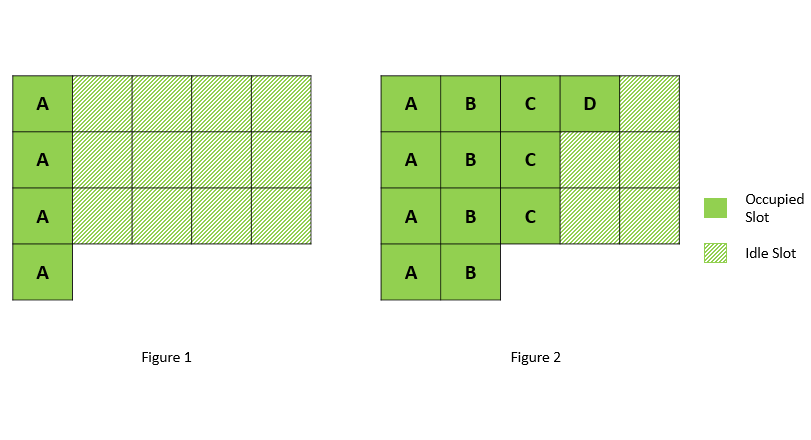
</div>

然后我们应当考虑把剩余的任务安排到这些空闲时间里，先将这些任务的出现次序，从大到小进行安排，会有下面两种情况：
* 某个任务和 A 出现的次数相同，例如图 2 中的任务 B。此时我们只能让 B 占据 p - 1 个空闲时间，而在非空闲时间里额外安排一个时间给 B 执行；
* 某个任务比 A 出现的次数少，例如图 2 中的任务 C 和 D。此时我们可以按照列优先的顺序，将其填入空闲时间中。

如果在安排某一个任务时，遇到了剩余的空闲时间不够的情况，那么答案一定就等于任务的总数。这是因为我们可以将空闲时间增加虚拟的一列，继续安排任务。

所以我们只需要求出出现次数最大（设为`mx`）的任务A，以及出现次数和A同样多的任务（即B这种）数`mx_cnt`，这样最终结果就为`max(N, (n + 1) * (mx - 1) + mx_cnt)`，其中N为任务总数。

空间复杂度O(1)，时间复杂度O(N)

[参考来源](https://leetcode-cn.com/problems/task-scheduler/solution/ren-wu-diao-du-qi-by-leetcode/)


# C++
## 思路一
``` C++
class Solution {
public:
    int leastInterval(vector<char>& tasks, int n) {
        if(n == 0) return tasks.size();
        vector<int>cnt(26, 0);
        for(char t: tasks) cnt[t - 'A']++;
         
        priority_queue<int>maxheap;
        for(int i: cnt) if(i > 0) maxheap.push(i);
        
        int res = 0;
        while(!maxheap.empty()){
            vector<int>tmp; // 存放从maxheap取出的元素
            for(int i = 0; i <= n; i++){
                if(maxheap.empty()) {
                    if(!tmp.empty()) res += n + 1 - i; // idle
                    break;
                }
                res += 1;
                auto num = maxheap.top(); maxheap.pop();
                if(--num > 0) tmp.push_back(num);
            }
            
            for(auto a: tmp) maxheap.push(a); // 放回队列中
        }
        
        return res;
    }
};
```

## 思路二
``` C++
class Solution {
public:
    int leastInterval(vector<char>& tasks, int n) {
        vector<int>cnt(26, 0);
        for(char t: tasks) cnt[t - 'A']++;
        
        int mx = cnt[0], mx_cnt = 0;
        for(int i: cnt) mx = max(mx, i);
        for(int i: cnt) if(i == mx) mx_cnt++;
        
        return max((int)tasks.size(), (n + 1) * (mx - 1) + mx_cnt);
    }
};
```
# [628. Maximum Product of Three Numbers](https://leetcode.com/problems/maximum-product-of-three-numbers/description/)
# 思路
这题由于可能存在负数和0，所以当数组元素个数大于3时需要分情况仔细考虑：
* (1. 全是非正数，则选三个最大的数相乘即可；
* (2. 只有一个正数，用这个(最大的)正数乘以最小的两个数(肯定是非正数)即可；
* (3. 有2个正数，选最大的(正)数与最小的两个(非正)数相乘；
* (4. 有3个及以上的正数，选三个最大的数相乘。

综上，这三个数要么是三个最大的数(1、4)，要么是一个最大的数与两个最小的数(2、3)。  
所以找出最大的三个数与最小的两个数，然后再比较两种乘积的大小即可。   
时间复杂度O(n)
# C++
```C++
class Solution {
public:
    int maximumProduct(vector<int>& nums) {
        // if(nums.size() == 3) return nums[0] * nums[1] * nums[2];
        int mx1 = INT_MIN, mx2 = INT_MIN, mx3 = INT_MIN;
        int mn1 = INT_MAX, mn2 = INT_MAX;
        for (int num : nums) { // 注意这种用一次循环求最大三个数的方式
            if (num > mx1) {
                mx3 = mx2; mx2 = mx1; mx1 = num;
            } else if (num > mx2) {
                mx3 = mx2; mx2 = num;
            } else if (num > mx3) {
                mx3 = num;
            }
            
            if (num < mn1) {
                mn2 = mn1; mn1 = num;
            } else if (num < mn2) {
                mn2 = num;
            }
        }
        return max(mx1 * mx2 * mx3, mx1 * mn1 * mn2);
    }
};
```

# [643. Maximum Average Subarray I](https://leetcode.com/problems/maximum-average-subarray-i/description/)
# 思路
用一个sum记录当前窗口的和，向右移动窗口找出最大的sum  
注意：亲测`if(max_sum < sum) max_sum = sum;`比`max_sum = max(max_sum, sum)`慢一些
# C++
```C++
class Solution {
public:
    double findMaxAverage(vector<int>& nums, int k) {
        double sum = 0, max_sum;
        for(int i = 0; i < k; i++) sum += nums[i];
        max_sum = sum;
        for(int i = k; i < nums.size(); i++){
            sum = sum - nums[i - k] + nums[i];
            max_sum = max(sum, max_sum);
        }
        return max_sum / double(k);
    }
};
```

# [647. Palindromic Substrings](https://leetcode.com/problems/palindromic-substrings/)

# 思路
计算有多少个回文子串。

## 思路一、扩散法

根据回文串的定义，回文串是对称的。所以我们可以以字符串中的每个字符作为回文串中心位置，然后向两边扩散，每当成功匹配两个左右两个字符，就说明找到了一个回文串，res自增1。注意回文字符串有奇数和偶数两种形式，处理方式略有不同。

空间复杂度O(1)， 时间复杂度O(n^2)

## 思路二、动态规划

还可以用动归来做：
```
dp[i][j] (i <= j) 定义成子字符串s[i,...,j]是否是回文串
```
所以初始状态就是`dp[i][i] = true`，状态转移方程为：
```
if s[i] == s[j] && (i+1 == j || dp[i+1][j-1]) :
    dp[i][j] = true
```

空间复杂度O(n^2)， 时间复杂度O(n^2)，亲测比思路一慢不少

# C++
## 思路一
``` C++
class Solution {
public:
    int countSubstrings(string s) {
        int n = s.size(), res = 0;
        
        for(int i = 0; i < n; i++){
            // 奇
            for(int j = 0; j <= min(i, n - 1 - i); j++){
                if(s[i-j] == s[i+j]) res++;
                else break;
            }
            // 偶
            for(int j = 1; j <= min(i+1, n - 1 - i); j++){
                if(s[i-j+1] == s[i+j]) res++;
                else break;
            }
        }
        return res;
    }
};
```

## 思路二
``` C++
class Solution {
public:
    int countSubstrings(string s) {
        int n = s.size(), res = 0;
        
        vector<vector<bool>>dp(n, vector<bool>(n, false));
        for(int i = n - 1; i >= 0; i--)
            for(int j = n - 1; j >= i; j--){
                if(s[i] == s[j] && (i == j || i+1 == j || dp[i+1][j-1])){
                    dp[i][j] = true;
                    res++;
                }
            }
        return res;
    }
};
```
# [661. Image Smoother](https://leetcode.com/problems/image-smoother/description/)
# 思路
将二维数组遍历一遍，每次按照题意计算avg值，实现相邻的小trick:   
```
  int dx[8] = {1, -1, 1, -1, 1, 0, -1, 0};
  int dy[8] = {-1, 1, 1, -1, 0, 1, 0, -1};
  for(int k = 0; k < 8; k++){
    new_x = x + dx[k];
    new_y = y + dy[k];
  }
```
另外要注意判断以上代码算出来的相邻坐标是否合法。   
空间上改进：   
由于元素值为0-255， 所以最多8位，所以可以先用int型的高8位存放新的值，这样就可以使空间复杂度为O(1)。

# C++
```C++
class Solution {
public:
    bool islegal(const int& x, const int& y, const int& r, const int &c){
        if(x < 0 || y < 0 || x >= r || y >= c) return false;
        return true;
    }
    vector<vector<int>> imageSmoother(vector<vector<int>>& M) {
        int dx[8] = {1, -1, 1, -1, 1, 0, -1, 0};
        int dy[8] = {-1, 1, 1, -1, 0, 1, 0, -1};
        
        int r = M.size(), c = M[0].size(), sum, count;
        vector<vector<int>>res;
        vector<int>tmp;
        for(int i = 0; i < r; i++){
            for(int j = 0; j < c; j++){
                sum = M[i][j], count = 1;
                for(int k = 0; k < 8; k++){
                    if(islegal(i + dx[k], j + dy[k], r, c)) {
                        sum += M[i + dx[k]][j + dy[k]];
                        count++;
                    }
                }
                tmp.push_back(sum / count);      
            }
            res.push_back(tmp);
            tmp.clear();
        }
        return res;
    }
};
```

# [665. Non-decreasing Array](https://leetcode.com/problems/non-decreasing-array/description/)
# 思路
题目的意思就是在允许最多修改数组的一个元素的条件下，这个数组是否是有序的。   
考虑从前往后遍历数组，将遇到不满足有序条件的元素nums[i]，即nums[i] < nums[i-1], 若i为size-1即最后一个元素，或者数组已经全部有序，直接返回true，否则应考虑nums[i+1]的大小：   
* 若nums[i+1] >= nums[i-1]，如数组0，1，2，【1】，3... 中 3 > 2，此时i+1及之前的元素满足题意条件，若后面是有序的则返回true；
* 否则，如数组0，1，4，【1】，3...中 3 < 4，则若将nums[i-1]改成nums[i]，再从i-2开始遍历数组判断其是否有序的即可。  

时间复杂度O(n), 空间复杂度O(1)

# C++
```C++
class Solution {
public:
    bool checkPossibility(vector<int>& nums) {
        int i;
        for(i = 1; i < nums.size(); i++){
            if(nums[i] < nums[i-1]) break;
        }
        if(i >= nums.size() - 1) return true;
        
        if(nums[i + 1] >= nums[i - 1]) i++;
        else {
            nums[i - 1] = nums[i];
            i = max(0, i-2);
        } 
        
        for(; i < nums.size() - 1; i++) // 判断后面是否有序
            if(nums[i] > nums[i + 1]) return false;
        return true;    
    }
};
```

# [714. Best Time to Buy and Sell Stock with Transaction Fee](https://leetcode.com/problems/best-time-to-buy-and-sell-stock-with-transaction-fee/)


带交易费用的股票买卖问题，属于LeetCode六道股票买卖题目之一，见我的博客文章[动态规划之股票买卖系列](https://shusentang.github.io/2019/11/03/Buy-and-Sell-Stock/)。
# [739. Daily Temperatures](https://leetcode.com/problems/daily-temperatures/)

# 思路

数组里每个元素的右边第一个比它大的元素，若找不到用0填充。典型的单调栈，关于单调栈我已经总结过了（[戳我](../algorithm/array/monotonic_stack_queue.md)），这里不再赘述，直接给出代码。

时空复杂度均为O(N)

# C++
``` C++
class Solution {
public:
    vector<int> dailyTemperatures(vector<int>& T) {
        int n = T.size();
        vector<int>res(T.size(), 0);
        
        stack<int>mono_stk;
        for(int i = n - 1; i >= 0; i--){ // 反向遍历
            while(!mono_stk.empty() && T[i] >= T[mono_stk.top()]) 
                mono_stk.pop();
            if(!mono_stk.empty()) 
                res[i] = mono_stk.top() - i;
            mono_stk.push(i);
        }
        return res;
    }
};
```
# [829. Consecutive Numbers Sum](https://leetcode.com/problems/consecutive-numbers-sum/)

# 思路

给定正整数N，问N能写成多少种连续正整数之和，比如9可以写成 4+5，或者2+3+4。

我们假设把N拆分成k个连续的数之和，并设最小的那个数是m，则我们有：

|k| 1 | 2 | 3 | 4 | ... | K |
|---|:-:|:-:|:-:|:-:|:-:|:-:|
|连续序列|m|m,m+1|m,m+1,m+2|m,m+1,m+2,m+3|...|m,m+1,m+K-1|
|满足关系|N=m|N = 2m+1| N = 3m+3| N = 4m+6|...| N = Km + f(k) |

其中 f(k) = 1 + 2 +...+ k-1。

有了这个规律我们就知道了如果 `(N - f(k)) % k == 0`则说明可以拆成k个连续的数，那我们就可以从 k=1 不断增大k直到不满足`N <= f(k)`即可。

由于 f(k) = 1 + 2 +...+ k-1 = (k*k-1)/2。所以k最大为 sqrt(2N) 向下取整。所以时间复杂度为O(sqrt(N))。

# C++
``` C++
class Solution {
public:
    int consecutiveNumbersSum(int N) {
        int res = 0, k = 1, fk = 0;
        while(N > fk){
            if((N - fk) % k == 0) res++;
            fk += (k++);
        }
        return res;
    }
};
```

# [846. Hand of Straights](https://leetcode.com/problems/hand-of-straights/)

# 思路

这道题说手里有扑克牌若干，是否能将手里的牌都以顺子的形式出完，每组顺子的牌数都为W。

由于顺子是等差为1的等差数列，所以如果知道了最小元素也就知道了其他所有元素。所以我们可以使用贪婪的算法：首先取出手中最小的牌，再按照不断+1的规则组成第一组顺子；再在剩下的牌中按照上一次一样的规则组成第二组顺子；以此类推。由此可见，我们需要一个快速获得最小值和快速删除元素的数据结构，map和multiset满足我们的要求。

若使用map，我们可以记录元素值到出现次数的隐射，删除操作即将出现次数减1；若使用multiset，我们每次根据迭代器删除元素即可，即`.erase(.find(val))`（不能根据元素值删除`.erase(val)`，那样会将所有值相等的元素都删了），代码中我们使用multiset。

时间复杂度O(nlogn)，空间复杂度O(n)

# C++
```C++
class Solution {
public:
    bool isNStraightHand(vector<int>& hand, int W) {
        int n = hand.size(), groups = n / W;
        if(n % W) return false;
        
        multiset<int>cards;
        for(int num: hand) cards.insert(num);
        
        int pre;
        while(groups--){
            pre = *cards.begin(); 
            cards.erase(cards.begin());
            for(int j = 1; j < W; j++){
                if(cards.find(++pre) == cards.end()) return false;
                cards.erase(cards.find(pre));
            }
        }
        return true;
    }
};
```
# [905. Sort Array By Parity](https://leetcode.com/problems/sort-array-by-parity/)

# 思路

题目要求将一个数组中的偶数放在奇数前面。很简单用两个指针i和j就可以了，分别表示`a[0, 1, ..., i-1]`全部为偶数而`a[j+1, j+2, ..., n-1]`全部为奇数，所以i和j初始分别为0和n-1。然后就是循环，每个循环内部：
* 1. 如果`A[i]`为奇数那么交换`A[i]`和`A[j]`然后将`j--`，否则`i++`；
* 2. 如果`A[j]`为偶数那么交换`A[i]`和`A[j]`然后将`i++`，否则`j--`；

上面的1和2单独使用也是可以的。

另外STL中`partition`所干的就是此题要求的事，它会使所有使给定比较函数返回 true 的元素放在返回false的前面，所以我们只需要自定义比较函数就可以了。

# C++
``` C++
class Solution {
public:
    vector<int> sortArrayByParity(vector<int>& A) {
        int i = 0, j = A.size() - 1;
        
        // 如果问题条件变一下, 例如将能被3整除的放在不能整除的前面, 我们只需要改这一行代码
        # define CONDITION(i) (A[i] & 1)
        
        while(i < j){
            if(i < j && CONDITION(i)) swap(A[i], A[j--]);
            else i++;
            
            if (i < j && !CONDITION(j)) swap(A[i++], A[j]);
            else j--;
        }
        return A;
    }
};
```
## 直接使用STL中的partition
``` C++
class Solution {
public:
    vector<int> sortArrayByParity(vector<int>& A) {
        partition(A.begin(), A.end(), [](int a) { return !(a & 1);});
        return A;
    }
};
```
# [946. Validate Stack Sequences](https://leetcode.com/problems/validate-stack-sequences/)

# 思路

输入两个整数序列，第一个序列表示栈的入栈顺序，请判断第二个序列是否可能为该栈的出栈顺序。

## 思路一

例
```
pushed = [1,2,3,4,5]
popped = [4,5,3,2,1]
```
出栈序列第一个是4，我们要什么时候pop出4呢，很明显是当4第一次出现在栈顶的时候（即push了4就要立马pop出），否则为了pop出4需要先pop出在4上面的元素，不符合出栈序列要求。出栈序列后面的元素同理，即是一个**贪心**的过程: 从前往后依次将元素入栈，在这个过程中不断判断栈顶元素是否为下一个popped元素，若是则应该出栈。最后如果栈为空则说明全部出栈了，返回真；否则返回假。

时空复杂度均为O(n)

## 思路二

一开始想到的是暴力法，即模拟出入栈的过程，用DFS回溯。亲测比思路一慢很多很多，就不细说了。

# C++

## 思路一
``` C++
class Solution {
public:
    bool validateStackSequences(vector<int>& pushed, vector<int>& popped) {
        int n = pushed.size(), pop_i = 0;
        stack<int>stk;
        for(int i = 0; i < n; i++){
            stk.push(pushed[i]);
            while(!stk.empty() && stk.top() == popped[pop_i]){
                stk.pop();
                pop_i++;
            }
        }
        return stk.empty();
    }
};
```

## 思路二
``` C++
class Solution {
private:
    vector<int>pushed_, popped_;
    int n;
    bool helper(stack<int>&stk, int push_i, int pop_i){
        if(pop_i == n) return true;
        
        // 出栈
        if(!stk.empty() && stk.top() == popped_[pop_i]){ 
            int tmp = stk.top(); stk.pop();
            if(helper(stk, push_i, pop_i + 1)) return true;
            stk.push(tmp);
        }
        
        // 入栈
        if(push_i >= n) return false;
        stk.push(pushed_[push_i]);
        if(helper(stk, push_i + 1, pop_i)) return true;
        
        return false;
    }
public:
    bool validateStackSequences(vector<int>& pushed, vector<int>& popped) {
        pushed_ = pushed;
        popped_ = popped;
        n = pushed.size();
        if(n <= 1) return true;
        stack<int>stk, out;
        int i = 0;
        return helper(stk, 0, 0);
    }
};
```


 
# [1155. Number of Dice Rolls With Target Sum](https://leetcode.com/problems/number-of-dice-rolls-with-target-sum/)

# 思路
仔细分析一下可知，d个骰子的和为 target 的情况数取决于 d-1 个骰子的和为target-1、target-2...target-f的情况数。所以这题是一个典型的动态规划题。状态定义为
```
dp[i][j]: i个骰子的和为j的情况数，dp[0][0]=1
```
状态转移方程为：
```
dp[i][j] = dp[i-1][j-1] + dp[i-1][j-2] +...+ dp[i-1][j-f]
```


## 思路一、自上而下

动态规划一般都可以转换成带记忆数组的递归，这题也不例外。

时间复杂度O(d * f * target)，空间复杂度O(d * target)

## 思路二、自下而上
更常见的是自下而上，而且我们还可以使用滚动数组对空间进行优化。

时间复杂度O(d * f * target)，空间复杂度O(target)

## 思路三
思路二一共有三层循环，可以进一步优化时间。

回顾一下状态转移方程，
```
dp[i][j] =                dp[i-1][j-1] + dp[i-1][j-2] +...+   dp[i-1][j-f]

j++后:
dp[i][j+1] = dp[i-1][j] + dp[i-1][j-1] +...+ dp[i-1][j-f+1]
```
所以说连续两次运行第三次循环是有大量重复的，所以第三层循环不是必须的。

可以这样考虑，`dp[i][j]` 的计算就是求一个大小为 f 的在数组`dp[i-1]`上的滑动窗口的元素和，思路二的第三层循环每次都从头到尾累加窗口内的元素，但事实上我们可以维护一个变量s代表窗口内元素的和，当窗口向右滑动一步时我们只需要将s加上窗口右端元素然后减去刚刚离开窗口左端的元素即可。

时间复杂度O(d * target)，空间复杂度O(target)

# C++

## 思路一
``` C++
class Solution {
private:
    vector<vector<int>>dp = vector<vector<int>>(31, vector<int>(1001, -1));
public:
    int numRollsToTarget(int d, int f, int target) {
        if(target < 0 || target > d * f) return 0;
        if(d == 0) return target == 0 ? 1 : 0;
        
        if(dp[d][target] >= 0) return dp[d][target];
        int res = 0;
        for(int i = 1; i <=f; i++){
            res += numRollsToTarget(d - 1, f, target - i);
            res %= 1000000007;
        }
        
        dp[d][target] = res;
        return res;
    }
};
```

## 思路二
``` C++
class Solution {    
public:
    int numRollsToTarget(int d, int f, int target) {
        if(target > d * f) return 0; // 会大大减少测试时间

        vector<int>dp(target+1, 0);
        dp[0] = 1;
        for(int i = 1; i <= d; i++)
            for(int j = target; j >= 0; j--){ // 注意这里要反向遍历!
                int max_k = min(j, f); dp[j] = 0;
                for(int k = 1; k <= max_k; k++){
                    dp[j] += dp[j-k];
                    dp[j] %= 1000000007;
                }
            }
        return dp[target];
    }
};
```

## 思路三
``` C++
class Solution {
public:
    int numRollsToTarget(int d, int f, int target) {
        const int M = 1000000007;
        
        // dp表示dp[i][...], pre代表dp[i-1][...]
        vector<int> dp(target + 1, 0), pre(target + 1, 0);
        dp[0] = 1;
        long long s = 0;
        for(int i = 1; i <= d; i++){
            for(int t = 0; t <= target; t++) pre[t] = dp[t];
            
            s = 0;
            for(int j = 0; j <= target; j++){
                dp[j] = s;
                s += pre[j]; // 累加上窗口右端元素
                if(j >= f) s += M - pre[j - f]; // 减去刚刚离开窗口左端的元素
                s %= M;
            }
        } 
        return dp[target];
    }
};
```
